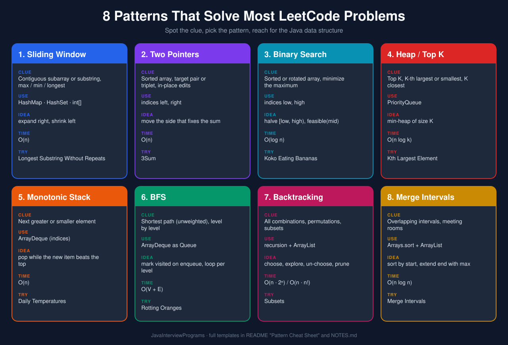
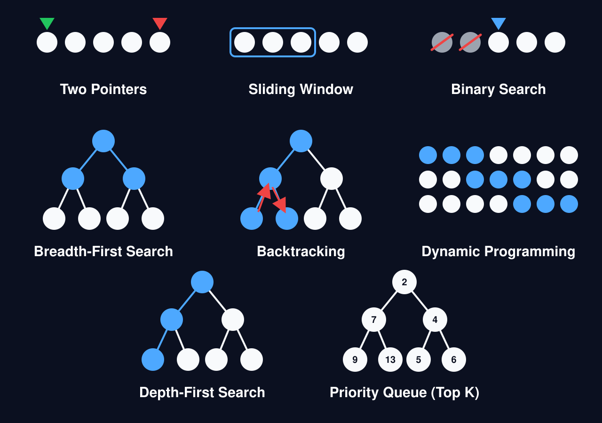

# Interview Revision Notes 📝

A compact revision guide distilled from the 497 programs in this repository. The [README](./README.md) is the index of problems; this file is what to reread the night before: the method, the cost tables, one idea and one template per topic, the traps, and a short "must solve" ladder per topic that links to the full write-ups.

**Contents**

1. [The 6-step method](#1-the-6-step-method)
2. [Constraints → target complexity](#2-constraints--target-complexity)
3. [Clue → pattern](#3-clue--pattern)
4. [Topic notes (01 to 18)](#4-topic-notes)
5. [Java quick reference](#5-java-quick-reference)
6. [Edge-case checklist](#6-edge-case-checklist)
7. [One-page last-minute sheet](#7-one-page-last-minute-sheet)

Every snippet is Java 8 and was compiled and run before it was added. Snippets guard `null` and empty input like the repository classes do.

---

## 1. The 6-step method

| Step | Do | Say out loud |
|------|----|--------------|
| 1. Clarify | Input size and range, duplicates, negatives, sorted?, can it be empty or `null`?, what to return when there is no answer | "Can values be negative? What do I return for an empty array?" |
| 2. Example | Work one small example and one edge case by hand | "For `[2,7,11,15]` and target 9, the answer is indices 0 and 1." |
| 3. Brute force | State it and its cost, even if you will not code it | "Check all pairs: O(n²) time, O(1) space." |
| 4. Optimize | Find the repeated work or the unused property (sorted, monotonic, bounded) and name the pattern | "Each element needs its complement, so a HashMap makes it O(n)." |
| 5. Code | Small helper methods, clear names, handle the guards first | |
| 6. Verify | Trace the example, then the edge cases, then state time and space | "Empty input returns -1; worst case O(n) time, O(n) space." |

If stuck for two minutes: restate the problem with a tiny input, sort the input and see what becomes easy, or ask what a brute force *recomputes*.

---

## 2. Constraints → target complexity

| n (input size) | Aim for | Typical techniques |
|----------------|---------|--------------------|
| n ≤ 10 | O(n!) | permutations, backtracking |
| n ≤ 20 | O(2ⁿ) | subsets, bitmask, backtracking with pruning |
| n ≤ 100 | O(n³) | triple loops, Floyd-Warshall, interval DP |
| n ≤ 1,000 | O(n²) | 2D DP, nested loops |
| n ≤ 100,000 | O(n log n) | sort, heap, binary search, segment tree |
| n ≤ 1,000,000 | O(n) | hash map, two pointers, sliding window, prefix sums |
| n ≥ 10⁹ | O(log n) or O(1) | binary search, math, bit tricks |

Recursion depth beyond about 10⁴ can overflow the Java stack; switch to an explicit stack or iteration.

**Cost of common operations**

| Structure | Access | Search | Insert | Delete | Notes |
|-----------|--------|--------|--------|--------|-------|
| `ArrayList` | O(1) | O(n) | O(1) amortized at end, O(n) middle | O(n) | |
| `LinkedList` | O(n) | O(n) | O(1) at an end or at a held node | O(1) at a held node | |
| `ArrayDeque` | O(1) ends | O(n) | O(1) ends | O(1) ends | stack and queue |
| `HashMap` / `HashSet` | | O(1) avg, O(n) worst | O(1) avg | O(1) avg | no order |
| `TreeMap` / `TreeSet` | | O(log n) | O(log n) | O(log n) | sorted, floor / ceiling |
| `PriorityQueue` | peek O(1) | O(n) | O(log n) | poll O(log n), remove(x) O(n) | iteration not sorted |
| Sorting (`Arrays.sort`) | | | O(n log n) | | primitives: dual-pivot quicksort; objects: stable TimSort |

Algorithms: BFS and DFS O(V + E); Dijkstra O((V + E) log V); topological sort O(V + E); Union-Find nearly O(1) per operation with path compression and union by rank; building a heap O(n); trie insert and search O(length).

---

## 3. Clue → pattern



| Clue in the statement | Pattern | Data structure |
|-----------------------|---------|----------------|
| Contiguous subarray or substring with max, min or longest | Sliding window | `HashMap`, `HashSet`, `int[]` |
| Sorted array, pair or triplet with a target | Two pointers | indices |
| Sorted or rotated array, or "minimize the maximum" | Binary search (on the array or on the answer) | indices |
| Subarray sum equals K, negatives allowed | Prefix sum + `HashMap` | `HashMap<Integer, Integer>` |
| Top K, K-th largest or smallest, K closest | Heap of size K | `PriorityQueue` |
| Next greater or smaller element | Monotonic stack | `ArrayDeque` |
| Shortest path, equal edge cost; level by level | BFS | `ArrayDeque` as `Queue` |
| Shortest path with weights | Dijkstra | `PriorityQueue<int[]>` |
| Dependencies, ordering, "can finish all" | Topological sort | in-degree array + queue |
| Components, cycle in undirected graph, "are connected" | Union-Find or DFS | `int[] parent` |
| All combinations, permutations, subsets, placements | Backtracking | recursion + `ArrayList` |
| Count ways, min or max over overlapping subproblems | Dynamic programming | `int[]` or `int[][]` |
| Locally best choice is provably safe | Greedy | sort + scan |
| Overlapping intervals, meeting rooms | Sort by start, merge or heap | `Arrays.sort` + `ArrayList` |
| Prefix search over many words | Trie | node array of 26 |
| Cache, O(1) operations on a collection | `HashMap` + linked list or array | `LinkedHashMap` |
| Single or missing number, parity, powers of two | Bit manipulation | `int` / `long` |



**What to learn first (difficulty to learn / return on investment).**

| Order | Topic | Difficulty | Return |
|-------|-------|------------|--------|
| 1 | Two Pointers | Easy | High |
| 2 | Sliding Window | Easy | High |
| 3 | BFS | Easy | High |
| 4 | DFS | Medium | High |
| 5 | Backtracking | High | High |
| 6 | Heap | Medium | Medium |
| 7 | Binary Search | Easy | Medium |
| 8 | Dynamic Programming | High | Medium |
| 9 | Divide and Conquer | Medium | Low |
| 10 | Trie, Union-Find | Medium | Low |
| 11 | Greedy | High | Low |

Divide and conquer: split into independent halves, solve, combine (merge sort, quickselect, build a tree from traversals); T(n) = 2T(n/2) + O(n) is O(n log n). If the halves overlap and repeat work, it is DP. DFS: explore one branch fully, mark visited on entry, three states for directed cycles; templates in the [README](./README.md#9-dfs-depth-first-search).

Look-alike pairs: sliding window needs a monotonic condition (non-negatives or distinct counts), else prefix sums. BFS for fewest steps, DFS for all paths and components. Greedy needs an exchange argument, otherwise DP. Backtracking lists every answer, DP only counts or optimizes.

Longer write-ups with templates: [Pattern Cheat Sheet in the README](./README.md#pattern-cheat-sheet-).

---

## 4. Topic notes

Each topic gives **Idea**, **Template** (where a snippet helps), **Traps**, and **Must solve** (an ordered ladder, easy to hard).

### 01. Arrays & Strings

**Idea.** Most array problems are one scan with a little state: a running value (Kadane, prefix sums), two indices (two pointers) or a window. Most string problems add a frequency table (`int[26]` or `int[128]`) or a two-pointer walk. Doing it in place usually means a read pointer ahead of a write pointer.

| Pattern | Use when | Example |
|---------|----------|---------|
| Kadane | best contiguous sum | Maximum Subarray |
| Prefix and suffix products | "all except self", no division | Product of Array Except Self |
| Boyer-Moore voting | element appearing more than n/2 (or n/3) times | Majority Element |
| Index placement or sign marking | values are in `1..n` | First Missing Positive |
| Dutch national flag | partition into three groups in one pass | Sort Colors |
| Expand around center | palindromic substrings | Longest Palindromic Substring |
| Fast and slow (write pointer) | in-place filtering | Move Zeroes, Remove Duplicates |

```java
// Kadane: best sum of a contiguous subarray (0 for null or empty input)
static int maxSubarray(int[] a) {
    if (a == null || a.length == 0) return 0;
    int best = a[0], cur = a[0];
    for (int i = 1; i < a.length; i++) {
        cur = Math.max(a[i], cur + a[i]);      // extend, or restart here
        best = Math.max(best, cur);
    }
    return best;
}

// Prefix sum + HashMap: number of subarrays whose sum equals k (negatives allowed)
static int subarraySumK(int[] a, int k) {
    if (a == null) return 0;
    Map<Integer, Integer> seen = new HashMap<>();
    seen.put(0, 1);                            // the empty prefix
    int sum = 0, count = 0;
    for (int x : a) {
        sum += x;
        count += seen.getOrDefault(sum - k, 0);   // earlier prefix = sum - k
        seen.merge(sum, 1, Integer::sum);
    }
    return count;
}
```

**Traps.** `int` overflow in sums and products (use `long`); `s.charAt(i) - 'a'` index math; modifying an array while iterating it; `String` is immutable, so building by `+=` in a loop is O(n²), use `StringBuilder`; for sliding windows see the README guide for the shrink-versus-record order.

**Must solve.** [Two Sum](./md_files/array/TwoSum.md) · [Best Time to Buy and Sell Stock](./md_files/array/BestTimeToBuyAndSellStock.md) · [Maximum Subarray](./md_files/array/MaximumSubarray.md) · [Product of Array Except Self](./md_files/array/ProductOfArrayExceptSelf.md) · [Subarray Sum Equals K](./md_files/array/SubarraySumEqualsK.md) · [3Sum](./md_files/array/ThreeSum.md) · [Container With Most Water](./md_files/array/ContainerWithMostWater.md) · [Trapping Rain Water](./md_files/array/TrappingRainWater.md) · [Longest Substring Without Repeating Characters](./md_files/string/LongestSubString.md) · [Minimum Window Substring](./md_files/string/MinimumWindowSubstring.md) · [Longest Palindromic Substring](./md_files/string/LongestPalindrome.md) · [First Missing Positive](./md_files/array/FirstMissingPositive.md)

### 02. Hashing

**Idea.** Trade O(n) memory for O(1) lookup. Use a `HashSet` for "have I seen this" and a `HashMap` for counts, last index or grouping. A canonical key (sorted letters, a count signature, a remainder) turns "same kind of thing" into equal keys. Prefix-sum remainders solve "divisible by K" problems.

**Traps.** Mutable keys (never change an object after using it as a key); `Integer` comparison with `==` above 127; `map.get(k)` returns `null` for a missing key, so unboxing it throws `NullPointerException`: use `getOrDefault`; iteration order of a `HashMap` is unspecified (use `LinkedHashMap` or `TreeMap` when order matters); negative remainders: use `((x % k) + k) % k`.

**Must solve.** [Two Sum](./md_files/array/TwoSum.md) · [Valid Anagram](./md_files/string/Anagram.md) · [Group Anagrams](./md_files/string/GroupAnagrams.md) · [Longest Consecutive Sequence](./md_files/array/LongestConsecutiveSequence.md) · [Subarray Sums Divisible by K](./md_files/array/SubarraySumsDivisibleByK.md) · [Design HashMap](./md_files/design/CustomHashMap.md)

### 03. Linked Lists

**Idea.** Pointer rewiring. Three tools cover most problems: a **dummy head** (removes special cases when the head can change), **fast and slow pointers** (middle, cycle, k-th from the end), and **reverse in place** (palindrome, reorder, k-group). Always save `next` before overwriting it.

```java
static Node reverse(Node head) {
    Node prev = null;
    while (head != null) {
        Node next = head.next;     // save
        head.next = prev;          // flip
        prev = head;               // advance both
        head = next;
    }
    return prev;
}

static boolean hasCycle(Node head) {          // Floyd: fast moves two, slow moves one
    Node slow = head, fast = head;
    while (fast != null && fast.next != null) {
        slow = slow.next;
        fast = fast.next.next;
        if (slow == fast) return true;
    }
    return false;
}
```

**Traps.** `NullPointerException` on `fast.next.next` (check both); losing the head; creating an accidental cycle by not setting the new tail's `next` to `null`; to remove the n-th node from the end, advance one pointer `n` steps first, with a dummy so removing the head works.

**Must solve.** [Reverse Linked List](./md_files/linkedlist/ReverseLinkedList.md) · [Merge Two Sorted Lists](./md_files/linkedlist/MergeTwoSortedLists.md) · [Linked List Cycle II](./md_files/linkedlist/LinkedListCycleII.md) · [Remove Nth Node From End](./md_files/linkedlist/RemoveNthNodeFromEnd.md) · [Reorder List](./md_files/linkedlist/ReorderList.md) · [Add Two Numbers](./md_files/linkedlist/AddTwoNumbers.md) · [Copy List with Random Pointer](./md_files/linkedlist/CopyListWithRandomPointer.md) · [Merge K Sorted Lists](./md_files/linkedlist/MergeKSortedLists.md) · [Reverse Nodes in K-Group](./md_files/linkedlist/ReverseNodesInKGroup.md)

### 04. Stacks & Queues

**Idea.** A stack matches nesting and "most recent unresolved item" (brackets, decode string, calculators, undo). A monotonic stack finds next greater or smaller in O(n) (see the README guide). A queue gives FIFO order and BFS. Two stacks make a queue (move on demand); one queue (rotate after each push) makes a stack.

**Traps.** Prefer `ArrayDeque` over `Stack`; check `isEmpty()` before `pop()` or `peek()`; with brackets the stack must also be empty at the end; keep indices, not values, when you need distances.

**Must solve.** [Valid Parentheses](./md_files/stack/ValidParentheses.md) · [Min Stack](./md_files/stack/MinStack.md) · [Daily Temperatures](./md_files/stack/DailyTemperatures.md) · [Decode String](./md_files/stack/DecodeString.md) · [Evaluate Reverse Polish Notation](./md_files/stack/EvaluateReversePolishNotation.md) · [Largest Rectangle in Histogram](./md_files/stack/LargestRectangleInHistogram.md) · [Basic Calculator](./md_files/stack/BasicCalculator.md)

### 05. Binary Search

**Idea.** Halve a search space that has a monotonic yes/no property. Use the half-open template `[low, high)` with `low = mid + 1` or `high = mid`, which also gives lower bounds. On the answer: define `feasible(x)`, bound the answer range, and find the first `x` that works. See the README guide for the template.

**Traps.** `mid = low + (high - low) / 2`; infinite loops from `low = mid`; rotated arrays: decide which half is sorted by comparing `a[mid]` with `a[high]`; `Arrays.binarySearch` returns `-(insertion point) - 1` when absent and any index among duplicates.

**Must solve.** [Binary Search](./md_files/search/BinarySearch.md) · [First and Last Position](./md_files/search/FirstAndLastPosition.md) · [Search in Rotated Sorted Array](./md_files/search/SearchInRotatedSortedArray.md) · [Find Minimum in Rotated Sorted Array](./md_files/search/FindMinimumInRotatedSortedArray.md) · [Koko Eating Bananas](./md_files/search/KokoEatingBananas.md) · [Capacity to Ship Packages](./md_files/search/CapacityToShipPackages.md) · [Split Array Largest Sum](./md_files/search/SplitArrayLargestSum.md) · [Median of Two Sorted Arrays](./md_files/search/MedianOfTwoSortedArrays.md)

### 06. Sorting & Intervals

**Idea.** Sorting is the cheapest way to create structure. For intervals, sort by start and sweep (merge, insert, free time). Sort by end for "maximum non-overlapping" and "fewest arrows". A min-heap of end times counts concurrent intervals (meeting rooms). A difference array counts overlaps in O(n).

| Algorithm | Best | Average | Worst | Space | Stable |
|-----------|------|---------|-------|-------|--------|
| Bubble / Insertion | O(n) | O(n²) | O(n²) | O(1) | yes |
| Selection | O(n²) | O(n²) | O(n²) | O(1) | no |
| Merge | O(n log n) | O(n log n) | O(n log n) | O(n) | yes |
| Quick | O(n log n) | O(n log n) | O(n²) | O(log n) | no |
| Heap | O(n log n) | O(n log n) | O(n log n) | O(1) | no |

**Traps.** Comparators: use `Integer.compare(a, b)`, never `a - b` (overflow); touching intervals `[1,2]`,`[2,3]` merge, but do not conflict as meetings; always take `Math.max` of the ends when merging.

**Must solve.** [Merge Intervals](./md_files/interval/MergeIntervals.md) · [Insert Interval](./md_files/interval/InsertInterval.md) · [Non-overlapping Intervals](./md_files/interval/NonOverlappingIntervals.md) · [Meeting Rooms II](./md_files/interval/MeetingRoomsII.md) · [Merge Sort](./md_files/sort/MergeSort.md) · [Quick Sort](./md_files/sort/QuickSort.md)

### 07. Trees & BST

**Idea.** Almost every tree problem is a recursion that answers one question per node: "what do I need from my children, and what do I give my parent?" Three recurring shapes:

- **Top-down with a parameter** (valid BST range, running maximum, remaining target).
- **Bottom-up return value** (height, diameter, max path sum: update a global answer, return the best one-sided value).
- **Level by level** with a queue (level order, right side view, zigzag).

An inorder traversal of a BST is sorted. The LCA of two nodes is the first node where they split.

```java
static int depth(T r) { return r == null ? 0 : 1 + Math.max(depth(r.left), depth(r.right)); }

static boolean isBst(T n, long lo, long hi) {          // long bounds: node values can be Integer.MIN/MAX
    if (n == null) return true;
    if (n.val <= lo || n.val >= hi) return false;
    return isBst(n.left, lo, n.val) && isBst(n.right, n.val, hi);
}

static List<List<Integer>> levels(T root) {              // BFS, one list per level
    List<List<Integer>> res = new ArrayList<>();
    if (root == null) return res;
    Queue<T> q = new ArrayDeque<>();
    q.offer(root);
    while (!q.isEmpty()) {
        List<Integer> level = new ArrayList<>();
        for (int n = q.size(); n > 0; n--) {
            T cur = q.poll();
            level.add(cur.val);
            if (cur.left != null) q.offer(cur.left);
            if (cur.right != null) q.offer(cur.right);
        }
        res.add(level);
    }
    return res;
}
```

**Traps.** Validating a BST by comparing only with the direct children (use ranges); `null` root; skewed trees make recursion O(n) deep; when you need a path, copy it on the way out (backtracking); height-based answers count nodes or edges, so state which.

**Must solve.** [Maximum Depth](./md_files/tree/MaximumDepthOfBinaryTree.md) · [Invert Binary Tree](./md_files/tree/InvertBinaryTree.md) · [Level Order Traversal](./md_files/tree/BinaryTreeLevelOrderTraversal.md) · [Validate BST](./md_files/tree/ValidateBinarySearchTree.md) · [Lowest Common Ancestor](./md_files/tree/LowestCommonAncestorOfBinaryTree.md) · [Diameter of Binary Tree](./md_files/tree/DiameterOfBinaryTree.md) · [Kth Smallest in BST](./md_files/tree/KthSmallestElementInBST.md) · [Binary Tree Maximum Path Sum](./md_files/tree/BinaryTreeMaximumPathSum.md) · [Serialize and Deserialize Binary Tree](./md_files/tree/SerializeDeserializeBinaryTree.md)

### 08. Heaps

**Idea.** `PriorityQueue` keeps the best item reachable in O(log n). K largest: min-heap of size K. K smallest: max-heap. Median: two heaps. Merge K lists or sorted rows: heap of (value, source). Scheduling: heap of the next available. See the README guide for the template.

**Traps.** `PriorityQueue` is a min-heap by default; the iteration order is not sorted; comparator overflow; `remove(Object)` is O(n); use `Collections.reverseOrder()` or `(a, b) -> Integer.compare(b, a)` for a max-heap.

**Must solve.** [Kth Largest Element in an Array](./md_files/heap/KthLargestElementInAnArray.md) · [Top K Frequent Elements](./md_files/heap/TopKFrequentElements.md) · [K Closest Points to Origin](./md_files/heap/KClosestPointsToOrigin.md) · [Task Scheduler](./md_files/heap/TaskScheduler.md) · [Find Median from Data Stream](./md_files/heap/FindMedianFromDataStream.md) · [Merge K Sorted Lists](./md_files/linkedlist/MergeKSortedLists.md)

### 09. Graphs

**Idea.** Decide the representation first: adjacency list (`List<List<Integer>>`) for sparse graphs, a grid with four direction offsets for matrices. Then choose the traversal: **BFS** for fewest steps and multi-source spreading; **DFS** for components, reachability, cycles and paths; **Union-Find** for dynamic connectivity and "redundant edge". Always keep a `visited` structure and mark it when you enqueue.

```java
// Union-Find with path halving; union returns false when the two nodes were already connected
static int[] parent;                       // parent[i] = i initially
static int find(int x) {
    while (parent[x] != x) { parent[x] = parent[parent[x]]; x = parent[x]; }
    return x;
}
static boolean union(int a, int b) {
    int ra = find(a), rb = find(b);
    if (ra == rb) return false;            // same set: this edge closes a cycle
    parent[ra] = rb;
    return true;
}
```

Grid flood fill: iterate over cells, start a DFS or BFS at each unvisited land cell, and count how many starts you needed (Number of Islands).

**Traps.** Undirected DFS needs the parent to avoid reporting the edge you came from as a cycle; a directed cycle needs three states (unvisited, in progress, done); a disconnected graph needs a loop over all start nodes; grid bounds checks before reading `grid[r][c]`; modifying the grid in place as the visited marker is fine only if the caller allows it.

**Must solve.** [Number of Islands](./md_files/graph/NumberOfIslands.md) · [Rotting Oranges](./md_files/graph/RottingOranges.md) · [Clone Graph](./md_files/graph/CloneGraph.md) · [Pacific Atlantic Water Flow](./md_files/graph/PacificAtlanticWaterFlow.md) · [Course Schedule](./md_files/graph/CourseSchedule.md) · [Graph Valid Tree](./md_files/graph/GraphValidTree.md) · [Number of Connected Components](./md_files/graph/NumberOfConnectedComponents.md) · [Redundant Connection](./md_files/graph/RedundantConnection.md) · [Word Ladder II](./md_files/graph/WordLadderII.md) · [Network Delay Time](./md_files/graph/NetworkDelayTime.md)

### 10. Dynamic Programming

**Idea.** If a recursion has overlapping subproblems, cache them. Write the steps in this order and the rest follows:

1. **State**: what do the indices mean? (`dp[i]` = best answer using the first `i` items.)
2. **Transition**: how does a state follow from smaller ones?
3. **Base case** and **order of evaluation**.
4. **Answer**: which cell? Then optimize space (keep only the last row or two variables).

| Family | State | Examples |
|--------|-------|----------|
| 1D linear | `dp[i]` from `dp[i-1]`, `dp[i-2]` | Climbing Stairs, House Robber, Decode Ways |
| Unbounded knapsack | `dp[amount]`, loop items inside | Coin Change, Perfect Squares |
| 0/1 knapsack | `dp[capacity]`, loop capacity downward | Partition Equal Subset Sum, Target Sum |
| Two sequences | `dp[i][j]` over prefixes | LCS, Edit Distance |
| Grid | `dp[r][c]` from top and left | Unique Paths, Minimum Path Sum |
| Subsequence (LIS) | `dp[i]` or a `tails` array with binary search | Longest Increasing Subsequence |
| Interval | `dp[l][r]` over a range | Burst Balloons, Strange Printer |
| State machine | `dp[day][state]` | Stock problems |

```java
static int coinChange(int[] coins, int amount) {        // fewest coins, -1 if impossible
    if (coins == null || amount < 0) return -1;
    int[] dp = new int[amount + 1];
    Arrays.fill(dp, amount + 1);                          // "infinity"
    dp[0] = 0;
    for (int a = 1; a <= amount; a++)
        for (int c : coins)
            if (c <= a) dp[a] = Math.min(dp[a], dp[a - c] + 1);
    return dp[amount] > amount ? -1 : dp[amount];
}

static int lcs(String a, String b) {                      // longest common subsequence length
    if (a == null || b == null) return 0;
    int[][] dp = new int[a.length() + 1][b.length() + 1];
    for (int i = 1; i <= a.length(); i++)
        for (int j = 1; j <= b.length(); j++)
            dp[i][j] = a.charAt(i - 1) == b.charAt(j - 1)
                    ? dp[i - 1][j - 1] + 1
                    : Math.max(dp[i - 1][j], dp[i][j - 1]);
    return dp[a.length()][b.length()];
}

static int lis(int[] a) {                                 // O(n log n): tails[i] = smallest tail of an increasing run of length i+1
    if (a == null) return 0;
    int[] tails = new int[a.length];
    int size = 0;
    for (int x : a) {
        int i = Arrays.binarySearch(tails, 0, size, x);
        if (i < 0) i = -(i + 1);
        tails[i] = x;
        if (i == size) size++;
    }
    return size;
}
```

**Traps.** Wrong loop direction in 0/1 knapsack (downward) versus unbounded (upward); `Integer.MAX_VALUE + 1` overflow when using it as infinity (use `amount + 1` or check first); off-by-one between `dp` size and string indices; top-down recursion needs a memo keyed by *all* state variables; if only the previous row is used, roll the array.

**Must solve.** [Climbing Stairs](./md_files/dp/ClimbingStairs.md) · [House Robber](./md_files/dp/HouseRobber.md) · [Coin Change](./md_files/dp/CoinChange.md) · [Longest Increasing Subsequence](./md_files/dp/LongestIncreasingSubsequence.md) · [Word Break](./md_files/dp/WordBreak.md) · [Unique Paths](./md_files/dp/UniquePaths.md) · [Longest Common Subsequence](./md_files/dp/LongestCommonSubsequence.md) · [Edit Distance](./md_files/dp/EditDistance.md) · [Partition Equal Subset Sum](./md_files/dp/PartitionEqualSubsetSum.md) · [Burst Balloons](./md_files/dp/BurstBalloons.md)

### 11. Backtracking

**Idea.** Choose, explore, un-choose, with pruning. Subsets and combinations loop from `start`; permutations loop over everything with a `used[]`; skip duplicates after sorting. Memoize when the same state recurs. See the README guide for the template.

**Traps.** Store a **copy** of the path (`new ArrayList<>(path)`); `path.remove(path.size() - 1)` removes by index; sort before skipping duplicates; prune early (sorted candidates, column and diagonal sets for N-Queens).

**Must solve.** [Subsets](./md_files/backtracking/Subsets.md) · [Permutations](./md_files/backtracking/Permutations.md) · [Combination Sum](./md_files/backtracking/CombinationSum.md) · [Generate Parentheses](./md_files/backtracking/GenerateParentheses.md) · [Word Search](./md_files/backtracking/WordSearch.md) · [Palindrome Partitioning](./md_files/backtracking/PalindromePartitioning.md) · [N-Queens](./md_files/backtracking/NQueens.md)

### 12. Greedy

**Idea.** Take the best local choice and never revisit it, when you can argue it is safe. The usual proofs: "the choice leaves at least as much room as any other" (earliest end time first) or an exchange argument (swapping to the greedy choice never hurts). Typical shapes: sort then scan, reach-based (Jump Game), two passes (Candy), heap for the next best (Task Scheduler).

**Traps.** Greedy is wrong when a choice can be regretted (0/1 knapsack, coin change with arbitrary coins): test with a counterexample before trusting it. Sort on the right key (end time for interval scheduling, start time for merging).

**Must solve.** [Jump Game](./md_files/greedy/JumpGame.md) · [Jump Game II](./md_files/greedy/JumpGameII.md) · [Gas Station](./md_files/greedy/GasStation.md) · [Partition Labels](./md_files/greedy/PartitionLabels.md) · [Candy](./md_files/greedy/Candy.md) · [Largest Number](./md_files/greedy/LargestNumber.md)

### 13. Tries

**Idea.** A tree where each edge is a character, so prefix queries cost O(length). Use it for prefix search, autocomplete, "word exists with wildcards" (DFS at `.`), and Word Search II (walk the board and the trie together, pruning dead branches).

```java
static class Trie {
    Trie[] next = new Trie[26];
    boolean end;
    void insert(String w) {
        Trie t = this;
        for (char c : w.toCharArray()) {
            if (t.next[c - 'a'] == null) t.next[c - 'a'] = new Trie();
            t = t.next[c - 'a'];
        }
        t.end = true;
    }
    boolean startsWith(String p) {
        Trie t = this;
        for (char c : p.toCharArray()) {
            t = t.next[c - 'a'];
            if (t == null) return false;
        }
        return true;
    }
}
```

**Traps.** Distinguish a stored word (`end`) from a mere prefix; use a `HashMap<Character, Trie>` instead of `Trie[26]` when the alphabet is not lowercase letters; memory is O(total characters).

**Must solve.** [Implement Trie](./md_files/trie/ImplementTrie.md) · [Design Add and Search Words](./md_files/trie/DesignAddAndSearchWords.md) · [Word Search II](./md_files/trie/WordSearchII.md)

### 14. Bit Manipulation

**Idea and cheat list.**

| Trick | Code | Use |
|-------|------|-----|
| XOR cancels pairs | `a ^ a == 0`, `a ^ 0 == a` | Single Number, Missing Number |
| Clear lowest set bit | `n & (n - 1)` | count bits, power of two (`n > 0 && (n & (n-1)) == 0`) |
| Isolate lowest set bit | `n & -n` | Fenwick trees, Single Number III |
| Check, set, clear, toggle bit `i` | `(n >> i) & 1`, `n \| (1 << i)`, `n & ~(1 << i)`, `n ^ (1 << i)` | masks |
| Add without `+` | sum `a ^ b`, carry `(a & b) << 1` | Sum of Two Integers |
| Fast power | square the base, halve the exponent | `Pow(x, n)` |

```java
static int popcount(int n) { int c = 0; while (n != 0) { n &= n - 1; c++; } return c; }

static double pow(double x, long n) {                    // long: -Integer.MIN_VALUE overflows int
    if (n < 0) { x = 1 / x; n = -n; }
    double r = 1;
    while (n > 0) { if ((n & 1) == 1) r *= x; x *= x; n >>= 1; }
    return r;
}
```

**Traps.** `>>` keeps the sign, `>>>` does not; `1 << 31` is negative for `int`, use `1L << i` for `long`; operator precedence (`&`, `^`, `|` bind looser than `==`), so parenthesize.

**Must solve.** [Single Number](./md_files/bit/SingleNumber.md) · [Number of 1 Bits](./md_files/bit/NumberOf1Bits.md) · [Counting Bits](./md_files/bit/CountingBits.md) · [Reverse Bits](./md_files/bit/ReverseBits.md) · [Pow(x, n)](./md_files/bit/PowXN.md)

### 15. Advanced Graphs

**Idea.** Add direction and weights.

- **Topological sort (Kahn)**: count in-degrees, queue the zeros, remove edges as you go. If fewer than `n` nodes come out, there is a cycle. Used for course scheduling, build order, alien dictionary.
- **Dijkstra**: shortest paths with non-negative weights, using a min-heap and skipping stale entries.
- **Bellman-Ford / BFS by layers**: paths with a limit on the number of edges (Cheapest Flights Within K Stops), or negative edges.
- **MST (Kruskal with Union-Find, or Prim with a heap)**: connect all nodes at minimum cost.
- **BFS with extra state**: `(row, col, keys or removals left)`.

```java
static int[] topo(int n, int[][] edges) {               // order of nodes, empty array when there is a cycle
    List<List<Integer>> g = new ArrayList<>();
    int[] indeg = new int[n];
    for (int i = 0; i < n; i++) g.add(new ArrayList<>());
    if (edges != null) for (int[] e : edges) { g.get(e[0]).add(e[1]); indeg[e[1]]++; }
    Queue<Integer> q = new ArrayDeque<>();
    for (int i = 0; i < n; i++) if (indeg[i] == 0) q.offer(i);
    int[] order = new int[n];
    int k = 0;
    while (!q.isEmpty()) {
        int u = q.poll();
        order[k++] = u;
        for (int v : g.get(u)) if (--indeg[v] == 0) q.offer(v);
    }
    return k == n ? order : new int[0];
}

static int[] dijkstra(List<List<int[]>> g, int src) {   // g.get(u) holds {v, weight}
    int[] dist = new int[g.size()];
    Arrays.fill(dist, Integer.MAX_VALUE);
    dist[src] = 0;
    PriorityQueue<int[]> pq = new PriorityQueue<>((x, y) -> Integer.compare(x[1], y[1]));
    pq.offer(new int[]{src, 0});
    while (!pq.isEmpty()) {
        int[] cur = pq.poll();
        if (cur[1] > dist[cur[0]]) continue;             // stale entry
        for (int[] e : g.get(cur[0])) {
            int nd = cur[1] + e[1];
            if (nd < dist[e[0]]) { dist[e[0]] = nd; pq.offer(new int[]{e[0], nd}); }
        }
    }
    return dist;
}
```

**Traps.** Dijkstra fails with negative weights; unreachable nodes keep `Integer.MAX_VALUE`, so check before adding to it; build both directions for undirected graphs; the topological order is not unique.

**Must solve.** [Course Schedule II](./md_files/graph/CourseScheduleII.md) · [Alien Dictionary](./md_files/graph/AlienDictionary.md) · [Network Delay Time](./md_files/graph/NetworkDelayTime.md) · [Cheapest Flights Within K Stops](./md_files/graph/CheapestFlightsWithinKStops.md) · [Min Cost to Connect All Points](./md_files/graph/MinCostToConnectAllPoints.md) · [Reconstruct Itinerary](./md_files/graph/ReconstructItinerary.md)

### 16. Advanced DP

**Idea.** The same recipe as topic 10 with a richer state: knapsack variants (subset sum, target sum reduced to subset sum, combinations versus permutations by loop order), two-string DP with a third choice (regex and wildcard matching: `*` can consume zero or more), interval DP (try every last or first action in `[l, r]`), and DP plus binary search for O(n log n) (job scheduling, Russian Doll Envelopes: sort by width ascending and height descending, then LIS on heights).

**Traps.** Combinations count each set once (items outer loop), permutations count orders (amount outer loop); interval DP fills by increasing length; memoize with a key that captures every changing parameter.

**Must solve.** [Coin Change II](./md_files/dp/CoinChangeII.md) · [Target Sum](./md_files/dp/TargetSum.md) · [Distinct Subsequences](./md_files/dp/DistinctSubsequences.md) · [Regular Expression Matching](./md_files/dp/RegularExpressionMatching.md) · [Longest Increasing Path in a Matrix](./md_files/dp/LongestIncreasingPathInAMatrix.md) · [Maximal Rectangle](./md_files/dp/MaximalRectangle.md)

### 17. Design Problems

**Idea.** Pick the structure that makes each required operation O(1) or O(log n), then keep the structures consistent.

| Need | Combine |
|------|---------|
| O(1) get, put and evict least recent | `HashMap` + doubly linked list (or `LinkedHashMap`) |
| O(1) insert, delete, random | `ArrayList` + `HashMap` (swap with last on delete) |
| Rate limit or hit counter in a window | `Queue` of timestamps, or `HashMap` of last time |
| Time-versioned values | `HashMap<String, TreeMap<Integer, V>>` or sorted list + binary search |
| Top-K over updates | `HashMap` + `PriorityQueue` |
| Frequency-based eviction | `HashMap` + frequency buckets (LFU) |

```java
// LRU with the library: access order plus an eviction hook (Java 8)
static class LRU<K, V> extends LinkedHashMap<K, V> {
    private final int cap;
    LRU(int cap) { super(16, 0.75f, true); this.cap = cap; }     // true = access order
    @Override protected boolean removeEldestEntry(Map.Entry<K, V> e) { return size() > cap; }
}
```

In an interview you are usually asked to build the doubly linked list yourself ([LRU Cache](./md_files/design/LRUCache.md)); mention the shortcut and then implement it.

**Traps.** Keep both structures updated on every operation; use sentinel head and tail nodes to avoid null checks; clarify thread safety and capacity limits; state the time of each method.

**Must solve.** [LRU Cache](./md_files/design/LRUCache.md) · [Insert Delete GetRandom O(1)](./md_files/design/InsertDeleteGetRandom.md) · [Time Based Key-Value Store](./md_files/design/TimeBasedKeyValueStore.md) · [LFU Cache](./md_files/design/LFUCache.md) · [Design Twitter](./md_files/design/DesignTwitter.md)

### 18. Java Core & Concurrency

**Java core points to be able to explain**

| Topic | One-liner |
|-------|-----------|
| `equals` / `hashCode` | Equal objects must have equal hash codes; override both, or neither. Keys of `HashMap` should be immutable. |
| `String` | Immutable and pooled; `==` compares references, `equals` compares content; `StringBuilder` (not thread-safe) is faster than `StringBuffer` (synchronized). |
| Immutability | `final` class, `private final` fields, no setters, defensive copies in constructor and getters. |
| `HashMap` internals | Array of buckets, hash spreading, collision chains converted to trees at 8 entries; resize at load factor 0.75. |
| `ConcurrentHashMap` | Thread-safe without locking the whole map; no `null` keys or values. |
| Fail-fast iterators | Structural modification during iteration throws `ConcurrentModificationException`; use `Iterator.remove()`. |
| Checked vs unchecked | Checked exceptions must be caught or declared; `RuntimeException` and `Error` need not. |
| try-with-resources | Closes `AutoCloseable` resources in reverse order; exceptions from `close()` are suppressed. |
| Streams | `map`, `filter`, `flatMap`, `collect(Collectors.groupingBy(...))`; lazy until the terminal operation. |
| Singleton | Thread-safe via double-checked locking with `volatile`, the holder idiom, or an `enum`. |

**Concurrency points**

| Topic | One-liner |
|-------|-----------|
| `synchronized` vs `ReentrantLock` | The lock adds `tryLock`, timeouts, fairness and multiple `Condition`s; always unlock in `finally`. |
| `wait` / `notify` | Call inside `synchronized`, wait in a `while` loop (spurious wakeups), prefer `notifyAll`. |
| `volatile` | Visibility and ordering, not atomicity; `count++` is still racy (use `AtomicInteger`). |
| Deadlock | Four conditions: mutual exclusion, hold and wait, no preemption, circular wait. Break one: acquire locks in a global order. |
| Producer-consumer | Bounded buffer with two conditions (not full, not empty), or a `BlockingQueue`. |
| Thread pool | Fixed workers pulling tasks from a queue; know `Executors`, `Future`, `CompletableFuture`. |
| Read-write lock | Many readers or one writer; beware writer starvation. |

**Must solve.** [Producer-Consumer](./md_files/threads/ProducerConsumer.md) · [Print Odd and Even Alternately](./md_files/threads/PrintEvenOddUsingThreads.md) · [Deadlock and How to Avoid It](./md_files/threads/DeadlockDemo.md) · [Thread-Safe Singleton Variations](./md_files/core/SingletonPattern.md) · [Fully Immutable Class](./md_files/core/ImmutableClassDemo.md) · [Java 8 Streams Interview Questions](./md_files/core/StreamsInterviewQuestions.md)

---

## 5. Java quick reference

```java
// Arrays
Arrays.sort(a);                                   // primitives
Arrays.sort(objs, (x, y) -> Integer.compare(x[0], y[0]));   // objects / int[] rows
Arrays.fill(a, -1);   Arrays.equals(a, b);   Arrays.toString(a);   Arrays.deepToString(m);
int[] copy = Arrays.copyOfRange(a, from, to);     // `to` exclusive
int[][] grid = new int[rows][cols];               // defaults to 0
List<Integer> list = Arrays.asList(1, 2, 3);      // fixed size
Collections.sort(list);  Collections.reverse(list);  Collections.max(list);

// Strings
s.charAt(i);  s.substring(i, j);  s.indexOf(t);  s.toCharArray();  s.split("\\s+");  s.isEmpty();
String.valueOf(chars);   Character.isLetterOrDigit(c);   Character.getNumericValue(c);
new StringBuilder(s).reverse().toString();   sb.append(x);   sb.insert(0, x);   sb.setLength(sb.length() - 1);
String.join(",", list);   s.equals(t);   s.compareTo(t);   s.equalsIgnoreCase(t);

// Maps and sets
map.put(k, v);  map.getOrDefault(k, 0);  map.merge(k, 1, Integer::sum);  map.computeIfAbsent(k, x -> new ArrayList<>()).add(v);
map.containsKey(k);  map.remove(k);  for (Map.Entry<K, V> e : map.entrySet()) { ... }
set.add(x);                                       // false if it was already there
TreeMap<Integer, V> tm;  tm.floorKey(x);  tm.ceilingKey(x);  tm.firstKey();  tm.pollFirstEntry();

// Stack, queue, deque, heap
Deque<Integer> stack = new ArrayDeque<>();   stack.push(x);  stack.pop();  stack.peek();
Queue<Integer> queue = new ArrayDeque<>();   queue.offer(x); queue.poll(); queue.peek();
PriorityQueue<Integer> min = new PriorityQueue<>();
PriorityQueue<Integer> max = new PriorityQueue<>(Collections.reverseOrder());

// Math and limits
Integer.MAX_VALUE;  Integer.MIN_VALUE;  Long.MAX_VALUE;  Math.abs(Integer.MIN_VALUE)   // still negative!
Math.floorMod(-1, 5);   (long) a * b;   Math.addExact(a, b);   // throws on overflow
Integer.bitCount(n);  Integer.toBinaryString(n);  Integer.parseInt("12");  Integer.compare(a, b);

// Streams (Java 8)
list.stream().filter(x -> x > 0).map(x -> x * 2).collect(Collectors.toList());
words.stream().collect(Collectors.groupingBy(String::length, Collectors.counting()));
Arrays.stream(a).sum();   IntStream.rangeClosed(1, n).boxed().collect(Collectors.toList());
```

---

## 6. Edge-case checklist

Run through this list before saying "done":

- [ ] `null` input, empty array or string, a single element, two elements
- [ ] All elements equal, all duplicates, already sorted, reverse sorted
- [ ] Negative numbers, zero, `Integer.MIN_VALUE` and `Integer.MAX_VALUE` (overflow in sums, products, `abs`, `-x`)
- [ ] No answer exists: return the documented sentinel (`-1`, empty collection, `null`)
- [ ] Index bounds: first and last element, `i - 1` and `i + 1`, empty grid or one row
- [ ] Linked list: empty list, one node, removing the head or tail, cycles
- [ ] Tree: `null` root, skewed (a linked list in disguise), a single node
- [ ] Graph: disconnected, self-loops, parallel edges, cycles, a single node
- [ ] Strings: case sensitivity, spaces, Unicode, empty string versus `null`
- [ ] Recursion: base case first, depth, mutable shared state copied before storing
- [ ] Time and space complexity stated, including the recursion stack and the output size

---

## 7. One-page last-minute sheet

| If you see... | Think... | Cost |
|---------------|----------|------|
| subarray / substring, longest or shortest | sliding window (or prefix sum if negatives) | O(n) |
| sorted + pair or triplet | two pointers | O(n) or O(n²) |
| sorted, rotated, or "minimize the maximum" | binary search | O(log n) or O(n log range) |
| top / k-th / k closest | heap of size k | O(n log k) |
| next greater / smaller | monotonic stack | O(n) |
| fewest steps, unweighted | BFS, visited marked on enqueue | O(V + E) |
| weighted shortest path | Dijkstra | O((V + E) log V) |
| prerequisites, order | topological sort (Kahn) | O(V + E) |
| connected? merge groups? | Union-Find | ~O(α(n)) per op |
| generate all | backtracking: choose, explore, un-choose | O(n · 2ⁿ) or O(n · n!) |
| count / optimize over choices | DP: state, transition, base, answer | O(states × transitions) |
| overlapping intervals | sort by start, sweep | O(n log n) |
| prefix of many words | trie | O(length) |
| pairs cancel, parity | XOR | O(n) |
| cache / O(1) structure | HashMap + linked list / array | O(1) |

**Last five minutes of any problem:** trace the example, trace the empty case, state time and space, mention what you would change if the input were sorted, huge, or streamed.

**Where to go next:** the [README](./README.md) lists all 497 problems by topic with difficulty and core concept, and each linked page walks from brute force to the optimized solution.
