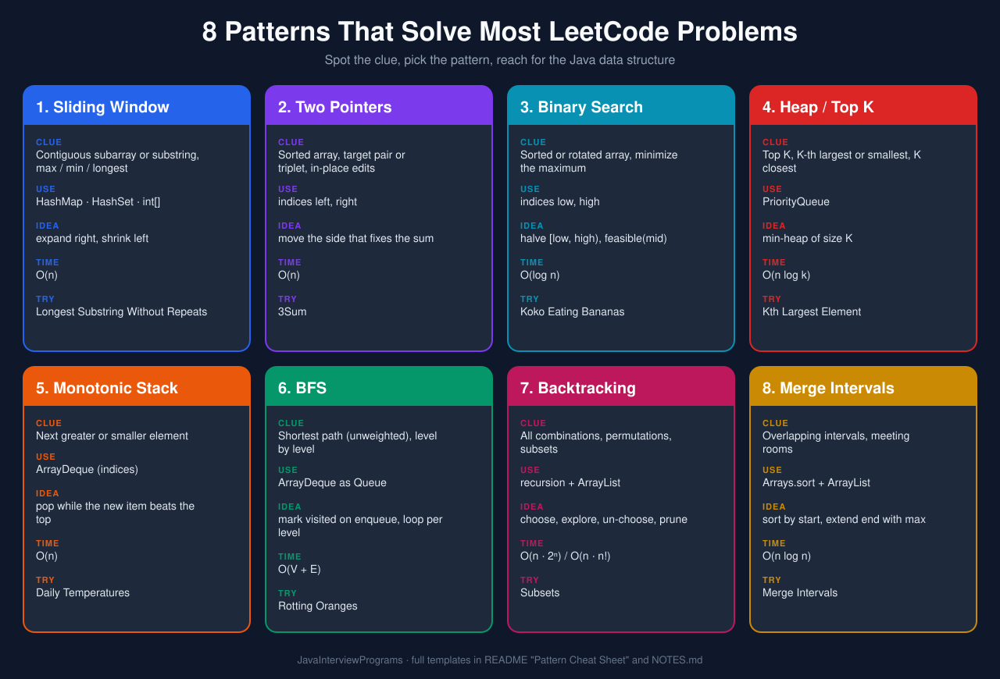

# Java Interview Programs 🎯


497 interview problems solved in plain Java, each one a standalone class you can run, with a write-up that walks from the brute-force idea to the optimized solution.

The set covers the Blind 75, NeetCode 150, the Kohei Arai "60 LeetCode questions" list, the LeetCode problems that ten or more companies ask about, and a block of classic Java core and concurrency questions. Nothing is listed twice.

If it helps your preparation, a star ⭐ on the repository is appreciated.

## Table of Contents 📖

- **[At a Glance 📊](#at-a-glance-)**
- **[How Each Problem Is Written ✍️](#how-each-problem-is-written-%EF%B8%8F)**
- **[Coding Interview Questions by Topic 🗂️](#coding-interview-questions-by-topic)**
- **[Pattern Cheat Sheet 💡](#pattern-cheat-sheet-)**
- **[Suggested Study Plan 🗓️](#suggested-study-plan-%EF%B8%8F)**
- **[Repository Structure 🧱](#repository-structure-)**
- **[How to Run 🚀](#how-to-run-)**
- **[Contributing 🤝](#contributing-)**

## At a Glance 📊

| Difficulty | Programs |
|------------|----------|
| 🟢 Easy | 122 |
| 🟡 Medium | 294 |
| 🔴 Hard | 81 |
| **Total** | **497** |

| Topic | Name | Programs |
|-------|------|----------|
| `01` | [Arrays & Strings](#topic-01) | 121 |
| `02` | [Hashing](#topic-02) | 27 |
| `03` | [Linked Lists](#topic-03) | 26 |
| `04` | [Stacks & Queues](#topic-04) | 28 |
| `05` | [Binary Search](#topic-05) | 20 |
| `06` | [Sorting & Intervals](#topic-06) | 20 |
| `07` | [Trees & BST](#topic-07) | 39 |
| `08` | [Heaps](#topic-08) | 17 |
| `09` | [Graphs](#topic-09) | 39 |
| `10` | [Dynamic Programming](#topic-10) | 32 |
| `11` | [Backtracking](#topic-11) | 18 |
| `12` | [Greedy Algorithms](#topic-12) | 18 |
| `13` | [Tries](#topic-13) | 5 |
| `14` | [Bit Manipulation](#topic-14) | 9 |
| `15` | [Advanced Graphs](#topic-15) | 12 |
| `16` | [Advanced DP](#topic-16) | 16 |
| `17` | [Design Problems](#topic-17) | 27 |
| `18` | [Java Core & Concurrency](#topic-18) | 23 |

## How Each Problem Is Written ✍️

Every program follows the same shape, so you always know where to look.

| Part | What you get |
|------|--------------|
| Java class | A standalone class under `src/main/java/com/ranga/<topic>/` with a Javadoc: problem statement, strategy, a worked example and the complexity. |
| `main` method | Sample data printed as aligned `Input  :` and `Output :` lines, plus an edge case such as `null` or empty input. |
| Markdown page | Strategy, then an **Approaches** section from brute force to optimized, each with code and time and space complexity, a comparison table, the full source, and a traced **Solution** walkthrough. |
| README row | The problem, a difficulty signal (🟢 🟡 🔴) and the core idea, linked to the page. |

The code in the Approaches section is compiled and compared with the repository class on many inputs before it is committed. Where a page describes an optimized variant that differs from the class in `src`, the page says so.

## Coding Interview Questions by Topic

Interview problems grouped by topic, in a recommended study order. Each page explains the strategy, shows several approaches from brute force to optimized, states the time and space complexity, and includes the Java source. Every program appears exactly once, under the topic where it is best learned.

### 1. Complete topic coverage

18 topics, 497 programs. Pick a card to jump to its problems.

<table>
<tr><td width="33%" align="center" valign="top"><a href="#topic-01"></a><br><code>01</code> <b><a href="#topic-01">Arrays &amp; Strings</a></b><br><sub>Two pointers, prefix sums, sliding window</sub><br><sub><b>121</b> problems</sub></td><td width="33%" align="center" valign="top"><a href="#topic-02"></a><br><code>02</code> <b><a href="#topic-02">Hashing</a></b><br><sub>HashMap, HashSet, frequency maps</sub><br><sub><b>27</b> problems</sub></td><td width="33%" align="center" valign="top"><a href="#topic-03"></a><br><code>03</code> <b><a href="#topic-03">Linked Lists</a></b><br><sub>Reversal, cycles, merge, pointers</sub><br><sub><b>26</b> problems</sub></td></tr>
<tr><td width="33%" align="center" valign="top"><a href="#topic-04"></a><br><code>04</code> <b><a href="#topic-04">Stacks &amp; Queues</a></b><br><sub>Monotonic stack, deque, expressions</sub><br><sub><b>28</b> problems</sub></td><td width="33%" align="center" valign="top"><a href="#topic-05"></a><br><code>05</code> <b><a href="#topic-05">Binary Search</a></b><br><sub>Search spaces, rotated arrays</sub><br><sub><b>20</b> problems</sub></td><td width="33%" align="center" valign="top"><a href="#topic-06"></a><br><code>06</code> <b><a href="#topic-06">Sorting &amp; Intervals</a></b><br><sub>Merge intervals, custom sorting</sub><br><sub><b>20</b> problems</sub></td></tr>
<tr><td width="33%" align="center" valign="top"><a href="#topic-07"></a><br><code>07</code> <b><a href="#topic-07">Trees &amp; BST</a></b><br><sub>DFS, BFS, traversal, construction</sub><br><sub><b>39</b> problems</sub></td><td width="33%" align="center" valign="top"><a href="#topic-08"></a><br><code>08</code> <b><a href="#topic-08">Heaps</a></b><br><sub>PriorityQueue, Top K, K-way merge</sub><br><sub><b>17</b> problems</sub></td><td width="33%" align="center" valign="top"><a href="#topic-09"></a><br><code>09</code> <b><a href="#topic-09">Graphs</a></b><br><sub>BFS, DFS, Dijkstra, Union-Find</sub><br><sub><b>39</b> problems</sub></td></tr>
<tr><td width="33%" align="center" valign="top"><a href="#topic-10"></a><br><code>10</code> <b><a href="#topic-10">Dynamic Programming</a></b><br><sub>Memoization, tabulation, optimization</sub><br><sub><b>32</b> problems</sub></td><td width="33%" align="center" valign="top"><a href="#topic-11"></a><br><code>11</code> <b><a href="#topic-11">Backtracking</a></b><br><sub>Permutations, combinations, subsets</sub><br><sub><b>18</b> problems</sub></td><td width="33%" align="center" valign="top"><a href="#topic-12"></a><br><code>12</code> <b><a href="#topic-12">Greedy Algorithms</a></b><br><sub>Scheduling, selection, optimization</sub><br><sub><b>18</b> problems</sub></td></tr>
<tr><td width="33%" align="center" valign="top"><a href="#topic-13"></a><br><code>13</code> <b><a href="#topic-13">Tries</a></b><br><sub>Prefix search, autocomplete</sub><br><sub><b>5</b> problems</sub></td><td width="33%" align="center" valign="top"><a href="#topic-14"></a><br><code>14</code> <b><a href="#topic-14">Bit Manipulation</a></b><br><sub>XOR, masks, swapping, bit operations</sub><br><sub><b>9</b> problems</sub></td><td width="33%" align="center" valign="top"><a href="#topic-15"></a><br><code>15</code> <b><a href="#topic-15">Advanced Graphs</a></b><br><sub>Topological sort, MST, SCC</sub><br><sub><b>12</b> problems</sub></td></tr>
<tr><td width="33%" align="center" valign="top"><a href="#topic-16"></a><br><code>16</code> <b><a href="#topic-16">Advanced DP</a></b><br><sub>Knapsack, interval DP, tree DP</sub><br><sub><b>16</b> problems</sub></td><td width="33%" align="center" valign="top"><a href="#topic-17"></a><br><code>17</code> <b><a href="#topic-17">Design Problems</a></b><br><sub>LRU, LFU, data structures</sub><br><sub><b>27</b> problems</sub></td><td width="33%" align="center" valign="top"><a href="#topic-18"></a><br><code>18</code> <b><a href="#topic-18">Java Core &amp; Concurrency</a></b><br><sub>Core Java basics, threads, locks, streams</sub><br><sub><b>23</b> problems</sub></td></tr>
</table>

<a id="topic-01"></a>

###  01. Arrays & Strings

*Two pointers, prefix sums, sliding window*

| # | Problem | Difficulty | Core concept |
|---|---------|------------|--------------|
| 1 | [Second Largest Element in an Array](./md_files/array/SecondLargestElement.md) | 🟢 Easy | Single pass |
| 2 | [Best Time to Buy and Sell Stock](./md_files/array/BestTimeToBuyAndSellStock.md) | 🟢 Easy | Greedy |
| 3 | [Maximum Subarray](./md_files/array/MaximumSubarray.md) | 🟡 Medium | Kadane's algorithm |
| 4 | [Product of Array Except Self](./md_files/array/ProductOfArrayExceptSelf.md) | 🟡 Medium | Prefix/suffix |
| 5 | [Maximum Product Subarray](./md_files/array/MaximumProductSubarray.md) | 🟡 Medium | Dynamic tracking |
| 6 | [Majority Element](./md_files/array/MajorityElement.md) | 🟢 Easy | Boyer-Moore |
| 7 | [Majority Element II](./md_files/array/MajorityElementII.md) | 🟡 Medium | Extended Boyer-Moore |
| 8 | [Missing Number](./md_files/array/MissingNumber.md) | 🟢 Easy | XOR / Math |
| 9 | [Find All Numbers Disappeared in an Array](./md_files/array/FindAllNumbersDisappeared.md) | 🟢 Easy | In-place marking |
| 10 | [First Missing Positive](./md_files/array/FirstMissingPositive.md) | 🔴 Hard | Index placement |
| 11 | [Merge Sorted Array](./md_files/array/MergeSortedArray.md) | 🟢 Easy | Two pointers |
| 12 | [Rotate an Array](./md_files/array/RotateAnArray.md) | 🟡 Medium | Reversal |
| 13 | [Next Permutation](./md_files/array/NextPermutation.md) | 🟡 Medium | Lexicographic order |
| 14 | [Sort Colors](./md_files/array/MoveZerosAndOnes.md) | 🟡 Medium | Dutch National Flag |
| 15 | [Remove Duplicates from Sorted Array](./md_files/array/RemoveDuplicates.md) | 🟢 Easy | In-place pointers |
| 16 | [Move Zeroes](./md_files/array/MoveZeroes.md) | 🟢 Easy | Fast and slow |
| 17 | [Subarray Sum Equals K](./md_files/array/SubarraySumEqualsK.md) | 🟡 Medium | Prefix sum + HashMap |
| 18 | [Set Matrix Zeroes](./md_files/matrix/SetMatrixZeroes.md) | 🟡 Medium | In-place matrix |
| 19 | [Rotate Image](./md_files/matrix/RotateImage.md) | 🟡 Medium | Matrix transpose |
| 20 | [Spiral Matrix](./md_files/matrix/SpiralMatrix.md) | 🟡 Medium | Boundary traversal |
| 21 | [Valid Sudoku](./md_files/matrix/ValidSudoku.md) | 🟡 Medium | Hash sets |
| 22 | [Two Sum II](./md_files/array/TwoSumII.md) | 🟡 Medium | Sorted two pointers |
| 23 | [3Sum](./md_files/array/ThreeSum.md) | 🟡 Medium | Sorting + pointers |
| 24 | [3Sum with Target (Indices, Hash Map)](./md_files/array/ThreeSumIndices.md) | 🟡 Medium | Fix one + Two Sum hash map |
| 25 | [4Sum](./md_files/array/FourSum.md) | 🟡 Medium | Multiple pointers |
| 26 | [Container With Most Water](./md_files/array/ContainerWithMostWater.md) | 🟡 Medium | Greedy pointers |
| 27 | [Trapping Rain Water](./md_files/array/TrappingRainWater.md) | 🔴 Hard | Two pointers |
| 28 | [Longest Substring Without Repeating Characters](./md_files/string/LongestSubString.md) | 🟡 Medium | Variable window |
| 29 | [Longest Repeating Character Replacement](./md_files/string/LongestRepeatingCharacterReplacement.md) | 🟡 Medium | Window + frequency |
| 30 | [Permutation in String](./md_files/string/PermutationInString.md) | 🟡 Medium | Fixed window |
| 31 | [Find All Anagrams in a String](./md_files/string/FindAllAnagramsInAString.md) | 🟡 Medium | Sliding window |
| 32 | [Minimum Window Substring](./md_files/string/MinimumWindowSubstring.md) | 🔴 Hard | Window + HashMap |
| 33 | [Sliding Window Maximum](./md_files/array/SlidingWindowMaximum.md) | 🔴 Hard | Monotonic deque |
| 34 | [Reverse a String](./md_files/string/ReverseString.md) | 🟢 Easy | Two pointers |
| 35 | [Palindrome Check (String and Number)](./md_files/string/PalindromeCheck.md) | 🟢 Easy | Two pointers |
| 36 | [Valid Palindrome](./md_files/string/ValidPalindrome.md) | 🟢 Easy | Two pointers |
| 37 | [Valid Palindrome II](./md_files/string/ValidPalindromeII.md) | 🟢 Easy | Conditional deletion |
| 38 | [Longest Common Prefix](./md_files/string/LongestCommonPrefix.md) | 🟢 Easy | String traversal |
| 39 | [Longest Palindromic Substring](./md_files/string/LongestPalindrome.md) | 🟡 Medium | Expand around center |
| 40 | [Palindromic Substrings](./md_files/string/PalindromicSubstrings.md) | 🟡 Medium | Expand around center |
| 41 | [String to Integer (atoi)](./md_files/string/StringToIntegerAtoi.md) | 🟡 Medium | Parsing |
| 42 | [Roman to Integer](./md_files/string/RomanToInteger.md) | 🟢 Easy | Mapping |
| 43 | [Integer to Roman](./md_files/string/IntegerToRoman.md) | 🟡 Medium | Greedy |
| 44 | [Multiply Strings](./md_files/string/MultiplyStrings.md) | 🟡 Medium | Manual arithmetic |
| 45 | [Encode and Decode Strings](./md_files/string/EncodeAndDecodeStrings.md) | 🟡 Medium | Serialization |
| 46 | [String Compression](./md_files/string/StringCompression.md) | 🟡 Medium | Two pointers |
| 47 | [Minimum Size Subarray Sum](./md_files/array/MinimumSizeSubarraySum.md) | 🟡 Medium | Variable-size sliding window |
| 48 | [Is Subsequence](./md_files/string/IsSubsequence.md) | 🟢 Easy | Two pointers |
| 49 | [ZigZag Conversion](./md_files/string/ZigZagConversion.md) | 🟡 Medium | Row simulation |
| 50 | [Text Justification](./md_files/string/TextJustification.md) | 🔴 Hard | Greedy line packing |
| 51 | [Palindrome Number](./md_files/string/PalindromeNumber.md) | 🟢 Easy | Reverse half of the number |
| 52 | [Reverse Words in a String](./md_files/string/ReverseWordsInAString.md) | 🟡 Medium | Split, trim and reverse |
| 53 | [Max Consecutive Ones III](./md_files/array/MaxConsecutiveOnesIII.md) | 🟡 Medium | Sliding window with a flip budget |
| 54 | [Subarray Product Less Than K](./md_files/array/SubarrayProductLessThanK.md) | 🟡 Medium | Sliding window with a product |
| 55 | [Pascal's Triangle](./md_files/array/PascalsTriangle.md) | 🟢 Easy | Build rows from the previous row |
| 56 | [Find Pivot Index](./md_files/array/FindPivotIndex.md) | 🟢 Easy | Prefix sum against the total |
| 57 | [Excel Sheet Column Title](./md_files/string/ExcelSheetColumnTitle.md) | 🟢 Easy | Bijective base-26 |
| 58 | [Squares of a Sorted Array](./md_files/array/SquaresOfASortedArray.md) | 🟢 Easy | Two pointers from both ends |
| 59 | [Count Binary Substrings](./md_files/string/CountBinarySubstrings.md) | 🟢 Easy | Run lengths of equal characters |
| 60 | [Reverse Vowels of a String](./md_files/string/ReverseVowelsOfAString.md) | 🟢 Easy | Two pointers |
| 61 | [Can Place Flowers](./md_files/array/CanPlaceFlowers.md) | 🟢 Easy | Greedy planting |
| 62 | [Rotate String](./md_files/string/RotateString.md) | 🟢 Easy | Substring of the doubled string |
| 63 | [Merge Strings Alternately](./md_files/string/MergeStringsAlternately.md) | 🟢 Easy | Two pointers |
| 64 | [Maximum Average Subarray I](./md_files/array/MaximumAverageSubarrayI.md) | 🟢 Easy | Fixed-size sliding window |
| 65 | [Minimum Value to Get Positive Step by Step Sum](./md_files/array/MinimumValueToGetPositiveStepByStepSum.md) | 🟢 Easy | Minimum prefix sum |
| 66 | [Minimum Absolute Difference](./md_files/array/MinimumAbsoluteDifference.md) | 🟢 Easy | Sort then compare neighbours |
| 67 | [Maximum Points You Can Obtain from Cards](./md_files/array/MaximumPointsYouCanObtainFromCards.md) | 🟡 Medium | Minimum sum window of size n - k |
| 68 | [Fruit Into Baskets](./md_files/array/FruitIntoBaskets.md) | 🟡 Medium | Longest window with at most two distinct values |
| 69 | [Remove Element](./md_files/array/RemoveElement.md) | 🟢 Easy | Overwrite with a write pointer |
| 70 | [Add Binary](./md_files/string/AddBinary.md) | 🟢 Easy | Digit-by-digit addition with carry |
| 71 | [Add Strings](./md_files/string/AddStrings.md) | 🟢 Easy | Digit-by-digit addition without big numbers |
| 72 | [Plus One](./md_files/array/PlusOne.md) | 🟢 Easy | Carry propagation from the right |
| 73 | [Find the Index of the First Occurrence in a String](./md_files/string/FirstOccurrenceInAString.md) | 🟢 Easy | Substring search |
| 74 | [Compare Version Numbers](./md_files/string/CompareVersionNumbers.md) | 🟡 Medium | Split and compare segment by segment |
| 75 | [Count and Say](./md_files/string/CountAndSay.md) | 🟡 Medium | Run-length description of the previous term |
| 76 | [Game of Life](./md_files/matrix/GameOfLife.md) | 🟡 Medium | In-place update with transition states |
| 77 | [Diagonal Traverse](./md_files/matrix/DiagonalTraverse.md) | 🟡 Medium | Walk anti-diagonals with alternating direction |
| 78 | [Remove All Occurrences of a Substring](./md_files/string/RemoveAllOccurrencesOfASubstring.md) | 🟡 Medium | Stack-like building with suffix check |
| 79 | [3Sum Closest](./md_files/array/ThreeSumClosest.md) | 🟡 Medium | Sort and two pointers |
| 80 | [Longest Continuous Subarray With Absolute Diff Less Than or Equal to Limit](./md_files/array/LongestContinuousSubarrayWithAbsoluteDiffLessThanOrEqualToLimit.md) | 🟡 Medium | Sliding window with two monotonic deques |
| 81 | [Maximum Sum Circular Subarray](./md_files/array/MaximumSumCircularSubarray.md) | 🟡 Medium | Kadane's algorithm for max and min |
| 82 | [Validate IP Address](./md_files/string/ValidateIPAddress.md) | 🟡 Medium | Parse and validate each group |
| 83 | [Integer to English Words](./md_files/string/IntegerToEnglishWords.md) | 🔴 Hard | Chunk by thousands |
| 84 | [Count Vowel Substrings of a String](./md_files/string/CountVowelSubstringsOfAString.md) | 🟢 Easy | Brute force over vowel-only windows |
| 85 | [Frequency of the Most Frequent Element](./md_files/array/FrequencyOfTheMostFrequentElement.md) | 🟡 Medium | Sorted sliding window with a budget |
| 86 | [Maximize Distance to Closest Person](./md_files/array/MaximizeDistanceToClosestPerson.md) | 🟡 Medium | Largest gap between occupied seats |
| 87 | [Sparse Matrix Multiplication](./md_files/matrix/SparseMatrixMultiplication.md) | 🟡 Medium | Skip zero entries |
| 88 | [Range Sum Query 2D - Immutable](./md_files/matrix/RangeSumQuery2DImmutable.md) | 🟡 Medium | 2D prefix sums |
| 89 | [Max Points on a Line](./md_files/array/MaxPointsOnALine.md) | 🔴 Hard | Slope map from each anchor point |
| 90 | [Subarrays with K Different Integers](./md_files/string/SubarraysWithKDifferentIntegers.md) | 🔴 Hard | At most K minus at most K minus 1 |
| 91 | [Candy Crush](./md_files/array/CandyCrush.md) | 🟡 Medium | Mark, crush and drop until stable |
| 92 | [Count Subarrays With Fixed Bounds](./md_files/array/CountSubarraysWithFixedBounds.md) | 🔴 Hard | Track the last min, max and out-of-range positions |
| 93 | [Substring with Concatenation of All Words](./md_files/string/SubstringWithConcatenationOfAllWords.md) | 🔴 Hard | Sliding window over word-sized steps |
| 94 | [Special Binary String](./md_files/string/SpecialBinaryString.md) | 🔴 Hard | Recursive decomposition into balanced primes |
| 95 | [Maximum Swap](./md_files/array/MaximumSwap.md) | 🟡 Medium | Last occurrence of each digit |
| 96 | [Check if Array Is Sorted and Rotated](./md_files/array/CheckIfArrayIsSortedAndRotated.md) | 🟢 Easy | Count descents on a circular array |
| 97 | [Shortest Palindrome](./md_files/string/ShortestPalindrome.md) | 🔴 Hard | Longest palindromic prefix with KMP prefix function |
| 98 | [Longest Substring with At Least K Repeating Characters](./md_files/string/LongestSubstringWithAtLeastKRepeatingCharacters.md) | 🟡 Medium | Divide and conquer on rare characters |
| 99 | [Remove Duplicates from Sorted Array II](./md_files/array/RemoveDuplicatesFromSortedArrayII.md) | 🟡 Medium | Write pointer compared with two positions back |
| 100 | [Count Number of Nice Subarrays](./md_files/array/CountNumberOfNiceSubarrays.md) | 🟡 Medium | Prefix count of odd numbers with a frequency map |
| 101 | [Summary Ranges](./md_files/array/SummaryRanges.md) | 🟢 Easy | Group consecutive runs |
| 102 | [Intersection of Two Arrays II](./md_files/array/IntersectionOfTwoArraysII.md) | 🟢 Easy | Frequency map of the smaller array |
| 103 | [Maximum Product of Three Numbers](./md_files/array/MaximumProductOfThreeNumbers.md) | 🟢 Easy | Two smallest and three largest |
| 104 | [Island Perimeter](./md_files/matrix/IslandPerimeter.md) | 🟢 Easy | Count land cells and shared edges |
| 105 | [Third Maximum Number](./md_files/array/ThirdMaximumNumber.md) | 🟢 Easy | Track three distinct maximums |
| 106 | [Restore the Array From Adjacent Pairs](./md_files/array/RestoreTheArrayFromAdjacentPairs.md) | 🟡 Medium | Adjacency map and walk from an endpoint |
| 107 | [Best Meeting Point](./md_files/array/BestMeetingPoint.md) | 🔴 Hard | Median of rows and columns |
| 108 | [Rotating the Box](./md_files/matrix/RotatingTheBox.md) | 🟡 Medium | Gravity per row, then rotate |
| 109 | [Shortest Word Distance](./md_files/array/ShortestWordDistance.md) | 🟢 Easy | Track the last index of each word |
| 110 | [Count Vowel Strings in Ranges](./md_files/array/CountVowelStringsInRanges.md) | 🟡 Medium | Prefix sums of qualifying words |
| 111 | [Rectangle Area](./md_files/array/RectangleArea.md) | 🟡 Medium | Sum of areas minus the overlap |
| 112 | [Longest Subarray of 1's After Deleting One Element](./md_files/array/LongestSubarrayOf1sAfterDeletingOneElement.md) | 🟡 Medium | Sliding window with at most one zero |
| 113 | [Grumpy Bookstore Owner](./md_files/array/GrumpyBookstoreOwner.md) | 🟡 Medium | Fixed window of the best extra satisfied customers |
| 114 | [Valid Triangle Number](./md_files/array/ValidTriangleNumber.md) | 🟡 Medium | Sort and two pointers |
| 115 | [Longest Mountain in Array](./md_files/array/LongestMountainInArray.md) | 🟡 Medium | Expand around each peak |
| 116 | [Valid Word](./md_files/string/ValidWord.md) | 🟢 Easy | Single-pass character classification |
| 117 | [Minimum Moves to Equal Array Elements](./md_files/array/MinimumMovesToEqualArrayElements.md) | 🟡 Medium | Reverse the move: decrement one element |
| 118 | [Shortest Unsorted Continuous Subarray](./md_files/array/ShortestUnsortedContinuousSubarray.md) | 🟡 Medium | Track running maximum and minimum |
| 119 | [Number of Steps to Reduce a Number in Binary Representation to One](./md_files/string/NumberOfStepsToReduceABinaryNumberToOne.md) | 🟡 Medium | Right-to-left scan with a carry |
| 120 | [Robot Bounded In Circle](./md_files/string/RobotBoundedInCircle.md) | 🟡 Medium | Simulate one cycle and check the end state |
| 121 | [Find the Highest Altitude](./md_files/array/FindTheHighestAltitude.md) | 🟢 Easy | Running prefix sum |

<a id="topic-02"></a>

###  02. Hashing

*HashMap, HashSet, frequency maps*

| # | Problem | Difficulty | Core concept |
|---|---------|------------|--------------|
| 122 | [Two Sum](./md_files/array/TwoSum.md) | 🟢 Easy | HashMap |
| 123 | [Contains Duplicate](./md_files/array/ContainsDuplicate.md) | 🟢 Easy | HashSet |
| 124 | [Intersection of Two Arrays](./md_files/array/IntersectionOfTwoArrays.md) | 🟢 Easy | HashSet |
| 125 | [Valid Anagram](./md_files/string/Anagram.md) | 🟢 Easy | Character frequency |
| 126 | [Group Anagrams](./md_files/string/GroupAnagrams.md) | 🟡 Medium | Frequency / Sorting |
| 127 | [Isomorphic Strings](./md_files/string/IsomorphicStrings.md) | 🟢 Easy | Two-way mapping |
| 128 | [First Non-Repeating Character](./md_files/string/FirstNonRepeatingCharacter.md) | 🟢 Easy | Frequency array |
| 129 | [Longest Consecutive Sequence](./md_files/array/LongestConsecutiveSequence.md) | 🟡 Medium | HashSet |
| 130 | [Design HashMap](./md_files/design/CustomHashMap.md) | 🟡 Medium | Hashing + collision handling |
| 131 | [Design HashSet](./md_files/design/DesignHashSet.md) | 🟢 Easy | Hashing |
| 132 | [Unique Email Addresses](./md_files/string/UniqueEmailAddresses.md) | 🟢 Easy | Normalise and hash |
| 133 | [Happy Number](./md_files/string/HappyNumber.md) | 🟢 Easy | Cycle detection on a number sequence |
| 134 | [Degree of an Array](./md_files/array/DegreeOfAnArray.md) | 🟢 Easy | Frequency map with first and last index |
| 135 | [Ransom Note](./md_files/string/RansomNote.md) | 🟢 Easy | Character counts |
| 136 | [Contiguous Array](./md_files/array/ContiguousArray.md) | 🟡 Medium | Prefix balance in a hash map |
| 137 | [Sort Characters By Frequency](./md_files/string/SortCharactersByFrequency.md) | 🟡 Medium | Frequency count and bucket sort |
| 138 | [Continuous Subarray Sum](./md_files/array/ContinuousSubarraySum.md) | 🟡 Medium | Prefix sums modulo k |
| 139 | [Minimum Number of Steps to Make Two Strings Anagram](./md_files/string/MinimumNumberOfStepsToMakeTwoStringsAnagram.md) | 🟡 Medium | Letter count difference |
| 140 | [Fraction to Recurring Decimal](./md_files/string/FractionToRecurringDecimal.md) | 🟡 Medium | Long division with remainder positions |
| 141 | [Subarray Sums Divisible by K](./md_files/array/SubarraySumsDivisibleByK.md) | 🟡 Medium | Prefix sum remainders |
| 142 | [Rabbits in Forest](./md_files/array/RabbitsInForest.md) | 🟡 Medium | Group rabbits that give the same answer |
| 143 | [Rank Teams by Votes](./md_files/array/RankTeamsByVotes.md) | 🟡 Medium | Position-count matrix and custom sort |
| 144 | [Word Pattern](./md_files/string/WordPattern.md) | 🟢 Easy | Two-way mapping between letters and words |
| 145 | [Verifying an Alien Dictionary](./md_files/string/VerifyingAnAlienDictionary.md) | 🟢 Easy | Letter rank lookup and adjacent comparison |
| 146 | [Maximum Nesting Depth of the Parentheses](./md_files/string/MaximumNestingDepthOfTheParentheses.md) | 🟢 Easy | Running depth counter |
| 147 | [Repeated Substring Pattern](./md_files/string/RepeatedSubstringPattern.md) | 🟢 Easy | Search the string inside its doubled copy |
| 148 | [Pairs of Songs With Total Durations Divisible by 60](./md_files/array/PairsOfSongsWithTotalDurationsDivisibleBy60.md) | 🟡 Medium | Count by remainder |

<a id="topic-03"></a>

###  03. Linked Lists

*Reversal, cycles, merge, pointers*

| # | Problem | Difficulty | Core concept |
|---|---------|------------|--------------|
| 149 | [Single Linked List](./md_files/linkedlist/SingleLinkedListDemo.md) | 🟢 Easy | Linked list implementation |
| 150 | [Reverse Linked List](./md_files/linkedlist/ReverseLinkedList.md) | 🟢 Easy | Iterative reversal |
| 151 | [Reverse Linked List II](./md_files/linkedlist/ReverseLinkedListII.md) | 🟡 Medium | Partial reversal |
| 152 | [Middle of the Linked List](./md_files/linkedlist/MiddleOfTheLinkedList.md) | 🟢 Easy | Fast and slow pointers |
| 153 | [Merge Two Sorted Lists](./md_files/linkedlist/MergeTwoSortedLists.md) | 🟢 Easy | Dummy node |
| 154 | [Linked List Cycle](./md_files/linkedlist/LinkedListCycle.md) | 🟢 Easy | Floyd's algorithm |
| 155 | [Linked List Cycle II](./md_files/linkedlist/LinkedListCycleII.md) | 🟡 Medium | Cycle entry detection |
| 156 | [Find the Duplicate Number](./md_files/linkedlist/FindTheDuplicateNumber.md) | 🟡 Medium | Floyd's cycle detection |
| 157 | [Add Two Numbers](./md_files/linkedlist/AddTwoNumbers.md) | 🟡 Medium | Carry handling |
| 158 | [Remove Nth Node From End](./md_files/linkedlist/RemoveNthNodeFromEnd.md) | 🟡 Medium | Two pointers |
| 159 | [Palindrome Linked List](./md_files/linkedlist/PalindromeLinkedList.md) | 🟢 Easy | Reverse second half |
| 160 | [Intersection of Two Linked Lists](./md_files/linkedlist/IntersectionOfTwoLinkedLists.md) | 🟢 Easy | Pointer switching |
| 161 | [Reorder List](./md_files/linkedlist/ReorderList.md) | 🟡 Medium | Split + reverse + merge |
| 162 | [Copy List with Random Pointer](./md_files/linkedlist/CopyListWithRandomPointer.md) | 🟡 Medium | HashMap / interweaving |
| 163 | [Sort List](./md_files/linkedlist/SortList.md) | 🟡 Medium | Merge sort |
| 164 | [Merge K Sorted Lists](./md_files/linkedlist/MergeKSortedLists.md) | 🔴 Hard | PriorityQueue |
| 165 | [Reverse Nodes in K-Group](./md_files/linkedlist/ReverseNodesInKGroup.md) | 🔴 Hard | Group reversal |
| 166 | [Remove Duplicates from Sorted List](./md_files/linkedlist/RemoveDuplicatesFromSortedList.md) | 🟢 Easy | Pointer skipping |
| 167 | [Remove Duplicates from Sorted List II](./md_files/linkedlist/RemoveDuplicatesFromSortedListII.md) | 🟡 Medium | Dummy head, skip runs |
| 168 | [Swap Nodes in Pairs](./md_files/linkedlist/SwapNodesInPairs.md) | 🟡 Medium | Pointer rewiring with a dummy head |
| 169 | [Odd Even Linked List](./md_files/linkedlist/OddEvenLinkedList.md) | 🟡 Medium | Two interleaved chains |
| 170 | [Rotate List](./md_files/linkedlist/RotateList.md) | 🟡 Medium | Make it a ring, cut at the new tail |
| 171 | [Convert Binary Number in a Linked List to Integer](./md_files/linkedlist/ConvertBinaryNumberInALinkedListToInteger.md) | 🟢 Easy | Shift and add while traversing |
| 172 | [Delete Node in a Linked List](./md_files/linkedlist/DeleteNodeInALinkedList.md) | 🟡 Medium | Copy the next node into this one |
| 173 | [Merge In Between Linked Lists](./md_files/linkedlist/MergeInBetweenLinkedLists.md) | 🟡 Medium | Pointer splicing |
| 174 | [Remove Linked List Elements](./md_files/linkedlist/RemoveLinkedListElements.md) | 🟢 Easy | Dummy head and in-place unlinking |

<a id="topic-04"></a>

###  04. Stacks & Queues

*Monotonic stack, deque, expressions*

| # | Problem | Difficulty | Core concept |
|---|---------|------------|--------------|
| 175 | [Valid Parentheses](./md_files/stack/ValidParentheses.md) | 🟢 Easy | Stack |
| 176 | [Min Stack](./md_files/stack/MinStack.md) | 🟡 Medium | Auxiliary stack |
| 177 | [Implement Queue Using Stacks](./md_files/stack/ImplementQueueUsingStacks.md) | 🟢 Easy | Two stacks |
| 178 | [Implement Stack Using Queues](./md_files/stack/ImplementStackUsingQueues.md) | 🟢 Easy | Queue |
| 179 | [Evaluate Reverse Polish Notation](./md_files/stack/EvaluateReversePolishNotation.md) | 🟡 Medium | Stack |
| 180 | [Decode String](./md_files/stack/DecodeString.md) | 🟡 Medium | Stack |
| 181 | [Minimum Remove to Make Valid Parentheses](./md_files/stack/MinimumRemoveToMakeValidParentheses.md) | 🟡 Medium | Stack |
| 182 | [Longest Valid Parentheses](./md_files/stack/LongestValidParentheses.md) | 🔴 Hard | Stack / DP |
| 183 | [Daily Temperatures](./md_files/stack/DailyTemperatures.md) | 🟡 Medium | Monotonic stack |
| 184 | [Next Greater Element I](./md_files/stack/NextGreaterElementI.md) | 🟢 Easy | Monotonic stack |
| 185 | [Next Greater Element II](./md_files/stack/NextGreaterElementII.md) | 🟡 Medium | Circular array |
| 186 | [Online Stock Span](./md_files/stack/OnlineStockSpan.md) | 🟡 Medium | Monotonic stack |
| 187 | [Asteroid Collision](./md_files/stack/AsteroidCollision.md) | 🟡 Medium | Stack simulation |
| 188 | [Car Fleet](./md_files/stack/CarFleet.md) | 🟡 Medium | Sorting + stack |
| 189 | [Largest Rectangle in Histogram](./md_files/stack/LargestRectangleInHistogram.md) | 🔴 Hard | Monotonic stack |
| 190 | [Basic Calculator](./md_files/stack/BasicCalculator.md) | 🔴 Hard | Stack / Parsing |
| 191 | [Remove K Digits](./md_files/stack/RemoveKDigits.md) | 🟡 Medium | Monotonic stack |
| 192 | [Simplify Path](./md_files/stack/SimplifyPath.md) | 🟡 Medium | Stack of path segments |
| 193 | [Backspace String Compare](./md_files/stack/BackspaceStringCompare.md) | 🟢 Easy | Backward scan with skip counts |
| 194 | [Remove All Adjacent Duplicates In String](./md_files/stack/RemoveAllAdjacentDuplicatesInString.md) | 🟢 Easy | Stack cancellation |
| 195 | [Minimum Number of Swaps to Make the String Balanced](./md_files/stack/MinimumNumberOfSwapsToMakeTheStringBalanced.md) | 🟡 Medium | Unmatched closing brackets |
| 196 | [Remove Duplicate Letters](./md_files/stack/RemoveDuplicateLetters.md) | 🟡 Medium | Monotonic stack with last occurrences |
| 197 | [Sum of Subarray Minimums](./md_files/stack/SumOfSubarrayMinimums.md) | 🟡 Medium | Monotonic stack, contribution of each element |
| 198 | [Number of Visible People in a Queue](./md_files/stack/NumberOfVisiblePeopleInAQueue.md) | 🔴 Hard | Monotonic decreasing stack from the right |
| 199 | [Exclusive Time of Functions](./md_files/stack/ExclusiveTimeOfFunctions.md) | 🟡 Medium | Call stack from log lines |
| 200 | [Remove All Adjacent Duplicates in String II](./md_files/stack/RemoveAllAdjacentDuplicatesInStringII.md) | 🟡 Medium | Stack of characters with run counts |
| 201 | [Smallest Subsequence of Distinct Characters](./md_files/stack/SmallestSubsequenceOfDistinctCharacters.md) | 🟡 Medium | Monotonic stack with last occurrences |
| 202 | [Reverse Substrings Between Each Pair of Parentheses](./md_files/stack/ReverseSubstringsBetweenEachPairOfParentheses.md) | 🟡 Medium | Stack of partial strings or paired-index walk |

<a id="topic-05"></a>

###  05. Binary Search

*Search spaces, rotated arrays*

| # | Problem | Difficulty | Core concept |
|---|---------|------------|--------------|
| 203 | [Linear Search](./md_files/search/LinearSearch.md) | 🟢 Easy | Sequential scan |
| 204 | [Binary Search](./md_files/search/BinarySearch.md) | 🟢 Easy | Basic binary search |
| 205 | [Search Insert Position](./md_files/search/SearchInsertPosition.md) | 🟢 Easy | Lower bound |
| 206 | [First and Last Position of Element](./md_files/search/FirstAndLastPosition.md) | 🟡 Medium | Boundary search |
| 207 | [Search in Rotated Sorted Array](./md_files/search/SearchInRotatedSortedArray.md) | 🟡 Medium | Modified binary search |
| 208 | [Find Minimum in Rotated Sorted Array](./md_files/search/FindMinimumInRotatedSortedArray.md) | 🟡 Medium | Binary search |
| 209 | [Find Peak Element](./md_files/search/FindPeakElement.md) | 🟡 Medium | Binary search |
| 210 | [Search a 2D Matrix](./md_files/search/SearchA2DMatrix.md) | 🟡 Medium | Matrix binary search |
| 211 | [Koko Eating Bananas](./md_files/search/KokoEatingBananas.md) | 🟡 Medium | Binary search on answer |
| 212 | [Capacity to Ship Packages Within D Days](./md_files/search/CapacityToShipPackages.md) | 🟡 Medium | Feasibility search |
| 213 | [Median of Two Sorted Arrays](./md_files/search/MedianOfTwoSortedArrays.md) | 🔴 Hard | Partition-based search |
| 214 | [Split Array Largest Sum](./md_files/search/SplitArrayLargestSum.md) | 🔴 Hard | Binary search on the answer |
| 215 | [Sqrt(x)](./md_files/search/SqrtX.md) | 🟢 Easy | Binary search on the answer |
| 216 | [Single Element in a Sorted Array](./md_files/search/SingleElementInASortedArray.md) | 🟡 Medium | Binary search on pair alignment |
| 217 | [Heaters](./md_files/search/Heaters.md) | 🟡 Medium | Nearest heater with binary search |
| 218 | [Find the Smallest Divisor Given a Threshold](./md_files/search/SmallestDivisorGivenAThreshold.md) | 🟡 Medium | Binary search on the divisor |
| 219 | [Kth Missing Positive Number](./md_files/search/KthMissingPositiveNumber.md) | 🟢 Easy | Binary search on missing count |
| 220 | [Minimum Number of Days to Make m Bouquets](./md_files/search/MinimumNumberOfDaysToMakeMBouquets.md) | 🟡 Medium | Binary search on the answer |
| 221 | [Peak Index in a Mountain Array](./md_files/search/PeakIndexInAMountainArray.md) | 🟡 Medium | Binary search on the slope |
| 222 | [Valid Perfect Square](./md_files/search/ValidPerfectSquare.md) | 🟢 Easy | Binary search on the square root |

<a id="topic-06"></a>

###  06. Sorting & Intervals

*Merge intervals, custom sorting*

| # | Problem | Difficulty | Core concept |
|---|---------|------------|--------------|
| 223 | [Bubble Sort](./md_files/sort/BubbleSort.md) | 🟢 Easy | Adjacent swaps |
| 224 | [Selection Sort](./md_files/sort/SelectionSort.md) | 🟢 Easy | Minimum selection |
| 225 | [Insertion Sort](./md_files/sort/InsertionSort.md) | 🟢 Easy | Shifting |
| 226 | [Merge Sort](./md_files/sort/MergeSort.md) | 🟡 Medium | Divide and conquer |
| 227 | [Quick Sort](./md_files/sort/QuickSort.md) | 🟡 Medium | Partitioning |
| 228 | [Heap Sort](./md_files/sort/HeapSort.md) | 🟡 Medium | Binary heap |
| 229 | [Merge Intervals](./md_files/interval/MergeIntervals.md) | 🟡 Medium | Sorting |
| 230 | [Insert Interval](./md_files/interval/InsertInterval.md) | 🟡 Medium | Interval merging |
| 231 | [Non-overlapping Intervals](./md_files/interval/NonOverlappingIntervals.md) | 🟡 Medium | Greedy |
| 232 | [Meeting Rooms](./md_files/interval/MeetingRooms.md) | 🟢 Easy | Sorting |
| 233 | [Meeting Rooms II](./md_files/interval/MeetingRoomsII.md) | 🟡 Medium | Min heap |
| 234 | [Minimum Interval to Include Each Query](./md_files/interval/MinimumIntervalToIncludeEachQuery.md) | 🔴 Hard | Sorting + min heap |
| 235 | [Car Pooling](./md_files/array/CarPooling.md) | 🟡 Medium | Difference array of passenger changes |
| 236 | [Interval List Intersections](./md_files/interval/IntervalListIntersections.md) | 🟡 Medium | Two pointers over sorted interval lists |
| 237 | [Meeting Scheduler](./md_files/interval/MeetingScheduler.md) | 🟡 Medium | Two pointers over sorted availability |
| 238 | [Sort an Array](./md_files/sort/SortAnArray.md) | 🟡 Medium | Merge sort without built-in sorting |
| 239 | [Employee Free Time](./md_files/interval/EmployeeFreeTime.md) | 🔴 Hard | Merge all busy intervals, gaps are free time |
| 240 | [Make Lexicographically Smallest Array by Swapping Elements](./md_files/sort/MakeLexicographicallySmallestArrayBySwappingElements.md) | 🟡 Medium | Sort within groups of values at most limit apart |
| 241 | [Sort Colors](./md_files/sort/SortColors.md) | 🟡 Medium | Dutch national flag with three pointers |
| 242 | [Minimum Number of Arrows to Burst Balloons](./md_files/interval/MinimumNumberOfArrowsToBurstBalloons.md) | 🟡 Medium | Sort by end and shoot greedily |

<a id="topic-07"></a>

###  07. Trees & BST

*DFS, BFS, traversal, construction*

| # | Problem | Difficulty | Core concept |
|---|---------|------------|--------------|
| 243 | [Binary Tree Traversals (Inorder, Preorder, Postorder)](./md_files/tree/TreeTraversals.md) | 🟢 Easy | DFS orders |
| 244 | [Maximum Depth of Binary Tree](./md_files/tree/MaximumDepthOfBinaryTree.md) | 🟢 Easy | DFS |
| 245 | [Minimum Depth of Binary Tree](./md_files/tree/MinimumDepthOfBinaryTree.md) | 🟢 Easy | BFS |
| 246 | [Invert Binary Tree](./md_files/tree/InvertBinaryTree.md) | 🟢 Easy | Recursion |
| 247 | [Same Tree](./md_files/tree/SameTree.md) | 🟢 Easy | Tree comparison |
| 248 | [Symmetric Tree](./md_files/tree/SymmetricTree.md) | 🟢 Easy | Recursive comparison |
| 249 | [Subtree of Another Tree](./md_files/tree/SubtreeOfAnotherTree.md) | 🟢 Easy | Recursion |
| 250 | [Binary Tree Level Order Traversal](./md_files/tree/BinaryTreeLevelOrderTraversal.md) | 🟡 Medium | BFS |
| 251 | [Binary Tree Zigzag Level Order Traversal](./md_files/tree/BinaryTreeZigzagLevelOrder.md) | 🟡 Medium | BFS |
| 252 | [Binary Tree Right Side View](./md_files/tree/BinaryTreeRightSideView.md) | 🟡 Medium | BFS / DFS |
| 253 | [Vertical Order Traversal](./md_files/tree/VerticalOrderTraversal.md) | 🔴 Hard | BFS + Sorting |
| 254 | [Diameter of Binary Tree](./md_files/tree/DiameterOfBinaryTree.md) | 🟢 Easy | DFS |
| 255 | [Balanced Binary Tree](./md_files/tree/BalancedBinaryTree.md) | 🟢 Easy | Height calculation |
| 256 | [Count Good Nodes in Binary Tree](./md_files/tree/CountGoodNodesInBinaryTree.md) | 🟡 Medium | DFS with running maximum |
| 257 | [Lowest Common Ancestor](./md_files/tree/LowestCommonAncestorOfBinaryTree.md) | 🟡 Medium | Tree recursion |
| 258 | [Binary Search Tree](./md_files/tree/BinarySearchTree.md) | 🟡 Medium | BST implementation |
| 259 | [Validate Binary Search Tree](./md_files/tree/ValidateBinarySearchTree.md) | 🟡 Medium | Range validation |
| 260 | [Kth Smallest Element in BST](./md_files/tree/KthSmallestElementInBST.md) | 🟡 Medium | Inorder traversal |
| 261 | [Lowest Common Ancestor of a Binary Search Tree](./md_files/tree/LowestCommonAncestorOfBST.md) | 🟡 Medium | BST property |
| 262 | [Construct Tree from Preorder and Inorder](./md_files/tree/ConstructBinaryTreeFromPreorderInorder.md) | 🟡 Medium | Recursion + HashMap |
| 263 | [Path Sum II](./md_files/tree/PathSumII.md) | 🟡 Medium | Backtracking |
| 264 | [Flatten Binary Tree to Linked List](./md_files/tree/FlattenBinaryTreeToLinkedList.md) | 🟡 Medium | Tree transformation |
| 265 | [Serialize and Deserialize Binary Tree](./md_files/tree/SerializeDeserializeBinaryTree.md) | 🔴 Hard | BFS / DFS |
| 266 | [Binary Tree Maximum Path Sum](./md_files/tree/BinaryTreeMaximumPathSum.md) | 🔴 Hard | DFS |
| 267 | [Binary Tree Cameras](./md_files/tree/BinaryTreeCameras.md) | 🔴 Hard | Greedy / DFS |
| 268 | [Merge Two Binary Trees](./md_files/tree/MergeTwoBinaryTrees.md) | 🟢 Easy | Parallel DFS |
| 269 | [Convert Sorted Array to Binary Search Tree](./md_files/tree/ConvertSortedArrayToBST.md) | 🟢 Easy | Divide and conquer, midpoint root |
| 270 | [Path Sum](./md_files/tree/PathSum.md) | 🟢 Easy | DFS with a remaining target |
| 271 | [Split BST](./md_files/tree/SplitBST.md) | 🟡 Medium | Recursive split by value |
| 272 | [Delete Node in a BST](./md_files/tree/DeleteNodeInABST.md) | 🟡 Medium | Replace with the in-order successor |
| 273 | [Lowest Common Ancestor of a Binary Tree III](./md_files/tree/LowestCommonAncestorOfABinaryTreeIII.md) | 🟡 Medium | Parent pointers as intersecting lists |
| 274 | [Amount of Time for Binary Tree to Be Infected](./md_files/tree/AmountOfTimeForBinaryTreeToBeInfected.md) | 🟡 Medium | Parent map and BFS from the start node |
| 275 | [All Nodes Distance K in Binary Tree](./md_files/tree/AllNodesDistanceKInBinaryTree.md) | 🟡 Medium | Parent map and BFS to depth k |
| 276 | [Boundary of Binary Tree](./md_files/tree/BoundaryOfBinaryTree.md) | 🟡 Medium | Left boundary, leaves, reversed right boundary |
| 277 | [Binary Tree Vertical Order Traversal](./md_files/tree/BinaryTreeVerticalOrderTraversal.md) | 🟡 Medium | BFS with column indexes |
| 278 | [Path Sum III](./md_files/tree/PathSumIII.md) | 🟡 Medium | Prefix sums on a root-to-node path |
| 279 | [Binary Tree Paths](./md_files/tree/BinaryTreePaths.md) | 🟢 Easy | DFS building the path string |
| 280 | [Sum Root to Leaf Numbers](./md_files/tree/SumRootToLeafNumbers.md) | 🟡 Medium | DFS carrying the number so far |
| 281 | [Binary Tree Inorder Traversal](./md_files/tree/BinaryTreeInorderTraversal.md) | 🟢 Easy | Left, node, right with an explicit stack |

<a id="topic-08"></a>

###  08. Heaps

*PriorityQueue, Top K, K-way merge*

| # | Problem | Difficulty | Core concept |
|---|---------|------------|--------------|
| 282 | [Kth Largest Element in a Stream](./md_files/heap/KthLargestElementInAStream.md) | 🟢 Easy | Min heap of size k |
| 283 | [Last Stone Weight](./md_files/heap/LastStoneWeight.md) | 🟢 Easy | Max heap |
| 284 | [Kth Largest Element in an Array](./md_files/heap/KthLargestElementInAnArray.md) | 🟡 Medium | Quickselect / Heap |
| 285 | [Top K Frequent Elements](./md_files/heap/TopKFrequentElements.md) | 🟡 Medium | HashMap + Heap |
| 286 | [K Closest Points to Origin](./md_files/heap/KClosestPointsToOrigin.md) | 🟡 Medium | PriorityQueue |
| 287 | [Find Median from Data Stream](./md_files/heap/FindMedianFromDataStream.md) | 🔴 Hard | Two heaps |
| 288 | [Task Scheduler](./md_files/heap/TaskScheduler.md) | 🟡 Medium | Heap + Greedy |
| 289 | [Reorganize String](./md_files/heap/ReorganizeString.md) | 🟡 Medium | Max heap |
| 290 | [Find K Pairs with Smallest Sums](./md_files/heap/FindKPairsWithSmallestSums.md) | 🟡 Medium | Heap |
| 291 | [Smallest Range Covering Elements from K Lists](./md_files/heap/SmallestRangeCoveringKLists.md) | 🔴 Hard | Heap |
| 292 | [Random Pick with Weight](./md_files/heap/RandomPickWithWeight.md) | 🟡 Medium | Prefix sums and binary search |
| 293 | [Top K Frequent Words](./md_files/heap/TopKFrequentWords.md) | 🟡 Medium | Min-heap with a tie-break |
| 294 | [Find K Closest Elements](./md_files/heap/FindKClosestElements.md) | 🟡 Medium | Binary search for the window start |
| 295 | [Kth Smallest Element in a Sorted Matrix](./md_files/heap/KthSmallestElementInASortedMatrix.md) | 🟡 Medium | Binary search on value or a min-heap of rows |
| 296 | [Furthest Building You Can Reach](./md_files/heap/FurthestBuildingYouCanReach.md) | 🟡 Medium | Min-heap of climbs covered by ladders |
| 297 | [The Skyline Problem](./md_files/heap/TheSkylineProblem.md) | 🔴 Hard | Sweep line with a max-heap of heights |
| 298 | [Maximum Product of Two Elements in an Array](./md_files/heap/MaximumProductOfTwoElementsInAnArray.md) | 🟢 Easy | Track the two largest values |

<a id="topic-09"></a>

###  09. Graphs

*BFS, DFS, Dijkstra, Union-Find*

| # | Problem | Difficulty | Core concept |
|---|---------|------------|--------------|
| 299 | [Graph Traversals (BFS and DFS)](./md_files/graph/GraphTraversals.md) | 🟢 Easy | BFS and DFS |
| 300 | [Flood Fill](./md_files/graph/FloodFill.md) | 🟢 Easy | DFS |
| 301 | [Number of Islands](./md_files/graph/NumberOfIslands.md) | 🟡 Medium | DFS / BFS |
| 302 | [Max Area of Island](./md_files/graph/MaxAreaOfIsland.md) | 🟡 Medium | DFS |
| 303 | [Surrounded Regions](./md_files/graph/SurroundedRegions.md) | 🟡 Medium | Border DFS |
| 304 | [Pacific Atlantic Water Flow](./md_files/graph/PacificAtlanticWaterFlow.md) | 🟡 Medium | Multi-source DFS |
| 305 | [Rotting Oranges](./md_files/graph/RottingOranges.md) | 🟡 Medium | Multi-source BFS |
| 306 | [Walls and Gates](./md_files/graph/WallsAndGates.md) | 🟡 Medium | Multi-source BFS |
| 307 | [Clone Graph](./md_files/graph/CloneGraph.md) | 🟡 Medium | DFS + HashMap |
| 308 | [Course Schedule](./md_files/graph/CourseSchedule.md) | 🟡 Medium | Cycle detection |
| 309 | [Word Ladder](./md_files/graph/WordLadder.md) | 🔴 Hard | BFS |
| 310 | [Evaluate Division](./md_files/graph/EvaluateDivision.md) | 🟡 Medium | Weighted graph |
| 311 | [Graph Valid Tree](./md_files/graph/GraphValidTree.md) | 🟡 Medium | DFS / Union-Find |
| 312 | [Number of Connected Components](./md_files/graph/NumberOfConnectedComponents.md) | 🟡 Medium | Union-Find |
| 313 | [Redundant Connection](./md_files/graph/RedundantConnection.md) | 🟡 Medium | DSU |
| 314 | [Accounts Merge](./md_files/graph/AccountsMerge.md) | 🟡 Medium | Union-Find |
| 315 | [Implement Union-Find from Scratch](./md_files/graph/UnionFind.md) | 🟡 Medium | Path compression + Union by Rank |
| 316 | [Network Delay Time](./md_files/graph/NetworkDelayTime.md) | 🟡 Medium | Dijkstra |
| 317 | [Cheapest Flights Within K Stops](./md_files/graph/CheapestFlightsWithinKStops.md) | 🟡 Medium | Bellman-Ford / BFS |
| 318 | [Implement Dijkstra from Scratch](./md_files/graph/DijkstraShortestPath.md) | 🟡 Medium | Graph + PriorityQueue |
| 319 | [Swim in Rising Water](./md_files/graph/SwimInRisingWater.md) | 🔴 Hard | Dijkstra / binary search |
| 320 | [Is Graph Bipartite?](./md_files/graph/IsGraphBipartite.md) | 🟡 Medium | Two-colouring with BFS |
| 321 | [Possible Bipartition](./md_files/graph/PossibleBipartition.md) | 🟡 Medium | Dislike graph two-colouring |
| 322 | [Shortest Path in Binary Matrix](./md_files/graph/ShortestPathInBinaryMatrix.md) | 🟡 Medium | BFS on a grid with 8 directions |
| 323 | [Open the Lock](./md_files/graph/OpenTheLock.md) | 🟡 Medium | BFS over lock states |
| 324 | [Number of Operations to Make Network Connected](./md_files/graph/NumberOfOperationsToMakeNetworkConnected.md) | 🟡 Medium | Union-Find components |
| 325 | [Number of Distinct Islands](./md_files/graph/NumberOfDistinctIslands.md) | 🟡 Medium | Shape signature of each island |
| 326 | [Bus Routes](./md_files/graph/BusRoutes.md) | 🔴 Hard | BFS over routes, not stops |
| 327 | [Making A Large Island](./md_files/graph/MakingALargeIsland.md) | 🔴 Hard | Label islands, then try flipping each zero |
| 328 | [Shortest Bridge](./md_files/graph/ShortestBridge.md) | 🟡 Medium | DFS to find one island, multi-source BFS to the other |
| 329 | [Minimum Knight Moves](./md_files/graph/MinimumKnightMoves.md) | 🟡 Medium | BFS on an infinite board with symmetry |
| 330 | [The Maze](./md_files/graph/TheMaze.md) | 🟡 Medium | BFS where the ball rolls until it hits a wall |
| 331 | [Shortest Distance from All Buildings](./md_files/graph/ShortestDistanceFromAllBuildings.md) | 🔴 Hard | BFS from every building, accumulate distances |
| 332 | [Word Ladder II](./md_files/graph/WordLadderII.md) | 🔴 Hard | BFS for levels, DFS to rebuild all shortest paths |
| 333 | [Snakes and Ladders](./md_files/graph/SnakesAndLadders.md) | 🟡 Medium | BFS over board squares with boustrophedon mapping |
| 334 | [Most Stones Removed with Same Row or Column](./md_files/graph/MostStonesRemovedWithSameRowOrColumn.md) | 🟡 Medium | Union-Find on rows and columns |
| 335 | [Number of Provinces](./md_files/graph/NumberOfProvinces.md) | 🟡 Medium | Union-Find on an adjacency matrix |
| 336 | [Keys and Rooms](./md_files/graph/KeysAndRooms.md) | 🟡 Medium | Graph reachability with DFS |
| 337 | [Smallest String With Swaps](./md_files/graph/SmallestStringWithSwaps.md) | 🟡 Medium | Union-Find components and sorted characters |

<a id="topic-10"></a>

###  10. Dynamic Programming

*Memoization, tabulation, optimization*

| # | Problem | Difficulty | Core concept |
|---|---------|------------|--------------|
| 338 | [Fibonacci](./md_files/dp/Fibonacci.md) | 🟢 Easy | Recursion / memoization |
| 339 | [Climbing Stairs](./md_files/dp/ClimbingStairs.md) | 🟢 Easy | 1D DP |
| 340 | [Min Cost Climbing Stairs](./md_files/dp/MinCostClimbingStairs.md) | 🟢 Easy | 1D DP |
| 341 | [House Robber](./md_files/dp/HouseRobber.md) | 🟡 Medium | DP |
| 342 | [House Robber II](./md_files/dp/HouseRobberII.md) | 🟡 Medium | Circular DP |
| 343 | [Decode Ways](./md_files/dp/DecodeWays.md) | 🟡 Medium | 1D DP |
| 344 | [Coin Change](./md_files/dp/CoinChange.md) | 🟡 Medium | Unbounded knapsack |
| 345 | [Word Break](./md_files/dp/WordBreak.md) | 🟡 Medium | DP + HashSet |
| 346 | [Longest Increasing Subsequence](./md_files/dp/LongestIncreasingSubsequence.md) | 🟡 Medium | DP / Binary search |
| 347 | [Unique Paths](./md_files/dp/UniquePaths.md) | 🟡 Medium | Grid DP |
| 348 | [Minimum Path Sum](./md_files/dp/MinimumPathSum.md) | 🟡 Medium | Grid DP |
| 349 | [Best Time to Buy and Sell Stock with Cooldown](./md_files/dp/BestTimeToBuyAndSellStockWithCooldown.md) | 🟡 Medium | State machine DP |
| 350 | [Longest Common Subsequence](./md_files/dp/LongestCommonSubsequence.md) | 🟡 Medium | 2D DP |
| 351 | [Longest Palindromic Subsequence](./md_files/dp/LongestPalindromicSubsequence.md) | 🟡 Medium | 2D DP |
| 352 | [Edit Distance](./md_files/dp/EditDistance.md) | 🟡 Medium | 2D DP |
| 353 | [Interleaving String](./md_files/dp/InterleavingString.md) | 🟡 Medium | 2D DP |
| 354 | [Paint Fence](./md_files/dp/PaintFence.md) | 🟡 Medium | Counting DP with two states |
| 355 | [Unique Paths II](./md_files/dp/UniquePathsII.md) | 🟡 Medium | Grid DP with obstacles |
| 356 | [K-th Symbol in Grammar](./md_files/dp/KthSymbolInGrammar.md) | 🟡 Medium | Recursion on a doubling structure |
| 357 | [Maximal Square](./md_files/dp/MaximalSquare.md) | 🟡 Medium | Grid DP, min of three neighbours |
| 358 | [Delete and Earn](./md_files/dp/DeleteAndEarn.md) | 🟡 Medium | Reduce to House Robber |
| 359 | [Perfect Squares](./md_files/dp/PerfectSquares.md) | 🟡 Medium | Unbounded knapsack over squares |
| 360 | [Triangle](./md_files/dp/TriangleMinimumPathSum.md) | 🟡 Medium | Bottom-up DP in place of the last row |
| 361 | [Find the Winner of the Circular Game](./md_files/dp/FindTheWinnerOfTheCircularGame.md) | 🟡 Medium | Josephus recurrence |
| 362 | [Minimum Cost For Tickets](./md_files/dp/MinimumCostForTickets.md) | 🟡 Medium | DP over days with 1, 7 and 30 day passes |
| 363 | [Frog Jump](./md_files/dp/FrogJump.md) | 🔴 Hard | DP on (stone, last jump size) |
| 364 | [Dungeon Game](./md_files/dp/DungeonGame.md) | 🔴 Hard | DP from the princess backward |
| 365 | [Longest String Chain](./md_files/dp/LongestStringChain.md) | 🟡 Medium | DP by removing one letter |
| 366 | [Count Ways To Build Good Strings](./md_files/dp/CountWaysToBuildGoodStrings.md) | 🟡 Medium | Length-indexed counting DP |
| 367 | [Minimum Falling Path Sum](./md_files/matrix/MinimumFallingPathSum.md) | 🟡 Medium | Row-by-row DP |
| 368 | [Count Square Submatrices with All Ones](./md_files/matrix/CountSquareSubmatricesWithAllOnes.md) | 🟡 Medium | Largest square ending at each cell |
| 369 | [Ugly Number II](./md_files/dp/UglyNumberII.md) | 🟡 Medium | Three pointers merging multiples of 2, 3 and 5 |

<a id="topic-11"></a>

###  11. Backtracking

*Permutations, combinations, subsets*

| # | Problem | Difficulty | Core concept |
|---|---------|------------|--------------|
| 370 | [Subsets](./md_files/backtracking/Subsets.md) | 🟡 Medium | Decision tree |
| 371 | [Subsets II](./md_files/backtracking/SubsetsII.md) | 🟡 Medium | Duplicate handling |
| 372 | [Permutations](./md_files/backtracking/Permutations.md) | 🟡 Medium | Backtracking |
| 373 | [Permutations II](./md_files/backtracking/PermutationsII.md) | 🟡 Medium | Duplicate handling |
| 374 | [Combination Sum](./md_files/backtracking/CombinationSum.md) | 🟡 Medium | Reusable choices |
| 375 | [Combination Sum II](./md_files/backtracking/CombinationSumII.md) | 🟡 Medium | Single-use choices |
| 376 | [Letter Combinations of a Phone Number](./md_files/backtracking/LetterCombinationsOfAPhoneNumber.md) | 🟡 Medium | Backtracking |
| 377 | [Generate Parentheses](./md_files/backtracking/GenerateParentheses.md) | 🟡 Medium | Recursive construction |
| 378 | [Palindrome Partitioning](./md_files/backtracking/PalindromePartitioning.md) | 🟡 Medium | Backtracking + palindrome check |
| 379 | [Word Search](./md_files/backtracking/WordSearch.md) | 🟡 Medium | DFS + Backtracking |
| 380 | [N-Queens](./md_files/backtracking/NQueens.md) | 🔴 Hard | Constraint search |
| 381 | [Sudoku Solver](./md_files/backtracking/SudokuSolver.md) | 🔴 Hard | Constraint propagation |
| 382 | [Restore IP Addresses](./md_files/backtracking/RestoreIPAddresses.md) | 🟡 Medium | Backtracking over segment lengths |
| 383 | [Word Break II](./md_files/backtracking/WordBreakII.md) | 🔴 Hard | Backtracking with memoisation on the suffix |
| 384 | [Optimal Account Balancing](./md_files/backtracking/OptimalAccountBalancing.md) | 🔴 Hard | Backtracking over non-zero debts |
| 385 | [N-Queens II](./md_files/backtracking/NQueensII.md) | 🔴 Hard | Backtracking with column and diagonal bitmasks |
| 386 | [Permutation Sequence](./md_files/backtracking/PermutationSequence.md) | 🔴 Hard | Factorial number system |
| 387 | [Partition to K Equal Sum Subsets](./md_files/backtracking/PartitionToKEqualSumSubsets.md) | 🟡 Medium | Fill buckets one at a time with pruning |

<a id="topic-12"></a>

###  12. Greedy Algorithms

*Scheduling, selection, optimization*

| # | Problem | Difficulty | Core concept |
|---|---------|------------|--------------|
| 388 | [Jump Game](./md_files/greedy/JumpGame.md) | 🟡 Medium | Greedy |
| 389 | [Jump Game II](./md_files/greedy/JumpGameII.md) | 🟡 Medium | Greedy |
| 390 | [Gas Station](./md_files/greedy/GasStation.md) | 🟡 Medium | Greedy |
| 391 | [Candy](./md_files/greedy/Candy.md) | 🔴 Hard | Two-pass greedy |
| 392 | [Hand of Straights](./md_files/greedy/HandOfStraights.md) | 🟡 Medium | Greedy + TreeMap |
| 393 | [Merge Triplets to Form Target Triplet](./md_files/greedy/MergeTripletsToFormTargetTriplet.md) | 🟡 Medium | Greedy |
| 394 | [Partition Labels](./md_files/greedy/PartitionLabels.md) | 🟡 Medium | Last occurrence |
| 395 | [Valid Parenthesis String](./md_files/greedy/ValidParenthesisString.md) | 🟡 Medium | Greedy range |
| 396 | [Best Time to Buy and Sell Stock II](./md_files/greedy/BestTimeToBuyAndSellStockII.md) | 🟡 Medium | Sum of every upward move |
| 397 | [Largest Number](./md_files/greedy/LargestNumber.md) | 🟡 Medium | Custom comparator on concatenation |
| 398 | [Boats to Save People](./md_files/greedy/BoatsToSavePeople.md) | 🟡 Medium | Sort and pair heaviest with lightest |
| 399 | [Maximum Number of Events That Can Be Attended](./md_files/greedy/MaximumNumberOfEventsThatCanBeAttended.md) | 🟡 Medium | Greedy with a min-heap of end days |
| 400 | [Minimum Number of Taps to Open to Water a Garden](./md_files/greedy/MinimumNumberOfTapsToOpenToWaterAGarden.md) | 🔴 Hard | Jump game over tap ranges |
| 401 | [Put Marbles in Bags](./md_files/greedy/PutMarblesInBags.md) | 🔴 Hard | Sort adjacent pair sums |
| 402 | [Using a Robot to Print the Lexicographically Smallest String](./md_files/greedy/UsingARobotToPrintTheLexicographicallySmallestString.md) | 🟡 Medium | Stack and the smallest remaining letter |
| 403 | [Best Time to Buy and Sell Stock with Transaction Fee](./md_files/dp/BestTimeToBuyAndSellStockWithTransactionFee.md) | 🟡 Medium | Two-state DP: holding and cash |
| 404 | [Lemonade Change](./md_files/greedy/LemonadeChange.md) | 🟢 Easy | Greedy change-making |
| 405 | [Maximum Units on a Truck](./md_files/greedy/MaximumUnitsOnATruck.md) | 🟢 Easy | Take boxes with the most units first |

<a id="topic-13"></a>

###  13. Tries

*Prefix search, autocomplete*

| # | Problem | Difficulty | Core concept |
|---|---------|------------|--------------|
| 406 | [Implement Trie](./md_files/trie/ImplementTrie.md) | 🟡 Medium | Prefix tree |
| 407 | [Design Add and Search Words](./md_files/trie/DesignAddAndSearchWords.md) | 🟡 Medium | Trie + DFS |
| 408 | [Word Search II](./md_files/trie/WordSearchII.md) | 🔴 Hard | Trie + Backtracking |
| 409 | [Search Suggestions System](./md_files/trie/SearchSuggestionsSystem.md) | 🟡 Medium | Sorted products and binary search per prefix |
| 410 | [Design Search Autocomplete System](./md_files/trie/DesignSearchAutocompleteSystem.md) | 🔴 Hard | Trie of sentences with counts |

<a id="topic-14"></a>

###  14. Bit Manipulation

*XOR, masks, swapping, bit operations*

| # | Problem | Difficulty | Core concept |
|---|---------|------------|--------------|
| 411 | [Single Number](./md_files/bit/SingleNumber.md) | 🟢 Easy | XOR |
| 412 | [Single Number II](./md_files/bit/SingleNumberII.md) | 🟡 Medium | Bit manipulation |
| 413 | [Counting Bits](./md_files/bit/CountingBits.md) | 🟢 Easy | DP + Bits |
| 414 | [Reverse Bits](./md_files/bit/ReverseBits.md) | 🟢 Easy | Bit operations |
| 415 | [Number of 1 Bits](./md_files/bit/NumberOf1Bits.md) | 🟢 Easy | Brian Kernighan |
| 416 | [Swap Two Numbers Without a Temporary Variable](./md_files/bit/SwapTwoNumbers.md) | 🟢 Easy | XOR / arithmetic |
| 417 | [Pow(x, n)](./md_files/bit/PowXN.md) | 🟡 Medium | Fast exponentiation by squaring |
| 418 | [Power of Two](./md_files/bit/PowerOfTwo.md) | 🟢 Easy | One set bit check |
| 419 | [Sum of Two Integers](./md_files/bit/SumOfTwoIntegers.md) | 🟡 Medium | XOR for the sum and AND for the carry |

<a id="topic-15"></a>

###  15. Advanced Graphs

*Topological sort, MST, SCC*

| # | Problem | Difficulty | Core concept |
|---|---------|------------|--------------|
| 420 | [Course Schedule II](./md_files/graph/CourseScheduleII.md) | 🟡 Medium | Topological sort |
| 421 | [Topological Sort](./md_files/graph/TopologicalSort.md) | 🟡 Medium | Kahn's algorithm / DFS |
| 422 | [Alien Dictionary](./md_files/graph/AlienDictionary.md) | 🔴 Hard | Topological sort |
| 423 | [Minimum Spanning Tree](./md_files/graph/MinimumSpanningTree.md) | 🟡 Medium | Kruskal / Prim |
| 424 | [Min Cost to Connect All Points](./md_files/graph/MinCostToConnectAllPoints.md) | 🟡 Medium | Prim / Kruskal |
| 425 | [Critical Connections in a Network](./md_files/graph/CriticalConnections.md) | 🔴 Hard | Tarjan's algorithm |
| 426 | [Reconstruct Itinerary](./md_files/graph/ReconstructItinerary.md) | 🔴 Hard | Eulerian path (Hierholzer) |
| 427 | [Shortest Path in a Grid with Obstacles Elimination](./md_files/graph/ShortestPathInAGridWithObstaclesElimination.md) | 🔴 Hard | BFS with state (row, col, eliminations left) |
| 428 | [Parallel Courses III](./md_files/graph/ParallelCoursesIII.md) | 🔴 Hard | Topological order with longest path |
| 429 | [Minimize Malware Spread](./md_files/graph/MinimizeMalwareSpread.md) | 🔴 Hard | Union-Find components with initial infections |
| 430 | [Minimum Edge Reversals So Every Node Is Reachable](./md_files/graph/MinimumEdgeReversalsSoEveryNodeIsReachable.md) | 🔴 Hard | Rerooting on a tree with reversal costs |
| 431 | [Collect Coins in a Tree](./md_files/graph/CollectCoinsInATree.md) | 🔴 Hard | Prune leaves, then peel two layers |

<a id="topic-16"></a>

###  16. Advanced DP

*Knapsack, interval DP, tree DP*

| # | Problem | Difficulty | Core concept |
|---|---------|------------|--------------|
| 432 | [Coin Change II](./md_files/dp/CoinChangeII.md) | 🟡 Medium | Combination DP |
| 433 | [Partition Equal Subset Sum](./md_files/dp/PartitionEqualSubsetSum.md) | 🟡 Medium | Knapsack |
| 434 | [Target Sum](./md_files/dp/TargetSum.md) | 🟡 Medium | Knapsack transformation |
| 435 | [0/1 Knapsack](./md_files/dp/Knapsack01.md) | 🟡 Medium | 0/1 knapsack |
| 436 | [Distinct Subsequences](./md_files/dp/DistinctSubsequences.md) | 🔴 Hard | 2D DP |
| 437 | [Regular Expression Matching](./md_files/dp/RegularExpressionMatching.md) | 🔴 Hard | 2D DP |
| 438 | [Burst Balloons](./md_files/dp/BurstBalloons.md) | 🔴 Hard | Interval DP |
| 439 | [Longest Increasing Path in a Matrix](./md_files/dp/LongestIncreasingPathInAMatrix.md) | 🔴 Hard | DFS + Memoization |
| 440 | [Maximum Profit in Job Scheduling](./md_files/dp/MaximumProfitInJobScheduling.md) | 🔴 Hard | DP + Binary search |
| 441 | [Russian Doll Envelopes](./md_files/dp/RussianDollEnvelopes.md) | 🔴 Hard | Sort then longest increasing subsequence |
| 442 | [Wildcard Matching](./md_files/dp/WildcardMatching.md) | 🔴 Hard | Two pointers with star backtracking, or 2D DP |
| 443 | [Maximal Rectangle](./md_files/dp/MaximalRectangle.md) | 🔴 Hard | Histogram of heights per row |
| 444 | [Remove Boxes](./md_files/dp/RemoveBoxes.md) | 🔴 Hard | Interval DP with extra equal boxes attached |
| 445 | [Cherry Pickup](./md_files/dp/CherryPickup.md) | 🔴 Hard | Two walkers moving together |
| 446 | [Count Palindromic Subsequences](./md_files/dp/CountPalindromicSubsequences.md) | 🔴 Hard | Prefix and suffix pair counts around a middle digit |
| 447 | [Strange Printer](./md_files/dp/StrangePrinter.md) | 🔴 Hard | Interval DP on matching characters |

<a id="topic-17"></a>

###  17. Design Problems

*LRU, LFU, data structures*

| # | Problem | Difficulty | Core concept |
|---|---------|------------|--------------|
| 448 | [LRU Cache](./md_files/design/LRUCache.md) | 🟡 Medium | HashMap + Doubly Linked List |
| 449 | [LFU Cache](./md_files/design/LFUCache.md) | 🔴 Hard | HashMap + Frequency Lists |
| 450 | [Design Hit Counter](./md_files/design/DesignHitCounter.md) | 🟡 Medium | Queue + Sliding window |
| 451 | [Logger Rate Limiter](./md_files/design/LoggerRateLimiter.md) | 🟢 Easy | HashMap + Time |
| 452 | [Time Based Key-Value Store](./md_files/design/TimeBasedKeyValueStore.md) | 🟡 Medium | HashMap + Binary search |
| 453 | [Design Twitter](./md_files/design/DesignTwitter.md) | 🟡 Medium | Heap + HashMap |
| 454 | [Insert Delete GetRandom O(1)](./md_files/design/InsertDeleteGetRandom.md) | 🟡 Medium | ArrayList + HashMap |
| 455 | [All O(1) Data Structure](./md_files/design/AllOneDataStructure.md) | 🔴 Hard | Doubly linked list + HashMap |
| 456 | [Design Circular Queue](./md_files/design/DesignCircularQueue.md) | 🟡 Medium | Array / Circular buffer |
| 457 | [Design Skip List](./md_files/design/DesignSkipList.md) | 🔴 Hard | Probabilistic data structure |
| 458 | [Design a Min/Max Heap](./md_files/design/BinaryHeap.md) | 🟡 Medium | Heap implementation |
| 459 | [Design Browser History](./md_files/design/DesignBrowserHistory.md) | 🟡 Medium | Array with a cursor, truncate on visit |
| 460 | [Design File System](./md_files/design/DesignFileSystem.md) | 🟡 Medium | HashMap of full paths |
| 461 | [Snapshot Array](./md_files/design/SnapshotArray.md) | 🟡 Medium | Per-index history with binary search |
| 462 | [Simple Bank System](./md_files/design/SimpleBankSystem.md) | 🟡 Medium | Array of balances with validation |
| 463 | [Design Memory Allocator](./md_files/design/DesignMemoryAllocator.md) | 🟡 Medium | Scan for the first free block |
| 464 | [Design Tic-Tac-Toe](./md_files/design/DesignTicTacToe.md) | 🟡 Medium | Row, column and diagonal counters |
| 465 | [Maximum Frequency Stack](./md_files/design/MaximumFrequencyStack.md) | 🔴 Hard | Stack per frequency |
| 466 | [Design Authentication Manager](./md_files/design/DesignAuthenticationManager.md) | 🟡 Medium | Map of token to expiry time |
| 467 | [Dot Product of Two Sparse Vectors](./md_files/design/DotProductOfTwoSparseVectors.md) | 🟡 Medium | Store only non-zero entries |
| 468 | [Flatten Nested List Iterator](./md_files/design/FlattenNestedListIterator.md) | 🟡 Medium | Stack of iterators |
| 469 | [Design a Text Editor](./md_files/design/DesignTextEditor.md) | 🔴 Hard | Two stacks around the cursor |
| 470 | [Design In-Memory File System](./md_files/design/DesignInMemoryFileSystem.md) | 🔴 Hard | Trie of directories and files |
| 471 | [Block Placement Queries](./md_files/design/BlockPlacementQueries.md) | 🔴 Hard | Obstacles in a sorted set and a segment tree of gaps |
| 472 | [Moving Average from Data Stream](./md_files/design/MovingAverageFromDataStream.md) | 🟢 Easy | Fixed-size queue with a running sum |
| 473 | [Product of the Last K Numbers](./md_files/design/ProductOfTheLastKNumbers.md) | 🟡 Medium | Prefix products reset on zero |
| 474 | [Design A Leaderboard](./md_files/design/DesignALeaderboard.md) | 🟡 Medium | Hash map plus min-heap for the top K |

<a id="topic-18"></a>

###  18. Java Core & Concurrency

*Core Java basics, threads, locks, streams*

| # | Problem | Difficulty | Core concept |
|---|---------|------------|--------------|
| 475 | [Factorial](./md_files/core/Factorial.md) | 🟢 Easy | Recursion / iteration |
| 476 | [Prime Numbers](./md_files/core/PrimeNumbers.md) | 🟢 Easy | Sieve of Eratosthenes |
| 477 | [GCD and LCM](./md_files/core/GcdAndLcm.md) | 🟢 Easy | Euclid's algorithm |
| 478 | [Armstrong Number](./md_files/core/ArmstrongNumber.md) | 🟢 Easy | Digit math |
| 479 | [FizzBuzz](./md_files/core/FizzBuzz.md) | 🟢 Easy | Modulo |
| 480 | [Producer-Consumer Implementation](./md_files/threads/ProducerConsumer.md) | 🟡 Medium | Raw monitor synchronization (wait() / notifyAll()) |
| 481 | [Print Odd and Even Alternately](./md_files/threads/PrintEvenOddUsingThreads.md) | 🟡 Medium | Thread coordination using wait/notify or semaphores |
| 482 | [Print Numbers in Sequence with Three Threads](./md_files/threads/PrintNumbersWithThreeThreads.md) | 🟡 Medium | wait / notifyAll |
| 483 | [Concurrency Coordination Puzzles](./md_files/threads/ConcurrencyCoordinationPuzzles.md) | 🟡 Medium | Print in Order / FooBar sequence synchronization |
| 484 | [Thread-Safe BlockingQueue](./md_files/threads/BoundedBlockingQueue.md) | 🔴 Hard | ReentrantLock + Conditions (notFull, notEmpty) |
| 485 | [Custom Simple Thread Pool](./md_files/threads/SimpleThreadPool.md) | 🔴 Hard | Worker thread pool with a task queue |
| 486 | [Custom Read-Write Lock](./md_files/threads/CustomReadWriteLock.md) | 🔴 Hard | State-based tracking for multiple readers / single writer |
| 487 | [Deadlock and How to Avoid It](./md_files/threads/DeadlockDemo.md) | 🟡 Medium | Lock ordering |
| 488 | [Thread-Safe Singleton Variations](./md_files/core/SingletonPattern.md) | 🟡 Medium | Double-Checked Locking (volatile) and Bill Pugh Holder pattern |
| 489 | [Fully Immutable Class with Mutable Fields](./md_files/core/ImmutableClassDemo.md) | 🟡 Medium | Deep defensive copying for constructors and getters |
| 490 | [Custom Functional Interface and Collector](./md_files/core/CustomCollectors.md) | 🔴 Hard | Custom stream reduction aggregation logic |
| 491 | [Custom Resource Manager (AutoCloseable)](./md_files/core/ResourceManager.md) | 🟡 Medium | Try-with-resources integration with exception suppression |
| 492 | [Java 8 Streams Interview Questions](./md_files/core/StreamsInterviewQuestions.md) | 🟡 Medium | Java 8 streams |
| 493 | [Reverse Integer](./md_files/core/ReverseInteger.md) | 🟡 Medium | Digit pop and push with overflow check |
| 494 | [Count Primes](./md_files/core/CountPrimes.md) | 🟡 Medium | Sieve of Eratosthenes |
| 495 | [Angle Between Hands of a Clock](./md_files/core/AngleBetweenHandsOfAClock.md) | 🟡 Medium | Degrees per hour and per minute |
| 496 | [Reaching Points](./md_files/core/ReachingPoints.md) | 🔴 Hard | Work backward with the Euclidean algorithm |
| 497 | [Add Digits](./md_files/core/AddDigits.md) | 🟢 Easy | Digital root formula |

## Pattern Cheat Sheet 💡

Most interview problems are one of a handful of patterns in disguise. Spot the signal in the statement, then pick the tool.

### Quick Pattern Cheat Sheet



| Problem Clue | Likely Pattern | Core Java Data Structure | Time |
|--------------|----------------|--------------------------|------|
| Contiguous subarray / substring + max/min/longest | [Sliding Window](#1-sliding-window) | `HashMap` / `HashSet` / `int[]` | O(n) |
| Sorted array + target pair or triplet | [Two Pointers](#2-two-pointers) | Primitive indices (`left`, `right`) | O(n), triplets O(n²) |
| Sorted / rotated array, or "minimize the maximum" | [Binary Search](#3-binary-search) | Primitive indices (`low`, `high`) | O(log n) |
| "Top K", "Kth largest/smallest", "K closest" | [Heap](#4-heap--top-k) | `PriorityQueue` | O(n log k) |
| "Next greater/smaller element" | [Monotonic Stack](#5-monotonic-stack) | `ArrayDeque` | O(n) |
| Shortest path (unweighted) or level-by-level | [BFS](#6-bfs) | `LinkedList` / `ArrayDeque` (as `Queue`) | O(V + E) |
| All combinations / permutations / subsets | [Backtracking](#7-backtracking) | Recursion + `ArrayList` | O(n · 2ⁿ), O(n · n!) |
| Overlapping intervals / meeting rooms | [Merge Intervals](#8-merge-intervals) | `Arrays.sort()` + `ArrayList` | O(n log n) |

**Beyond the eight.** These patterns come up just as often and have their own pages and notes: prefix sum + `HashMap` (subarray sums, negatives allowed), DFS and Union-Find (components, cycles), topological sort (dependencies), Dijkstra (weighted shortest path), dynamic programming (counting and optimizing over overlapping subproblems), greedy (a locally best choice is provably safe), trie (prefix search) and bit manipulation (XOR, masks). See the table below and the [revision notes](./NOTES.md).

### More Clues and Examples in This Repo

| If the problem says... | Reach for | Examples in this repo |
|------------------------|-----------|-----------------------|
| sorted array, pair or triplet with a target | Two pointers or binary search | [3Sum](./md_files/array/ThreeSum.md), [Container With Most Water](./md_files/array/ContainerWithMostWater.md) |
| longest or shortest subarray or substring with a condition | Sliding window | [Longest Substring Without Repeating Characters](./md_files/string/LongestSubString.md), [Subarrays with K Different Integers](./md_files/string/SubarraysWithKDifferentIntegers.md) |
| count or find a subarray with a given sum | Prefix sum plus HashMap | [Subarray Sum Equals K](./md_files/array/SubarraySumEqualsK.md) |
| top K, k-th largest, running median | Heap | [Top K Frequent Words](./md_files/heap/TopKFrequentWords.md), [The Skyline Problem](./md_files/heap/TheSkylineProblem.md) |
| next greater or smaller element, nested structure | Monotonic stack | [Maximal Rectangle](./md_files/dp/MaximalRectangle.md), [Remove K Digits](./md_files/stack/RemoveKDigits.md) |
| shortest path with equal edge costs, level by level | BFS | [Word Ladder II](./md_files/graph/WordLadderII.md), [Snakes and Ladders](./md_files/graph/SnakesAndLadders.md) |
| connected components, cycles, ordering with dependencies | DFS, Union-Find, topological sort | [Course Schedule](./md_files/graph/CourseSchedule.md), [Parallel Courses III](./md_files/graph/ParallelCoursesIII.md) |
| all combinations, permutations or placements | Backtracking | [Word Break II](./md_files/backtracking/WordBreakII.md), [Optimal Account Balancing](./md_files/backtracking/OptimalAccountBalancing.md) |
| minimum, maximum or count of ways, overlapping subproblems | Dynamic programming | [Cherry Pickup](./md_files/dp/CherryPickup.md), [Remove Boxes](./md_files/dp/RemoveBoxes.md) |
| locally best choice looks safe | Greedy | [Put Marbles in Bags](./md_files/greedy/PutMarblesInBags.md) |
| prefix search, many strings | Trie | [Search Suggestions System](./md_files/trie/SearchSuggestionsSystem.md) |
| intervals, meetings, schedules | Sort by start, sweep line | [The Skyline Problem](./md_files/heap/TheSkylineProblem.md) |
| answer is monotonic in a parameter | Binary search on the answer | [Split Array Largest Sum](./md_files/search/SplitArrayLargestSum.md) |
| build a data structure with O(1) operations | HashMap plus linked list or array | [LRU Cache](./md_files/design/LRUCache.md), [Design a Text Editor](./md_files/design/DesignTextEditor.md) |

### The Patterns in Depth

Each pattern below gives the signal to look for, the idea, a Java template (Java 8, null and empty input guarded), the cost, the usual traps and practice problems from this repository.

#### 1. Sliding Window

**Signal.** "Longest / shortest / maximum / minimum contiguous subarray or substring such that ...", with a condition that can be updated incrementally (a sum, a distinct count, a frequency map).

**Idea.** Keep a window `[left, right]`. Expand `right` one step at a time and update the state. While the window is invalid (or, for "shortest", while it is still valid), shrink from `left`. Every index enters and leaves the window at most once, so the whole scan is O(n) instead of O(n²).

- **Variable window** (length is the answer): longest substring without repeats, minimum size subarray with sum ≥ target.
- **Fixed window** (length `k` given): maximum average of `k` elements, sliding window maximum. Add the new element, drop the one that falls out.

**State holder.** `int[26]` or `int[128]` for letters or ASCII (fastest), `HashMap<Character, Integer>` for any character, `HashSet` when only presence matters, a running `int` or `long` for sums.

```java
// Longest substring without repeating characters: jump `left` past the previous copy
static int longestUnique(String s) {
    if (s == null || s.isEmpty()) return 0;
    Map<Character, Integer> last = new HashMap<>();   // char -> last index seen
    int best = 0, left = 0;
    for (int right = 0; right < s.length(); right++) {
        char c = s.charAt(right);
        Integer prev = last.get(c);
        if (prev != null && prev >= left) left = prev + 1;   // shrink past the duplicate
        last.put(c, right);
        best = Math.max(best, right - left + 1);
    }
    return best;
}

// Shortest subarray with sum >= target: shrink while still valid
static int minLenAtLeast(int target, int[] nums) {
    if (nums == null || nums.length == 0) return 0;
    int best = Integer.MAX_VALUE, left = 0, sum = 0;
    for (int right = 0; right < nums.length; right++) {
        sum += nums[right];
        while (sum >= target) {
            best = Math.min(best, right - left + 1);
            sum -= nums[left++];
        }
    }
    return best == Integer.MAX_VALUE ? 0 : best;
}
```

**Cost.** O(n) time, O(k) space for the state (k = alphabet or distinct values).

**Traps.**
- The standard window needs the condition to be monotonic. With negative numbers a running sum is not, so use prefix sums plus a `HashMap` ([Subarray Sum Equals K](./md_files/array/SubarraySumEqualsK.md)).
- "Exactly K" is usually `atMost(K) - atMost(K - 1)` ([Subarrays with K Different Integers](./md_files/string/SubarraysWithKDifferentIntegers.md)).
- When you store indices in the map, check `prev >= left`, or `left` moves backwards.
- Remember to record the answer at the right moment: after expanding for "longest", before shrinking for "shortest".

**Practice.** [Longest Substring Without Repeating Characters](./md_files/string/LongestSubString.md), [Minimum Window Substring](./md_files/string/MinimumWindowSubstring.md), [Minimum Size Subarray Sum](./md_files/array/MinimumSizeSubarraySum.md), [Longest Repeating Character Replacement](./md_files/string/LongestRepeatingCharacterReplacement.md), [Find All Anagrams in a String](./md_files/string/FindAllAnagramsInAString.md), [Sliding Window Maximum](./md_files/array/SlidingWindowMaximum.md).

#### 2. Two Pointers

**Signal.** A sorted array (or one you may sort) and a target pair, triplet or "closest" value; in-place removal or partitioning; palindromes; merging two sorted sequences.

**Idea.** Two indices move with a rule that never skips a valid answer. In the *opposite ends* form, `left` starts at the front and `right` at the back; if the sum is too small only `left++` can help (the array is sorted), if too big only `right--` can. In the *same direction* (slow/fast) form, `fast` scans and `slow` marks the write position, or the pointers move at different speeds (cycle detection, middle of a linked list).

```java
// Pair with a given sum in a sorted array: indices, or an empty array when none exists
static int[] twoSumSorted(int[] a, int target) {
    if (a == null || a.length < 2) return new int[0];
    int left = 0, right = a.length - 1;
    while (left < right) {
        int sum = a[left] + a[right];
        if (sum == target) return new int[]{left, right};
        if (sum < target) left++; else right--;
    }
    return new int[0];
}
```

**Cost.** O(n) after sorting, so O(n log n) overall with a sort; O(1) extra space. A triplet problem fixes one element and runs two pointers on the rest: O(n²).

**Traps.**
- It needs sorted input. If the original indices matter, sort an index array or use a `HashMap` ([Two Sum](./md_files/array/TwoSum.md)) instead.
- For 3Sum / 4Sum skip duplicate values after a hit, otherwise the result repeats.
- Use `long` for sums that can overflow `int`.
- In the slow/fast form decide whether `slow` points at the last written element or the next slot, and stay consistent.

**Practice.** [Two Sum II](./md_files/array/TwoSumII.md), [3Sum](./md_files/array/ThreeSum.md), [3Sum Closest](./md_files/array/ThreeSumClosest.md), [4Sum](./md_files/array/FourSum.md), [Container With Most Water](./md_files/array/ContainerWithMostWater.md), [Trapping Rain Water](./md_files/array/TrappingRainWater.md), [Move Zeros and Ones](./md_files/array/MoveZerosAndOnes.md).

#### 3. Binary Search

**Signal.** A sorted or rotated array, "find the first / last position", or "the minimum value of the maximum" (or "the maximum of the minimum") where feasibility is monotonic: if `x` works, every larger `x` also works.

**Idea.** Each step discards half of the range. Use the **half-open template** `[low, high)` with `while (low < high)`; it avoids the off-by-one errors of the closed form and gives the *first index where a condition becomes true* (a lower bound).

- **On an array**: lower bound, upper bound, rotated array (compare `mid` with an end to see which half is sorted), peak element.
- **On the answer** ("binary search on the answer"): the search space is a range of possible answers, and a helper `feasible(mid)` decides which half to keep. Typical: capacity to ship packages in D days, Koko eating bananas, split array largest sum.

```java
// Lower bound: first index with a[i] >= target (a.length when every element is smaller)
static int lowerBound(int[] a, int target) {
    if (a == null) return 0;
    int low = 0, high = a.length;                 // search space is [low, high)
    while (low < high) {
        int mid = low + (high - low) / 2;         // never (low + high) / 2: overflow
        if (a[mid] < target) low = mid + 1; else high = mid;
    }
    return low;
}

// Binary search on the answer: least ship capacity that delivers within `days`
static int minCapacity(int[] weights, int days) {
    if (weights == null || weights.length == 0) return 0;
    int low = 0, high = 0;
    for (int w : weights) { low = Math.max(low, w); high += w; }   // answer is in [max, sum]
    while (low < high) {
        int mid = low + (high - low) / 2;
        int need = 1, load = 0;                   // days needed with capacity mid
        for (int w : weights) {
            if (load + w > mid) { need++; load = 0; }
            load += w;
        }
        if (need <= days) high = mid; else low = mid + 1;   // feasible: try smaller
    }
    return low;
}
```

**Cost.** O(log n) for an array search; O(n log(range)) for search on the answer (each check is O(n)). O(1) space.

**Traps.**
- Infinite loops come from `low = mid` with a floor midpoint; always move past `mid` on one side.
- Pick tight, correct bounds for the answer range (low = largest single item, high = total).
- Duplicates in a rotated array make "which half is sorted" ambiguous and degrade the worst case to O(n).
- `Arrays.binarySearch` returns `-(insertionPoint) - 1` when absent and an *arbitrary* index among equal elements, so write your own bound when duplicates matter.

**Practice.** [Binary Search](./md_files/search/BinarySearch.md), [Search in Rotated Sorted Array](./md_files/search/SearchInRotatedSortedArray.md), [First and Last Position](./md_files/search/FirstAndLastPosition.md), [Find Minimum in Rotated Sorted Array](./md_files/search/FindMinimumInRotatedSortedArray.md), [Koko Eating Bananas](./md_files/search/KokoEatingBananas.md), [Capacity to Ship Packages](./md_files/search/CapacityToShipPackages.md), [Split Array Largest Sum](./md_files/search/SplitArrayLargestSum.md), [Median of Two Sorted Arrays](./md_files/search/MedianOfTwoSortedArrays.md).

#### 4. Heap / Top K

**Signal.** "Top K", "K-th largest or smallest", "K closest", "K most frequent", merging K sorted lists, a running median, or repeatedly taking the current best item.

**Idea.** A `PriorityQueue` gives the smallest (default) element in O(log n). To keep the **K largest**, hold a **min-heap of size K**: push each item and pop the minimum once the size exceeds K; what remains are the K largest, and the root is the K-th largest. For the K smallest use a max-heap (`Collections.reverseOrder()`). This is O(n log k), better than sorting everything when `k << n`.

```java
// K-th largest element: min-heap of size k, the root is the answer
static int kthLargest(int[] nums, int k) {
    if (nums == null || k < 1 || k > nums.length) return -1;   // documented sentinel
    PriorityQueue<Integer> heap = new PriorityQueue<>();       // min-heap
    for (int x : nums) {
        heap.offer(x);
        if (heap.size() > k) heap.poll();                      // drop the smallest
    }
    return heap.peek();
}
```

**Variants.**
- **Two heaps** (max-heap for the lower half, min-heap for the upper half) keep a running median ([Find Median from Data Stream](./md_files/heap/FindMedianFromDataStream.md)).
- **Heap of (value, source)** merges K sorted sequences: pop the smallest, push the next element of the same source.
- **Frequency first**: count with a `HashMap`, then heap the entries by count ([Top K Frequent Elements](./md_files/heap/TopKFrequentElements.md)).
- **Lazy deletion** when an element must be removed from the middle: mark it, and discard stale tops on `poll`.

**Cost.** O(n log k) time, O(k) space. `offer`/`poll` are O(log n), `peek` is O(1), `remove(Object)` is O(n).

**Traps.**
- Never write a comparator as `(a, b) -> a - b` when values can be large or negative: it overflows. Use `Integer.compare(a, b)`.
- `PriorityQueue` iteration order is **not** sorted; only `poll` is.
- For equal priorities define a tie-break in the comparator, or the order is unspecified.
- Quickselect is O(n) on average if you only need the K-th value and may reorder the array.

**Practice.** [Kth Largest Element in an Array](./md_files/heap/KthLargestElementInAnArray.md), [Top K Frequent Elements](./md_files/heap/TopKFrequentElements.md), [K Closest Points to Origin](./md_files/heap/KClosestPointsToOrigin.md), [Find K Closest Elements](./md_files/heap/FindKClosestElements.md), [Task Scheduler](./md_files/heap/TaskScheduler.md), [Last Stone Weight](./md_files/heap/LastStoneWeight.md).

#### 5. Monotonic Stack

**Signal.** "Next greater / smaller element", "previous smaller", "days until a warmer temperature", the largest rectangle in a histogram, stock span, or removing characters to get the smallest result.

**Idea.** Keep a stack whose values stay in sorted order (decreasing for "next greater"). When a new element breaks the order, pop everything it beats; for each popped element the new one *is* its answer. Each index is pushed and popped once, so the pass is O(n) although there is a loop inside the loop. Store **indices**, not values, so you can compute distances and look the value up.

```java
// Next greater element to the right (-1 when none), using ArrayDeque as the stack
static int[] nextGreater(int[] a) {
    if (a == null) return new int[0];
    int[] res = new int[a.length];
    Arrays.fill(res, -1);
    Deque<Integer> stack = new ArrayDeque<>();     // indices of elements still waiting
    for (int i = 0; i < a.length; i++) {
        while (!stack.isEmpty() && a[stack.peek()] < a[i]) {
            res[stack.pop()] = a[i];               // a[i] is the next greater for it
        }
        stack.push(i);
    }
    return res;
}
```

**Cost.** O(n) time, O(n) space.

**Traps.**
- Use `ArrayDeque`, not `java.util.Stack`. `Stack` extends `Vector` (every call is synchronized) and is legacy; `ArrayDeque` is faster and is the recommended stack.
- `ArrayDeque` rejects `null` elements; and `push`/`pop`/`peek` work on the *head*, so do not mix them with `add`/`poll` on the tail unintentionally.
- Decide strict versus non-strict comparison (`<` vs `<=`) for equal values; it changes which duplicate gets the answer.
- For a circular array loop over `2 * n` indices and use `i % n` ([Next Greater Element II](./md_files/stack/NextGreaterElementII.md)).
- Pop the leftovers after the loop when the problem needs them (histogram: append a sentinel bar of height 0).

**Practice.** [Next Greater Element I](./md_files/stack/NextGreaterElementI.md), [Daily Temperatures](./md_files/stack/DailyTemperatures.md), [Online Stock Span](./md_files/stack/OnlineStockSpan.md), [Largest Rectangle in Histogram](./md_files/stack/LargestRectangleInHistogram.md), [Remove K Digits](./md_files/stack/RemoveKDigits.md), [Car Fleet](./md_files/stack/CarFleet.md), [Sum of Subarray Minimums](./md_files/stack/SumOfSubarrayMinimums.md).

#### 6. BFS

**Signal.** The shortest path or fewest steps when every move costs the same (a grid, a word ladder, a puzzle state), level-order traversal, "minimum number of moves", spreading simultaneously from several sources (rotting oranges).

**Idea.** A FIFO queue explores nodes in order of distance from the start, so the first time you reach the target is the shortest path. Process the queue **one level at a time** (`for size = q.size()`) to count steps. Mark nodes visited **when you enqueue them**, not when you dequeue them, otherwise the same node is queued many times. For several sources, enqueue all of them first (multi-source BFS).

```java
// Fewest steps from top-left to bottom-right in a grid of 0 (open) and 1 (wall); -1 if unreachable
static int shortestPath(int[][] grid) {
    if (grid == null || grid.length == 0 || grid[0].length == 0 || grid[0][0] == 1) return -1;
    int n = grid.length, m = grid[0].length;
    boolean[][] seen = new boolean[n][m];
    Queue<int[]> queue = new ArrayDeque<>();
    queue.offer(new int[]{0, 0});
    seen[0][0] = true;                                  // mark on enqueue
    int steps = 0;
    int[][] dirs = {{1, 0}, {-1, 0}, {0, 1}, {0, -1}};
    while (!queue.isEmpty()) {
        for (int size = queue.size(); size > 0; size--) {   // one level
            int[] cur = queue.poll();
            if (cur[0] == n - 1 && cur[1] == m - 1) return steps;
            for (int[] d : dirs) {
                int r = cur[0] + d[0], c = cur[1] + d[1];
                if (r >= 0 && c >= 0 && r < n && c < m && grid[r][c] == 0 && !seen[r][c]) {
                    seen[r][c] = true;
                    queue.offer(new int[]{r, c});
                }
            }
        }
        steps++;
    }
    return -1;
}
```

**Cost.** O(V + E) time (a grid has V = rows × cols, E ≈ 4V), O(V) space for the queue and the visited set.

**Traps.**
- Use `ArrayDeque` (or `LinkedList`) as the `Queue`. `offer` / `poll` return `false` / `null` instead of throwing, unlike `add` / `remove`.
- BFS is only the shortest path for **unweighted** edges. With weights use Dijkstra (`PriorityQueue`, [Dijkstra Shortest Path](./md_files/graph/DijkstraShortestPath.md)); with weights 0 and 1 use a deque (0-1 BFS).
- When the state is more than a position (keys held, obstacles removed, a word) put it in the visited key ([Shortest Path in a Grid with Obstacles Elimination](./md_files/graph/ShortestPathInAGridWithObstaclesElimination.md)).
- For a word-like state, represent it as a `String` in a `HashSet` and generate neighbours on the fly.
- Bidirectional BFS from both ends cuts the work from b^d to roughly 2·b^(d/2) when both ends are known.

**Practice.** [Number of Islands](./md_files/graph/NumberOfIslands.md), [Rotting Oranges](./md_files/graph/RottingOranges.md), [Open the Lock](./md_files/graph/OpenTheLock.md), [Word Ladder II](./md_files/graph/WordLadderII.md), [Snakes and Ladders](./md_files/graph/SnakesAndLadders.md), [Minimum Knight Moves](./md_files/graph/MinimumKnightMoves.md), [Graph Traversals](./md_files/graph/GraphTraversals.md).

#### 7. Backtracking

**Signal.** "Generate all", "list every", "count the arrangements", "can you place / partition / fill...", with small input (n ≤ 15 or so) because the answer set is exponential.

**Idea.** Build a solution one choice at a time in a shared `path`. **Choose** (add to `path`), **explore** (recurse), **un-choose** (remove it again). Prune a branch the moment it cannot lead to a valid answer. The shape depends on the problem:

| Problem | Loop starts at | Reuse an element? | Duplicates |
|---------|----------------|-------------------|------------|
| Subsets, combinations | `start` (next index) | no | sort, skip `nums[i] == nums[i-1]` when `i > start` |
| Combination Sum | `i` (same index) | yes | sort and skip as above |
| Permutations | `0` with a `used[]` array | no | sort, skip a duplicate whose twin is unused |
| Board puzzles (N-Queens, Sudoku) | each row / cell | no | none; prune with column and diagonal sets |

```java
// All subsets: record the path at every node of the decision tree
static List<List<Integer>> subsets(int[] nums) {
    List<List<Integer>> res = new ArrayList<>();
    if (nums == null) return res;
    backtrack(nums, 0, new ArrayList<>(), res);
    return res;
}

private static void backtrack(int[] nums, int start, List<Integer> path, List<List<Integer>> res) {
    res.add(new ArrayList<>(path));              // copy: `path` keeps changing
    for (int i = start; i < nums.length; i++) {
        path.add(nums[i]);                       // choose
        backtrack(nums, i + 1, path, res);       // explore
        path.remove(path.size() - 1);            // un-choose (index, not Integer value)
    }
}
```

**Cost.** Subsets O(n · 2ⁿ), permutations O(n · n!), plus O(n) recursion depth. The copy of each answer is the `n` factor.

**Traps.**
- **Copy the path** (`new ArrayList<>(path)`) before storing it; otherwise every stored answer ends up empty.
- `path.remove(path.size() - 1)` removes by index. `path.remove(Integer.valueOf(x))` or `remove(x)` with an `int` removes something else.
- Pruning is what makes it pass: sort first and `break` when the running total exceeds the target; track attacked columns and diagonals in boolean arrays.
- If the same state recurs, add memoization and you have top-down DP ([Word Break II](./md_files/backtracking/WordBreakII.md)).
- Very deep recursion can overflow the stack; convert to an explicit stack if depth reaches about 10⁴.

**Practice.** [Subsets](./md_files/backtracking/Subsets.md), [Subsets II](./md_files/backtracking/SubsetsII.md), [Permutations](./md_files/backtracking/Permutations.md), [Permutations II](./md_files/backtracking/PermutationsII.md), [Combination Sum](./md_files/backtracking/CombinationSum.md), [Generate Parentheses](./md_files/backtracking/GenerateParentheses.md), [Word Search](./md_files/backtracking/WordSearch.md), [N-Queens](./md_files/backtracking/NQueens.md), [Sudoku Solver](./md_files/backtracking/SudokuSolver.md).

#### 8. Merge Intervals

**Signal.** Ranges `[start, end]`: merge overlapping ones, insert a new one, find free time, the minimum number of meeting rooms, remove the fewest intervals so none overlap.

**Idea.** **Sort by start** and sweep once. Keep the current merged interval; if the next one starts at or before the current end they overlap, so extend the end with `max`; otherwise emit the current one and start a new one. Variants: a **min-heap of end times** counts how many rooms are in use at once; the **greedy "earliest end first"** order minimizes removals for non-overlapping selection; a **sweep line** over `+1` / `-1` events counts concurrent intervals.

```java
// Merge overlapping intervals
static int[][] merge(int[][] intervals) {
    if (intervals == null || intervals.length == 0) return new int[0][];
    Arrays.sort(intervals, (x, y) -> Integer.compare(x[0], y[0]));   // by start
    List<int[]> out = new ArrayList<>();
    int[] cur = intervals[0];
    for (int i = 1; i < intervals.length; i++) {
        if (intervals[i][0] <= cur[1]) {
            cur[1] = Math.max(cur[1], intervals[i][1]);   // overlap: extend (mind the max)
        } else {
            out.add(cur);
            cur = intervals[i];
        }
    }
    out.add(cur);
    return out.toArray(new int[0][]);
}
```

**Cost.** O(n log n) for the sort, then O(n); O(n) space for the output.

**Traps.**
- Decide whether touching intervals (`[1,2]` and `[2,3]`) overlap. Merge uses `<=`; for meeting rooms they do not conflict, so use `<`.
- Use `Integer.compare`, not subtraction, in the comparator, because `x[0] - y[0]` overflows for extreme values.
- Always take `Math.max` of the ends: `[1,10]` followed by `[2,3]` must stay `[1,10]`.
- The merge above mutates the input rows (`cur` is an input array). Copy them first if the caller needs the original.
- Already sorted input (Insert Interval) needs no sort: add the intervals before, merge the overlapping ones, add the rest.

**Practice.** [Merge Intervals](./md_files/interval/MergeIntervals.md), [Insert Interval](./md_files/interval/InsertInterval.md), [Meeting Rooms](./md_files/interval/MeetingRooms.md), [Meeting Rooms II](./md_files/interval/MeetingRoomsII.md), [Non-overlapping Intervals](./md_files/interval/NonOverlappingIntervals.md), [Minimum Number of Arrows to Burst Balloons](./md_files/interval/MinimumNumberOfArrowsToBurstBalloons.md), [Interval List Intersections](./md_files/interval/IntervalListIntersections.md), [Employee Free Time](./md_files/interval/EmployeeFreeTime.md).

#### Choosing Between Look-Alike Patterns

| Confusable pair | Decide by |
|-----------------|-----------|
| Sliding window vs prefix sum + `HashMap` | Window needs a monotonic condition (non-negative numbers, or distinct counts). Negative numbers or "sum equals K" need prefix sums. |
| Two pointers vs `HashMap` | Sorted (or sortable, indices not needed) and O(1) space wanted → pointers. Unsorted and original indices needed → map. |
| Binary search vs two pointers | Searching one target by halving vs. walking two ends toward each other for a pair. |
| BFS vs DFS | Shortest path or fewest steps, level by level → BFS. Exploring all paths, components, cycle checks, backtracking → DFS. |
| Heap vs sort | Need only K items or a stream (`n log k`) → heap. Need everything ordered → sort. |
| Greedy vs DP | If a locally best choice can be proven safe (exchange argument) → greedy. If a choice can be regretted later (overlapping subproblems) → DP. |
| Backtracking vs DP | Must list every solution → backtracking. Only a count, minimum or maximum → DP over the same recursion with memoization. |

#### Core Java Collections: Which One and Why

| Need | Use | Notes |
|------|-----|-------|
| Stack (LIFO) | `Deque<Integer> s = new ArrayDeque<>()` with `push` / `pop` / `peek` | Not `java.util.Stack`. No `null` elements. |
| Queue (FIFO) | `Queue<int[]> q = new ArrayDeque<>()` with `offer` / `poll` / `peek` | `LinkedList` also works and allows `null`; `ArrayDeque` is faster. |
| Min-heap | `new PriorityQueue<>()` | Max-heap: `new PriorityQueue<>(Collections.reverseOrder())`. Custom: `(a, b) -> Integer.compare(a[0], b[0])`. |
| Frequency / lookup | `HashMap` (O(1) average) | Use `getOrDefault` and `merge(key, 1, Integer::sum)`. |
| Membership / seen set | `HashSet` | `add` returns `false` when already present. |
| Sorted keys, floor / ceiling | `TreeMap` / `TreeSet` (O(log n)) | `floorKey`, `ceilingKey`, `firstKey`. |
| Insertion-ordered map (LRU) | `LinkedHashMap` | Access order plus `removeEldestEntry`. |
| Fixed small alphabet | `int[26]` / `int[128]` | Fastest; compare with `Arrays.equals`. |
| Building a string | `StringBuilder` | Never `+=` in a loop (O(n²)). |
| List of results | `ArrayList` | Copy before storing a mutable path. |

Typical complexity to quote in an interview: sort `O(n log n)`; hash lookup `O(1)` average, `O(n)` worst; heap push or pop `O(log n)`; tree map operations `O(log n)`; BFS or DFS `O(V + E)`.

## Suggested Study Plan 🗓️

Work in the topic order of the tables above, since later topics lean on earlier ones.

| Week | Topics | Goal |
|------|--------|------|
| Week 1 | 01 Arrays & Strings, 02 Hashing | Two pointers, sliding window and prefix sums without looking anything up |
| Week 2 | 03 Linked Lists, 04 Stacks & Queues, 05 Binary Search | Pointer manipulation and monotonic stacks |
| Week 3 | 06 Sorting & Intervals, 07 Trees & BST, 08 Heaps | Recursion on trees, top-K patterns |
| Week 4 | 09 Graphs, 13 Tries | BFS, DFS, topological sort |
| Week 5 | 10 Dynamic Programming, 11 Backtracking, 12 Greedy | Choose between DP, backtracking and greedy for a new problem |
| Week 6 | 14 Bit Manipulation, 15 Advanced Graphs, 16 Advanced DP | Hard problems, Dijkstra, interval DP |
| Week 7 | 17 Design Problems, 18 Java Core & Concurrency | LRU-style designs, locks, thread pools |

For each problem: read the statement, try it on your own for 20 to 30 minutes, then open the page and compare your approach with the brute force and optimized ones.

## Repository Structure 🧱

```text
JavaInterviewPrograms/
├── pom.xml                      # Java 8 build, no dependencies
├── README.md                    # this index
├── images/                      # banner and topic icons
├── src/main/java/com/ranga/
│   ├── array/  string/  matrix/ # one package per topic area
│   ├── linkedlist/  stack/  tree/  graph/  heap/  trie/
│   ├── dp/  backtracking/  greedy/  search/  sort/  interval/
│   ├── bit/  design/  core/  threads/
│   └── ...                      # each program is one standalone class
└── md_files/<topic>/<Class>.md  # the write-up for each class, same name
```

Every page in `md_files` has a class with the same name in the matching package.

## How to Run 🚀

You need JDK 8 or newer and Maven.

```bash
git clone https://github.com/rangareddy/JavaInterviewPrograms.git
cd JavaInterviewPrograms
mvn compile
java -cp target/classes com.ranga.array.MaximumSubarray
```

Replace the class name with any program in the tables; the package is the topic folder shown in its link.

## Contributing 🤝

Found a bug, a faster solution or a missing problem? Open an issue or a pull request. Please keep to the layout above: a Javadoc'd standalone class, an aligned `Input  :` and `Output :` in `main`, a page with tested approaches, and one README row. Check the tables first so a problem is not listed twice.

Happy coding and good luck with your interviews! 🎉
