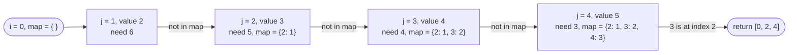

# Three Sum Indices (Hash Map, Like Two Sum)

Given an integer array `nums` and an integer `target`, return the indices of three different elements whose sum is `target`. This is Two Sum extended by one number, and the same hash map idea carries over. (For all unique triplets that sum to 0, see 3Sum.)

## Algorithm Strategy (Fix One Number, Then Run Two Sum with a Hash Map)

1. Fix the first index `i`. The remaining task is Two Sum on the elements after `i` with the target `target - nums[i]`.
2. Solve that inner Two Sum exactly like the single-pass hash map version: create an empty map from value to index, and walk `j` from `i + 1` to the end.
3. For each `j` compute the complement `target - nums[i] - nums[j]`. If the map already holds it, the indices `i`, the stored index and `j` are the answer.
4. Otherwise store `nums[j] -> j` and continue. The value is stored only after the lookup, so the same element is never used twice, and every stored index is greater than `i` and smaller than `j`.
5. If no `i` produces a match, return `{-1, -1, -1}`. A fresh map is created for every `i`, so the extra space stays `O(n)`.

## Example walkthrough

- For `nums = [1, 2, 3, 4, 5]` and `target = 9`: with `i = 0` (value 1) the inner target is 8; `j = 1` stores 2, `j = 2` stores 3, `j = 3` (value 4) needs 4 but the map holds only 2 and 3, `j = 4` (value 5) needs 3, which is stored at index 2.
- The answer is the indices `[0, 2, 4]`, the values `1 + 3 + 5 = 9`.

## Complexity Analysis

- **Time Complexity:** `O(n^2)` — One `O(n)` hash map pass for each of the `n` choices of the first index.
- **Space Complexity:** `O(n)` — The hash map of the inner pass.

## Approaches

The same problem can be solved in several ways. The approach marked (Optimized) is the one to use in practice.

### Approach 1: Brute Force (Three Nested Loops)

Try every combination of three different indices.

```java
public static int[] threeSumBrute(int[] nums, int target) {
    for (int i = 0; i < nums.length; i++) {
        for (int j = i + 1; j < nums.length; j++) {
            for (int k = j + 1; k < nums.length; k++) {
                if (nums[i] + nums[j] + nums[k] == target) return new int[]{i, j, k};
            }
        }
    }
    return new int[]{-1, -1, -1};
}
```

- **Time Complexity:** O(n^3)
- **Space Complexity:** O(1)

### Approach 2: Sort Indices and Two Pointers

Sort the indices by their values, fix one position and move two pointers inward. The pointers work on the sorted order, so the original indices come from the sorted index array. Needs `O(n log n)` for the sort but no hash map.

```java
public static int[] threeSumSorted(int[] nums, int target) {
    int n = nums.length;
    Integer[] order = new Integer[n];
    for (int i = 0; i < n; i++) order[i] = i;
    Arrays.sort(order, (a, b) -> Integer.compare(nums[a], nums[b]));
    for (int i = 0; i < n - 2; i++) {
        int left = i + 1, right = n - 1;
        while (left < right) {
            long sum = (long) nums[order[i]] + nums[order[left]] + nums[order[right]];
            if (sum == target) return new int[]{order[i], order[left], order[right]};
            if (sum < target) left++; else right--;
        }
    }
    return new int[]{-1, -1, -1};
}
```

- **Time Complexity:** O(n^2)
- **Space Complexity:** O(n) for the index array

### Approach 3: Fix One Number and Run Two Sum with a Hash Map (Optimized)

Fix the first index and apply the single-pass hash map Two Sum to the rest of the array. This is the version implemented in the repository.

```java
public static int[] threeSum(int[] nums, int target) {
    // Guard Clause: a valid triple requires at least 3 elements
    if (nums == null || nums.length < 3) {
        return new int[]{-1, -1, -1};
    }

    for (int i = 0; i < nums.length - 2; i++) {
        // Two Sum on the elements after i
        Map<Integer, Integer> valueToIndex = new HashMap<>();
        for (int j = i + 1; j < nums.length; j++) {
            int complement = target - nums[i] - nums[j];
            if (valueToIndex.containsKey(complement)) {
                return new int[]{i, valueToIndex.get(complement), j};
            }
            valueToIndex.put(nums[j], j);
        }
    }
    return new int[]{-1, -1, -1};
}
```

- **Time Complexity:** O(n^2)
- **Space Complexity:** O(n)

### Comparison

| # | Approach | Time | Space |
|---|----------|------|-------|
| 1 | Brute Force (Three Nested Loops) | O(n^3) | O(1) |
| 2 | Sort Indices and Two Pointers | O(n^2) | O(n) for the index array |
| 3 | Fix One Number and Run Two Sum with a Hash Map (Optimized) | O(n^2) | O(n) |

## Source Code

### ThreeSumIndices.java

```java
import java.util.Arrays;
import java.util.HashMap;
import java.util.Map;

public class ThreeSumIndices {

    public static void main(String[] args) {
        int[][] inputs = {{1, 2, 3, 4, 5}, {-1, 0, 1, 2, -1, -4}, {3, 3, 3}, {1, 2}};
        int[] targets = {9, 0, 9, 3};
        for (int i = 0; i < inputs.length; i++) {
            System.out.println("Input  : " + Arrays.toString(inputs[i]) + ", Target: " + targets[i]);
            System.out.println("Output : " + Arrays.toString(threeSum(inputs[i], targets[i])));
            System.out.println();
        }
    }

    public static int[] threeSum(int[] nums, int target) {
        // Guard Clause: a valid triple requires at least 3 elements
        if (nums == null || nums.length < 3) {
            return new int[]{-1, -1, -1};
        }

        for (int i = 0; i < nums.length - 2; i++) {
            // Two Sum on the elements after i
            Map<Integer, Integer> valueToIndex = new HashMap<>();
            for (int j = i + 1; j < nums.length; j++) {
                int complement = target - nums[i] - nums[j];
                if (valueToIndex.containsKey(complement)) {
                    return new int[]{i, valueToIndex.get(complement), j};
                }
                valueToIndex.put(nums[j], j);
            }
        }
        return new int[]{-1, -1, -1};
    }
}
```

## Solution

The optimized solution is Approach 3 above, which is also the version implemented in this repository.

The idea: fix one index `i`, then solve Two Sum on the elements after it. For each `j > i` the number needed is `target - nums[i] - nums[j]`; if it is already in the map of values seen after `i`, a triple is found. The lookup happens before `nums[j]` is stored, so an index is never used twice. The map is rebuilt for every `i`. No sorting is done, so the original indices are kept.

**Input:** `nums = [1, 2, 3, 4, 5]`, `target = 9`.

| Step | `i` | `j` | `nums[i]`, `nums[j]` | Needed (`9 - nums[i] - nums[j]`) | Map before lookup | Action |
|------|-----|-----|----------------------|---------------------------------|-------------------|--------|
| 1 | 0 | 1 | 1, 2 | 6 | `{}` | not found, store `2 -> 1` |
| 2 | 0 | 2 | 1, 3 | 5 | `{2=1}` | not found, store `3 -> 2` |
| 3 | 0 | 3 | 1, 4 | 4 | `{2=1, 3=2}` | not found, store `4 -> 3` |
| 4 | 0 | 4 | 1, 5 | 3 | `{2=1, 3=2, 4=3}` | `3` is at index 2: **return `[0, 2, 4]`** |

`1 + 3 + 5 = 9`. The loop stops at step 4, so `i = 1, 2` are never tried.



**Edge cases.** `null` or fewer than 3 numbers returns `[-1, -1, -1]`, and so does an array with no valid triple. `[3, 3, 3]` with target 9 works: at `i = 0, j = 1` the map is empty, `3 -> 1` is stored; at `j = 2` the needed `3` is found at index 1, giving `[0, 1, 2]`.

**Result:** `[0, 2, 4]`, matching the class output.
