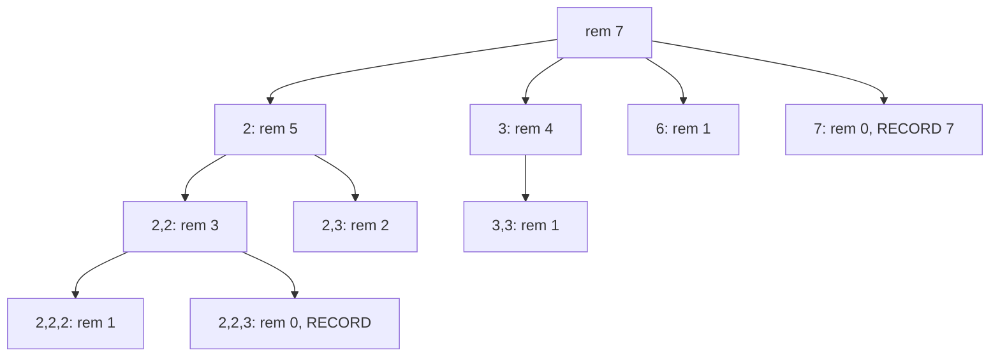

# Combination Sum

Given an array of distinct integers `candidates` and a `target`, return all unique combinations of candidates that sum to the target (a candidate may be used any number of times). A second method also solves the variant printed in the Blind 75 PDF, which only counts the ordered ways to reach the target.

## Algorithm Strategy (Backtracking (and DP for the Counting Variant))

1. Sort the candidates so the search can stop as soon as a candidate exceeds the remaining target.
2. Backtrack with a start index: at each step try every candidate from `start` onwards, add it to the current combination and recurse with the reduced remaining target. Passing the same index again allows reusing a candidate; never going back to smaller indexes prevents duplicate combinations in a different order.
3. When the remaining target is 0, record a copy of the current combination; when a candidate is larger than the remaining target, stop the loop.
4. Counting variant (ordered sequences, e.g. 1+1+2 and 2+1+1 count separately): `ways[t] = sum(ways[t - c])` over all candidates `c <= t`, with `ways[0] = 1`.

## Example walkthrough

- For `[2, 3, 6, 7]` and target 7: the combinations are `[2, 2, 3]` and `[7]`.
- For `[1, 2, 3]` and target 4 the counting variant gives `7` ordered sequences.

## Complexity Analysis

- **Time Complexity:** `O(N^(T/M))` — Backtracking: `N` candidates, target `T`, smallest candidate `M`; the counting variant is `O(T * N)`.
- **Space Complexity:** `O(T/M)` — Recursion depth (the counting variant uses `O(T)`).

## Approaches

The same problem can be solved in several ways. The approach marked (Optimized) is the one to use in practice.

### Approach 1: Backtracking Without Sorting

Try every candidate at every step, restricted to indexes not smaller than the last chosen one (to avoid permutations of the same combination). It cannot stop early, because without sorting a later candidate may still fit.

```java
public static List<List<Integer>> combinationSumPlain(int[] candidates, int target) {
    List<List<Integer>> result = new ArrayList<>();
    search(candidates, target, 0, new ArrayList<>(), result);
    return result;
}

private static void search(int[] candidates, int remaining, int start, List<Integer> current, List<List<Integer>> result) {
    if (remaining < 0) return;
    if (remaining == 0) { result.add(new ArrayList<>(current)); return; }
    for (int i = start; i < candidates.length; i++) {
        current.add(candidates[i]);
        search(candidates, remaining - candidates[i], i, current, result);
        current.remove(current.size() - 1);
    }
}
```

- **Time Complexity:** O(N^(T/M))
- **Space Complexity:** O(T/M)

### Approach 2: Backtracking with Sorted Candidates and Early Stop (Optimized)

Sort the candidates so the loop can stop at the first candidate larger than the remaining target, which prunes whole branches. This is the version implemented in the repository.

```java
public static List<List<Integer>> combinationSum(int[] candidates, int target) {
    List<List<Integer>> result = new ArrayList<>();
    int[] sorted = candidates.clone();
    Arrays.sort(sorted);
    backtrack(sorted, target, 0, new ArrayList<>(), result);
    return result;
}

private static void backtrack(int[] candidates, int remaining, int start, List<Integer> current, List<List<Integer>> result) {
    if (remaining == 0) { result.add(new ArrayList<>(current)); return; }
    for (int i = start; i < candidates.length && candidates[i] <= remaining; i++) {
        current.add(candidates[i]);
        backtrack(candidates, remaining - candidates[i], i, current, result);
        current.remove(current.size() - 1);
    }
}
```

- **Time Complexity:** O(N^(T/M)) with pruning
- **Space Complexity:** O(T/M)

### Approach 3: Dynamic Programming over Targets (All Combinations)

For every sum `t`, store the combinations that reach it. Processing the candidates in the outer loop keeps each combination in non-decreasing order, so there are no duplicates. Easy to extend, but it stores many intermediate lists.

```java
public static List<List<Integer>> combinationSumDp(int[] candidates, int target) {
    List<List<List<Integer>>> dp = new ArrayList<>();
    for (int t = 0; t <= target; t++) dp.add(new ArrayList<>());
    dp.get(0).add(new ArrayList<>());
    int[] sorted = candidates.clone();
    Arrays.sort(sorted);
    for (int candidate : sorted) {
        for (int t = candidate; t <= target; t++) {
            for (List<Integer> combination : dp.get(t - candidate)) {
                List<Integer> extended = new ArrayList<>(combination);
                extended.add(candidate);
                dp.get(t).add(extended);
            }
        }
    }
    return dp.get(target);
}
```

- **Time Complexity:** O(N * T * C) where C is the number of combinations
- **Space Complexity:** O(T * C)

### Approach 4: Counting Variant: Ordered Sequences (DP)

The Blind 75 PDF prints the counting version of the problem (different orders count separately): `ways[t] = sum(ways[t - c])`. This is `combinationSum4` in the repository class.

```java
public static int combinationSum4(int[] nums, int target) {
    int[] ways = new int[target + 1];
    ways[0] = 1;
    for (int t = 1; t <= target; t++) {
        for (int num : nums) {
            if (num <= t) ways[t] += ways[t - num];
        }
    }
    return ways[target];
}
```

- **Time Complexity:** O(T * N)
- **Space Complexity:** O(T)

### Comparison

| # | Approach | Time | Space |
|---|----------|------|-------|
| 1 | Backtracking Without Sorting | O(N^(T/M)) | O(T/M) |
| 2 | Backtracking with Sorted Candidates and Early Stop (Optimized) | O(N^(T/M)) with pruning | O(T/M) |
| 3 | Dynamic Programming over Targets (All Combinations) | O(N * T * C) where C is the number of combinations | O(T * C) |
| 4 | Counting Variant: Ordered Sequences (DP) | O(T * N) | O(T) |

### Optimized Solution

The optimized solution is Approach 2 above. The version implemented in this repository is Approach 2 and 4.

#### Optimized solution explained

The idea: sort the candidates, then build combinations by choosing a candidate, subtracting it from `remaining` and recursing from the same index `i` (so a number can be reused) but never from an earlier index (so `[2, 3]` and `[3, 2]` are not both produced). Because the array is sorted, the loop stops as soon as `candidates[i] > remaining`: every later candidate is bigger too. When `remaining == 0` the path is recorded.

**Input:** `candidates = [2, 3, 6, 7]`, `target = 7`.

| Step | Path | `remaining` | What happens |
|------|------|-------------|--------------|
| 1 | `[2]` | 5 | add 2 |
| 2 | `[2, 2]` | 3 | add 2 |
| 3 | `[2, 2, 2]` | 1 | add 2; next candidate 2 > 1, loop stops |
| 4 | `[2, 2, 3]` | 0 | add 3 (from `[2, 2]`); record `[2, 2, 3]` |
| 5 | `[2, 2]` | 3 | next candidate 6 > 3, stop |
| 6 | `[2, 3]` | 2 | add 3 (from `[2]`); next candidate 3 > 2, stop |
| 7 | `[2]` | 5 | next candidate 6 > 5, stop |
| 8 | `[3, 3]` | 1 | `[3]` has remaining 4; add 3; next candidate 3 > 1, stop; then 6 > 4, stop |
| 9 | `[6]` | 1 | 6 > 1 stops |
| 10 | `[7]` | 0 | record `[7]` |



**Edge cases.** If no combination reaches the target (`[2]`, target `1`), the first candidate 2 > 1 stops the loop at once and the result is `[]`. The candidates are cloned before sorting.

**Counting variant** (also in this class, `combinationSum4`): `ways[t]` counts ordered sequences summing to `t`, with `ways[0] = 1`. For `nums = [1, 2, 3]`, `target = 4`: `ways[1] = 1`, `ways[2] = ways[1] + ways[0] = 2`, `ways[3] = ways[2] + ways[1] + ways[0] = 4`, `ways[4] = ways[3] + ways[2] + ways[1] = 7`.

**Result:** `combinationSum([2, 3, 6, 7], 7)` returns `[[2, 2, 3], [7]]` and `combinationSum4([1, 2, 3], 4)` returns `7`, matching the class output.

## Source Code

### CombinationSum.java

```java
import java.util.ArrayList;
import java.util.Arrays;
import java.util.List;

public class CombinationSum {

    public static void main(String[] args) {
        int[][] candidates = {{2, 3, 6, 7}, {2, 3, 5}, {2}};
        int[] targets = {7, 8, 1};
        for (int i = 0; i < candidates.length; i++) {
            System.out.println("Input  : candidates = " + Arrays.toString(candidates[i]) + ", target = " + targets[i]);
            System.out.println("Output : " + combinationSum(candidates[i], targets[i]));
            System.out.println();
        }

        int[] nums = {1, 2, 3};
        System.out.println("Input  : nums = " + Arrays.toString(nums) + ", target = 4 (count ordered combinations)");
        System.out.println("Output : " + combinationSum4(nums, 4));
    }

    public static List<List<Integer>> combinationSum(int[] candidates, int target) {
        List<List<Integer>> result = new ArrayList<>();
        int[] sorted = candidates.clone();
        Arrays.sort(sorted);
        backtrack(sorted, target, 0, new ArrayList<>(), result);
        return result;
    }

    private static void backtrack(int[] candidates, int remaining, int start, List<Integer> current, List<List<Integer>> result) {
        if (remaining == 0) {
            result.add(new ArrayList<>(current));
            return;
        }
        for (int i = start; i < candidates.length && candidates[i] <= remaining; i++) {
            current.add(candidates[i]);
            backtrack(candidates, remaining - candidates[i], i, current, result);   // i again: reuse allowed
            current.remove(current.size() - 1);
        }
    }

    /** Counts the ordered sequences of numbers that add up to the target. */
    public static int combinationSum4(int[] nums, int target) {
        int[] ways = new int[target + 1];
        ways[0] = 1;
        for (int t = 1; t <= target; t++) {
            for (int num : nums) {
                if (num <= t) {
                    ways[t] += ways[t - num];
                }
            }
        }
        return ways[target];
    }
}
```
