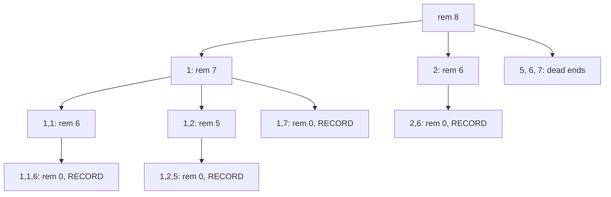

# Combination Sum II

Given a collection of candidate numbers (which may contain duplicates) and a `target`, find all unique combinations of candidates that sum to the target. Each number may be used at most once in a combination, and the solution set must not contain duplicate combinations.

## Algorithm Strategy (Sorted Backtracking with Duplicate Skipping and Pruning)

1. Sort the candidates: equal numbers become adjacent and the loop can stop early once a number exceeds the remaining target.
2. Backtrack with a start index and the remaining target; when the remaining target is 0 record a copy of the current combination.
3. Every candidate is used at most once, so recurse with `i + 1`. To avoid duplicate combinations, skip a candidate equal to the previous one at the same level (`i > start && candidates[i] == candidates[i - 1]`).
4. Break the loop when `candidates[i] > remaining`: the following numbers are even larger.

## Example walkthrough

- For `[10, 1, 2, 7, 6, 1, 5]` and target 8 (sorted `[1, 1, 2, 5, 6, 7, 10]`): `[1,1,6]`, `[1,2,5]`, `[1,7]`, `[2,6]`.
- The second 1 is only used inside `[1,1,6]`, never as an alternative first choice.

## Complexity Analysis

- **Time Complexity:** `O(2^n)` — Each candidate is either taken or skipped; pruning cuts most branches.
- **Space Complexity:** `O(n)` — Recursion depth (excluding the output).

## Approaches

The same problem can be solved in several ways. The approach marked (Optimized) is the one to use in practice.

### Approach 1: Brute Force over All Subsets

Try every subset of the sorted candidates; keep those whose sum equals the target and remove duplicate combinations with a set.

```java
public static List<List<Integer>> combinationSum2Subsets(int[] candidates, int target) {
    int[] sorted = candidates.clone();
    Arrays.sort(sorted);
    Set<List<Integer>> unique = new LinkedHashSet<>();
    for (int mask = 1; mask < (1 << sorted.length); mask++) {
        int sum = 0;
        List<Integer> subset = new ArrayList<>();
        for (int i = 0; i < sorted.length; i++) if ((mask & (1 << i)) != 0) { sum += sorted[i]; subset.add(sorted[i]); }
        if (sum == target) unique.add(subset);
    }
    return new ArrayList<>(unique);
}
```

- **Time Complexity:** O(n * 2^n)
- **Space Complexity:** O(2^n)

### Approach 2: Backtracking with a Result Set

Backtrack over the sorted candidates (each used at most once) and let a `LinkedHashSet` of combinations remove the duplicates that appear because of equal candidates. Simpler than the skip logic, but explores the duplicate branches.

```java
public static List<List<Integer>> combinationSum2Set(int[] candidates, int target) {
    int[] sorted = candidates.clone();
    Arrays.sort(sorted);
    Set<List<Integer>> unique = new LinkedHashSet<>();
    search(sorted, target, 0, new ArrayList<>(), unique);
    return new ArrayList<>(unique);
}

private static void search(int[] a, int remaining, int start, List<Integer> current, Set<List<Integer>> unique) {
    if (remaining == 0) { unique.add(new ArrayList<>(current)); return; }
    for (int i = start; i < a.length && a[i] <= remaining; i++) {
        current.add(a[i]);
        search(a, remaining - a[i], i + 1, current, unique);
        current.remove(current.size() - 1);
    }
}
```

- **Time Complexity:** O(2^n)
- **Space Complexity:** O(2^n)

### Approach 3: Count Map of Distinct Values

Group equal candidates into `(value, count)` pairs and decide how many copies (0 to `count`) of each value to use. A multiset is determined by its counts, so no duplicates are produced.

```java
public static List<List<Integer>> combinationSum2Counts(int[] candidates, int target) {
    TreeMap<Integer, Integer> counts = new TreeMap<>();
    for (int c : candidates) counts.merge(c, 1, Integer::sum);
    List<int[]> values = new ArrayList<>();
    for (Map.Entry<Integer, Integer> e : counts.entrySet()) values.add(new int[]{e.getKey(), e.getValue()});
    List<List<Integer>> result = new ArrayList<>();
    pick(values, 0, target, new ArrayList<>(), result);
    return result;
}

private static void pick(List<int[]> values, int index, int remaining, List<Integer> current, List<List<Integer>> result) {
    if (remaining == 0) { result.add(new ArrayList<>(current)); return; }
    if (index == values.size() || values.get(index)[0] > remaining) return;
    int value = values.get(index)[0], count = values.get(index)[1];
    for (int copies = 0; copies <= count && copies * value <= remaining; copies++) {
        for (int i = 0; i < copies; i++) current.add(value);
        pick(values, index + 1, remaining - copies * value, current, result);
        for (int i = 0; i < copies; i++) current.remove(current.size() - 1);
    }
}
```

- **Time Complexity:** O(2^n)
- **Space Complexity:** O(n)

### Approach 4: Sorted Backtracking with Duplicate Skipping and Pruning (Optimized)

Sort the candidates, skip a candidate equal to the previous one at the same level, and stop the loop as soon as a candidate exceeds the remaining target. This is the version implemented in the repository.

```java
public static List<List<Integer>> combinationSum2(int[] candidates, int target) {
    int[] sorted = candidates.clone();
    Arrays.sort(sorted);
    List<List<Integer>> result = new ArrayList<>();
    backtrack(sorted, target, 0, new ArrayList<>(), result);
    return result;
}

private static void backtrack(int[] a, int remaining, int start, List<Integer> current, List<List<Integer>> result) {
    if (remaining == 0) { result.add(new ArrayList<>(current)); return; }
    for (int i = start; i < a.length; i++) {
        if (a[i] > remaining) break;
        if (i > start && a[i] == a[i - 1]) continue;
        current.add(a[i]);
        backtrack(a, remaining - a[i], i + 1, current, result);
        current.remove(current.size() - 1);
    }
}
```

- **Time Complexity:** O(2^n)
- **Space Complexity:** O(n)

### Comparison

| # | Approach | Time | Space |
|---|----------|------|-------|
| 1 | Brute Force over All Subsets | O(n * 2^n) | O(2^n) |
| 2 | Backtracking with a Result Set | O(2^n) | O(2^n) |
| 3 | Count Map of Distinct Values | O(2^n) | O(n) |
| 4 | Sorted Backtracking with Duplicate Skipping and Pruning (Optimized) | O(2^n) | O(n) |

## Source Code

### CombinationSumII.java

```java
import java.util.ArrayList;
import java.util.Arrays;
import java.util.List;

public class CombinationSumII {

    public static void main(String[] args) {
        int[][] candidates = {{10, 1, 2, 7, 6, 1, 5}, {2, 5, 2, 1, 2}, {1, 1, 1}, {3, 4}};
        int[] targets = {8, 5, 2, 2};
        for (int i = 0; i < candidates.length; i++) {
            System.out.println("Input  : candidates = " + Arrays.toString(candidates[i]) + ", target = " + targets[i]);
            System.out.println("Output : " + combinationSum2(candidates[i], targets[i]));
            System.out.println();
        }
    }

    public static List<List<Integer>> combinationSum2(int[] candidates, int target) {
        int[] sorted = candidates.clone();
        Arrays.sort(sorted);
        List<List<Integer>> result = new ArrayList<>();
        backtrack(sorted, target, 0, new ArrayList<>(), result);
        return result;
    }

    private static void backtrack(int[] candidates, int remaining, int start, List<Integer> current, List<List<Integer>> result) {
        if (remaining == 0) {
            result.add(new ArrayList<>(current));
            return;
        }
        for (int i = start; i < candidates.length; i++) {
            if (candidates[i] > remaining) {
                break;                                      // all following numbers are larger
            }
            if (i > start && candidates[i] == candidates[i - 1]) {
                continue;                                   // skip duplicates at the same level
            }
            current.add(candidates[i]);
            backtrack(candidates, remaining - candidates[i], i + 1, current, result);
            current.remove(current.size() - 1);
        }
    }
}
```

## Solution

The optimized solution is Approach 4 above, which is also the version implemented in this repository.

The idea: sort the candidates, then pick numbers left to right with `start = i + 1` so each array element is used at most once. Two rules keep the search small and free of duplicates: `break` as soon as `candidates[i] > remaining` (everything after it is larger), and `continue` when `i > start` and the value equals its left neighbour (a second copy of a value cannot begin a new branch at the same level, but it can still follow the first copy deeper).

**Input:** `candidates = [10, 1, 2, 7, 6, 1, 5]`, `target = 8`. Sorted: `[1, 1, 2, 5, 6, 7, 10]` (indices 0-6).

| Step | Path (remaining) | Note |
|------|------------------|------|
| 1 | `[1]` (7) | take idx 0 |
| 2 | `[1, 1]` (6) | take idx 1 (`i == start`, so not skipped) |
| 3 | `[1, 1, 2]` (4) | next 5 > 4: break |
| 4 | `[1, 1, 5]` (1) | next 6 > 1: break |
| 5 | `[1, 1, 6]` (0) | record `[1, 1, 6]`; then 7 > 6: break |
| 6 | `[1, 2]` (5) | back at `[1]`; take 2 |
| 7 | `[1, 2, 5]` (0) | record `[1, 2, 5]`; then 6 > 5: break |
| 8 | `[1, 5]` (2), `[1, 6]` (1) | both end at once (next number too large) |
| 9 | `[1, 7]` (0) | record `[1, 7]`; then 10 > 7: break |
| 10 | root, idx 1 | value 1 equals idx 0 and `i > start`: skipped (it would repeat every `[1, ...]` result) |
| 11 | `[2]` (6), `[2, 5]` (1) | dead end |
| 12 | `[2, 6]` (0) | record `[2, 6]` |
| 13 | `[5]`, `[6]`, `[7]` | remaining 3, 2, 1: every continuation is too large; then 10 > 8 breaks the root loop |



**Edge cases.** If nothing reaches the target (`[3, 4]`, target `2`), the first number is larger than `remaining`, the loop breaks and the result is `[]`. `[1, 1, 1]` with target `2` returns the single combination `[1, 1]` thanks to the skip rule. The input array is cloned before sorting.

**Result:** `combinationSum2([10, 1, 2, 7, 6, 1, 5], 8)` returns `[[1, 1, 6], [1, 2, 5], [1, 7], [2, 6]]`, matching the class output.
