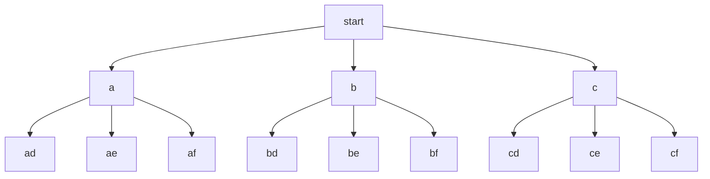

# Letter Combinations of a Phone Number

Given a string containing digits from 2 to 9, return all possible letter combinations that the number could represent on a telephone keypad (2 = abc, 3 = def, 4 = ghi, 5 = jkl, 6 = mno, 7 = pqrs, 8 = tuv, 9 = wxyz). Digit 1 maps to no letters. The answer may be returned in any order.

## Algorithm Strategy (Backtracking over the Digits)

1. Keep a lookup table from digit to letters.
2. Build a combination one digit at a time: at depth `d` try every letter of `digits.charAt(d)`, append it, recurse for the next digit and remove it again (backtrack).
3. When the combination has one letter for every digit, record it.
4. An empty input has no combination at all (the answer is an empty list, not a list containing the empty string).

## Example walkthrough

- For `"23"`: the letters of 2 are `abc`, the letters of 3 are `def`, giving `ad, ae, af, bd, be, bf, cd, ce, cf`.
- The number of results is the product of the number of letters of each digit.

## Complexity Analysis

- **Time Complexity:** `O(4^n * n)` — At most 4 letters per digit; every combination is copied in `O(n)`.
- **Space Complexity:** `O(n)` — Recursion depth (excluding the output).

## Approaches

The same problem can be solved in several ways. The approach marked (Optimized) is the one to use in practice.

### Approach 1: Queue (Breadth-First) Expansion

Start with the empty string in a queue. For every digit, remove all strings of the previous length and add each of them extended with every letter of the digit.

```java
public static List<String> letterCombinationsQueue(String digits) {
    if (digits.isEmpty()) return new ArrayList<>();
    String[] letters = {"", "", "abc", "def", "ghi", "jkl", "mno", "pqrs", "tuv", "wxyz"};
    Queue<String> queue = new LinkedList<>();
    queue.add("");
    for (char digit : digits.toCharArray()) {
        for (int i = queue.size(); i > 0; i--) {
            String prefix = queue.poll();
            for (char letter : letters[digit - '0'].toCharArray()) queue.add(prefix + letter);
        }
    }
    return new ArrayList<>(queue);
}
```

- **Time Complexity:** O(4^n * n)
- **Space Complexity:** O(4^n * n)

### Approach 2: Odometer Counter

Treat the combination as a number whose "digit" `i` ranges over the letters of the i-th phone digit. Keep an array of positions and increment it like an odometer, carrying to the left when a position wraps around.

```java
public static List<String> letterCombinationsOdometer(String digits) {
    List<String> result = new ArrayList<>();
    if (digits.isEmpty()) return result;
    String[] letters = {"", "", "abc", "def", "ghi", "jkl", "mno", "pqrs", "tuv", "wxyz"};
    int n = digits.length();
    int[] position = new int[n];
    while (true) {
        StringBuilder sb = new StringBuilder();
        for (int i = 0; i < n; i++) sb.append(letters[digits.charAt(i) - '0'].charAt(position[i]));
        result.add(sb.toString());
        int i = n - 1;
        while (i >= 0 && ++position[i] == letters[digits.charAt(i) - '0'].length()) { position[i] = 0; i--; }
        if (i < 0) return result;
    }
}
```

- **Time Complexity:** O(4^n * n)
- **Space Complexity:** O(n)

### Approach 3: Recursion Returning Lists

The combinations of a digit string are the letters of its first digit combined with the combinations of the remaining digits. A purely functional recursion with no shared mutable state.

```java
public static List<String> letterCombinationsFunctional(String digits) {
    if (digits.isEmpty()) return new ArrayList<>();
    String[] letters = {"", "", "abc", "def", "ghi", "jkl", "mno", "pqrs", "tuv", "wxyz"};
    List<String> rest = digits.length() == 1 ? Collections.singletonList("") : letterCombinationsFunctional(digits.substring(1));
    List<String> result = new ArrayList<>();
    for (char letter : letters[digits.charAt(0) - '0'].toCharArray()) {
        for (String suffix : rest) result.add(letter + suffix);
    }
    return result;
}
```

- **Time Complexity:** O(4^n * n)
- **Space Complexity:** O(4^n * n)

### Approach 4: Backtracking over the Digits (Optimized)

Append each letter of the current digit, recurse for the next digit and remove the letter again. This is the version implemented in the repository.

```java
public static List<String> letterCombinations(String digits) {
    List<String> result = new ArrayList<>();
    if (digits == null || digits.isEmpty()) return result;
    String[] letters = {"", "", "abc", "def", "ghi", "jkl", "mno", "pqrs", "tuv", "wxyz"};
    backtrack(digits, letters, 0, new StringBuilder(), result);
    return result;
}

private static void backtrack(String digits, String[] letters, int index, StringBuilder current, List<String> result) {
    if (index == digits.length()) { result.add(current.toString()); return; }
    for (char letter : letters[digits.charAt(index) - '0'].toCharArray()) {
        current.append(letter);
        backtrack(digits, letters, index + 1, current, result);
        current.deleteCharAt(current.length() - 1);
    }
}
```

- **Time Complexity:** O(4^n * n)
- **Space Complexity:** O(n)

### Comparison

| # | Approach | Time | Space |
|---|----------|------|-------|
| 1 | Queue (Breadth-First) Expansion | O(4^n * n) | O(4^n * n) |
| 2 | Odometer Counter | O(4^n * n) | O(n) |
| 3 | Recursion Returning Lists | O(4^n * n) | O(4^n * n) |
| 4 | Backtracking over the Digits (Optimized) | O(4^n * n) | O(n) |

## Source Code

### LetterCombinationsOfAPhoneNumber.java

```java
import java.util.ArrayList;
import java.util.List;

public class LetterCombinationsOfAPhoneNumber {

    private static final String[] LETTERS = {"", "", "abc", "def", "ghi", "jkl", "mno", "pqrs", "tuv", "wxyz"};

    public static void main(String[] args) {
        String[] inputs = {"23", "", "2", "79"};
        for (String digits : inputs) {
            System.out.println("Input  : digits = \"" + digits + "\"");
            System.out.println("Output : " + letterCombinations(digits));
            System.out.println();
        }
    }

    public static List<String> letterCombinations(String digits) {
        List<String> result = new ArrayList<>();
        if (digits == null || digits.isEmpty()) {
            return result;
        }
        backtrack(digits, 0, new StringBuilder(), result);
        return result;
    }

    private static void backtrack(String digits, int index, StringBuilder current, List<String> result) {
        if (index == digits.length()) {
            result.add(current.toString());
            return;
        }
        for (char letter : LETTERS[digits.charAt(index) - '0'].toCharArray()) {
            current.append(letter);
            backtrack(digits, index + 1, current, result);
            current.deleteCharAt(current.length() - 1);
        }
    }
}
```

## Solution

The optimized solution is Approach 4 above, which is also the version implemented in this repository.

The idea: each digit position is one level of recursion. At level `index` the loop tries every letter of that digit (from the `LETTERS` table), appends it to one shared `StringBuilder`, recurses to the next digit, then deletes the last character to restore the state. When `index` reaches the number of digits the string is complete and is stored. One buffer is reused, so extra memory is only the recursion depth.

**Input:** `digits = "23"` (2 = `abc`, 3 = `def`).

| Step | `index` | Buffer | Action |
|------|---------|--------|--------|
| 1 | 0 | `a` | append `a`, go to digit 3 |
| 2 | 1 | `ad` | `index == 2`: record `ad`; delete `d` |
| 3 | 1 | `ae` | record `ae`; delete `e` |
| 4 | 1 | `af` | record `af`; delete `f`, back to `a`, delete `a` |
| 5 | 0 | `b` | append `b`; then record `bd`, `be`, `bf` the same way |
| 6 | 0 | `c` | append `c`; then record `cd`, `ce`, `cf` |



**Edge cases.** `null` or empty `digits` returns an empty list (not `[""]`). A single digit `"2"` returns `[a, b, c]`. Digits `7` and `9` have four letters, so `"79"` yields 16 strings.

**Result:** `letterCombinations("23")` returns `[ad, ae, af, bd, be, bf, cd, ce, cf]`, matching the class output.
