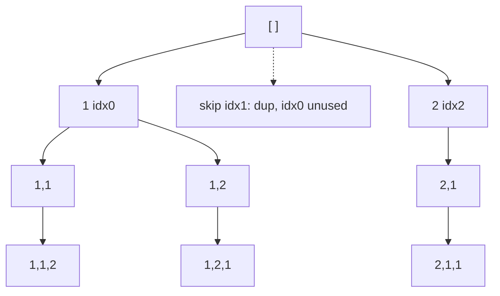

# Permutations II

Given an array `nums` that may contain duplicates, return all unique permutations in any order.

## Algorithm Strategy (Sorted Backtracking with a Duplicate Skip Rule)

1. Sort the array so that equal values sit next to each other.
2. Build a permutation position by position, marking each chosen index in a `used` array.
3. Skip `nums[i]` when it equals `nums[i - 1]` and `nums[i - 1]` is not currently used. That means the earlier twin was already tried at this position, so choosing the later one would repeat the same permutation.
4. When the current permutation has `n` elements, add a copy to the result, then undo the last choice and continue.

## Example walkthrough

- For `[1, 1, 2]` (already sorted): the first position can be the first `1`, then the second `1` is allowed (its twin is used) or `2`.
- Choosing the second `1` first is skipped because its twin is unused, so each distinct arrangement is built once.
- Result: `[[1, 1, 2], [1, 2, 1], [2, 1, 1]]`.

## Complexity Analysis

- **Time Complexity:** `O(n * n!)` — In the worst case, all values distinct: `n!` permutations, each copied in `O(n)`.
- **Space Complexity:** `O(n)` — Recursion depth, the `used` array and the current permutation, excluding the output.

## Approaches

The same problem can be solved in several ways. The approach marked (Optimized) is the one to use in practice.

### Approach 1: Generate All, Deduplicate with a Set

Generate every permutation (duplicates included) and keep the distinct ones in a set.

```java
public static List<List<Integer>> permuteUniqueSet(int[] nums) {
    Set<List<Integer>> seen = new LinkedHashSet<>();
    permute(nums, new boolean[nums.length], new ArrayList<>(), seen);
    return new ArrayList<>(seen);
}

private static void permute(int[] nums, boolean[] used, List<Integer> current, Set<List<Integer>> seen) {
    if (current.size() == nums.length) {
        seen.add(new ArrayList<>(current));
        return;
    }
    for (int i = 0; i < nums.length; i++) {
        if (used[i]) continue;
        used[i] = true;
        current.add(nums[i]);
        permute(nums, used, current, seen);
        current.remove(current.size() - 1);
        used[i] = false;
    }
}
```

- **Time Complexity:** O(n * n!) work even when few permutations are unique
- **Space Complexity:** O(n * n!) for the set

### Approach 2: Frequency Map

Count each distinct value and, at every position, try each value that still has a remaining count.

```java
public static List<List<Integer>> permuteUniqueCounts(int[] nums) {
    Map<Integer, Integer> counts = new TreeMap<>();
    for (int num : nums) counts.merge(num, 1, Integer::sum);
    List<List<Integer>> result = new ArrayList<>();
    fill(counts, nums.length, new ArrayList<>(), result);
    return result;
}

private static void fill(Map<Integer, Integer> counts, int n, List<Integer> current, List<List<Integer>> result) {
    if (current.size() == n) {
        result.add(new ArrayList<>(current));
        return;
    }
    for (Map.Entry<Integer, Integer> e : counts.entrySet()) {
        if (e.getValue() == 0) continue;
        e.setValue(e.getValue() - 1);
        current.add(e.getKey());
        fill(counts, n, current, result);
        current.remove(current.size() - 1);
        e.setValue(e.getValue() + 1);
    }
}
```

- **Time Complexity:** O(n * n!) in the worst case, and never builds a duplicate
- **Space Complexity:** O(n) plus the map

### Approach 3: Sorted Backtracking with a Skip Rule (Optimized)

Sort once and skip a value whose equal left neighbour is not in use, so duplicates are never built. This is the version implemented in the repository.

```java
public static List<List<Integer>> permuteUnique(int[] nums) {
    List<List<Integer>> result = new ArrayList<>();
    int[] sorted = nums.clone();
    Arrays.sort(sorted);
    backtrack(sorted, new boolean[sorted.length], new ArrayList<>(), result);
    return result;
}

private static void backtrack(int[] nums, boolean[] used, List<Integer> current, List<List<Integer>> result) {
    if (current.size() == nums.length) {
        result.add(new ArrayList<>(current));
        return;
    }
    for (int i = 0; i < nums.length; i++) {
        if (used[i] || (i > 0 && nums[i] == nums[i - 1] && !used[i - 1])) {
            continue;
        }
        used[i] = true;
        current.add(nums[i]);
        backtrack(nums, used, current, result);
        current.remove(current.size() - 1);
        used[i] = false;
    }
}
```

- **Time Complexity:** O(n * n!)
- **Space Complexity:** O(n)

### Comparison

| # | Approach | Time | Space |
|---|----------|------|-------|
| 1 | Generate All, Deduplicate with a Set | O(n * n!) work even when few permutations are unique | O(n * n!) for the set |
| 2 | Frequency Map | O(n * n!) in the worst case, and never builds a duplicate | O(n) plus the map |
| 3 | Sorted Backtracking with a Skip Rule (Optimized) | O(n * n!) | O(n) |

### Optimized Solution

The optimized solution is Approach 3 above, which is also the version implemented in this repository.

#### Optimized solution explained

The idea: the same used-array permutation search as Permutations, on a sorted copy so equal values are neighbours. The skip rule `i > 0 && nums[i] == nums[i - 1] && !used[i - 1]` means: a copy of a value may only be placed if the copy before it is already in the path. That forces equal values to be used left to right, so each distinct arrangement is generated once.

**Input:** `nums = [1, 1, 2]` (sorted indices: 0 = 1, 1 = 1, 2 = 2).

| Step | Action | Path | Result so far |
|------|--------|------|---------------|
| 1 | choose idx 0 (1) | `[1]` | |
| 2 | choose idx 1 (1): previous copy is used, allowed | `[1, 1]` | |
| 3 | choose idx 2 (2), full | `[1, 1, 2]` | record `[1, 1, 2]` |
| 4 | undo; choose idx 2 (2) | `[1, 2]` | |
| 5 | choose idx 1 (1), full | `[1, 2, 1]` | record `[1, 2, 1]` |
| 6 | undo to `[]`; idx 1 skipped (equals idx 0 and idx 0 unused) | `[]` | |
| 7 | choose idx 2 (2) | `[2]` | |
| 8 | choose idx 0 (1), then idx 1 (1), full | `[2, 1, 1]` | record `[2, 1, 1]` |
| 9 | undo back to `[2]`: idx 1 is skipped (equals idx 0, which is unused again); done | `[2]` | |



**Edge cases.** The array is cloned and sorted, so the input is untouched. `[2, 2, 2]` produces the single permutation `[2, 2, 2]`; `[1]` produces `[[1]]`. For an empty array the root already has full length and the result is `[[]]`.

**Result:** `permuteUnique([1, 1, 2])` returns `[[1, 1, 2], [1, 2, 1], [2, 1, 1]]`, matching the class output.

## Source Code

### PermutationsII.java

```java
import java.util.ArrayList;
import java.util.Arrays;
import java.util.List;

public class PermutationsII {

    public static void main(String[] args) {
        int[][] inputs = {{1, 1, 2}, {1, 2, 3}, {2, 2, 2}, {1}};
        for (int[] nums : inputs) {
            System.out.println("Input  : nums = " + Arrays.toString(nums));
            System.out.println("Output : " + permuteUnique(nums));
            System.out.println();
        }
    }

    public static List<List<Integer>> permuteUnique(int[] nums) {
        List<List<Integer>> result = new ArrayList<>();
        int[] sorted = nums.clone();
        Arrays.sort(sorted);
        backtrack(sorted, new boolean[sorted.length], new ArrayList<>(), result);
        return result;
    }

    private static void backtrack(int[] nums, boolean[] used, List<Integer> current, List<List<Integer>> result) {
        if (current.size() == nums.length) {
            result.add(new ArrayList<>(current));
            return;
        }
        for (int i = 0; i < nums.length; i++) {
            if (used[i] || (i > 0 && nums[i] == nums[i - 1] && !used[i - 1])) {
                continue;
            }
            used[i] = true;
            current.add(nums[i]);
            backtrack(nums, used, current, result);
            current.remove(current.size() - 1);
            used[i] = false;
        }
    }
}
```
