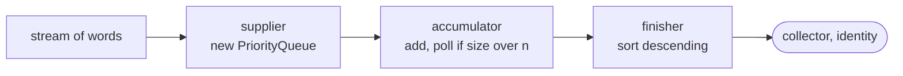

# Custom Functional Interface and Collector

Write a custom functional interface (`TriFunction`) and two custom stream collectors: `summarizing`, which computes count, sum, min, max and average in one pass, and `topN`, which keeps only the `n` largest elements without sorting the whole stream. Both must work for sequential and parallel streams.

## Algorithm Strategy (Collector.of with a Mutable Accumulator and a Combiner)

1. A collector has four parts: a `supplier` that creates an empty mutable container, an `accumulator` that folds one element into it, a `combiner` that merges two containers (used by parallel streams) and an optional `finisher` that converts the container into the result.
2. `summarizing` uses a small mutable `Stats` object as the container. `accept` updates count, sum, min and max, and `combine` adds another `Stats` into this one, so partial results from parallel threads can be merged.
3. `topN` uses a `PriorityQueue` ordered by the comparator, so its head is the smallest of the elements kept so far. After each add, if the queue holds more than `n` elements, the head is removed. The combiner offers the elements of one queue to the other, and the finisher copies the queue into a list sorted from largest to smallest.
4. `TriFunction` is a custom `@FunctionalInterface` with one abstract method of three arguments and a default `andThen` method that composes it with a `Function`, the same way `BiFunction.andThen` works.
5. Each parallel thread fills its own container, so no locking is needed. This only works because the accumulator and combiner never share state between containers.

## Example walkthrough

- For the words `map, collector, stream, on, identity` (lengths 3, 9, 6, 2, 8): `summarizing` gives count `5`, sum `28`, min `2`, max `9`, average `5.6`.
- `topN(2, byLength)` offers every word to a min-heap of size 2: after `collector` and `stream` the heap holds 9 and 6; `identity` (8) pushes the heap to three and the smallest (6) is removed, so the heap ends as 8 and 9. The finisher returns `[collector, identity]`.
- `volume.andThen(v -> "volume=" + v).apply(2, 3, 4)` computes `24` and then formats it: `volume=24`.

## Complexity Analysis

- **Time Complexity:** `O(n) for summarizing, O(n log k) for topN` — `topN` does one heap operation of cost `O(log k)` per element, `k` being the requested size.
- **Space Complexity:** `O(1) for summarizing, O(k) for topN` — The accumulators hold only the statistics or the `k` kept elements.

## Approaches

The same problem can be solved in several ways. The approach marked (Optimized) is the one to use in practice.

### Approach 1: Plain Loop

Fold the values by hand. It is the simplest and fastest for one thread, but it cannot be dropped into a stream pipeline or run in parallel.

```java
public static int[] statsLoop(List<Integer> values) {
    long sum = 0;
    int min = Integer.MAX_VALUE, max = Integer.MIN_VALUE;
    for (int v : values) {
        sum += v;
        min = Math.min(min, v);
        max = Math.max(max, v);
    }
    return new int[]{values.size(), (int) sum, min, max};
}
```

- **Time Complexity:** O(n)
- **Space Complexity:** O(1)

### Approach 2: Built-in summaryStatistics and Sort-then-Limit

The JDK already has `IntSummaryStatistics` for the statistics. For the top `n` the usual stream idiom sorts everything and takes the first `n`, which buffers the whole stream and costs `O(n log n)`.

```java
public static IntSummaryStatistics statsBuiltIn(List<Integer> values) {
    return values.stream().mapToInt(Integer::intValue).summaryStatistics();
}

public static List<Integer> topNSorted(List<Integer> values, int n) {
    return values.stream().sorted(Comparator.reverseOrder()).limit(n).collect(Collectors.toList());
}
```

- **Time Complexity:** O(n) for the statistics, O(n log n) for the top n
- **Space Complexity:** O(1) for the statistics, O(n) for the sorted stream

### Approach 3: Collector.of with Mutable Accumulators (Optimized)

Package the one-pass aggregation as a `Collector` with an accumulator and a combiner, so it works in any stream, sequential or parallel. This is the version implemented in the repository.

```java
@FunctionalInterface
public interface TriFunction<A, B, C, R> {
    R apply(A a, B b, C c);

    default <V> TriFunction<A, B, C, V> andThen(Function<? super R, ? extends V> after) {
        Objects.requireNonNull(after);
        return (a, b, c) -> after.apply(apply(a, b, c));
    }
}

public static final class Stats {
    private long count;
    private long sum;
    private int min = Integer.MAX_VALUE;
    private int max = Integer.MIN_VALUE;

    void accept(int value) {
        count++;
        sum += value;
        min = Math.min(min, value);
        max = Math.max(max, value);
    }

    Stats combine(Stats other) {
        count += other.count;
        sum += other.sum;
        min = Math.min(min, other.min);
        max = Math.max(max, other.max);
        return this;
    }

    public long getCount() { return count; }
    public long getSum() { return sum; }
    public int getMin() { return min; }
    public int getMax() { return max; }
    public double getAverage() { return count == 0 ? 0.0 : (double) sum / count; }

    @Override
    public String toString() {
        return "count=" + count + ", sum=" + sum + ", min=" + min + ", max=" + max + ", avg=" + getAverage();
    }
}

public static <T> Collector<T, ?, Stats> summarizing(ToIntFunction<? super T> mapper) {
    return Collector.of(
            Stats::new,
            (stats, element) -> stats.accept(mapper.applyAsInt(element)),
            Stats::combine);
}

public static <T> Collector<T, ?, List<T>> topN(int n, Comparator<? super T> comparator) {
    return Collector.of(
            () -> new PriorityQueue<T>(Math.max(1, n + 1), comparator),
            (heap, element) -> {
                heap.add(element);
                if (heap.size() > n) {
                    heap.poll();
                }
            },
            (left, right) -> {
                for (T element : right) {
                    left.add(element);
                    if (left.size() > n) {
                        left.poll();
                    }
                }
                return left;
            },
            heap -> {
                List<T> result = new ArrayList<>(heap);
                result.sort(comparator.reversed());
                return result;
            });
}
```

- **Time Complexity:** O(n) and O(n log k)
- **Space Complexity:** O(1) and O(k)

### Comparison

| # | Approach | Time | Space |
|---|----------|------|-------|
| 1 | Plain Loop | O(n) | O(1) |
| 2 | Built-in summaryStatistics and Sort-then-Limit | O(n) for the statistics, O(n log n) for the top n | O(1) for the statistics, O(n) for the sorted stream |
| 3 | Collector.of with Mutable Accumulators (Optimized) | O(n) and O(n log k) | O(1) and O(k) |

## Source Code

### CustomCollectors.java

```java
import java.util.ArrayList;
import java.util.Arrays;
import java.util.Comparator;
import java.util.List;
import java.util.Objects;
import java.util.PriorityQueue;
import java.util.function.Function;
import java.util.function.ToIntFunction;
import java.util.stream.Collector;

public class CustomCollectors {

    public static void main(String[] args) {
        List<String> words = Arrays.asList("map", "collector", "stream", "on", "identity");
        System.out.println("Input  : words = " + words);
        System.out.println("Output : " + words.stream().collect(summarizing(String::length)));
        System.out.println("Output : " + words.stream().collect(topN(2, Comparator.comparingInt(String::length))));

        System.out.println();

        TriFunction<Integer, Integer, Integer, Integer> volume = (l, w, h) -> l * w * h;
        System.out.println("Input  : volume(2, 3, 4) composed with a formatter");
        System.out.println("Output : " + volume.andThen(v -> "volume=" + v).apply(2, 3, 4));
    }

    @FunctionalInterface
    public interface TriFunction<A, B, C, R> {
        R apply(A a, B b, C c);

        default <V> TriFunction<A, B, C, V> andThen(Function<? super R, ? extends V> after) {
            Objects.requireNonNull(after);
            return (a, b, c) -> after.apply(apply(a, b, c));
        }
    }

    public static final class Stats {
        private long count;
        private long sum;
        private int min = Integer.MAX_VALUE;
        private int max = Integer.MIN_VALUE;

        void accept(int value) {
            count++;
            sum += value;
            min = Math.min(min, value);
            max = Math.max(max, value);
        }

        Stats combine(Stats other) {
            count += other.count;
            sum += other.sum;
            min = Math.min(min, other.min);
            max = Math.max(max, other.max);
            return this;
        }

        public long getCount() { return count; }
        public long getSum() { return sum; }
        public int getMin() { return min; }
        public int getMax() { return max; }
        public double getAverage() { return count == 0 ? 0.0 : (double) sum / count; }

        @Override
        public String toString() {
            return "count=" + count + ", sum=" + sum + ", min=" + min + ", max=" + max + ", avg=" + getAverage();
        }
    }

    public static <T> Collector<T, ?, Stats> summarizing(ToIntFunction<? super T> mapper) {
        return Collector.of(
                Stats::new,
                (stats, element) -> stats.accept(mapper.applyAsInt(element)),
                Stats::combine);
    }

    public static <T> Collector<T, ?, List<T>> topN(int n, Comparator<? super T> comparator) {
        return Collector.of(
                () -> new PriorityQueue<T>(Math.max(1, n + 1), comparator),
                (heap, element) -> {
                    heap.add(element);
                    if (heap.size() > n) {
                        heap.poll();
                    }
                },
                (left, right) -> {
                    for (T element : right) {
                        left.add(element);
                        if (left.size() > n) {
                            left.poll();
                        }
                    }
                    return left;
                },
                heap -> {
                    List<T> result = new ArrayList<>(heap);
                    result.sort(comparator.reversed());
                    return result;
                });
    }
}
```

## Solution

The optimized solution is Approach 3 above, which is also the version implemented in this repository.

The idea: a `Collector` is four small functions: a **supplier** that creates an empty mutable container, an **accumulator** that folds one element into it, a **combiner** that merges two containers (used only by parallel streams), and an optional **finisher** that turns the container into the final result. `Collector.of(...)` builds one from those functions, so the stream does one pass and keeps only the small container. The class has two: `summarizing(mapper)` keeps a `Stats` object (count, sum, min, max) updated in place, and `topN(n, comparator)` keeps a **min-heap capped at `n`** (a `PriorityQueue` whose head is the weakest element kept), dropping the head whenever the size passes `n`.

**Input:** `words = [map, collector, stream, on, identity]` (lengths 3, 9, 6, 2, 8).

`summarizing(String::length)`, starting from count 0, sum 0, min `Integer.MAX_VALUE`, max `Integer.MIN_VALUE`:

| Step | Element | Length | count | sum | min | max |
|------|---------|--------|-------|-----|-----|-----|
| 1 | map | 3 | 1 | 3 | 3 | 3 |
| 2 | collector | 9 | 2 | 12 | 3 | 9 |
| 3 | stream | 6 | 3 | 18 | 3 | 9 |
| 4 | on | 2 | 4 | 20 | 2 | 9 |
| 5 | identity | 8 | 5 | 28 | 2 | 9 |

The average is `28 / 5 = 5.6`.

`topN(2, comparingInt(String::length))`, a min-heap by length holding at most 2 words:

| Step | Element | After `add` | Size over 2? | Heap contents afterwards (the set) |
|------|---------|-------------|--------------|-------------------------------------|
| 1 | map (3) | 1 element | no | map |
| 2 | collector (9) | 2 elements | no | map, collector |
| 3 | stream (6) | 3 elements | yes: `poll()` removes the smallest, map (3) | stream, collector |
| 4 | on (2) | 3 elements | yes: removes on (2) | stream, collector |
| 5 | identity (8) | 3 elements | yes: removes stream (6) | identity, collector |

The finisher copies the heap into a list and sorts it with `comparator.reversed()` (longest first): `[collector, identity]`.



The combiner is used only when the stream is parallel, so it is not exercised by this sequential run; it merges two heaps the same way (add each element, drop the smallest if over `n`). The class also holds a `TriFunction` with a default `andThen`, and `volume.andThen(v -> "volume=" + v).apply(2, 3, 4)` computes `2 * 3 * 4 = 24` and formats it as `volume=24`.

**Edge cases.** An empty stream gives `Stats` with count 0 (and `getAverage()` returns `0.0` instead of dividing by zero, though min and max keep their sentinel values) and an empty list for `topN`. The heap capacity is `Math.max(1, n + 1)`, so `n = 0` still works and keeps nothing. Memory is O(1) for `summarizing` and O(n) for `topN`, and each element costs O(log n).

**Result:** the class prints `count=5, sum=28, min=2, max=9, avg=5.6`, `[collector, identity]` and `volume=24`, matching the traces.
