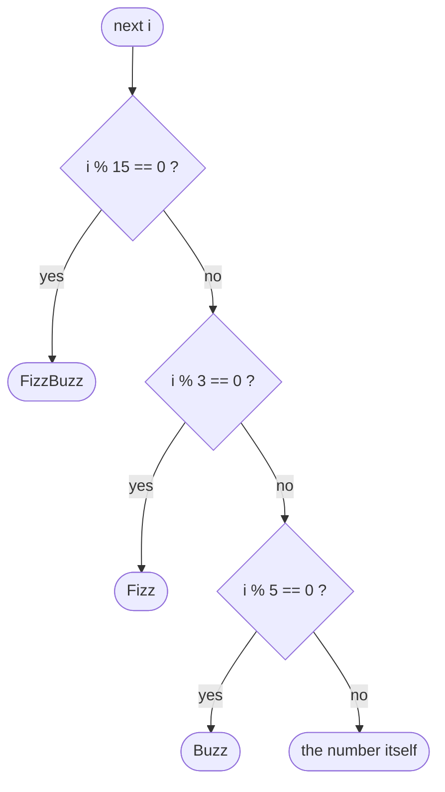

# FizzBuzz

For the numbers from 1 to `n` produce `"Fizz"` for multiples of 3, `"Buzz"` for multiples of 5, `"FizzBuzz"` for multiples of both and the number itself otherwise.

## Algorithm Strategy (Single Pass with Modulo Checks)

1. Loop `i` from 1 to `n`.
2. Check the combined case first: if `i % 15 == 0` (divisible by both 3 and 5) the word is `"FizzBuzz"`.
3. Otherwise, if `i % 3 == 0` the word is `"Fizz"`, and if `i % 5 == 0` it is `"Buzz"`.
4. In every other case the word is the number `i` written as a string. Collect the words in order.

## Example walkthrough

- For `n = 15`: `1, 2, Fizz, 4, Buzz, Fizz, 7, 8, Fizz, Buzz, 11, Fizz, 13, 14, FizzBuzz`.
- Checking `i % 15` before the single checks is what makes 15 print `FizzBuzz` instead of just `Fizz`.

## Complexity Analysis

- **Time Complexity:** `O(n)` — Constant work per number.
- **Space Complexity:** `O(n)` — The returned list of `n` words.

## Approaches

The same problem can be solved in several ways. The approach marked (Optimized) is the one to use in practice.

### Approach 1: Divisibility by 15 First (Optimized)

Check the combined case first, then 3 and 5.

```java
public static List<String> fizzBuzzCombined(int n) {
    List<String> words = new ArrayList<>();
    for (int i = 1; i <= n; i++) {
        if (i % 15 == 0) words.add("FizzBuzz");
        else if (i % 3 == 0) words.add("Fizz");
        else if (i % 5 == 0) words.add("Buzz");
        else words.add(String.valueOf(i));
    }
    return words;
}
```

- **Time Complexity:** O(n)
- **Space Complexity:** O(n)

### Approach 2: Concatenate the Words

Append `Fizz` and `Buzz` independently so a new divisor only needs one more line.

```java
public static List<String> fizzBuzz(int n) {
    List<String> words = new ArrayList<>();
    for (int i = 1; i <= n; i++) {
        String word = "";
        if (i % 3 == 0) word += "Fizz";
        if (i % 5 == 0) word += "Buzz";
        words.add(word.isEmpty() ? String.valueOf(i) : word);
    }
    return words;
}
```

- **Time Complexity:** O(n)
- **Space Complexity:** O(n)

### Approach 3: Counters Instead of Modulo

Keep two countdown counters so no division is needed.

```java
public static List<String> fizzBuzzCounters(int n) {
    List<String> words = new ArrayList<>();
    int threes = 0, fives = 0;
    for (int i = 1; i <= n; i++) {
        threes++;
        fives++;
        if (threes == 3 && fives == 5) { words.add("FizzBuzz"); threes = 0; fives = 0; }
        else if (threes == 3) { words.add("Fizz"); threes = 0; }
        else if (fives == 5) { words.add("Buzz"); fives = 0; }
        else words.add(String.valueOf(i));
    }
    return words;
}
```

- **Time Complexity:** O(n)
- **Space Complexity:** O(n)

### Approach 4: Streams

Describe the mapping declaratively with `IntStream`.

```java
public static List<String> fizzBuzzStream(int n) {
    return IntStream.rangeClosed(1, n)
            .mapToObj(i -> i % 15 == 0 ? "FizzBuzz" : i % 3 == 0 ? "Fizz" : i % 5 == 0 ? "Buzz" : String.valueOf(i))
            .collect(Collectors.toList());
}
```

- **Time Complexity:** O(n)
- **Space Complexity:** O(n)

### Comparison

| # | Approach | Time | Space |
|---|----------|------|-------|
| 1 | Divisibility by 15 First | O(n) | O(n) |
| 2 | Concatenate the Words | O(n) | O(n) |
| 3 | Counters Instead of Modulo | O(n) | O(n) |
| 4 | Streams | O(n) | O(n) |

## Source Code

### FizzBuzz.java

```java
import java.util.ArrayList;
import java.util.List;

public class FizzBuzz {

    public static void main(String[] args) {
        int[] inputs = {1, 5, 15};
        for (int n : inputs) {
            System.out.println("Input  : n = " + n);
            System.out.println("Output : " + fizzBuzz(n));
            System.out.println();
        }
    }

    public static List<String> fizzBuzz(int n) {
        List<String> words = new ArrayList<>();
        for (int i = 1; i <= n; i++) {
            if (i % 15 == 0) {
                words.add("FizzBuzz");
            } else if (i % 3 == 0) {
                words.add("Fizz");
            } else if (i % 5 == 0) {
                words.add("Buzz");
            } else {
                words.add(String.valueOf(i));
            }
        }
        return words;
    }
}
```

## Solution

The optimized solution is Approach 1 above (divisibility by 15 checked first), which is also the version implemented in this repository.

The idea: for each number from 1 to `n`, decide which word it becomes. The order of the checks matters: a multiple of 15 is a multiple of both 3 and 5, so `i % 15 == 0` must be tested **first**, otherwise `15` would be caught by the `% 3` check and wrongly become `Fizz`.

**Input:** `n = 15`.

| `i` | `i % 15 == 0` | `i % 3 == 0` | `i % 5 == 0` | Word added |
|-----|---------------|--------------|--------------|------------|
| 1 | no | no | no | `1` |
| 2 | no | no | no | `2` |
| 3 | no | yes | | `Fizz` |
| 4 | no | no | no | `4` |
| 5 | no | no | yes | `Buzz` |
| 6 | no | yes | | `Fizz` |
| 7 | no | no | no | `7` |
| 8 | no | no | no | `8` |
| 9 | no | yes | | `Fizz` |
| 10 | no | no | yes | `Buzz` |
| 11 | no | no | no | `11` |
| 12 | no | yes | | `Fizz` |
| 13 | no | no | no | `13` |
| 14 | no | no | no | `14` |
| 15 | **yes** | | | `FizzBuzz` |

An empty cell means the check was never evaluated, because an earlier `if` / `else if` already matched. The result is `[1, 2, Fizz, 4, Buzz, Fizz, 7, 8, Fizz, Buzz, 11, Fizz, 13, 14, FizzBuzz]`.



**Edge cases.** For `n = 0` or a negative `n` the loop never runs and the method returns an empty list. There is no input to guard against beyond that, and each number costs at most three modulo checks, so the whole method is `O(n)`.
