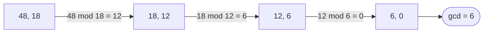

# GCD and LCM

Find the greatest common divisor (GCD, the largest number that divides both) and the least common multiple (LCM, the smallest positive number divisible by both) of two integers.

## Algorithm Strategy (Euclidean Algorithm)

1. The GCD does not change if the larger number is replaced by the remainder of dividing it by the smaller one: `gcd(a, b) = gcd(b, a % b)`.
2. Repeat until the second number becomes 0; the first number is then the GCD (so `gcd(a, 0) = a`).
3. Use the identity `a * b = gcd(a, b) * lcm(a, b)` to get `lcm(a, b) = a / gcd(a, b) * b`. Dividing first avoids an unnecessary overflow of `a * b`.
4. If either number is 0 the LCM is defined as 0.

## Example walkthrough

- `gcd(48, 18)`: `(48, 18) -> (18, 12) -> (12, 6) -> (6, 0)`, so the GCD is `6`.
- `lcm(48, 18) = 48 / 6 * 18 = 144`.

## Complexity Analysis

- **Time Complexity:** `O(log min(a, b))` — The remainder at least halves every two steps.
- **Space Complexity:** `O(1)` — Iterative version.

## Approaches

The same problem can be solved in several ways. The approach marked (Optimized) is the one to use in practice.

### Approach 1: Check Every Candidate

Try every number from `min(a, b)` down to 1 and take the first common divisor.

```java
public static int gcdBrute(int a, int b) {
    a = Math.abs(a);
    b = Math.abs(b);
    if (a == 0) return b;
    if (b == 0) return a;
    for (int d = Math.min(a, b); d >= 1; d--) if (a % d == 0 && b % d == 0) return d;
    return 1;
}
```

- **Time Complexity:** O(min(a, b))
- **Space Complexity:** O(1)

### Approach 2: Euclid by Subtraction

Replace the larger number by the difference until both are equal. Correct, but slow for very different numbers.

```java
public static int gcdSubtraction(int a, int b) {
    a = Math.abs(a);
    b = Math.abs(b);
    if (a == 0) return b;
    if (b == 0) return a;
    while (a != b) {
        if (a > b) a -= b; else b -= a;
    }
    return a;
}
```

- **Time Complexity:** O(max(a, b))
- **Space Complexity:** O(1)

### Approach 3: Recursive Euclid

`gcd(a, b) = gcd(b, a % b)` written recursively.

```java
public static int gcdRecursive(int a, int b) {
    return b == 0 ? Math.abs(a) : gcdRecursive(b, a % b);
}
```

- **Time Complexity:** O(log min(a, b))
- **Space Complexity:** O(log min(a, b))

### Approach 4: Iterative Euclid (Optimized)

The remainder loop, with the LCM derived from the GCD. This is the version implemented in the repository.

```java
public static int gcd(int a, int b) {
    a = Math.abs(a);
    b = Math.abs(b);
    while (b != 0) {
        int remainder = a % b;
        a = b;
        b = remainder;
    }
    return a;
}

public static long lcm(int a, int b) {
    if (a == 0 || b == 0) return 0;
    return Math.abs((long) a / gcd(a, b) * b);
}
```

- **Time Complexity:** O(log min(a, b))
- **Space Complexity:** O(1)

### Comparison

| # | Approach | Time | Space |
|---|----------|------|-------|
| 1 | Check Every Candidate | O(min(a, b)) | O(1) |
| 2 | Euclid by Subtraction | O(max(a, b)) | O(1) |
| 3 | Recursive Euclid | O(log min(a, b)) | O(log min(a, b)) |
| 4 | Iterative Euclid (Optimized) | O(log min(a, b)) | O(1) |

### Optimized Solution

The optimized solution is Approach 4 above, which is also the version implemented in this repository.

#### Optimized solution explained

The idea: Euclid's algorithm. `gcd(a, b)` equals `gcd(b, a % b)`, because any common divisor of `a` and `b` also divides the remainder. Repeat until the remainder is `0`; the last non-zero value is the gcd. The remainder shrinks quickly, so the loop runs O(log min(a, b)) times with constant memory. The lcm then follows from `gcd * lcm = a * b`, computed as `a / gcd * b` (dividing first keeps the number small, and the arithmetic is done in `long`).

**Input:** `a = 48`, `b = 18`.

| Step | `a` | `b` | `remainder = a % b` | Next `(a, b)` |
|------|-----|-----|---------------------|---------------|
| 1 | 48 | 18 | 12 | (18, 12) |
| 2 | 18 | 12 | 6 | (12, 6) |
| 3 | 12 | 6 | 0 | (6, 0) |
| 4 | 6 | 0 | loop ends | return `a = 6` |

So `gcd(48, 18) = 6`, and `lcm(48, 18) = 48 / 6 * 18 = 8 * 18 = 144`.



**Edge cases.** `gcd` takes `Math.abs` of both inputs first, so negatives work (`gcd(-48, 18) = 6`). If `b` is `0` the loop is skipped and `a` is returned (`gcd(7, 0) = 7`; `gcd(0, 0) = 0`). `lcm` returns `0` when either number is `0`, avoiding a division by a zero gcd, and takes the absolute value so the result is never negative.

**Result:** the class prints `gcd = 6, lcm = 144` for `(48, 18)`, `1, 85` for `(17, 5)`, `25, 300` for `(100, 75)`, `7, 0` for `(7, 0)` and `3, 42` for `(21, 6)`, matching the trace.

## Source Code

### GcdAndLcm.java

```java
public class GcdAndLcm {

    public static void main(String[] args) {
        int[][] inputs = {{48, 18}, {17, 5}, {100, 75}, {7, 0}, {21, 6}};
        for (int[] pair : inputs) {
            System.out.println("Input  : a = " + pair[0] + ", b = " + pair[1]);
            System.out.println("Output : gcd = " + gcd(pair[0], pair[1]) + ", lcm = " + lcm(pair[0], pair[1]));
            System.out.println();
        }
    }

    public static int gcd(int a, int b) {
        a = Math.abs(a);
        b = Math.abs(b);
        while (b != 0) {
            int remainder = a % b;
            a = b;
            b = remainder;
        }
        return a;
    }

    public static long lcm(int a, int b) {
        if (a == 0 || b == 0) {
            return 0;
        }
        return Math.abs((long) a / gcd(a, b) * b);
    }
}
```
