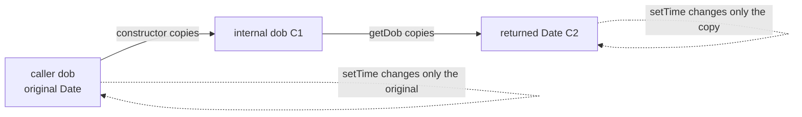

# Immutable Class

**Definition:**
Immutable class are the classes, whose object is created once, we cannot modify its content, it means any modification on immutable object 
will result in another immutable object.
In Java, String class and all the wrapper classes (like Integer, Boolean, Byte, Short) are immutable. 

**Advantages:**
1. Thread-safe
2. Caching

**Dis-Advantages:**
1. Consumes more memory

## Algorithm Strategy (Steps to Make a Class Immutable)

1. Declare the class `final` so it cannot be extended (a subclass could otherwise add mutable state).
2. Make all fields `private` and `final` so they are assigned exactly once.
3. Do not provide setter methods.
4. Initialize all fields in the constructor; for mutable fields (such as `Date`) store a defensive copy, so later changes to the caller's object do not affect this one.
5. In getters of mutable fields return a copy, never the internal reference.

## Example walkthrough

- Creating `ImmutablePerson(123, "Ranga", dob)` stores a copy of `dob`.
- Calling `person.getDob().setTime(...)` changes only the copy returned by the getter, and `dob.setTime(...)` changes only the caller's object, so printing the person afterwards shows the original date.

## Complexity Analysis

- **Time Complexity:** `O(1)` — Constructing and reading the object copies a constant number of fields.
- **Space Complexity:** `O(1)` — One extra `Date` copy per construction/read.

## Approaches

The same problem can be solved in several ways. They are listed from the simplest to the most efficient.

### Approach 1: Mutable Class (What to Avoid)

A class with public setters or that leaks its mutable `Date` can be changed after construction, so it is not thread-safe and cannot be shared or cached safely.

```java
static class MutablePerson {
    private int id;
    private Date dob;
    MutablePerson(int id, Date dob) { this.id = id; this.dob = dob; }   // keeps the caller's reference
    public void setId(int id) { this.id = id; }
    public Date getDob() { return dob; }                                // leaks the internal reference
}
```

- **Time Complexity:** n/a
- **Space Complexity:** n/a

### Approach 2: Final Class with Defensive Copies (Implemented)

Make the class `final`, all fields `private final`, no setters, and copy mutable fields (`Date`) both in the constructor and in the getter. This is the version implemented in the repository.

```java
static final class ImmutablePerson {
    private final int id;
    private final String name;
    private final Date dob;

    ImmutablePerson(int id, String name, Date dob) {
        this.id = id;
        this.name = name;
        this.dob = new Date(dob.getTime());      // defensive copy in
    }

    public int getId() { return id; }
    public String getName() { return name; }
    public Date getDob() { return new Date(dob.getTime()); }   // defensive copy out
}
```

- **Time Complexity:** O(1)
- **Space Complexity:** O(1)

### Approach 3: Immutable Types Only (java.time) (Optimized)

Prefer fields whose type is already immutable (`String`, `LocalDate`, `Integer`...). Then no defensive copying is needed at all, and `java.util.Date` (itself mutable and legacy) disappears from the API.

```java
static final class Person {
    private final int id;
    private final String name;
    private final LocalDate dob;

    Person(int id, String name, LocalDate dob) {
        this.id = id;
        this.name = Objects.requireNonNull(name);
        this.dob = Objects.requireNonNull(dob);
    }

    public int getId() { return id; }
    public String getName() { return name; }
    public LocalDate getDob() { return dob; }                  // safe: LocalDate is immutable

    // "Wither": a change produces a new object instead of modifying this one
    public Person withName(String newName) { return new Person(id, newName, dob); }
}
```

- **Time Complexity:** O(1)
- **Space Complexity:** O(1)

### Approach 4: Record (Java 16+)

A `record` is shallowly immutable by design and generates the constructor, accessors, `equals`, `hashCode` and `toString`. Use immutable component types (such as `LocalDate`) to make it deeply immutable.

```java
record PersonRecord(int id, String name, LocalDate dob) {
    PersonRecord {
        Objects.requireNonNull(name);
        Objects.requireNonNull(dob);
    }
}
```

- **Time Complexity:** O(1)
- **Space Complexity:** O(1)

### Comparison

| # | Approach | Time | Space |
|---|----------|------|-------|
| 1 | Mutable Class (What to Avoid) | n/a | n/a |
| 2 | Final Class with Defensive Copies (Implemented) | O(1) | O(1) |
| 3 | Immutable Types Only (java.time) (Optimized) | O(1) | O(1) |
| 4 | Record (Java 16+) | O(1) | O(1) |

## Source Code

### ImmutableClassDemo.java

```java
import java.io.Serializable;
import java.util.Date;

public class ImmutableClassDemo {

    public static void main(String[] args) {
        Date dob = new Date(0L);
        ImmutablePerson person = new ImmutablePerson(123, "Ranga", dob);
        System.out.println("Original : " + person);

        // Try to change the state through the getter's copy and through the caller's own reference
        person.getDob().setTime(System.currentTimeMillis());
        dob.setTime(System.currentTimeMillis());

        System.out.println("After modification attempts : " + person);
    }
}

final class ImmutablePerson implements Serializable {
    private final int id;
    private final String name;
    private final Date dob;

    public ImmutablePerson(int id, String name, Date dob) {
        this.id = id;
        this.name = name;
        this.dob = new Date(dob.getTime()); // defensive copy
    }

    public int getId() {
        return id;
    }

    public String getName() {
        return name;
    }

    public Date getDob() {
        return new Date(dob.getTime()); // return a copy, not the internal reference
    }

    @Override
    public String toString() {
        return "ImmutablePerson{" +
                "id=" + id +
                ", name='" + name + '\'' +
                ", dob=" + dob +
                '}';
    }
}
```

## Solution

This repository implements Approach 2 (Final Class with Defensive Copies), marked `(Implemented)` in the Approaches section. The optimized approach on this page, Approach 3 (Immutable Types Only (java.time)), is not implemented in the class.

The idea: an object is immutable if nothing can change it after construction. `ImmutablePerson` is `final` (no subclass can add mutable behaviour), all fields are `private final`, there are no setters, and the one mutable field, `Date dob`, is protected on both sides: the constructor stores a **copy** (`new Date(dob.getTime())`) so the caller's own `Date` object is not shared, and `getDob()` returns a **new copy** each time so the caller never receives the internal reference. `int` and `String` are already immutable and need no copy.

**Input:** `dob = new Date(0L)` (the epoch), `new ImmutablePerson(123, "Ranga", dob)`, then two attempts to change it.

| Step | Action | Which object changes | The person's internal `dob` |
|------|--------|----------------------|-----------------------------|
| 1 | `new ImmutablePerson(123, "Ranga", dob)` | constructor copies the date: internal copy C1 (time 0) | C1 = epoch |
| 2 | `person.getDob()` returns a new copy C2 | C2 is a throw-away copy | C1 = epoch |
| 3 | `.setTime(now)` on C2 | only C2 changes | C1 = epoch |
| 4 | `dob.setTime(now)` on the caller's original | only the caller's `dob` changes (it is not C1) | C1 = epoch |
| 5 | print the person | reads C1 | still the epoch |



**Edge cases.** The constructor calls `dob.getTime()`, so passing `null` throws `NullPointerException` at construction rather than leaving a half-built object; the class does not check `id` or `name`, and `name` is safe because `String` is immutable. Without the two copies, step 3 or step 4 would silently change the person's date (the classic leak in a "final" class). The class also implements `Serializable`.

**Result:** the class prints the same `ImmutablePerson{id=123, name='Ranga', dob=...}` line before and after the modification attempts. The date text is the epoch rendered in the machine's time zone (`Thu Jan 01 05:30:00 IST 1970` on this machine), which depends on the zone but is identical in both lines.
