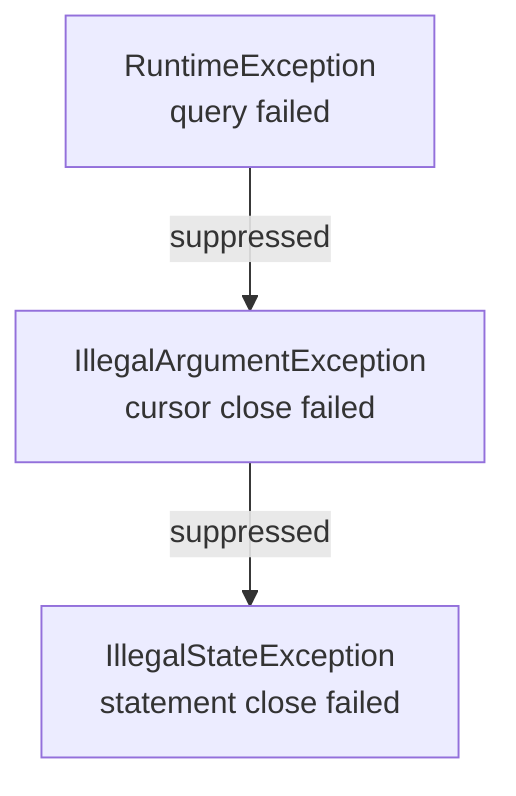

# Custom Resource Manager (AutoCloseable)

Implement a `ResourceManager` that implements `AutoCloseable`, collects several cleanup actions and closes all of them, in reverse order of registration, when it is used in a try-with-resources block. A failing cleanup must not stop the others, and no exception may be lost.

## Algorithm Strategy (Reverse-Order Close with Suppressed Exceptions)

1. Keep the registered `Closer` actions on a stack (`ArrayDeque` with `push`), so the last resource opened is the first one closed, which is the order dependent resources need.
2. `close()` pops and runs every closer, even when one throws. The first exception becomes the primary exception; every later one is attached to it with `addSuppressed`.
3. After all closers have run, `close()` throws the primary exception, so the caller sees one exception that still carries all the others as `getSuppressed()`.
4. In try-with-resources, if the body also throws, the body exception stays the primary one and the exception from `close()` is added to it as suppressed. Nothing is lost, which a hand-written `try/finally` cannot guarantee: an exception thrown in `finally` replaces the one from the body.
5. The manager is idempotent (a second `close()` finds an empty stack and does nothing) and refuses new registrations after it was closed.

## Example walkthrough

- Register `connection`, `statement` (its close throws "statement close failed") and `cursor` (throws "cursor close failed"), then throw "query failed" from the body.
- `close()` runs `cursor` first: its exception becomes the primary. `statement` fails next and is added as suppressed on it. `connection` closes normally.
- The caller catches "query failed"; its suppressed list holds "cursor close failed", which in turn has "statement close failed" suppressed.

## Complexity Analysis

- **Time Complexity:** `O(r)` — One call per registered resource, `r` being the number of resources.
- **Space Complexity:** `O(r)` — The stack of registered closers.

## Approaches

The same problem can be solved in several ways. The approach marked (Optimized) is the one to use in practice.

### Approach 1: Manual try / finally

Close the resource in a `finally` block. If both the body and `close()` throw, the exception from `finally` replaces the one from the body, so the original failure is lost, and with several resources the nesting becomes hard to get right.

```java
public static void manualFinally(Runnable body, AutoCloseable resource) throws Exception {
    try {
        body.run();
    } finally {
        resource.close();   // an exception here hides the one thrown by the body
    }
}
```

- **Time Complexity:** O(1) per resource
- **Space Complexity:** O(1)

### Approach 2: Nested try-with-resources

One try-with-resources block per resource. The compiler adds the suppressed exceptions and closes in reverse order, but every extra resource adds a level of nesting, and the set of resources has to be known at compile time.

```java
public static void nested(Runnable body, AutoCloseable first, AutoCloseable second) throws Exception {
    try (AutoCloseable a = first) {
        try (AutoCloseable b = second) {
            body.run();
        }
    }
}
```

- **Time Complexity:** O(1) per resource
- **Space Complexity:** O(1)

### Approach 3: Closer Stack with addSuppressed (Optimized)

Register cleanup actions at run time, close them last-in first-out, and keep every failure by chaining them as suppressed exceptions. This is the version implemented in the repository.

```java
@FunctionalInterface
public interface Closer {
    void close() throws Exception;
}

private final Deque<Closer> closers = new ArrayDeque<>();
private boolean closed;

public void register(Closer closer) {
    if (closed) {
        throw new IllegalStateException("ResourceManager is already closed");
    }
    closers.push(closer);
}

@Override
public void close() throws Exception {
    closed = true;
    Exception primary = null;
    while (!closers.isEmpty()) {
        Closer closer = closers.pop();
        try {
            closer.close();
        } catch (Exception e) {
            if (primary == null) {
                primary = e;
            } else {
                primary.addSuppressed(e);
            }
        }
    }
    if (primary != null) {
        throw primary;
    }
}
```

- **Time Complexity:** O(r)
- **Space Complexity:** O(r)

### Comparison

| # | Approach | Time | Space |
|---|----------|------|-------|
| 1 | Manual try / finally | O(1) per resource | O(1) |
| 2 | Nested try-with-resources | O(1) per resource | O(1) |
| 3 | Closer Stack with addSuppressed (Optimized) | O(r) | O(r) |

### Optimized Solution

The optimized solution is Approach 3 above, which is also the version implemented in this repository.

#### Optimized solution explained

The idea: register cleanup actions as you acquire things, and close them all in reverse order (last opened, first closed) the way nested try-with-resources would. `register` pushes a `Closer` onto a `Deque` (a stack). `close()` pops and runs every closer, and a closer that throws does **not** stop the rest: the first failure becomes the `primary` exception, later failures are attached to it with `addSuppressed`, and at the end `primary` is thrown. So every resource gets a chance to close and no failure is lost. Because the manager is `AutoCloseable`, a try-with-resources block calls `close()` for you, and if the block body also threw, Java attaches the thrown close exception to the body's exception as suppressed.

**Input:** register `connection` (closes fine), `statement` (throws `IllegalStateException("statement close failed")`), `cursor` (throws `IllegalArgumentException("cursor close failed")`), then the body throws `RuntimeException("query failed")`.

| Step | Event | Stack top to bottom | `primary` | Output / effect |
|------|-------|---------------------|-----------|-----------------|
| 1 | `register` connection | connection | none | |
| 2 | `register` statement | statement, connection | none | |
| 3 | `register` cursor | cursor, statement, connection | none | |
| 4 | body throws `query failed` | cursor, statement, connection | none | try-with-resources now calls `close()` |
| 5 | `close()` pops cursor, it throws | statement, connection | cursor exception | first failure becomes `primary` |
| 6 | pops statement, it throws | connection | cursor exception | statement exception added as suppressed to it |
| 7 | pops connection, runs fine | empty | cursor exception | prints `closed connection` |
| 8 | `close()` rethrows `primary` | empty | | Java adds it as suppressed to `query failed` |
| 9 | the catch block prints | | | main exception, its suppressed, and the nested suppressed |



**Edge cases.** `closed` is set at the start of `close()`, so calling `register` afterwards throws `IllegalStateException("ResourceManager is already closed")`; a second `close()` finds an empty stack and does nothing. If no closer fails, `close()` returns normally. Only `Exception` is caught, so an `Error` stops the loop. Cost is O(r) time and space for `r` registered closers.

**Result:** the class prints `closed connection`, then `caught query failed`, `suppressed cursor close failed` and, nested below it, `suppressed statement close failed`, which matches the trace (the output is deterministic, since it is single-threaded).

## Source Code

### ResourceManager.java

```java
import java.util.ArrayDeque;
import java.util.Deque;

public class ResourceManager implements AutoCloseable {

    public static void main(String[] args) {
        System.out.println("Input  : 3 resources, two of them fail to close, and the body throws as well");
        try (ResourceManager manager = new ResourceManager()) {
            manager.register(() -> System.out.println("closed connection"));
            manager.register(() -> {
                throw new IllegalStateException("statement close failed");
            });
            manager.register(() -> {
                throw new IllegalArgumentException("cursor close failed");
            });
            throw new RuntimeException("query failed");
        } catch (Exception e) {
            System.out.println("Output : caught " + e.getMessage());
            for (Throwable suppressed : e.getSuppressed()) {
                System.out.println("         suppressed " + suppressed.getMessage());
                for (Throwable nested : suppressed.getSuppressed()) {
                    System.out.println("           suppressed " + nested.getMessage());
                }
            }
        }
    }

    @FunctionalInterface
    public interface Closer {
        void close() throws Exception;
    }

    private final Deque<Closer> closers = new ArrayDeque<>();
    private boolean closed;

    public void register(Closer closer) {
        if (closed) {
            throw new IllegalStateException("ResourceManager is already closed");
        }
        closers.push(closer);
    }

    @Override
    public void close() throws Exception {
        closed = true;
        Exception primary = null;
        while (!closers.isEmpty()) {
            Closer closer = closers.pop();
            try {
                closer.close();
            } catch (Exception e) {
                if (primary == null) {
                    primary = e;
                } else {
                    primary.addSuppressed(e);
                }
            }
        }
        if (primary != null) {
            throw primary;
        }
    }
}
```
