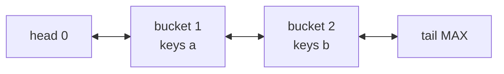

# All O(1) Data Structure

Design a data structure that stores string counts and supports `inc(key)` (add 1, inserting the key with count 1 if needed), `dec(key)` (subtract 1, removing the key at 0), `getMaxKey()` and `getMinKey()` (a key with the largest and the smallest count, or `""` when empty). Each operation must run in `O(1)` average time.

## Algorithm Strategy (Doubly Linked List of Count Buckets plus a HashMap)

1. Keep a doubly linked list of buckets ordered by count, smallest at the head and largest at the tail. Each bucket has a `count` and the set of keys with exactly that count.
2. Keep a map from key to its bucket, so a key can be found in `O(1)`.
3. `inc(key)`: look at the next bucket. If its count is `count + 1` move the key there, otherwise create a new bucket with that count right after the current one (or at the head for a new key). Remove the old bucket if it is empty.
4. `dec(key)` works the same way towards the previous bucket, and removes the key from the map when its count reaches 0.
5. `getMaxKey` and `getMinKey` read any key from the tail and head buckets, so they take constant time.

## Example walkthrough

- `inc("a")`, `inc("b")`, `inc("b")`: buckets `1: {a}` then `2: {b}`. `getMaxKey()` is `b` and `getMinKey()` is `a`.
- `dec("b")` moves `b` to bucket 1 (`1: {a, b}`) and the empty bucket 2 is unlinked. The second `dec("b")` removes `b` entirely, so bucket 1 holds only `a`; `getMaxKey()` and `getMinKey()` both return `a`.

## Complexity Analysis

- **Time Complexity:** `O(1)` — Average for all four operations.
- **Space Complexity:** `O(n)` — The keys, their buckets and the list nodes.

## Approaches

The same problem can be solved in several ways. The approach marked (Optimized) is the one to use in practice.

### Approach 1: HashMap with a Scan for Min and Max

Store the counts in a map; `inc` and `dec` are constant time, but `getMaxKey` and `getMinKey` scan all entries.

```java
class ScanAllOne {
    private final Map<String, Integer> counts = new HashMap<>();

    void inc(String key) { counts.merge(key, 1, Integer::sum); }

    void dec(String key) {
        Integer c = counts.get(key);
        if (c == null) return;
        if (c == 1) counts.remove(key); else counts.put(key, c - 1);
    }

    int maxCount() {
        int best = 0;
        for (int c : counts.values()) best = Math.max(best, c);
        return best;
    }

    int minCount() {
        int best = Integer.MAX_VALUE;
        for (int c : counts.values()) best = Math.min(best, c);
        return counts.isEmpty() ? 0 : best;
    }
}
```

- **Time Complexity:** inc/dec O(1), getMaxKey/getMinKey O(n)
- **Space Complexity:** O(n)

### Approach 2: Linked List of Count Buckets (Optimized)

Keep keys grouped by count in a sorted doubly linked list so the neighbours of a key's bucket are the only places it can move to. This is the version implemented in the repository.

```java
private final Bucket head = new Bucket(0);
private final Bucket tail = new Bucket(Integer.MAX_VALUE);
private final Map<String, Bucket> bucketOf = new HashMap<>();

public AllOneDataStructure() {
    head.next = tail;
    tail.prev = head;
}

public void inc(String key) {
    Bucket current = bucketOf.get(key);
    Bucket target;
    if (current == null) {
        target = head.next.count == 1 ? head.next : insertAfter(head, 1);
    } else {
        target = current.next.count == current.count + 1 ? current.next : insertAfter(current, current.count + 1);
        current.keys.remove(key);
        removeIfEmpty(current);
    }
    target.keys.add(key);
    bucketOf.put(key, target);
}

public void dec(String key) {
    Bucket current = bucketOf.get(key);
    if (current == null) {
        return;
    }
    if (current.count == 1) {
        bucketOf.remove(key);
    } else {
        Bucket target = current.prev.count == current.count - 1 ? current.prev : insertAfter(current.prev, current.count - 1);
        target.keys.add(key);
        bucketOf.put(key, target);
    }
    current.keys.remove(key);
    removeIfEmpty(current);
}

public String getMaxKey() {
    return tail.prev == head ? "" : tail.prev.keys.iterator().next();
}

public String getMinKey() {
    return head.next == tail ? "" : head.next.keys.iterator().next();
}

private Bucket insertAfter(Bucket node, int count) {
    Bucket bucket = new Bucket(count);
    bucket.prev = node;
    bucket.next = node.next;
    node.next.prev = bucket;
    node.next = bucket;
    return bucket;
}

private void removeIfEmpty(Bucket bucket) {
    if (bucket.keys.isEmpty()) {
        bucket.prev.next = bucket.next;
        bucket.next.prev = bucket.prev;
    }
}
```

- **Time Complexity:** O(1) for all operations
- **Space Complexity:** O(n)

### Comparison

| # | Approach | Time | Space |
|---|----------|------|-------|
| 1 | HashMap with a Scan for Min and Max | inc/dec O(1), getMaxKey/getMinKey O(n) | O(n) |
| 2 | Linked List of Count Buckets (Optimized) | O(1) for all operations | O(n) |

### Optimized Solution

The optimized solution is Approach 2 above, which is also the version implemented in this repository.

#### Optimized solution explained

The idea: keep the keys grouped by count in a doubly linked list of buckets, ordered by count from smallest (next to `head`) to largest (next to `tail`). A `HashMap` gives the bucket of any key. `inc` and `dec` only move a key to the neighbouring bucket (count + 1 or count - 1), creating that bucket if it does not exist and unlinking a bucket that becomes empty. The minimum key is in `head.next`, the maximum key in `tail.prev`, so all four operations are O(1).

**Input:** `inc(a)`, `inc(b)`, `inc(b)`, `getMaxKey()`, `getMinKey()`, `dec(b)`, `dec(b)`, `getMaxKey()`, `getMinKey()`. The list is `head <-> tail` (the dummy buckets have counts 0 and `Integer.MAX_VALUE`).

| Step | Operation | What happens | Bucket list (count: keys) | Result |
|------|-----------|--------------|---------------------------|--------|
| 1 | `inc(a)` | new key; `head.next` is not a count-1 bucket, so create it | 1: {a} | |
| 2 | `inc(b)` | new key; `head.next` is the count-1 bucket, reuse it | 1: {a, b} | |
| 3 | `inc(b)` | `b` is in bucket 1; `next` is `tail`, not count 2, so create bucket 2 after it; move `b`; bucket 1 still has `a` | 1: {a} <-> 2: {b} | |
| 4 | `getMaxKey()` | `tail.prev` = bucket 2 | unchanged | `b` |
| 5 | `getMinKey()` | `head.next` = bucket 1 | unchanged | `a` |
| 6 | `dec(b)` | bucket 2, count 2 != 1; `prev` is bucket 1 (count 1), reuse it; move `b`; bucket 2 is empty, unlink it | 1: {a, b} | |
| 7 | `dec(b)` | bucket 1, count == 1: remove `b` from the map and from the bucket; bucket 1 still has `a` | 1: {a} | |
| 8 | `getMaxKey()` | `tail.prev` = bucket 1 | unchanged | `a` |
| 9 | `getMinKey()` | `head.next` = bucket 1 | unchanged | `a` |



The diagram shows the list after step 3. When a bucket holds several keys (step 2 and 6) `getMaxKey` / `getMinKey` return any one of them, as the problem allows.

**Edge cases.** `dec` of an unknown key does nothing. A key whose count drops to 0 is removed entirely. With no keys left, `head.next == tail` and both getters return `""`. Buckets are created only when needed and removed when empty, so the list never holds an empty bucket.

**Result:** `b, a, a, a`, exactly what the class prints.

## Source Code

### AllOneDataStructure.java

```java
import java.util.HashMap;
import java.util.HashSet;
import java.util.Map;
import java.util.Set;

public class AllOneDataStructure {

    private static class Bucket {
        final int count;
        final Set<String> keys = new HashSet<>();
        Bucket prev;
        Bucket next;

        Bucket(int count) {
            this.count = count;
        }
    }

    public static void main(String[] args) {
        AllOneDataStructure allOne = new AllOneDataStructure();
        System.out.println("Input  : inc(a), inc(b), inc(b), getMaxKey(), getMinKey(), dec(b), dec(b), getMaxKey(), getMinKey()");
        allOne.inc("a");
        allOne.inc("b");
        allOne.inc("b");
        String maxKey1 = allOne.getMaxKey();
        String minKey1 = allOne.getMinKey();
        allOne.dec("b");
        allOne.dec("b");
        String maxKey2 = allOne.getMaxKey();
        String minKey2 = allOne.getMinKey();
        System.out.println("Output : " + maxKey1 + ", " + minKey1 + ", " + maxKey2 + ", " + minKey2);
    }

    private final Bucket head = new Bucket(0);
    private final Bucket tail = new Bucket(Integer.MAX_VALUE);
    private final Map<String, Bucket> bucketOf = new HashMap<>();

    public AllOneDataStructure() {
        head.next = tail;
        tail.prev = head;
    }

    public void inc(String key) {
        Bucket current = bucketOf.get(key);
        Bucket target;
        if (current == null) {
            target = head.next.count == 1 ? head.next : insertAfter(head, 1);
        } else {
            target = current.next.count == current.count + 1 ? current.next : insertAfter(current, current.count + 1);
            current.keys.remove(key);
            removeIfEmpty(current);
        }
        target.keys.add(key);
        bucketOf.put(key, target);
    }

    public void dec(String key) {
        Bucket current = bucketOf.get(key);
        if (current == null) {
            return;
        }
        if (current.count == 1) {
            bucketOf.remove(key);
        } else {
            Bucket target = current.prev.count == current.count - 1 ? current.prev : insertAfter(current.prev, current.count - 1);
            target.keys.add(key);
            bucketOf.put(key, target);
        }
        current.keys.remove(key);
        removeIfEmpty(current);
    }

    public String getMaxKey() {
        return tail.prev == head ? "" : tail.prev.keys.iterator().next();
    }

    public String getMinKey() {
        return head.next == tail ? "" : head.next.keys.iterator().next();
    }

    private Bucket insertAfter(Bucket node, int count) {
        Bucket bucket = new Bucket(count);
        bucket.prev = node;
        bucket.next = node.next;
        node.next.prev = bucket;
        node.next = bucket;
        return bucket;
    }

    private void removeIfEmpty(Bucket bucket) {
        if (bucket.keys.isEmpty()) {
            bucket.prev.next = bucket.next;
            bucket.next.prev = bucket.prev;
        }
    }
}
```
