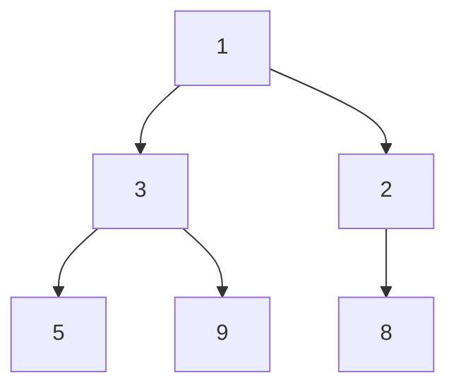

# Design a Min/Max Heap

Implement a binary heap from scratch that can work as a min-heap or a max-heap, with `add(value)`, `peek()`, `poll()`, `size()` and `isEmpty()`. `add` and `poll` must run in `O(log n)` and `peek` in `O(1)`.

## Algorithm Strategy (Array-Backed Complete Binary Tree with Sift Up and Sift Down)

1. Store a complete binary tree in an array: the children of index `i` are `2i + 1` and `2i + 2`, and its parent is `(i - 1) / 2`. No pointers are needed.
2. The heap property says every parent is ordered before its children (smaller for a min-heap, larger for a max-heap), so the root is always the extreme element.
3. `add` appends the value at the end and sifts it up: while it is ordered before its parent, swap them.
4. `poll` takes the root, moves the last element to the root and sifts it down: swap with the better of its two children until the heap property holds again.
5. One class serves both kinds by using a single comparison, `before(a, b)`, that is `a < b` for a min-heap and `a > b` for a max-heap.

## Example walkthrough

- A min-heap after adding 5, 3, 8, 1 is the array `[1, 3, 8, 5]`: 5 is placed first, 3 swaps above it, 8 is a right child, and 1 is added below 3 and sifts up past 3 to the root, pushing 3 down.
- `poll()` returns 1, moves the last element 5 to the root and sifts down: `[3, 5, 8]`.

## Complexity Analysis

- **Time Complexity:** `O(log n)` — `add` and `poll`; `peek` is `O(1)` and building by repeated `add` costs `O(n log n)`.
- **Space Complexity:** `O(n)` — The backing array.

## Approaches

The same problem can be solved in several ways. The approach marked (Optimized) is the one to use in practice.

### Approach 1: Sorted Array

Keep the elements sorted; `peek` and `poll` are cheap but every `add` shifts elements to keep the order.

```java
class SortedArrayHeap {
    private final List<Integer> values = new ArrayList<>();
    private final boolean minHeap;

    SortedArrayHeap(boolean minHeap) { this.minHeap = minHeap; }

    void add(int v) {
        int index = Collections.binarySearch(values, v);
        values.add(index >= 0 ? index : -index - 1, v);
    }

    int peek() { return minHeap ? values.get(0) : values.get(values.size() - 1); }

    int poll() { return minHeap ? values.remove(0) : values.remove(values.size() - 1); }
}
```

- **Time Complexity:** add O(n), peek O(1), poll O(n) for the min end
- **Space Complexity:** O(n)

### Approach 2: Binary Heap in an Array (Optimized)

Keep a complete binary tree in an array and restore the heap property by sifting a single element up or down. This is the version implemented in the repository.

```java
public void add(int value) {
    if (size == data.length) {
        data = Arrays.copyOf(data, size * 2);
    }
    data[size] = value;
    siftUp(size++);
}

public int peek() {
    if (size == 0) {
        throw new IllegalStateException("heap is empty");
    }
    return data[0];
}

public int poll() {
    int top = peek();
    data[0] = data[--size];
    if (size > 0) {
        siftDown(0);
    }
    return top;
}

public int size() {
    return size;
}

public boolean isEmpty() {
    return size == 0;
}

private boolean before(int a, int b) {
    return minHeap ? a < b : a > b;
}

private void siftUp(int i) {
    while (i > 0) {
        int parent = (i - 1) / 2;
        if (!before(data[i], data[parent])) {
            break;
        }
        swap(i, parent);
        i = parent;
    }
}

private void siftDown(int i) {
    while (true) {
        int best = i;
        int left = 2 * i + 1;
        int right = left + 1;
        if (left < size && before(data[left], data[best])) {
            best = left;
        }
        if (right < size && before(data[right], data[best])) {
            best = right;
        }
        if (best == i) {
            return;
        }
        swap(i, best);
        i = best;
    }
}

private void swap(int a, int b) {
    int temp = data[a];
    data[a] = data[b];
    data[b] = temp;
}
```

- **Time Complexity:** add and poll O(log n), peek O(1)
- **Space Complexity:** O(n)

### Comparison

| # | Approach | Time | Space |
|---|----------|------|-------|
| 1 | Sorted Array | add O(n), peek O(1), poll O(n) for the min end | O(n) |
| 2 | Binary Heap in an Array (Optimized) | add and poll O(log n), peek O(1) | O(n) |

## Source Code

### BinaryHeap.java

```java
import java.util.Arrays;

public class BinaryHeap {

    private int[] data = new int[8];
    private int size;
    private final boolean minHeap;

    public BinaryHeap(boolean minHeap) {
        this.minHeap = minHeap;
    }

    public static void main(String[] args) {
        int[] values = {5, 3, 8, 1, 9, 2};
        BinaryHeap min = new BinaryHeap(true);
        BinaryHeap max = new BinaryHeap(false);
        for (int v : values) {
            min.add(v);
            max.add(v);
        }
        System.out.println("Input  : add " + Arrays.toString(values));
        System.out.println("Output : min peek = " + min.peek() + ", max peek = " + max.peek());
        System.out.println();
        StringBuilder minOrder = new StringBuilder();
        StringBuilder maxOrder = new StringBuilder();
        while (!min.isEmpty()) {
            minOrder.append(minOrder.length() == 0 ? "" : ", ").append(min.poll());
            maxOrder.append(maxOrder.length() == 0 ? "" : ", ").append(max.poll());
        }
        System.out.println("Input  : poll until empty");
        System.out.println("Output : min order = [" + minOrder + "], max order = [" + maxOrder + "]");
    }

    public void add(int value) {
        if (size == data.length) {
            data = Arrays.copyOf(data, size * 2);
        }
        data[size] = value;
        siftUp(size++);
    }

    public int peek() {
        if (size == 0) {
            throw new IllegalStateException("heap is empty");
        }
        return data[0];
    }

    public int poll() {
        int top = peek();
        data[0] = data[--size];
        if (size > 0) {
            siftDown(0);
        }
        return top;
    }

    public int size() {
        return size;
    }

    public boolean isEmpty() {
        return size == 0;
    }

    private boolean before(int a, int b) {
        return minHeap ? a < b : a > b;
    }

    private void siftUp(int i) {
        while (i > 0) {
            int parent = (i - 1) / 2;
            if (!before(data[i], data[parent])) {
                break;
            }
            swap(i, parent);
            i = parent;
        }
    }

    private void siftDown(int i) {
        while (true) {
            int best = i;
            int left = 2 * i + 1;
            int right = left + 1;
            if (left < size && before(data[left], data[best])) {
                best = left;
            }
            if (right < size && before(data[right], data[best])) {
                best = right;
            }
            if (best == i) {
                return;
            }
            swap(i, best);
            i = best;
        }
    }

    private void swap(int a, int b) {
        int temp = data[a];
        data[a] = data[b];
        data[b] = temp;
    }
}
```

## Solution

The optimized solution is Approach 2 above, which is also the version implemented in this repository.

The idea: store a complete binary tree in an array, where the children of index `i` are `2i + 1` and `2i + 2` and the parent is `(i - 1) / 2`. The heap rule is that every parent is "before" its children, where `before(a, b)` is `a < b` for a min-heap and `a > b` for a max-heap, so the root is always the extreme value. `add` appends at the end and sifts up (swap with the parent while it is before it). `poll` returns the root, moves the last element to the root and sifts down (swap with the better child until the rule holds). Each walk follows one root-to-leaf path, so both are O(log n); `peek` is just `data[0]`.

**Input:** `add 5, 3, 8, 1, 9, 2` into a min-heap, then `poll` until empty (the array is shown as it is after each operation).

| Step | Operation | What happens | Array afterwards |
|------|-----------|--------------|------------------|
| 1 | `add(5)` | placed at index 0, no parent | `[5]` |
| 2 | `add(3)` | index 1, parent `5`; `3 < 5`, swap | `[3, 5]` |
| 3 | `add(8)` | index 2, parent `3`; `8 < 3` is false, stop | `[3, 5, 8]` |
| 4 | `add(1)` | index 3, parent index 1 (`5`): swap; then parent index 0 (`3`): swap | `[1, 3, 8, 5]` |
| 5 | `add(9)` | index 4, parent index 1 (`3`); no swap | `[1, 3, 8, 5, 9]` |
| 6 | `add(2)` | index 5, parent index 2 (`8`): swap; parent index 0 (`1`): stop | `[1, 3, 2, 5, 9, 8]` |
| 7 | `poll()` returns `1` | last element `8` moves to the root, children `3` and `2`, swap with `2` | `[2, 3, 8, 5, 9]` |
| 8 | `poll()` returns `2` | `9` to the root, children `3` and `8`: swap with `3`; then child `5`: swap | `[3, 5, 8, 9]` |
| 9 | `poll()` returns `3` | `9` to the root, children `5` and `8`: swap with `5`; no children left | `[5, 9, 8]` |
| 10 | `poll()` returns `5` | `8` to the root, child `9` is not before it | `[8, 9]` |
| 11 | `poll()` returns `8` | `9` to the root | `[9]` |
| 12 | `poll()` returns `9` | size becomes 0, no sift | `[]` |



The diagram is the heap `[1, 3, 2, 5, 9, 8]` after step 6. Polling `1` moves `8` to the top and sifts it down past `2`.

**Edge cases.** The backing array starts at 8 slots and doubles when full. `peek` and `poll` on an empty heap throw `IllegalStateException("heap is empty")`. Polling the last element skips the sift (`size > 0` check). A max-heap fed the same input flips the comparison only.

**Result:** min peek is `1`, max peek is `9`; poll order is `[1, 2, 3, 5, 8, 9]` for the min-heap and `[9, 8, 5, 3, 2, 1]` for the max-heap, which matches the class output.
