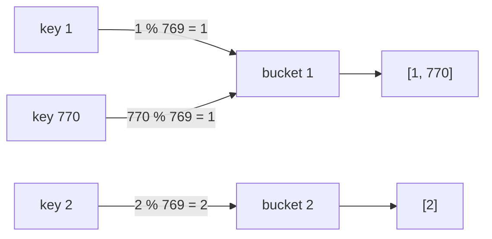

# Design HashSet

Design a `MyHashSet` of non-negative integers without using the built-in hash table, supporting `add(key)`, `remove(key)` and `contains(key)`. Adding an existing key or removing a missing one does nothing.

## Algorithm Strategy (Separate Chaining with a Fixed Number of Buckets)

1. Allocate an array of buckets; each bucket is a small linked list of the keys that hash to it. A prime bucket count such as 769 spreads keys well.
2. The bucket of a key is `key % buckets`. All operations search only that bucket.
3. `add` appends the key if it is not in the bucket, `remove` deletes it if present and `contains` scans the bucket.
4. With `n` keys spread over `b` buckets each chain holds about `n / b` keys, so operations take `O(n / b)` on average. A production table would also resize when the load grows; this fixed version keeps the structure visible.

## Example walkthrough

- `add(1)`, `add(2)`: keys 1 and 2 go to buckets 1 and 2. `contains(1)` looks only in bucket 1 and returns true; `contains(3)` looks in bucket 3 and returns false.
- `add(2)` again is ignored; `remove(2)` empties bucket 2, so `contains(2)` is false.

## Complexity Analysis

- **Time Complexity:** `O(n / b)` — Average per operation, with `b` buckets and `n` keys.
- **Space Complexity:** `O(n + b)` — The keys plus the bucket array.

## Approaches

The same problem can be solved in several ways. The approach marked (Optimized) is the one to use in practice.

### Approach 1: Direct Addressing with a Boolean Array

If keys are at most 1,000,000, one boolean per possible key gives constant time operations at the cost of fixed memory.

```java
class ArrayHashSet {
    private final boolean[] present = new boolean[1_000_001];

    void add(int key) { present[key] = true; }
    void remove(int key) { present[key] = false; }
    boolean contains(int key) { return present[key]; }
}
```

- **Time Complexity:** O(1)
- **Space Complexity:** O(range of keys)

### Approach 2: Chaining with Buckets (Optimized)

Hash each key to one of a fixed number of linked lists, so memory is proportional to the number of keys and operations only scan one short list. This is the version implemented in the repository.

```java
private static final int BUCKETS = 769;
private final LinkedList<Integer>[] table;

@SuppressWarnings("unchecked")
public DesignHashSet() {
    table = new LinkedList[BUCKETS];
    for (int i = 0; i < BUCKETS; i++) {
        table[i] = new LinkedList<>();
    }
}

public void add(int key) {
    LinkedList<Integer> bucket = table[key % BUCKETS];
    if (!bucket.contains(key)) {
        bucket.add(key);
    }
}

public void remove(int key) {
    table[key % BUCKETS].remove(Integer.valueOf(key));
}

public boolean contains(int key) {
    return table[key % BUCKETS].contains(key);
}
```

- **Time Complexity:** O(n / b) average
- **Space Complexity:** O(n + b)

### Comparison

| # | Approach | Time | Space |
|---|----------|------|-------|
| 1 | Direct Addressing with a Boolean Array | O(1) | O(range of keys) |
| 2 | Chaining with Buckets (Optimized) | O(n / b) average | O(n + b) |

## Source Code

### DesignHashSet.java

```java
import java.util.LinkedList;

public class DesignHashSet {

    public static void main(String[] args) {
        DesignHashSet set = new DesignHashSet();
        System.out.println("Input  : add(1), add(2), contains(1), contains(3), add(2), contains(2), remove(2), contains(2)");
        set.add(1);
        set.add(2);
        boolean a = set.contains(1);
        boolean b = set.contains(3);
        set.add(2);
        boolean c = set.contains(2);
        set.remove(2);
        boolean d = set.contains(2);
        System.out.println("Output : " + a + ", " + b + ", " + c + ", " + d);
    }

    private static final int BUCKETS = 769;
    private final LinkedList<Integer>[] table;

    @SuppressWarnings("unchecked")
    public DesignHashSet() {
        table = new LinkedList[BUCKETS];
        for (int i = 0; i < BUCKETS; i++) {
            table[i] = new LinkedList<>();
        }
    }

    public void add(int key) {
        LinkedList<Integer> bucket = table[key % BUCKETS];
        if (!bucket.contains(key)) {
            bucket.add(key);
        }
    }

    public void remove(int key) {
        table[key % BUCKETS].remove(Integer.valueOf(key));
    }

    public boolean contains(int key) {
        return table[key % BUCKETS].contains(key);
    }
}
```

## Solution

The optimized solution is Approach 2 above, which is also the version implemented in this repository.

The idea: use a fixed array of 769 buckets (a prime, which spreads keys evenly), each holding a `LinkedList<Integer>`. A key lives in bucket `key % 769`. `add` inserts only if the bucket does not contain the key (so no duplicates), `contains` and `remove` search only that one bucket. With few keys per bucket every operation is close to O(1).

**Input (operations):** `add(1)`, `add(770)`, `add(2)`, `contains(770)`, `add(2)`, `remove(770)`, `contains(770)`, `remove(2)`, `contains(2)`.

| Step | Operation | Bucket | What happens | Non-empty buckets afterwards | Returns |
|------|-----------|--------|--------------|------------------------------|---------|
| 1 | `add(1)` | 1 | not in bucket, appended | `1: [1]` | |
| 2 | `add(770)` | 770 % 769 = 1 | collision with 1, appended | `1: [1, 770]` | |
| 3 | `add(2)` | 2 | appended | `1: [1, 770]`, `2: [2]` | |
| 4 | `contains(770)` | 1 | scans the 2-item bucket, finds it | unchanged | `true` |
| 5 | `add(2)` | 2 | already in bucket, ignored | unchanged | |
| 6 | `remove(770)` | 1 | removes the value (`Integer.valueOf`, not an index) | `1: [1]`, `2: [2]` | |
| 7 | `contains(770)` | 1 | not found | unchanged | `false` |
| 8 | `remove(2)` | 2 | removed | `1: [1]` | |
| 9 | `contains(2)` | 2 | empty bucket | unchanged | `false` |



**Edge cases.** Adding an existing key does not create a second copy. Removing a key that is absent does nothing. Keys are assumed to be non-negative (as in the problem), because `key % 769` would be negative for a negative key.

**Result:** the real class prints `true, false, true, false` for its own sequence `add(1), add(2), contains(1), contains(3), add(2), contains(2), remove(2), contains(2)`; the collision sequence above (`contains(770)` true, then false after `remove(770)`, `contains(2)` false after `remove(2)`) was also run against the class and matches.
