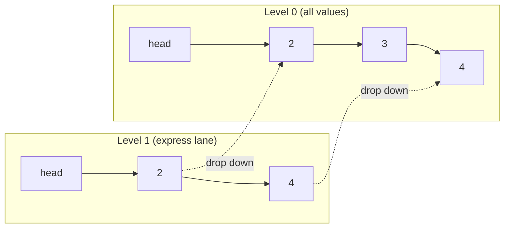

# Design Skip List

Design a skip list without using a built-in balanced tree. It stores integers (duplicates allowed) and supports `search(num)`, `add(num)` and `erase(num)` (removes one occurrence and returns whether it existed), each in `O(log n)` expected time.

## Algorithm Strategy (Layered Sorted Linked Lists with Random Heights)

1. A skip list is a sorted linked list with extra "express lane" lists above it. Level 0 holds every element; each higher level holds a random subset of the level below, about half of it.
2. Each node has a `next` pointer per level it belongs to. Search starts at the top level of a sentinel head node, moves right while the next value is smaller than the target, and drops down a level when it cannot. At level 0 the next node is the candidate.
3. `add` records, for every level, the last node before the insertion point (found with the same walk). It picks a random height by flipping a coin until it gets tails (capped at the maximum level) and links the new node into that many levels.
4. `erase` does the same walk, then unlinks one node with the value from every level where it appears. The random heights keep the structure balanced on average, with no rotations needed.

## Example walkthrough

- With elements 1, 2, 3, 4 and levels `L1: 1 -> 3`, `L0: 1 -> 2 -> 3 -> 4`, searching 4 starts at `L1` (head to 3), cannot go right past 4, drops to `L0` and walks from 3 to 4: found.
- Searching 5 ends at 4 with no next node, so it returns false. Erasing 3 unlinks it from both levels.

## Complexity Analysis

- **Time Complexity:** `O(log n)` — Expected time for search, add and erase.
- **Space Complexity:** `O(n)` — Expected, about two pointers per node on average.

## Approaches

The same problem can be solved in several ways. The approach marked (Optimized) is the one to use in practice.

### Approach 1: Sorted ArrayList with Binary Search

Keep the values in a sorted list; binary search finds the position, but inserting or removing in the middle shifts elements.

```java
class SortedListSkipList {
    private final List<Integer> values = new ArrayList<>();

    boolean search(int num) { return Collections.binarySearch(values, num) >= 0; }

    void add(int num) {
        int index = Collections.binarySearch(values, num);
        values.add(index >= 0 ? index : -index - 1, num);
    }

    boolean erase(int num) {
        int index = Collections.binarySearch(values, num);
        if (index < 0) return false;
        values.remove(index);
        return true;
    }
}
```

- **Time Complexity:** search O(log n), add/erase O(n)
- **Space Complexity:** O(n)

### Approach 2: Skip List (Optimized)

Link every element in a sorted bottom list and randomly promote some to higher lists, so a search skips over runs of elements. This is the version implemented in the repository.

```java
private final Node head = new Node(-1, MAX_LEVEL);
private final Random random = new Random(42);
private int level = 1;

public boolean search(int num) {
    Node node = head;
    for (int i = level - 1; i >= 0; i--) {
        while (node.next[i] != null && node.next[i].val < num) {
            node = node.next[i];
        }
    }
    node = node.next[0];
    return node != null && node.val == num;
}

public void add(int num) {
    Node[] update = predecessors(num);
    int height = randomHeight();
    if (height > level) {
        for (int i = level; i < height; i++) {
            update[i] = head;
        }
        level = height;
    }
    Node node = new Node(num, height);
    for (int i = 0; i < height; i++) {
        node.next[i] = update[i].next[i];
        update[i].next[i] = node;
    }
}

public boolean erase(int num) {
    Node[] update = predecessors(num);
    Node target = update[0].next[0];
    if (target == null || target.val != num) {
        return false;
    }
    for (int i = 0; i < level && update[i].next[i] == target; i++) {
        update[i].next[i] = target.next[i];
    }
    while (level > 1 && head.next[level - 1] == null) {
        level--;
    }
    return true;
}

private Node[] predecessors(int num) {
    Node[] update = new Node[MAX_LEVEL];
    Node node = head;
    for (int i = level - 1; i >= 0; i--) {
        while (node.next[i] != null && node.next[i].val < num) {
            node = node.next[i];
        }
        update[i] = node;
    }
    return update;
}

private int randomHeight() {
    int height = 1;
    while (height < MAX_LEVEL && random.nextBoolean()) {
        height++;
    }
    return height;
}
```

- **Time Complexity:** O(log n) expected for every operation
- **Space Complexity:** O(n) expected

### Comparison

| # | Approach | Time | Space |
|---|----------|------|-------|
| 1 | Sorted ArrayList with Binary Search | search O(log n), add/erase O(n) | O(n) |
| 2 | Skip List (Optimized) | O(log n) expected for every operation | O(n) expected |

### Optimized Solution

The optimized solution is Approach 2 above, which is also the version implemented in this repository.

#### Optimized solution explained

The idea: a skip list is a sorted linked list with "express lanes" above it. Level 0 holds every value; each higher level holds a random subset (each node gets height 1, then keeps growing while a coin flip says heads). A search starts at the top level of a sentinel `head`, moves right while the next value is smaller than the target, then drops one level, so it skips many nodes at once. At level 0 the node right after the stop point is the only candidate. `add` and `erase` use the same walk and remember the last node visited on each level (`update[i]`), which are exactly the pointers to rewire.

**Input:** `add(1), add(2), add(3), search(0), add(4), search(1), erase(0), erase(1), search(1)`. The class uses `new Random(42)`, so the heights are the same on every run: value 1 gets height 2, value 2 gets height 2, value 3 gets height 1, value 4 gets height 2 (observed by running the class and dumping its levels).

| Step | Operation | What the code does | Structure afterwards (`L1` / `L0`) | Result |
|------|-----------|--------------------|-------------------------------------|--------|
| 1 | `add(1)` | `update[0] = update[1] = head`; height 2 raises `level` from 1 to 2; link into both levels | `head -> 1` / `head -> 1` | |
| 2 | `add(2)` | at each level the walk stops after 1; height 2 | `head -> 1 -> 2` / `head -> 1 -> 2` | |
| 3 | `add(3)` | walk stops after 2 on both levels; height 1, so only level 0 is linked | `head -> 1 -> 2` / `head -> 1 -> 2 -> 3` | |
| 4 | `search(0)` | `L1`: next is 1, `1 < 0` is false, stay at head; `L0`: same; candidate is `1`, and `1 != 0` | unchanged | `false` |
| 5 | `add(4)` | walk goes right to 2 on `L1` and to 3 on `L0`; height 2 | `head -> 1 -> 2 -> 4` / `head -> 1 -> 2 -> 3 -> 4` | |
| 6 | `search(1)` | stops at head on both levels; candidate `1` equals 1 | unchanged | `true` |
| 7 | `erase(0)` | `update[0] = head`, target is `1`, `1 != 0` | unchanged | `false` |
| 8 | `erase(1)` | target is `1`; unlink it on `L1` and `L0` (both `update[i].next[i] == target`); `head.next[1]` is 2, so `level` stays 2 | `head -> 2 -> 4` / `head -> 2 -> 3 -> 4` | `true` |
| 9 | `search(1)` | stops at head, candidate is `2`, `2 != 1` | unchanged | `false` |



The diagram shows the structure after step 8. For example, a search for `4` would go head to `2` to `4` on level 1, then drop to level 0 and find `4` immediately, without visiting `3`.

**Edge cases.** The walk in `search` ends with `node != null && node.val == num`, so searching past the last value or in an empty list returns `false`. `erase` of a missing value returns `false` before touching any pointer. After an erase, `level` shrinks while the top lane is empty (`head.next[level - 1] == null`), but never below 1. Heights are capped at `MAX_LEVEL = 16`. Duplicates are allowed; `erase` removes one occurrence.

**Result:** the outputs are `false, true, false, true, false`, which matches what the class prints.

## Source Code

### DesignSkipList.java

```java
import java.util.Random;

public class DesignSkipList {

    private static final int MAX_LEVEL = 16;

    private static class Node {
        final int val;
        final Node[] next;

        Node(int val, int level) {
            this.val = val;
            this.next = new Node[level];
        }
    }

    public static void main(String[] args) {
        DesignSkipList list = new DesignSkipList();
        System.out.println("Input  : add(1), add(2), add(3), search(0), add(4), search(1), erase(0), erase(1), search(1)");
        list.add(1);
        list.add(2);
        list.add(3);
        boolean a = list.search(0);
        list.add(4);
        boolean b = list.search(1);
        boolean c = list.erase(0);
        boolean d = list.erase(1);
        boolean e = list.search(1);
        System.out.println("Output : " + a + ", " + b + ", " + c + ", " + d + ", " + e);
    }

    private final Node head = new Node(-1, MAX_LEVEL);
    private final Random random = new Random(42);
    private int level = 1;

    public boolean search(int num) {
        Node node = head;
        for (int i = level - 1; i >= 0; i--) {
            while (node.next[i] != null && node.next[i].val < num) {
                node = node.next[i];
            }
        }
        node = node.next[0];
        return node != null && node.val == num;
    }

    public void add(int num) {
        Node[] update = predecessors(num);
        int height = randomHeight();
        if (height > level) {
            for (int i = level; i < height; i++) {
                update[i] = head;
            }
            level = height;
        }
        Node node = new Node(num, height);
        for (int i = 0; i < height; i++) {
            node.next[i] = update[i].next[i];
            update[i].next[i] = node;
        }
    }

    public boolean erase(int num) {
        Node[] update = predecessors(num);
        Node target = update[0].next[0];
        if (target == null || target.val != num) {
            return false;
        }
        for (int i = 0; i < level && update[i].next[i] == target; i++) {
            update[i].next[i] = target.next[i];
        }
        while (level > 1 && head.next[level - 1] == null) {
            level--;
        }
        return true;
    }

    private Node[] predecessors(int num) {
        Node[] update = new Node[MAX_LEVEL];
        Node node = head;
        for (int i = level - 1; i >= 0; i--) {
            while (node.next[i] != null && node.next[i].val < num) {
                node = node.next[i];
            }
            update[i] = node;
        }
        return update;
    }

    private int randomHeight() {
        int height = 1;
        while (height < MAX_LEVEL && random.nextBoolean()) {
            height++;
        }
        return height;
    }
}
```
