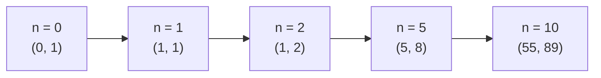

# Fibonacci

**Definition:** 

The Fibonacci numbers is a series of numbers in which each number ( Fibonacci number ) is the sum of the two preceding numbers. \

Let the first two numbers in the series be taken as 0 and 1. By adding 0 and 1, we get the third number as 1. \
Then by adding the second and the third number (i.e) 1 and 1, we get the fourth number as 2, and similarly, the process goes on.

**Example:** 

`0, 1, 1, 2, 3, 5, 8, 13, 21, 34, 55, 89, 144, 233, .... ∞`

**Formula:**

The sequence of Fibonacci numbers can be defined as:

`Fn = Fn-1 + Fn-2`

Where Fn is the nth term or number

Fn-1 is the (n-1)th term
Fn-2 is the (n-2)th term

## Algorithm Strategy (Rolling Pair to print, Fast Doubling for one number)

1. The sequence is defined by `F(0) = 0`, `F(1) = 1` and `F(i) = F(i - 1) + F(i - 2)`.
2. **Printing the first `n` numbers:** keep only the last two numbers in `first` and `second`, starting with `0` and `1`, and print them. For each remaining position compute `third = first + second`, print it, and slide the pair forward.
3. **Computing only `F(n)`:** the identities `F(2k) = F(k) * (2 * F(k + 1) - F(k))` and `F(2k + 1) = F(k)^2 + F(k + 1)^2` let one call turn the pair `(F(k), F(k + 1))` into the pair for `2k` or `2k + 1`, so `n` is halved at every step.
4. A `long` holds values up to `F(92)`. For `n < 0` or `n > 92` the method returns `-1` instead of an overflowed number.

## Example walkthrough for `n = 6`

- Start: `0 1`
- Then `0 + 1 = 1`, `1 + 1 = 2`, `1 + 2 = 3`, `2 + 3 = 5`
- Output: `0 1 1 2 3 5`
- Fast doubling for `F(10)`: the pairs go `(F(0), F(1))`, `(F(1), F(2))`, `(F(2), F(3))`, `(F(5), F(6))`, `(F(10), F(11)) = (55, 89)`.

## Complexity Analysis

- **Time Complexity:** `O(n)` to print `n` numbers; `O(log n)` for a single `F(n)`.
- **Space Complexity:** `O(1)` to print; `O(log n)` recursion stack for a single `F(n)`.

## Approaches

The same problem can be solved in several ways. They are listed from the simplest to the most efficient.

### Approach 1: Naive Recursion

Translate the definition `F(n) = F(n-1) + F(n-2)` directly. The same sub-problems are recomputed over and over, so the number of calls grows exponentially.

```java
public static long fibRecursive(int n) {
    if (n <= 1) return n;
    return fibRecursive(n - 1) + fibRecursive(n - 2);
}
```

- **Time Complexity:** O(2^n)
- **Space Complexity:** O(n) recursion stack

### Approach 2: Memoization (Top-Down DP)

Same recursion, but cache every computed value so each sub-problem is solved only once.

```java
public static long fibMemo(int n, long[] memo) {
    if (n <= 1) return n;
    if (memo[n] != 0) return memo[n];
    memo[n] = fibMemo(n - 1, memo) + fibMemo(n - 2, memo);
    return memo[n];
}
```

- **Time Complexity:** O(n)
- **Space Complexity:** O(n)

### Approach 3: Tabulation (Bottom-Up DP)

Fill a table from the base cases upwards: `fib[i] = fib[i-1] + fib[i-2]`. This is the version in the `dp` package.

```java
public static long fibTable(int n) {
    if (n <= 1) return n;
    long[] fib = new long[n + 1];
    fib[1] = 1;
    for (int i = 2; i <= n; i++) fib[i] = fib[i - 1] + fib[i - 2];
    return fib[n];
}
```

- **Time Complexity:** O(n)
- **Space Complexity:** O(n)

### Approach 4: Iterative with Two Variables (Optimized for Printing)

Each number only needs the previous two, so keep just a rolling pair. This is the version in the `basic` package and is optimal when you must produce all of the first `n` numbers.

```java
public static long fibIterative(int n) {
    if (n <= 1) return n;
    long first = 0, second = 1;
    for (int i = 2; i <= n; i++) {
        long third = first + second;
        first = second;
        second = third;
    }
    return second;
}
```

- **Time Complexity:** O(n)
- **Space Complexity:** O(1)

### Approach 5: Fast Doubling (Optimized for a Single Number)

To get only the n-th number, use the identities `F(2k) = F(k) * (2*F(k+1) - F(k))` and `F(2k+1) = F(k)^2 + F(k+1)^2` to halve `n` each step. (Beyond `n = 92` the value no longer fits in a `long`; use `BigInteger`.)

```java
public static long fibFastDoubling(int n) {
    return fastDoubling(n)[0];
}

// returns {F(n), F(n + 1)}
private static long[] fastDoubling(int n) {
    if (n == 0) return new long[]{0, 1};
    long[] half = fastDoubling(n / 2);
    long a = half[0], b = half[1];
    long c = a * (2 * b - a);   // F(2k)
    long d = a * a + b * b;     // F(2k + 1)
    return (n % 2 == 0) ? new long[]{c, d} : new long[]{d, c + d};
}
```

- **Time Complexity:** O(log n)
- **Space Complexity:** O(log n) recursion stack

### Comparison

| # | Approach | Time | Space |
|---|----------|------|-------|
| 1 | Naive Recursion | O(2^n) | O(n) recursion stack |
| 2 | Memoization (Top-Down DP) | O(n) | O(n) |
| 3 | Tabulation (Bottom-Up DP) | O(n) | O(n) |
| 4 | Iterative with Two Variables (Optimized for Printing) | O(n) | O(1) |
| 5 | Fast Doubling (Optimized for a Single Number) | O(log n) | O(log n) recursion stack |

## Source Code

### Fibonacci.java

```java
public class Fibonacci {

    public static void main(String[] args) {
        int n = 10;

        System.out.println("Input  : n = " + n);
        System.out.print("Output : ");
        printFibonacciNumber(n);
        System.out.println();
        System.out.println();

        int[] single = {10, 50, 92, 0, -1, 93};
        for (int k : single) {
            System.out.println("Input  : n = " + k + "   (single number with fast doubling)");
            System.out.println("Output : " + fibonacci(k));
        }
    }

    /**
     * Computes {@code F(n)} with fast doubling in {@code O(log n)} steps.
     *
     * @param n the position in the sequence, starting at 0
     * @return {@code F(n)}, or {@code -1} when {@code n} is negative or {@code F(n)} does not fit a {@code long} ({@code n > 92})
     */
    public static long fibonacci(int n) {
        // Guard Clause: outside 0..92 there is no value that fits a long
        if (n < 0 || n > 92) {
            return -1;
        }
        return fastDoubling(n)[0];
    }

    /** Returns {F(n), F(n + 1)}. */
    private static long[] fastDoubling(int n) {
        if (n == 0) {
            return new long[]{0, 1};
        }
        long[] half = fastDoubling(n / 2);
        long a = half[0], b = half[1];
        long c = a * (2 * b - a);   // F(2k)
        long d = a * a + b * b;     // F(2k + 1)
        return (n % 2 == 0) ? new long[]{c, d} : new long[]{d, c + d};
    }

    /**
     * Prints the first {@code n} Fibonacci numbers.
     *
     * @param n how many numbers to print
     */
    private static void printFibonacciNumber(int n) {
        // Guard Clause: nothing to print for non-positive n
        if (n <= 0) {
            return;
        }
        if (n == 1) {
            System.out.print(0 + " ");
            return;
        }

        int first = 0, second = 1;
        System.out.print(first + " " + second + " ");
        int third;
        for (int i = 2; i < n; i++) {
            third = first + second;
            System.out.print(third + " ");
            first = second;
            second = third;
        }
    }
}
```

## Solution

The optimized solution is Approach 4 and 5 above, which are also the versions implemented in this repository: Approach 4 prints the series, Approach 5 computes a single number.

The idea: the class does two jobs. To **print** the first `n` numbers it keeps a rolling pair and slides it forward one position per number. To get **one** number, `F(n)`, it does not walk through the sequence: the pair `(F(k), F(k + 1))` is enough to build the pair for `2k` and `2k + 1` (the doubling identities), so `n` is halved at every step.

**Input (single number):** `n = 10`. The recursion goes `10 -> 5 -> 2 -> 1 -> 0`, and the pairs are built on the way back; `a` and `b` are the pair returned by the call for `n / 2`.

| `n` | What is computed | Pair returned |
|-----|------------------|---------------|
| 0 | base case | `(F(0), F(1)) = (0, 1)` |
| 1 | `n` odd: `F(1) = a^2 + b^2 = 0^2 + 1^2 = 1`; `F(2) = F(0) + F(1) = 0 + 1 = 1` | `(F(1), F(2)) = (1, 1)` |
| 2 | `n` even: `F(2) = a * (2b - a) = 1 * (2 * 1 - 1) = 1`; `F(3) = a^2 + b^2 = 2` | `(F(2), F(3)) = (1, 2)` |
| 5 | `n` odd: `F(5) = a^2 + b^2 = 1^2 + 2^2 = 5`; `F(6) = F(4) + F(5) = 3 + 5 = 8` | `(F(5), F(6)) = (5, 8)` |
| 10 | `n` even: `F(10) = a * (2b - a) = 5 * (2 * 8 - 5) = 55`; `F(11) = a^2 + b^2 = 89` | `(F(10), F(11)) = (55, 89)` |

Only 5 calls were made to reach `F(10) = 55`, where the rolling pair would need 10 steps. For `n = 92` the recursion is only 7 levels deep.

**Input (printing):** `n = 6` starts with the pair `0 1`; then `third = 0 + 1 = 1`, `1 + 1 = 2`, `1 + 2 = 3`, `2 + 3 = 5`, and the printed series is `0 1 1 2 3 5`.



**Edge cases.** For printing, `n <= 0` prints nothing and `n = 1` prints just `0`. `fibonacci(0)` is `0`. The largest value that fits a `long` is `F(92) = 7540113804746346429`, so `n < 0` or `n > 92` returns `-1` rather than an overflowed number. The intermediate values of fast doubling never exceed `F(93)`-sized products for `n <= 92` in the middle of the calculation, because they are always `F(k)` and `F(k + 1)` with `k <= n`.

**Result:** `fibonacci(10) = 55`, `fibonacci(50) = 12586269025`, `fibonacci(92) = 7540113804746346429`, matching the class output.
