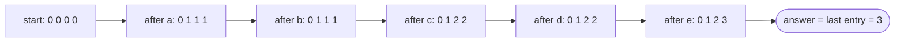

# Longest Common Subsequence

Given two strings `text1` and `text2`, return the length of their longest common subsequence (characters in the same relative order, not necessarily contiguous), or 0 if there is none.

## Algorithm Strategy (Dynamic Programming with Two Rolling Rows)

1. Guard first: a `null` string has no common subsequence, so the answer is 0.
2. Let `dp[i][j]` be the LCS length of the first `i` characters of `text1` and the first `j` characters of `text2`. If `text1[i - 1] == text2[j - 1]` then `dp[i][j] = dp[i - 1][j - 1] + 1`, otherwise `dp[i][j] = max(dp[i - 1][j], dp[i][j - 1])`.
3. Row `i` depends only on row `i - 1`, so keep just two arrays, `previous` and `current`, and swap them after every row.
4. Use the shorter string for the columns, so the arrays have `min(m, n) + 1` entries.
5. The answer is the last entry of the final row.

## Example walkthrough

- For `"abcde"` and `"ace"` (columns = the shorter `"ace"`): the equal pairs a, c and e each add 1 along a diagonal, so the last row ends with `[0, 1, 2, 3]`.
- Result: `3` ("ace").

## Complexity Analysis

- **Time Complexity:** `O(m * n)` — Every table cell is computed once.
- **Space Complexity:** `O(min(m, n))` — Two rows of the shorter string's length instead of the whole table.

## Approaches

The same problem can be solved in several ways. The approach marked (Optimized) is the one to use in practice.

### Approach 1: Plain Recursion

If the last characters match they are part of the subsequence; otherwise drop the last character of either string and take the better result. Exponential.

```java
public static int lcsRecursive(String a, String b) {
    return solve(a, b, a.length(), b.length());
}

private static int solve(String a, String b, int i, int j) {
    if (i == 0 || j == 0) return 0;
    if (a.charAt(i - 1) == b.charAt(j - 1)) return 1 + solve(a, b, i - 1, j - 1);
    return Math.max(solve(a, b, i - 1, j), solve(a, b, i, j - 1));
}
```

- **Time Complexity:** O(2^(m + n))
- **Space Complexity:** O(m + n)

### Approach 2: Memoization (Top-Down DP)

The same recursion with a table of already solved `(i, j)` pairs.

```java
public static int lcsMemo(String a, String b) {
    int[][] memo = new int[a.length() + 1][b.length() + 1];
    for (int[] row : memo) Arrays.fill(row, -1);
    return solve(a, b, a.length(), b.length(), memo);
}

private static int solve(String a, String b, int i, int j, int[][] memo) {
    if (i == 0 || j == 0) return 0;
    if (memo[i][j] != -1) return memo[i][j];
    if (a.charAt(i - 1) == b.charAt(j - 1)) memo[i][j] = 1 + solve(a, b, i - 1, j - 1, memo);
    else memo[i][j] = Math.max(solve(a, b, i - 1, j, memo), solve(a, b, i, j - 1, memo));
    return memo[i][j];
}
```

- **Time Complexity:** O(m * n)
- **Space Complexity:** O(m * n)

### Approach 3: Bottom-Up DP Table

`dp[i][j]` is the LCS of the first `i` and `j` characters. This is the version implemented in the repository.

```java
public static int longestCommonSubsequence(String text1, String text2) {
    int m = text1.length(), n = text2.length();
    int[][] dp = new int[m + 1][n + 1];
    for (int i = 1; i <= m; i++) {
        for (int j = 1; j <= n; j++) {
            if (text1.charAt(i - 1) == text2.charAt(j - 1)) dp[i][j] = dp[i - 1][j - 1] + 1;
            else dp[i][j] = Math.max(dp[i - 1][j], dp[i][j - 1]);
        }
    }
    return dp[m][n];
}
```

- **Time Complexity:** O(m * n)
- **Space Complexity:** O(m * n)

### Approach 4: Two Rolling Rows (Optimized)

A row of the table only depends on the previous row, so keep just two rows of the shorter string's length. The LCS length is unchanged and the memory drops to `O(min(m, n))`.

```java
public static int lcsTwoRows(String text1, String text2) {
    if (text1.length() < text2.length()) { String t = text1; text1 = text2; text2 = t; }   // columns = shorter string
    int n = text2.length();
    int[] previous = new int[n + 1], current = new int[n + 1];
    for (int i = 1; i <= text1.length(); i++) {
        for (int j = 1; j <= n; j++) {
            if (text1.charAt(i - 1) == text2.charAt(j - 1)) current[j] = previous[j - 1] + 1;
            else current[j] = Math.max(previous[j], current[j - 1]);
        }
        int[] temp = previous; previous = current; current = temp;
    }
    return previous[n];
}
```

- **Time Complexity:** O(m * n)
- **Space Complexity:** O(min(m, n))

### Comparison

| # | Approach | Time | Space |
|---|----------|------|-------|
| 1 | Plain Recursion | O(2^(m + n)) | O(m + n) |
| 2 | Memoization (Top-Down DP) | O(m * n) | O(m * n) |
| 3 | Bottom-Up DP Table | O(m * n) | O(m * n) |
| 4 | Two Rolling Rows (Optimized) | O(m * n) | O(min(m, n)) |

## Source Code

### LongestCommonSubsequence.java

```java
public class LongestCommonSubsequence {

    public static void main(String[] args) {
        String[][] inputs = {{"abcde", "ace"}, {"abc", "abc"}, {"abc", "def"}, {"AGGTAB", "GXTXAYB"}, {"", "abc"}, {null, "abc"}};
        for (String[] input : inputs) {
            System.out.println("Input  : text1 = " + quote(input[0]) + ", text2 = " + quote(input[1]));
            System.out.println("Output : " + longestCommonSubsequence(input[0], input[1]));
            System.out.println();
        }
    }

    private static String quote(String s) {
        return s == null ? "null" : "\"" + s + "\"";
    }

    public static int longestCommonSubsequence(String text1, String text2) {
        // Guard Clause: a missing string has nothing in common with anything
        if (text1 == null || text2 == null) {
            return 0;
        }
        // The columns follow the shorter string, which keeps the two rows small
        if (text1.length() < text2.length()) {
            String temp = text1;
            text1 = text2;
            text2 = temp;
        }

        int n = text2.length();
        int[] previous = new int[n + 1];
        int[] current = new int[n + 1];
        for (int i = 1; i <= text1.length(); i++) {
            for (int j = 1; j <= n; j++) {
                if (text1.charAt(i - 1) == text2.charAt(j - 1)) {
                    current[j] = previous[j - 1] + 1;
                } else {
                    current[j] = Math.max(previous[j], current[j - 1]);
                }
            }
            int[] temp = previous;
            previous = current;
            current = temp;
        }
        return previous[n];
    }
}
```

## Solution

The optimized solution is Approach 4 above, which is also the version implemented in this repository.

The idea: the best subsequence of the first `i` characters of one string and the first `j` characters of the other either extends the diagonal result (the two characters match) or is the better of "skip a character of the first string" and "skip a character of the second string". Row `i` only needs row `i - 1`, so two arrays are enough, and the columns follow the shorter string so those arrays stay short.

**Input:** `text1 = "abcde"`, `text2 = "ace"`. The longer string gives the rows, the shorter one the columns, so the arrays hold 4 entries (`""`, `a`, `c`, `e`). `previous` starts as `0 0 0 0`.

| Row `i` | Character of `abcde` | `current` after the row (columns: empty, a, c, e) |
|---------|----------------------|---------------------------------------------------|
| 1 | `a` | `0 1 1 1` |
| 2 | `b` | `0 1 1 1` |
| 3 | `c` | `0 1 2 2` |
| 4 | `d` | `0 1 2 2` |
| 5 | `e` | `0 1 2 3` |

Reading row 1 (`a`): only the column `a` matches, so `current[1] = previous[0] + 1 = 1`; the next columns take the left neighbour, `1 1`. Row 3 (`c`): column `c` matches, `current[2] = previous[1] + 1 = 2`. Row 5 (`e`): column `e` matches, `current[3] = previous[2] + 1 = 3`. After each row the two arrays swap roles, so no more than two rows exist at any time.



**Edge cases.** A `null` string returns 0 through the guard clause; an empty string gives rows (or columns) of zeros and so the answer 0. If the strings share nothing (`abc`, `def`) every cell stays 0. The strings are swapped only to pick the shorter one for the columns; the result is symmetric, so it does not change.

**Result:** `3` (the subsequence `ace`), matching the class output.
