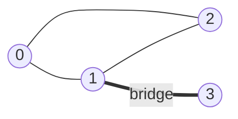

# Critical Connections in a Network

There are `n` servers numbered `0..n-1` connected by undirected links `connections[i] = [a, b]`, and every server can reach every other one. A connection is critical if removing it makes some servers unable to reach others. Return all critical connections (the bridges of the graph) in any order.

## Algorithm Strategy (Tarjan's Bridge-Finding Algorithm (Discovery and Low-Link Times))

1. Run a DFS and give each vertex a discovery time `disc[v]`. Also compute `low[v]`, the smallest discovery time reachable from the subtree of `v` using tree edges plus at most one back edge.
2. For a tree edge `v -> w`, after the recursive call set `low[v] = min(low[v], low[w])`. For an edge to an already-visited vertex (a back edge, not the edge back to the parent) set `low[v] = min(low[v], disc[w])`.
3. The edge `v -> w` is a bridge exactly when `low[w] > disc[v]`: the subtree of `w` has no way back to `v` or above except through this edge.
4. Skip the edge to the parent once so the tree edge itself is not mistaken for a back edge. Parallel edges are not part of this problem.

## Example walkthrough

- For `n = 4` and connections `[[0,1],[1,2],[2,0],[1,3]]`: the cycle `0-1-2` gives low values of 0 for vertices 0, 1, 2.
- Vertex 3 hangs from 1 with `low[3] = 3 > disc[1] = 1`, so `[1, 3]` is the only bridge.

## Complexity Analysis

- **Time Complexity:** `O(V + E)` — A single DFS.
- **Space Complexity:** `O(V + E)` — The adjacency list plus the recursion stack.

## Approaches

The same problem can be solved in several ways. The approach marked (Optimized) is the one to use in practice.

### Approach 1: Remove Each Edge and Test Connectivity

For every edge, delete it and run a BFS from vertex 0; if some vertex becomes unreachable the edge is a bridge.

```java
public static List<List<Integer>> criticalConnectionsBrute(int n, List<List<Integer>> connections) {
    List<List<Integer>> bridges = new ArrayList<>();
    for (int skip = 0; skip < connections.size(); skip++) {
        List<List<Integer>> graph = new ArrayList<>();
        for (int i = 0; i < n; i++) graph.add(new ArrayList<>());
        for (int e = 0; e < connections.size(); e++) {
            if (e == skip) continue;
            graph.get(connections.get(e).get(0)).add(connections.get(e).get(1));
            graph.get(connections.get(e).get(1)).add(connections.get(e).get(0));
        }
        boolean[] seen = new boolean[n];
        Deque<Integer> stack = new ArrayDeque<>();
        stack.push(0);
        seen[0] = true;
        int count = 1;
        while (!stack.isEmpty()) {
            for (int w : graph.get(stack.pop())) {
                if (!seen[w]) { seen[w] = true; count++; stack.push(w); }
            }
        }
        if (count < n) bridges.add(connections.get(skip));
    }
    return bridges;
}
```

- **Time Complexity:** O(E * (V + E))
- **Space Complexity:** O(V + E)

### Approach 2: Tarjan Low-Link DFS (Optimized)

Compute discovery and low-link times in one DFS; an edge is a bridge when the child subtree cannot reach the parent or above. This is the version implemented in the repository.

```java
public static List<List<Integer>> criticalConnections(int n, List<List<Integer>> connections) {
    List<List<Integer>> graph = new ArrayList<>();
    for (int i = 0; i < n; i++) {
        graph.add(new ArrayList<>());
    }
    for (List<Integer> edge : connections) {
        graph.get(edge.get(0)).add(edge.get(1));
        graph.get(edge.get(1)).add(edge.get(0));
    }
    int[] disc = new int[n];
    int[] low = new int[n];
    Arrays.fill(disc, -1);
    List<List<Integer>> bridges = new ArrayList<>();
    dfs(0, -1, graph, disc, low, new int[]{0}, bridges);
    return bridges;
}

private static void dfs(int v, int parent, List<List<Integer>> graph, int[] disc, int[] low,
                        int[] timer, List<List<Integer>> bridges) {
    disc[v] = low[v] = timer[0]++;
    for (int w : graph.get(v)) {
        if (w == parent) {
            continue;
        }
        if (disc[w] == -1) {
            dfs(w, v, graph, disc, low, timer, bridges);
            low[v] = Math.min(low[v], low[w]);
            if (low[w] > disc[v]) {
                bridges.add(Arrays.asList(v, w));
            }
        } else {
            low[v] = Math.min(low[v], disc[w]);
        }
    }
}
```

- **Time Complexity:** O(V + E)
- **Space Complexity:** O(V + E)

### Comparison

| # | Approach | Time | Space |
|---|----------|------|-------|
| 1 | Remove Each Edge and Test Connectivity | O(E * (V + E)) | O(V + E) |
| 2 | Tarjan Low-Link DFS (Optimized) | O(V + E) | O(V + E) |

### Optimized Solution

The optimized solution is Approach 2 above, which is also the version implemented in this repository.

#### Optimized solution explained

The idea: run one DFS from server 0 and give each server a discovery number `disc[v]` (the order it is first reached). Also keep `low[v]`, the smallest discovery number that the subtree of `v` can reach, using tree edges plus back edges to already-visited servers (the edge back to the parent is skipped). After finishing a child `w` of `v`, the link `v - w` is a bridge exactly when `low[w] > disc[v]`: nothing in the subtree of `w` can get back to `v` or higher except through this link.

**Input:** `n = 4`, `connections = [[0,1], [1,2], [2,0], [1,3]]`. Adjacency lists: `0: [1,2]`, `1: [0,2,3]`, `2: [1,0]`, `3: [1]`. All `disc` start at -1.

| Step | Event | `disc` | `low` | Note |
|------|-------|--------|-------|------|
| 1 | enter 0 (parent -1) | `[0,-1,-1,-1]` | `[0,-,-,-]` | first neighbour 1 is unvisited, recurse |
| 2 | enter 1 (parent 0) | `[0,1,-1,-1]` | `[0,1,-,-]` | skip neighbour 0 (parent), recurse into 2 |
| 3 | enter 2 (parent 1) | `[0,1,2,-1]` | `[0,1,2,-]` | skip 1 (parent) |
| 4 | at 2, neighbour 0 already visited | | `[0,1,0,-]` | back edge: `low[2] = min(2, disc[0]) = 0` |
| 5 | back at 1 from 2 | | `[0,0,0,-]` | `low[1] = min(1, low[2]) = 0`; `low[2] = 0 > disc[1] = 1`? no |
| 6 | enter 3 (parent 1) | `[0,1,2,3]` | `[0,0,0,3]` | no other neighbours |
| 7 | back at 1 from 3 | | `[0,0,0,3]` | `low[3] = 3 > disc[1] = 1`: **bridge `[1, 3]`** |
| 8 | back at 0 from 1 | | `[0,0,0,3]` | `low[1] = 0 > disc[0] = 0`? no |
| 9 | at 0, neighbour 2 already visited | | `[0,0,0,3]` | back edge, `low[0]` stays 0 |



**Edge cases.** Two servers with one link (`n = 2`, `[[0,1]]`): `low[1] = 1 > disc[0] = 0`, so `[[0, 1]]` is reported. A graph that is one big cycle reports nothing, because every `low` value reaches back to the start. The graph is assumed connected (the DFS starts only at 0) and without parallel links.

**Result:** the only bridge is `[1, 3]`, so the method returns `[[1, 3]]`, as the class prints.

## Source Code

### CriticalConnections.java

```java
import java.util.ArrayList;
import java.util.Arrays;
import java.util.List;

public class CriticalConnections {

    public static void main(String[] args) {
        List<List<Integer>> connections = Arrays.asList(
                Arrays.asList(0, 1), Arrays.asList(1, 2), Arrays.asList(2, 0), Arrays.asList(1, 3));
        System.out.println("Input  : n = 4, connections = " + connections);
        System.out.println("Output : " + criticalConnections(4, connections));
        System.out.println();

        List<List<Integer>> single = Arrays.asList(Arrays.asList(0, 1));
        System.out.println("Input  : n = 2, connections = " + single);
        System.out.println("Output : " + criticalConnections(2, single));
    }

    public static List<List<Integer>> criticalConnections(int n, List<List<Integer>> connections) {
        List<List<Integer>> graph = new ArrayList<>();
        for (int i = 0; i < n; i++) {
            graph.add(new ArrayList<>());
        }
        for (List<Integer> edge : connections) {
            graph.get(edge.get(0)).add(edge.get(1));
            graph.get(edge.get(1)).add(edge.get(0));
        }
        int[] disc = new int[n];
        int[] low = new int[n];
        Arrays.fill(disc, -1);
        List<List<Integer>> bridges = new ArrayList<>();
        dfs(0, -1, graph, disc, low, new int[]{0}, bridges);
        return bridges;
    }

    private static void dfs(int v, int parent, List<List<Integer>> graph, int[] disc, int[] low,
                            int[] timer, List<List<Integer>> bridges) {
        disc[v] = low[v] = timer[0]++;
        for (int w : graph.get(v)) {
            if (w == parent) {
                continue;
            }
            if (disc[w] == -1) {
                dfs(w, v, graph, disc, low, timer, bridges);
                low[v] = Math.min(low[v], low[w]);
                if (low[w] > disc[v]) {
                    bridges.add(Arrays.asList(v, w));
                }
            } else {
                low[v] = Math.min(low[v], disc[w]);
            }
        }
    }
}
```
