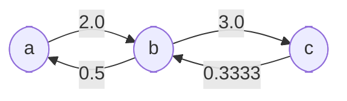

# Evaluate Division

You are given equations `A / B = k` as variable pairs with values, and queries `C / D`. Return the answer to each query as a `double`, or `-1.0` if it cannot be determined (an unknown variable or two variables that are not connected by the equations).

## Algorithm Strategy (Weighted Graph and DFS)

1. Model each variable as a node. The equation `A / B = k` gives an edge `A -> B` with weight `k` and an edge `B -> A` with weight `1 / k`.
2. A query `C / D` is the product of the edge weights along any path from `C` to `D`, because `C / D = (C / X) * (X / Y) * ... * (Z / D)`.
3. For each query run a DFS from `C`, multiplying the weights, until `D` is reached. Track visited nodes to avoid cycles.
4. If either variable does not appear in the graph, or `D` is not reachable from `C`, the answer is `-1.0`. A variable divided by itself is `1.0` when it exists.

## Example walkthrough

- For `a / b = 2.0` and `b / c = 3.0`: the edges are `a -> b = 2`, `b -> a = 0.5`, `b -> c = 3`, `c -> b = 1/3`.
- Query `a / c`: `2 * 3 = 6.0`. Query `c / a`: `(1/3) * 0.5 = 0.16667`. Query `a / e`: `e` is unknown, so `-1.0`.

## Complexity Analysis

- **Time Complexity:** `O(Q * (V + E))` — One DFS per query over a graph with `V` variables and `E` equations.
- **Space Complexity:** `O(V + E)` — The graph and the recursion stack.

## Approaches

The same problem can be solved in several ways. The approach marked (Optimized) is the one to use in practice.

### Approach 1: Weighted Union-Find

Keep for each variable its root and the ratio `variable / root`. Two variables are connected when they share a root, and their ratio is the quotient of the two stored ratios. Path compression keeps the ratios correct.

```java
public static double[] calcEquationUnionFind(List<List<String>> equations, double[] values, List<List<String>> queries) {
    Map<String, String> parent = new HashMap<>();
    Map<String, Double> ratio = new HashMap<>();       // ratio.get(x) = x / parent.get(x)
    for (int i = 0; i < equations.size(); i++) {
        String a = equations.get(i).get(0), b = equations.get(i).get(1);
        parent.putIfAbsent(a, a); ratio.putIfAbsent(a, 1.0);
        parent.putIfAbsent(b, b); ratio.putIfAbsent(b, 1.0);
        String ra = find(parent, ratio, a), rb = find(parent, ratio, b);
        if (!ra.equals(rb)) {
            parent.put(ra, rb);
            ratio.put(ra, values[i] * ratio.get(b) / ratio.get(a));
        }
    }
    double[] answers = new double[queries.size()];
    for (int i = 0; i < queries.size(); i++) {
        String a = queries.get(i).get(0), b = queries.get(i).get(1);
        if (!parent.containsKey(a) || !parent.containsKey(b)) { answers[i] = -1.0; continue; }
        String ra = find(parent, ratio, a), rb = find(parent, ratio, b);
        answers[i] = ra.equals(rb) ? ratio.get(a) / ratio.get(b) : -1.0;
    }
    return answers;
}

private static String find(Map<String, String> parent, Map<String, Double> ratio, String x) {
    String p = parent.get(x);
    if (p.equals(x)) return x;
    String root = find(parent, ratio, p);
    ratio.put(x, ratio.get(x) * ratio.get(p));
    parent.put(x, root);
    return root;
}
```

- **Time Complexity:** O((E + Q) * alpha(V))
- **Space Complexity:** O(V)

### Approach 2: Weighted Graph with DFS (Optimized)

Store `A / B` and `B / A` as edges and multiply the weights along a DFS path for each query. This is the version implemented in the repository.

```java
public static double[] calcEquation(List<List<String>> equations, double[] values, List<List<String>> queries) {
    Map<String, Map<String, Double>> graph = new HashMap<>();
    for (int i = 0; i < equations.size(); i++) {
        String a = equations.get(i).get(0);
        String b = equations.get(i).get(1);
        graph.computeIfAbsent(a, k -> new HashMap<>()).put(b, values[i]);
        graph.computeIfAbsent(b, k -> new HashMap<>()).put(a, 1.0 / values[i]);
    }
    double[] answers = new double[queries.size()];
    for (int i = 0; i < queries.size(); i++) {
        String from = queries.get(i).get(0);
        String to = queries.get(i).get(1);
        if (!graph.containsKey(from) || !graph.containsKey(to)) {
            answers[i] = -1.0;
        } else {
            answers[i] = dfs(graph, from, to, new HashSet<>());
        }
    }
    return answers;
}

private static double dfs(Map<String, Map<String, Double>> graph, String from, String to, Set<String> visited) {
    if (from.equals(to)) {
        return 1.0;
    }
    visited.add(from);
    for (Map.Entry<String, Double> edge : graph.get(from).entrySet()) {
        if (!visited.contains(edge.getKey())) {
            double rest = dfs(graph, edge.getKey(), to, visited);
            if (rest != -1.0) {
                return edge.getValue() * rest;
            }
        }
    }
    return -1.0;
}
```

- **Time Complexity:** O(Q * (V + E))
- **Space Complexity:** O(V + E)

### Comparison

| # | Approach | Time | Space |
|---|----------|------|-------|
| 1 | Weighted Union-Find | O((E + Q) * alpha(V)) | O(V) |
| 2 | Weighted Graph with DFS (Optimized) | O(Q * (V + E)) | O(V + E) |

### Optimized Solution

The optimized solution is Approach 2 above, which is also the version implemented in this repository.

#### Optimized solution explained

The idea: every equation `a / b = v` is an edge in a weighted graph: `a -> b` with weight `v` and `b -> a` with weight `1/v`. A query `x / y` is the product of the weights along any path from `x` to `y`. A DFS from `x` multiplies the edge weight with the result of the rest of the path and uses a `visited` set so it does not loop. Unknown variables or unreachable pairs give `-1.0`.

**Input:** `equations = [[a,b],[b,c]]`, `values = [2.0, 3.0]`. Graph built: `a -> b (2.0)`, `b -> a (0.5)`, `b -> c (3.0)`, `c -> b (0.3333...)`.

| Query | Check | DFS | Answer |
|-------|-------|-----|--------|
| `a / c` | both exist | `dfs(a)`: edge `a->b` 2.0, `dfs(b)`: edge `b->a` skipped (a is visited), edge `b->c` 3.0, `dfs(c)`: `c == c` returns 1.0, so `dfs(b)` = 3.0 * 1.0 = 3.0 and `dfs(a)` = 2.0 * 3.0 | `6.0` |
| `b / a` | both exist | `dfs(b)`: edge `b->a` 0.5, `dfs(a)` returns 1.0 | `0.5` |
| `a / e` | `e` not in the graph | no DFS | `-1.0` |
| `a / a` | both exist | `dfs(a)`: `a == a` returns 1.0 immediately | `1.0` |
| `x / x` | `x` not in the graph | no DFS | `-1.0` |



The query `a / c` follows `a -> b -> c`: `2.0 * 3.0 = 6.0`, which is right because `a/b * b/c = a/c`. Note the unknown-variable check comes first, so `x / x` is `-1.0` even though a variable divided by itself would normally be 1.

**Edge cases.** A variable never seen in an equation gives `-1.0`; variables in separate components (no path) give `-1.0`, because the DFS returns `-1.0` when it runs out of unvisited neighbours. The DFS tests for `-1.0` as the "no path" marker, which assumes real answers are never exactly `-1.0` (true here since all values are positive).

**Result:** `[6.0, 0.5, -1.0, 1.0, -1.0]`, identical to the class output.

## Source Code

### EvaluateDivision.java

```java
import java.util.Arrays;
import java.util.HashMap;
import java.util.HashSet;
import java.util.List;
import java.util.Map;
import java.util.Set;

public class EvaluateDivision {

    public static void main(String[] args) {
        List<List<String>> equations = Arrays.asList(Arrays.asList("a", "b"), Arrays.asList("b", "c"));
        double[] values = {2.0, 3.0};
        List<List<String>> queries = Arrays.asList(Arrays.asList("a", "c"), Arrays.asList("b", "a"),
                Arrays.asList("a", "e"), Arrays.asList("a", "a"), Arrays.asList("x", "x"));
        System.out.println("Input  : equations = " + equations + ", values = " + Arrays.toString(values));
        System.out.println("         queries = " + queries);
        System.out.println("Output : " + Arrays.toString(calcEquation(equations, values, queries)));
    }

    public static double[] calcEquation(List<List<String>> equations, double[] values, List<List<String>> queries) {
        Map<String, Map<String, Double>> graph = new HashMap<>();
        for (int i = 0; i < equations.size(); i++) {
            String a = equations.get(i).get(0);
            String b = equations.get(i).get(1);
            graph.computeIfAbsent(a, k -> new HashMap<>()).put(b, values[i]);
            graph.computeIfAbsent(b, k -> new HashMap<>()).put(a, 1.0 / values[i]);
        }
        double[] answers = new double[queries.size()];
        for (int i = 0; i < queries.size(); i++) {
            String from = queries.get(i).get(0);
            String to = queries.get(i).get(1);
            if (!graph.containsKey(from) || !graph.containsKey(to)) {
                answers[i] = -1.0;
            } else {
                answers[i] = dfs(graph, from, to, new HashSet<>());
            }
        }
        return answers;
    }

    private static double dfs(Map<String, Map<String, Double>> graph, String from, String to, Set<String> visited) {
        if (from.equals(to)) {
            return 1.0;
        }
        visited.add(from);
        for (Map.Entry<String, Double> edge : graph.get(from).entrySet()) {
            if (!visited.contains(edge.getKey())) {
                double rest = dfs(graph, edge.getKey(), to, visited);
                if (rest != -1.0) {
                    return edge.getValue() * rest;
                }
            }
        }
        return -1.0;
    }
}
```
