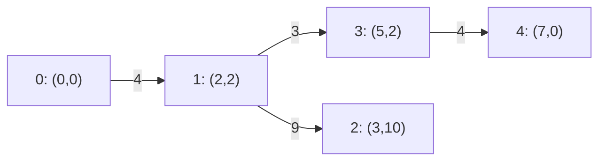

# Min Cost to Connect All Points

Given points `[x, y]` on a 2D plane, the cost of connecting two points is their Manhattan distance `|x1 - x2| + |y1 - y2|`. Return the minimum cost to connect all points so that there is exactly one simple path between any two points (a minimum spanning tree).

## Algorithm Strategy (Prim's Algorithm on the Complete Graph)

1. Every pair of points is connected, so the graph is dense (`n^2` edges). Prim's algorithm without a heap fits it well.
2. Keep `minCost[i]`, the cheapest known edge connecting point `i` to the tree, and a flag `inTree[i]`. Start with point 0 at cost 0.
3. Repeat `n` times: pick the point that is not yet in the tree and has the smallest `minCost`, add its cost to the total and mark it as part of the tree.
4. Update `minCost` of every point not in the tree with its distance to the newly added point if that is smaller.

## Example walkthrough

- For `[[0,0],[2,2],[3,10],[5,2],[7,0]]`: the tree edges cost 4 (0,0 to 2,2), 3 (2,2 to 5,2), 4 (5,2 to 7,0) and 9 (2,2 to 3,10).
- Total: `20`.

## Complexity Analysis

- **Time Complexity:** `O(n^2)` — `n` rounds, each scanning all points.
- **Space Complexity:** `O(n)` — Two arrays.

## Approaches

The same problem can be solved in several ways. The approach marked (Optimized) is the one to use in practice.

### Approach 1: Kruskal's Algorithm

Generate all `n(n-1)/2` edges, sort them by cost and add an edge whenever it joins two different components (union-find), until `n - 1` edges are chosen.

```java
public static int minCostKruskal(int[][] points) {
    int n = points.length;
    List<int[]> edges = new ArrayList<>();
    for (int i = 0; i < n; i++)
        for (int j = i + 1; j < n; j++)
            edges.add(new int[]{i, j, Math.abs(points[i][0] - points[j][0]) + Math.abs(points[i][1] - points[j][1])});
    edges.sort(Comparator.comparingInt((int[] e) -> e[2]));
    int[] parent = new int[n];
    for (int i = 0; i < n; i++) parent[i] = i;
    int total = 0, used = 0;
    for (int[] edge : edges) {
        int a = find(parent, edge[0]), b = find(parent, edge[1]);
        if (a == b) continue;
        parent[a] = b;
        total += edge[2];
        if (++used == n - 1) break;
    }
    return total;
}

private static int find(int[] parent, int x) {
    while (parent[x] != x) { parent[x] = parent[parent[x]]; x = parent[x]; }
    return x;
}
```

- **Time Complexity:** O(n^2 log n)
- **Space Complexity:** O(n^2)

### Approach 2: Prim's Algorithm with a Priority Queue of Edges

Grow the tree from point 0. Keep a min-heap of candidate edges leaving the tree; take the cheapest edge that reaches a new point. Better suited to sparse graphs than to this complete graph.

```java
public static int minCostPrimHeap(int[][] points) {
    int n = points.length, total = 0, added = 0;
    boolean[] inTree = new boolean[n];
    PriorityQueue<int[]> heap = new PriorityQueue<>(Comparator.comparingInt((int[] e) -> e[1]));        // {point, cost}
    heap.add(new int[]{0, 0});
    while (added < n) {
        int[] edge = heap.poll();
        if (inTree[edge[0]]) continue;
        inTree[edge[0]] = true;
        total += edge[1];
        added++;
        for (int next = 0; next < n; next++) {
            if (!inTree[next]) heap.add(new int[]{next, Math.abs(points[edge[0]][0] - points[next][0]) + Math.abs(points[edge[0]][1] - points[next][1])});
        }
    }
    return total;
}
```

- **Time Complexity:** O(n^2 log n)
- **Space Complexity:** O(n^2)

### Approach 3: Borůvka's Algorithm

In every round each component picks its cheapest edge to another component; all picked edges are added at once. The number of components at least halves per round, so there are `O(log n)` rounds. Easy to parallelise.

```java
public static int minCostBoruvka(int[][] points) {
    int n = points.length, components = n, total = 0;
    int[] parent = new int[n];
    for (int i = 0; i < n; i++) parent[i] = i;
    while (components > 1) {
        int[][] cheapest = new int[n][];                          // per component root: {u, v, cost}
        for (int i = 0; i < n; i++) {
            for (int j = i + 1; j < n; j++) {
                int a = findRoot(parent, i), b = findRoot(parent, j);
                if (a == b) continue;
                int cost = Math.abs(points[i][0] - points[j][0]) + Math.abs(points[i][1] - points[j][1]);
                if (cheapest[a] == null || cost < cheapest[a][2]) cheapest[a] = new int[]{i, j, cost};
                if (cheapest[b] == null || cost < cheapest[b][2]) cheapest[b] = new int[]{i, j, cost};
            }
        }
        for (int[] edge : cheapest) {
            if (edge == null) continue;
            int a = findRoot(parent, edge[0]), b = findRoot(parent, edge[1]);
            if (a != b) { parent[a] = b; total += edge[2]; components--; }
        }
    }
    return total;
}

private static int findRoot(int[] parent, int x) {
    while (parent[x] != x) { parent[x] = parent[parent[x]]; x = parent[x]; }
    return x;
}
```

- **Time Complexity:** O(n^2 log n)
- **Space Complexity:** O(n)

### Approach 4: Prim's Algorithm with Arrays (Optimized)

On a complete graph the heap is unnecessary: keep the cheapest known cost to the tree for every point and pick the minimum with a linear scan. This is the version implemented in the repository.

```java
public static int minCostConnectPoints(int[][] points) {
    int n = points.length, total = 0;
    int[] minCost = new int[n];
    boolean[] inTree = new boolean[n];
    Arrays.fill(minCost, Integer.MAX_VALUE);
    minCost[0] = 0;
    for (int round = 0; round < n; round++) {
        int next = -1;
        for (int i = 0; i < n; i++) if (!inTree[i] && (next == -1 || minCost[i] < minCost[next])) next = i;
        inTree[next] = true;
        total += minCost[next];
        for (int i = 0; i < n; i++) {
            if (!inTree[i]) minCost[i] = Math.min(minCost[i], Math.abs(points[next][0] - points[i][0]) + Math.abs(points[next][1] - points[i][1]));
        }
    }
    return total;
}
```

- **Time Complexity:** O(n^2)
- **Space Complexity:** O(n)

### Comparison

| # | Approach | Time | Space |
|---|----------|------|-------|
| 1 | Kruskal's Algorithm | O(n^2 log n) | O(n^2) |
| 2 | Prim's Algorithm with a Priority Queue of Edges | O(n^2 log n) | O(n^2) |
| 3 | Borůvka's Algorithm | O(n^2 log n) | O(n) |
| 4 | Prim's Algorithm with Arrays (Optimized) | O(n^2) | O(n) |

## Source Code

### MinCostToConnectAllPoints.java

```java
import java.util.Arrays;

public class MinCostToConnectAllPoints {

    public static void main(String[] args) {
        int[][][] inputs = {
                {{0, 0}, {2, 2}, {3, 10}, {5, 2}, {7, 0}},
                {{3, 12}, {-2, 5}, {-4, 1}},
                {{0, 0}},
                {{0, 0}, {1, 1}, {1, 0}, {-1, 1}}
        };
        for (int[][] points : inputs) {
            System.out.println("Input  : points = " + Arrays.deepToString(points));
            System.out.println("Output : " + minCostConnectPoints(points));
            System.out.println();
        }
    }

    public static int minCostConnectPoints(int[][] points) {
        int n = points.length;
        int[] minCost = new int[n];
        boolean[] inTree = new boolean[n];
        Arrays.fill(minCost, Integer.MAX_VALUE);
        minCost[0] = 0;

        int total = 0;
        for (int round = 0; round < n; round++) {
            int next = -1;
            for (int i = 0; i < n; i++) {
                if (!inTree[i] && (next == -1 || minCost[i] < minCost[next])) {
                    next = i;
                }
            }
            inTree[next] = true;
            total += minCost[next];

            for (int i = 0; i < n; i++) {
                if (!inTree[i]) {
                    int distance = Math.abs(points[next][0] - points[i][0]) + Math.abs(points[next][1] - points[i][1]);
                    minCost[i] = Math.min(minCost[i], distance);
                }
            }
        }
        return total;
    }
}
```

## Solution

The optimized solution is Approach 4 above, which is also the version implemented in this repository.

The idea: the points form a complete graph (every pair has a Manhattan-distance edge), so Prim's algorithm with plain arrays beats a heap. `minCost[i]` holds the cheapest known edge from point `i` to the tree built so far and `inTree[i]` marks the points already joined. Each round picks the outside point with the smallest `minCost`, adds that cost to the total, and then lowers `minCost` of the remaining points using their distance to the newly added point.

**Input:** `points = [[0,0], [2,2], [3,10], [5,2], [7,0]]`. Start: `minCost = [0, inf, inf, inf, inf]`, `total = 0`.

| Round | Picked point | Cost added | `total` | `minCost` after the update (`-` = already in the tree) |
|-------|--------------|------------|---------|--------------------------------------------------------|
| 1 | 0 = (0,0) | 0 | 0 | `[-, 4, 13, 7, 7]` |
| 2 | 1 = (2,2) | 4 | 4 | `[-, -, 9, 3, 7]` |
| 3 | 3 = (5,2) | 3 | 7 | `[-, -, 9, -, 4]` |
| 4 | 4 = (7,0) | 4 | 11 | `[-, -, 9, -, -]` |
| 5 | 2 = (3,10) | 9 | 20 | `[-, -, -, -, -]` |

Example of an update: in round 2 point 3 had cost 7 (distance from (0,0)); its distance to the new point (2,2) is `3 + 0 = 3`, so `minCost[3]` drops to 3. Point 4 stays at 7 because its distance to (2,2) is `5 + 2 = 7`.



**Edge cases.** A single point (`[[0,0]]`) runs one round, adds `minCost[0] = 0` and returns `0`. Each round scans all points twice, giving `O(n^2)` time with no heap and only two arrays of extra space. An empty `points` array is not handled (`minCost[0]` would fail), so the class expects at least one point.

**Result:** the tree edges cost 4 + 3 + 4 + 9, so the method returns `20`, matching the class output. The other sample inputs print `18`, `0` and `4`.
