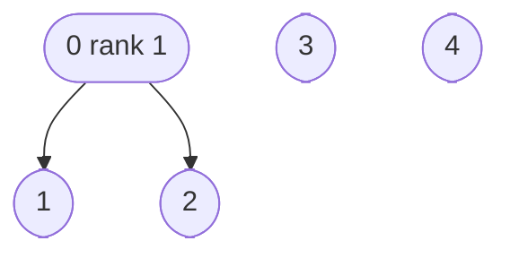

# Union-Find (Disjoint Set Union) from Scratch

Implement a disjoint set union (union-find) over the elements `0..n-1` with `find(x)` (the representative of the set of `x`), `union(a, b)` (merge the sets, returning whether they were different), `connected(a, b)` and `count()` (the number of sets). Use path compression and union by rank so that operations take almost constant time.

## Algorithm Strategy (Parent Array with Path Compression and Union by Rank)

1. Each element points to a parent; a root points to itself. Two elements are in the same set exactly when they have the same root.
2. `find(x)` follows parents to the root. Path compression makes every node on the way point straight to the root, so the next lookups are short. The loop below does it by path halving: each node on the path is re-pointed to its grandparent.
3. `union(a, b)` finds the two roots. If they are the same the elements are already connected. Otherwise attach the root with the smaller rank (an upper bound on the tree height) under the other; if the ranks are equal, pick one and increase its rank.
4. With both optimizations the amortized cost per operation is `O(alpha(n))`, where `alpha` is the inverse Ackermann function, below 5 for any practical `n`. Each successful union reduces the set count by one.

## Example walkthrough

- With 5 elements: `union(0, 1)` and `union(1, 2)` give the set `{0, 1, 2}`; `count()` is 3 (that set, `{3}` and `{4}`).
- `connected(0, 2)` is true, `connected(0, 3)` is false; `union(0, 2)` returns false because they are already joined.

## Complexity Analysis

- **Time Complexity:** `O(alpha(n))` — Amortized per `find` or `union`.
- **Space Complexity:** `O(n)` — The parent and rank arrays.

## Approaches

The same problem can be solved in several ways. The approach marked (Optimized) is the one to use in practice.

### Approach 1: Quick-Find (Component Label Array)

Store the set label of every element. `find` is one array read, but `union` relabels all elements of one set.

```java
class QuickFind {
    private final int[] label;
    private int count;

    QuickFind(int n) {
        label = new int[n];
        count = n;
        for (int i = 0; i < n; i++) label[i] = i;
    }

    int find(int x) { return label[x]; }

    boolean union(int a, int b) {
        int la = label[a], lb = label[b];
        if (la == lb) return false;
        for (int i = 0; i < label.length; i++) if (label[i] == lb) label[i] = la;
        count--;
        return true;
    }

    boolean connected(int a, int b) { return label[a] == label[b]; }
    int count() { return count; }
}
```

- **Time Complexity:** find O(1), union O(n)
- **Space Complexity:** O(n)

### Approach 2: Quick-Union Without Optimizations

Point one root at the other with no rank and no compression. Trees can degrade into long chains, so `find` can take `O(n)`.

```java
class QuickUnion {
    private final int[] parent;
    private int count;

    QuickUnion(int n) {
        parent = new int[n];
        count = n;
        for (int i = 0; i < n; i++) parent[i] = i;
    }

    int find(int x) {
        while (parent[x] != x) x = parent[x];
        return x;
    }

    boolean union(int a, int b) {
        int ra = find(a), rb = find(b);
        if (ra == rb) return false;
        parent[ra] = rb;
        count--;
        return true;
    }

    boolean connected(int a, int b) { return find(a) == find(b); }
    int count() { return count; }
}
```

- **Time Complexity:** O(n) worst case per operation
- **Space Complexity:** O(n)

### Approach 3: Path Compression and Union by Rank (Optimized)

Flatten paths while searching and always attach the shallower tree under the deeper one, so trees stay almost flat. This is the version implemented in the repository.

```java
public int find(int x) {
    while (parent[x] != x) {
        parent[x] = parent[parent[x]];
        x = parent[x];
    }
    return x;
}

public boolean union(int a, int b) {
    int rootA = find(a);
    int rootB = find(b);
    if (rootA == rootB) {
        return false;
    }
    if (rank[rootA] < rank[rootB]) {
        parent[rootA] = rootB;
    } else if (rank[rootA] > rank[rootB]) {
        parent[rootB] = rootA;
    } else {
        parent[rootB] = rootA;
        rank[rootA]++;
    }
    count--;
    return true;
}

public boolean connected(int a, int b) {
    return find(a) == find(b);
}

public int count() {
    return count;
}
```

- **Time Complexity:** O(alpha(n)) amortized
- **Space Complexity:** O(n)

### Comparison

| # | Approach | Time | Space |
|---|----------|------|-------|
| 1 | Quick-Find (Component Label Array) | find O(1), union O(n) | O(n) |
| 2 | Quick-Union Without Optimizations | O(n) worst case per operation | O(n) |
| 3 | Path Compression and Union by Rank (Optimized) | O(alpha(n)) amortized | O(n) |

### Optimized Solution

The optimized solution is Approach 3 above, which is also the version implemented in this repository.

#### Optimized solution explained

The idea: keep each set as a tree of `parent` pointers whose root represents the set. `find(x)` walks up to the root and shortens the path on the way (path halving: `parent[x] = parent[parent[x]]`). `union(a, b)` finds both roots; if they are equal it returns `false` (already in one set); otherwise the root with the smaller `rank` (an upper bound of the tree height) is attached under the other, so trees stay shallow, and on equal ranks the second root goes under the first and the winner's rank grows by 1. `count` starts at `n` and decreases by one for every real merge. Together, path compression and union by rank make each operation almost O(1).

**Input:** `new UnionFind(5)`, then `union(0,1)`, `union(1,2)`, `count()`, `connected(0,2)`, `connected(0,3)`, `union(0,2)`. Start: `parent = [0,1,2,3,4]`, `rank = [0,0,0,0,0]`, `count = 5`.

| Operation | Roots found | What happens | `parent` | `rank` | `count` | Returns |
|-----------|-------------|--------------|----------|--------|---------|---------|
| `union(0,1)` | 0 and 1 | equal ranks (0, 0): `parent[1] = 0`, `rank[0]` becomes 1 | `[0,0,2,3,4]` | `[1,0,0,0,0]` | 4 | `true` |
| `union(1,2)` | 0 and 2 | `rank[0] = 1 > rank[2] = 0`: `parent[2] = 0` | `[0,0,0,3,4]` | `[1,0,0,0,0]` | 3 | `true` |
| `count()` | | read the counter | | | 3 | `3` |
| `connected(0,2)` | 0 and 0 | same root | | | 3 | `true` |
| `connected(0,3)` | 0 and 3 | different roots | | | 3 | `false` |
| `union(0,2)` | 0 and 0 | same root, nothing changes | `[0,0,0,3,4]` | `[1,0,0,0,0]` | 3 | `false` |



The final state has three sets: `{0,1,2}`, `{3}`, `{4}`. Because rank decided the direction, root 0 stays the root of the bigger tree and 2 is attached directly to it (depth 1) instead of making a chain 2 -> 1 -> 0.

**Edge cases.** `union` of two elements already in one set returns `false` and leaves `count` alone. `find` of a root returns the root itself in zero steps. The class does not check bounds, so an index outside `0..n-1` would throw `ArrayIndexOutOfBoundsException`.

**Result:** `true, true, 3, true, false, false`, identical to the class output.

## Source Code

### UnionFind.java

```java
public class UnionFind {

    private final int[] parent;
    private final int[] rank;
    private int count;

    public UnionFind(int n) {
        parent = new int[n];
        rank = new int[n];
        count = n;
        for (int i = 0; i < n; i++) {
            parent[i] = i;
        }
    }

    public static void main(String[] args) {
        UnionFind uf = new UnionFind(5);
        System.out.println("Input  : UnionFind(5), union(0, 1), union(1, 2), count(), connected(0, 2), connected(0, 3), union(0, 2)");
        boolean a = uf.union(0, 1);
        boolean b = uf.union(1, 2);
        int sets = uf.count();
        boolean c = uf.connected(0, 2);
        boolean d = uf.connected(0, 3);
        boolean e = uf.union(0, 2);
        System.out.println("Output : " + a + ", " + b + ", " + sets + ", " + c + ", " + d + ", " + e);
    }

    public int find(int x) {
        while (parent[x] != x) {
            parent[x] = parent[parent[x]];
            x = parent[x];
        }
        return x;
    }

    public boolean union(int a, int b) {
        int rootA = find(a);
        int rootB = find(b);
        if (rootA == rootB) {
            return false;
        }
        if (rank[rootA] < rank[rootB]) {
            parent[rootA] = rootB;
        } else if (rank[rootA] > rank[rootB]) {
            parent[rootB] = rootA;
        } else {
            parent[rootB] = rootA;
            rank[rootA]++;
        }
        count--;
        return true;
    }

    public boolean connected(int a, int b) {
        return find(a) == find(b);
    }

    public int count() {
        return count;
    }
}
```
