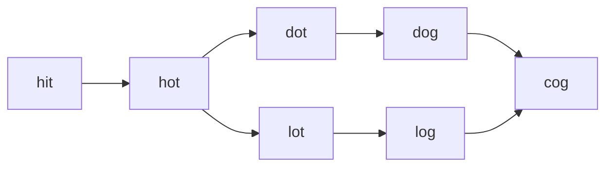

# Word Ladder

A transformation sequence from `beginWord` to `endWord` using a dictionary `wordList` is a sequence of words where every neighbouring pair differs by exactly one letter and every word after `beginWord` is in the dictionary. Return the number of words in the shortest transformation sequence (including `beginWord` and `endWord`), or 0 if none exists.

## Algorithm Strategy (Bidirectional Breadth-First Search)

1. Guard first: `null` arguments, or an `endWord` that is not in the dictionary, give 0.
2. Keep two frontiers, `front` (starting at `beginWord`) and `back` (starting at `endWord`), and a `HashSet` of the dictionary words that are still unvisited.
3. Always expand the smaller frontier. For each word in it, replace each position with every letter `a`-`z`; if a candidate is in the other frontier, the two searches have met and the answer is `length + 1`.
4. Otherwise every unvisited dictionary candidate is removed from the set and becomes part of the next frontier.
5. Each round adds one word to the path length. If a frontier becomes empty, no ladder exists.

## Example walkthrough

- For `hit -> cog` with `[hot, dot, dog, lot, log, cog]`: the front grows `{hit} -> {hot} -> {dot, lot}`; now the other side is smaller, so `{cog}` grows to `{dog, log}`; expanding `dog` generates `dot`, which is in the other frontier, so the searches meet with 5 words (`hit, hot, dot, dog, cog`).
- Result: `5`. Without `cog` in the list, the answer is `0`.

## Complexity Analysis

- **Time Complexity:** `O(N * L * 26)` — `N` words of length `L`: each word is expanded at most once into `26 * L` candidates; in practice the two searches meet in the middle, so far fewer words are expanded than with a one-sided search.
- **Space Complexity:** `O(N * L)` — The word set and the two frontiers.

## Approaches

The same problem can be solved in several ways. The approach marked (Optimized) is the one to use in practice.

### Approach 1: BFS over a Pairwise-Built Graph

First build an adjacency list by comparing every pair of words (one letter apart means connected), then run a BFS from the begin word. Simple, but building the graph is quadratic in the number of words.

```java
public static int ladderLengthPairwise(String beginWord, String endWord, List<String> wordList) {
    List<String> words = new ArrayList<>(wordList);
    if (!words.contains(endWord)) return 0;
    if (!words.contains(beginWord)) words.add(beginWord);
    int n = words.size(), start = words.indexOf(beginWord), end = words.indexOf(endWord);
    List<List<Integer>> graph = new ArrayList<>();
    for (int i = 0; i < n; i++) graph.add(new ArrayList<>());
    for (int i = 0; i < n; i++)
        for (int j = i + 1; j < n; j++)
            if (oneApart(words.get(i), words.get(j))) { graph.get(i).add(j); graph.get(j).add(i); }
    int[] distance = new int[n];
    Arrays.fill(distance, -1);
    distance[start] = 1;
    Queue<Integer> queue = new LinkedList<>();
    queue.add(start);
    while (!queue.isEmpty()) {
        int node = queue.poll();
        if (node == end) return distance[node];
        for (int next : graph.get(node)) if (distance[next] < 0) { distance[next] = distance[node] + 1; queue.add(next); }
    }
    return 0;
}

private static boolean oneApart(String a, String b) {
    if (a.length() != b.length()) return false;
    int diff = 0;
    for (int i = 0; i < a.length(); i++) if (a.charAt(i) != b.charAt(i) && ++diff > 1) return false;
    return diff == 1;
}
```

- **Time Complexity:** O(N^2 * L)
- **Space Complexity:** O(N^2)

### Approach 2: BFS with Wildcard Patterns

Group the words by wildcard patterns such as `h*t`: two words are neighbours exactly when they share a pattern. Neighbours are found by looking up the `L` patterns of a word instead of trying 26 letters at every position.

```java
public static int ladderLengthPatterns(String beginWord, String endWord, List<String> wordList) {
    Map<String, List<String>> groups = new HashMap<>();
    for (String word : wordList) {
        for (int i = 0; i < word.length(); i++) {
            groups.computeIfAbsent(word.substring(0, i) + "*" + word.substring(i + 1), k -> new ArrayList<>()).add(word);
        }
    }
    Set<String> visited = new HashSet<>();
    Queue<String> queue = new LinkedList<>();
    queue.add(beginWord);
    visited.add(beginWord);
    int length = 1;
    while (!queue.isEmpty()) {
        for (int size = queue.size(); size > 0; size--) {
            String word = queue.poll();
            if (word.equals(endWord)) return length;
            for (int i = 0; i < word.length(); i++) {
                for (String next : groups.getOrDefault(word.substring(0, i) + "*" + word.substring(i + 1), Collections.emptyList())) {
                    if (visited.add(next)) queue.add(next);
                }
            }
        }
        length++;
    }
    return 0;
}
```

- **Time Complexity:** O(N * L^2)
- **Space Complexity:** O(N * L^2)

### Approach 3: Bidirectional BFS (Optimized)

Search from both ends at once, always expanding the smaller frontier; the search meets in the middle, so far fewer words are generated than in a one-sided BFS on a dictionary with a high branching factor.

```java
public static int ladderLengthBidirectional(String beginWord, String endWord, List<String> wordList) {
    Set<String> dictionary = new HashSet<>(wordList);
    if (!dictionary.contains(endWord)) return 0;
    Set<String> front = new HashSet<>(), back = new HashSet<>();
    front.add(beginWord);
    back.add(endWord);
    dictionary.remove(beginWord);
    int length = 1;
    while (!front.isEmpty() && !back.isEmpty()) {
        if (front.size() > back.size()) { Set<String> t = front; front = back; back = t; }
        Set<String> next = new HashSet<>();
        for (String word : front) {
            char[] chars = word.toCharArray();
            for (int i = 0; i < chars.length; i++) {
                char original = chars[i];
                for (char c = 'a'; c <= 'z'; c++) {
                    chars[i] = c;
                    String candidate = new String(chars);
                    if (back.contains(candidate)) return length + 1;
                    if (dictionary.remove(candidate)) next.add(candidate);
                }
                chars[i] = original;
            }
        }
        front = next;
        length++;
    }
    return 0;
}
```

- **Time Complexity:** O(N * L * 26), usually far fewer steps
- **Space Complexity:** O(N * L)

### Approach 4: BFS Trying All 26 Letters

Generate the neighbours of a word by replacing each position with every letter and keeping those in the dictionary; remove found words from the set so they are queued once. This is the version implemented in the repository.

```java
public static int ladderLength(String beginWord, String endWord, List<String> wordList) {
    Set<String> words = new HashSet<>(wordList);
    if (!words.contains(endWord)) return 0;
    Queue<String> queue = new LinkedList<>();
    queue.add(beginWord);
    words.remove(beginWord);
    int length = 1;
    while (!queue.isEmpty()) {
        for (int size = queue.size(); size > 0; size--) {
            char[] word = queue.poll().toCharArray();
            for (int i = 0; i < word.length; i++) {
                char original = word[i];
                for (char c = 'a'; c <= 'z'; c++) {
                    word[i] = c;
                    String next = new String(word);
                    if (words.remove(next)) {
                        if (next.equals(endWord)) return length + 1;
                        queue.add(next);
                    }
                }
                word[i] = original;
            }
        }
        length++;
    }
    return 0;
}
```

- **Time Complexity:** O(N * L * 26)
- **Space Complexity:** O(N * L)

### Comparison

| # | Approach | Time | Space |
|---|----------|------|-------|
| 1 | BFS over a Pairwise-Built Graph | O(N^2 * L) | O(N^2) |
| 2 | BFS with Wildcard Patterns | O(N * L^2) | O(N * L^2) |
| 3 | Bidirectional BFS (Optimized) | O(N * L * 26), usually far fewer steps | O(N * L) |
| 4 | BFS Trying All 26 Letters | O(N * L * 26) | O(N * L) |

## Source Code

### WordLadder.java

```java
import java.util.Arrays;
import java.util.HashSet;
import java.util.List;
import java.util.Set;

public class WordLadder {

    public static void main(String[] args) {
        String[] begins = {"hit", "hit", "a", "hit"};
        String[] ends = {"cog", "cog", "c", "hit"};
        List<List<String>> lists = Arrays.asList(
                Arrays.asList("hot", "dot", "dog", "lot", "log", "cog"),
                Arrays.asList("hot", "dot", "dog", "lot", "log"),
                Arrays.asList("a", "b", "c"),
                Arrays.asList("hit", "hot"));
        for (int i = 0; i < begins.length; i++) {
            System.out.println("Input  : beginWord = \"" + begins[i] + "\", endWord = \"" + ends[i] + "\", wordList = " + lists.get(i));
            System.out.println("Output : " + ladderLength(begins[i], ends[i], lists.get(i)));
            System.out.println();
        }
        System.out.println("Input  : wordList = null");
        System.out.println("Output : " + ladderLength("hit", "cog", null));
    }

    public static int ladderLength(String beginWord, String endWord, List<String> wordList) {
        // Guard Clause: nothing to search without both words and a dictionary
        if (beginWord == null || endWord == null || wordList == null) {
            return 0;
        }
        Set<String> dictionary = new HashSet<>(wordList);
        if (!dictionary.contains(endWord)) {
            return 0;
        }
        if (beginWord.equals(endWord)) {
            return 1;                                       // the sequence is the single word
        }

        Set<String> front = new HashSet<>();
        Set<String> back = new HashSet<>();
        front.add(beginWord);
        back.add(endWord);
        dictionary.remove(beginWord);
        dictionary.remove(endWord);
        int length = 1;
        while (!front.isEmpty() && !back.isEmpty()) {
            // Always expand the smaller frontier
            if (front.size() > back.size()) {
                Set<String> temp = front;
                front = back;
                back = temp;
            }
            Set<String> next = new HashSet<>();
            for (String word : front) {
                char[] chars = word.toCharArray();
                for (int i = 0; i < chars.length; i++) {
                    char original = chars[i];
                    for (char c = 'a'; c <= 'z'; c++) {
                        chars[i] = c;
                        String candidate = new String(chars);
                        if (back.contains(candidate)) {
                            return length + 1;              // the two searches met
                        }
                        if (dictionary.remove(candidate)) { // unseen dictionary word
                            next.add(candidate);
                        }
                    }
                    chars[i] = original;
                }
            }
            front = next;
            length++;
        }
        return 0;
    }
}
```

## Solution

The optimized solution is Approach 3 above, which is also the version implemented in this repository.

The idea: the words form a graph where two words are neighbours when they differ by one letter, and the answer is the length of the shortest path from `beginWord` to `endWord`. A search from one end alone spreads out like a fan; two searches that start at both ends and always grow the smaller side meet in the middle and look at far fewer words.

**Input:** `beginWord = "hit"`, `endWord = "cog"`, `wordList = [hot, dot, dog, lot, log, cog]`. The unvisited dictionary starts as `{hot, dot, dog, lot, log}` (`cog` and `hit` are taken out because they are the starting frontiers). `length` starts at 1.

| Round | `front` (expanded) | `back` | Candidates found | Result of the round | `length` after |
|-------|--------------------|--------|------------------|---------------------|----------------|
| 1 | `{hit}` | `{cog}` | `hot` is in the dictionary, nothing in `back` | `next = {hot}` | 2 |
| 2 | `{hot}` | `{cog}` | `dot`, `lot` (from `hot`) | `next = {dot, lot}` | 3 |
| 3 | sizes 2 and 1: swap, so `front = {cog}` | `{dot, lot}` | `dog`, `log` (from `cog`) | `next = {dog, log}` | 4 |
| 4 | `{dog, log}` | `{dot, lot}` | expanding `dog` makes `dot`, which is in `back` | **return `length + 1 = 5`** | |



The search from `hit` reached `hot` and `dot`/`lot`; the search from `cog` reached `dog`/`log`. They meet when `dog` (from the `cog` side) generates `dot` (from the `hit` side), which gives the path `hit, hot, dot, dog, cog` with 5 words. The one-sided search would have expanded every word at distances 1, 2 and 3 from `hit` before finding `cog`.

**Edge cases.** `null` arguments return 0. If `endWord` is not in the list (second sample) the guard clause returns 0 immediately. `beginWord` equal to `endWord` returns 1 (the sequence is that single word). If one frontier becomes empty (no unvisited neighbours), the loop ends and returns 0. Removing every visited word from the dictionary is what prevents the searches from going in circles.

**Result:** `5`, matching the class output.
