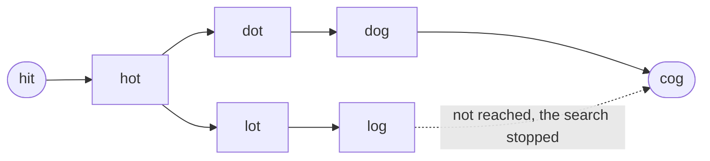

# Word Ladder

A transformation sequence from `beginWord` to `endWord` using a dictionary `wordList` is a sequence of words where every neighbouring pair differs by exactly one letter and every word after `beginWord` is in the dictionary. Return the number of words in the shortest transformation sequence (including `beginWord` and `endWord`), or 0 if none exists.

## Algorithm Strategy (Breadth-First Search over Words)

1. Think of the words as nodes of a graph; two words are connected when they differ by one letter. The shortest transformation is a shortest path, so use BFS.
2. Put the dictionary into a `HashSet` for `O(1)` lookups; if `endWord` is not in it, return 0.
3. For each word taken from the queue, generate its neighbours by replacing each position with every letter `a`-`z`; every neighbour in the set is queued and removed from the set (so it is never queued twice).
4. The BFS level at which `endWord` is reached is the length of the sequence.

## Example walkthrough

- For `hit -> cog` with `[hot, dot, dog, lot, log, cog]`: `hit -> hot -> dot -> dog -> cog` has 5 words.
- Result: `5`. Without `cog` in the list, the answer is `0`.

## Complexity Analysis

- **Time Complexity:** `O(N * L * 26)` — `N` words of length `L`: each word generates `26 * L` candidate neighbours.
- **Space Complexity:** `O(N * L)` — The word set and the queue.

## Approaches

The same problem can be solved in several ways. The approach marked (Optimized) is the one to use in practice.

### Approach 1: BFS over a Pairwise-Built Graph

First build an adjacency list by comparing every pair of words (one letter apart means connected), then run a BFS from the begin word. Simple, but building the graph is quadratic in the number of words.

```java
public static int ladderLengthPairwise(String beginWord, String endWord, List<String> wordList) {
    List<String> words = new ArrayList<>(wordList);
    if (!words.contains(endWord)) return 0;
    if (!words.contains(beginWord)) words.add(beginWord);
    int n = words.size(), start = words.indexOf(beginWord), end = words.indexOf(endWord);
    List<List<Integer>> graph = new ArrayList<>();
    for (int i = 0; i < n; i++) graph.add(new ArrayList<>());
    for (int i = 0; i < n; i++)
        for (int j = i + 1; j < n; j++)
            if (oneApart(words.get(i), words.get(j))) { graph.get(i).add(j); graph.get(j).add(i); }
    int[] distance = new int[n];
    Arrays.fill(distance, -1);
    distance[start] = 1;
    Queue<Integer> queue = new LinkedList<>();
    queue.add(start);
    while (!queue.isEmpty()) {
        int node = queue.poll();
        if (node == end) return distance[node];
        for (int next : graph.get(node)) if (distance[next] < 0) { distance[next] = distance[node] + 1; queue.add(next); }
    }
    return 0;
}

private static boolean oneApart(String a, String b) {
    if (a.length() != b.length()) return false;
    int diff = 0;
    for (int i = 0; i < a.length(); i++) if (a.charAt(i) != b.charAt(i) && ++diff > 1) return false;
    return diff == 1;
}
```

- **Time Complexity:** O(N^2 * L)
- **Space Complexity:** O(N^2)

### Approach 2: BFS with Wildcard Patterns

Group the words by wildcard patterns such as `h*t`: two words are neighbours exactly when they share a pattern. Neighbours are found by looking up the `L` patterns of a word instead of trying 26 letters at every position.

```java
public static int ladderLengthPatterns(String beginWord, String endWord, List<String> wordList) {
    Map<String, List<String>> groups = new HashMap<>();
    for (String word : wordList) {
        for (int i = 0; i < word.length(); i++) {
            groups.computeIfAbsent(word.substring(0, i) + "*" + word.substring(i + 1), k -> new ArrayList<>()).add(word);
        }
    }
    Set<String> visited = new HashSet<>();
    Queue<String> queue = new LinkedList<>();
    queue.add(beginWord);
    visited.add(beginWord);
    int length = 1;
    while (!queue.isEmpty()) {
        for (int size = queue.size(); size > 0; size--) {
            String word = queue.poll();
            if (word.equals(endWord)) return length;
            for (int i = 0; i < word.length(); i++) {
                for (String next : groups.getOrDefault(word.substring(0, i) + "*" + word.substring(i + 1), Collections.emptyList())) {
                    if (visited.add(next)) queue.add(next);
                }
            }
        }
        length++;
    }
    return 0;
}
```

- **Time Complexity:** O(N * L^2)
- **Space Complexity:** O(N * L^2)

### Approach 3: Bidirectional BFS (Optimized)

Search from both ends at once, always expanding the smaller frontier; the search meets in the middle, so far fewer words are generated than in a one-sided BFS on a dictionary with a high branching factor.

```java
public static int ladderLengthBidirectional(String beginWord, String endWord, List<String> wordList) {
    Set<String> dictionary = new HashSet<>(wordList);
    if (!dictionary.contains(endWord)) return 0;
    Set<String> front = new HashSet<>(), back = new HashSet<>();
    front.add(beginWord);
    back.add(endWord);
    dictionary.remove(beginWord);
    int length = 1;
    while (!front.isEmpty() && !back.isEmpty()) {
        if (front.size() > back.size()) { Set<String> t = front; front = back; back = t; }
        Set<String> next = new HashSet<>();
        for (String word : front) {
            char[] chars = word.toCharArray();
            for (int i = 0; i < chars.length; i++) {
                char original = chars[i];
                for (char c = 'a'; c <= 'z'; c++) {
                    chars[i] = c;
                    String candidate = new String(chars);
                    if (back.contains(candidate)) return length + 1;
                    if (dictionary.remove(candidate)) next.add(candidate);
                }
                chars[i] = original;
            }
        }
        front = next;
        length++;
    }
    return 0;
}
```

- **Time Complexity:** O(N * L * 26), usually far fewer steps
- **Space Complexity:** O(N * L)

### Approach 4: BFS Trying All 26 Letters (Implemented)

Generate the neighbours of a word by replacing each position with every letter and keeping those in the dictionary; remove found words from the set so they are queued once. This is the version implemented in the repository.

```java
public static int ladderLength(String beginWord, String endWord, List<String> wordList) {
    Set<String> words = new HashSet<>(wordList);
    if (!words.contains(endWord)) return 0;
    Queue<String> queue = new LinkedList<>();
    queue.add(beginWord);
    words.remove(beginWord);
    int length = 1;
    while (!queue.isEmpty()) {
        for (int size = queue.size(); size > 0; size--) {
            char[] word = queue.poll().toCharArray();
            for (int i = 0; i < word.length; i++) {
                char original = word[i];
                for (char c = 'a'; c <= 'z'; c++) {
                    word[i] = c;
                    String next = new String(word);
                    if (words.remove(next)) {
                        if (next.equals(endWord)) return length + 1;
                        queue.add(next);
                    }
                }
                word[i] = original;
            }
        }
        length++;
    }
    return 0;
}
```

- **Time Complexity:** O(N * L * 26)
- **Space Complexity:** O(N * L)

### Comparison

| # | Approach | Time | Space |
|---|----------|------|-------|
| 1 | BFS over a Pairwise-Built Graph | O(N^2 * L) | O(N^2) |
| 2 | BFS with Wildcard Patterns | O(N * L^2) | O(N * L^2) |
| 3 | Bidirectional BFS (Optimized) | O(N * L * 26), usually far fewer steps | O(N * L) |
| 4 | BFS Trying All 26 Letters (Implemented) | O(N * L * 26) | O(N * L) |

## Source Code

### WordLadder.java

```java
import java.util.Arrays;
import java.util.HashSet;
import java.util.LinkedList;
import java.util.List;
import java.util.Queue;
import java.util.Set;

public class WordLadder {

    public static void main(String[] args) {
        String[] begins = {"hit", "hit", "a"};
        String[] ends = {"cog", "cog", "c"};
        List<List<String>> lists = Arrays.asList(
                Arrays.asList("hot", "dot", "dog", "lot", "log", "cog"),
                Arrays.asList("hot", "dot", "dog", "lot", "log"),
                Arrays.asList("a", "b", "c"));
        for (int i = 0; i < begins.length; i++) {
            System.out.println("Input  : beginWord = \"" + begins[i] + "\", endWord = \"" + ends[i] + "\", wordList = " + lists.get(i));
            System.out.println("Output : " + ladderLength(begins[i], ends[i], lists.get(i)));
            System.out.println();
        }
    }

    public static int ladderLength(String beginWord, String endWord, List<String> wordList) {
        Set<String> words = new HashSet<>(wordList);
        if (!words.contains(endWord)) {
            return 0;
        }

        Queue<String> queue = new LinkedList<>();
        queue.add(beginWord);
        words.remove(beginWord);
        int length = 1;
        while (!queue.isEmpty()) {
            for (int size = queue.size(); size > 0; size--) {
                char[] word = queue.poll().toCharArray();
                for (int i = 0; i < word.length; i++) {
                    char original = word[i];
                    for (char c = 'a'; c <= 'z'; c++) {
                        word[i] = c;
                        String next = new String(word);
                        if (words.remove(next)) {                   // unseen dictionary word
                            if (next.equals(endWord)) {
                                return length + 1;
                            }
                            queue.add(next);
                        }
                    }
                    word[i] = original;
                }
            }
            length++;
        }
        return 0;
    }
}
```

## Solution

This repository implements Approach 4 (BFS Trying All 26 Letters), marked `(Implemented)` in the Approaches section. The optimized approach on this page, Approach 3 (Bidirectional BFS), is not implemented in the class.

This page marks Approach 3 (bidirectional BFS) as the fastest, but the class in this repository implements Approach 4, so this section explains the code as written: a one-directional BFS that tries all 26 letters at every position.

The idea: words are nodes and two words are neighbours when they differ in one letter. BFS from `beginWord` finds the shortest chain, one level per word-change. The dictionary is put in a `HashSet`; instead of a separate visited set, a word is **removed** from the set when it is first reached (`words.remove(next)` returns `true` only for an unseen dictionary word), so it can never be queued twice. For each dequeued word, every position is replaced with `'a'..'z'` and the candidate is looked up in O(1). The first time `endWord` is produced the chain length is `length + 1`.

**Input:** `beginWord = "hit"`, `endWord = "cog"`, `wordList = [hot, dot, dog, lot, log, cog]`. Start: `words = {hot, dot, dog, lot, log, cog}` (`hit` is not in it), queue = `[hit]`, `length = 1`.

| Round | `length` | Word taken | Candidate found in the set | Queue afterwards |
|-------|----------|------------|----------------------------|------------------|
| 1 | 1 | `hit` | `hot` (position 1 = `o`) | `hot` |
| 2 | 2 | `hot` | `dot`, `lot` (position 0) | `dot lot` |
| 3 | 3 | `dot` | `dog` (position 2) | `lot dog` |
| 3 | 3 | `lot` | `log` (position 2) | `dog log` |
| 4 | 4 | `dog` | `cog` (position 0 = `c`), equals `endWord` | return `length + 1 = 5` |



The shortest chain is `hit -> hot -> dot -> dog -> cog`, which has 5 words, so the method returns `5`.

**Edge cases.** If `endWord` is not in the word list the method returns `0` at once (second sample, where `cog` is missing). If the queue empties without producing `endWord` the result is `0`. For `"a" -> "c"` with `[a, b, c]` the first round finds `c`, so the result is `2`. A word equal to `beginWord` in the list is removed up front so it is not revisited.

**Result:** `5` for the traced input, matching the class output (`5`, `0`, `2` for its three samples).
