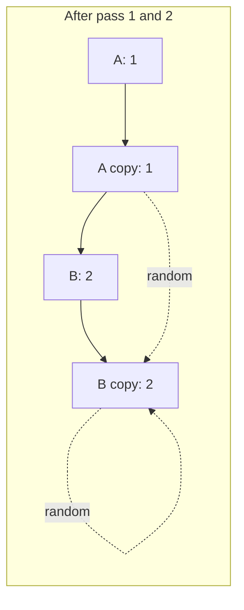

# Copy List with Random Pointer

A linked list of length `n` is given in which every node has an additional `random` pointer that points to any node of the list or to `null`. Construct a deep copy of the list: `n` brand-new nodes whose `next` and `random` pointers point to new nodes only.

## Algorithm Strategy (Interweave the Copies with the Originals)

1. Pass 1: after every original node insert its copy (`A -> A' -> B -> B' -> ...`). The copy of a node is now always `node.next`.
2. Pass 2: set the random pointer of each copy: `copy.random = node.random.next` (the copy of the node that `node.random` points to), or `null`.
3. Pass 3: unweave the two lists: restore the `next` pointers of the originals and link the copies to each other.
4. No hash map is needed, so the extra space is constant (not counting the copy itself).

## Example walkthrough

- For `[[7,null],[13,0],[11,4],[10,2],[1,0]]` (each pair is `[value, index of the random node]`) the copy has the same values and the same random indexes, but none of its nodes is an original node.

## Complexity Analysis

- **Time Complexity:** `O(n)` — Three linear passes.
- **Space Complexity:** `O(1)` — Besides the copied nodes.

## Approaches

The same problem can be solved in several ways. The approach marked (Optimized) is the one to use in practice.

### Approach 1: Hash Map from Original to Copy (Two Passes)

First pass: create a copy of every node and store it in a map. Second pass: set `next` and `random` of every copy through the map.

```java
public static Node copyRandomListMap(Node head) {
    Map<Node, Node> copies = new HashMap<>();
    for (Node curr = head; curr != null; curr = curr.next) copies.put(curr, new Node(curr.val));
    for (Node curr = head; curr != null; curr = curr.next) {
        copies.get(curr).next = copies.get(curr.next);
        copies.get(curr).random = copies.get(curr.random);
    }
    return copies.get(head);
}
```

- **Time Complexity:** O(n)
- **Space Complexity:** O(n)

### Approach 2: Recursion with a Memo Map

Copy a node, remember it in a map before following its pointers, then copy its `next` and `random` targets recursively. The map prevents infinite loops and duplicate copies.

```java
public static Node copyRandomListRecursive(Node head) {
    return copy(head, new HashMap<>());
}

private static Node copy(Node node, Map<Node, Node> copies) {
    if (node == null) return null;
    if (copies.containsKey(node)) return copies.get(node);
    Node clone = new Node(node.val);
    copies.put(node, clone);
    clone.next = copy(node.next, copies);
    clone.random = copy(node.random, copies);
    return clone;
}
```

- **Time Complexity:** O(n)
- **Space Complexity:** O(n) map and recursion stack

### Approach 3: One Pass with a Lazily Filled Map

Walk the list once; for each node get-or-create its copy and the copies of its `next` and `random` targets on demand. Each copy is created exactly once, whenever it is first needed.

```java
public static Node copyRandomListLazy(Node head) {
    if (head == null) return null;
    Map<Node, Node> copies = new HashMap<>();
    for (Node curr = head; curr != null; curr = curr.next) {
        Node clone = copies.computeIfAbsent(curr, n -> new Node(n.val));
        if (curr.next != null) clone.next = copies.computeIfAbsent(curr.next, n -> new Node(n.val));
        if (curr.random != null) clone.random = copies.computeIfAbsent(curr.random, n -> new Node(n.val));
    }
    return copies.get(head);
}
```

- **Time Complexity:** O(n)
- **Space Complexity:** O(n)

### Approach 4: Interweave the Copies (Optimized)

Insert every copy right after its original, set `copy.random = original.random.next`, then separate the two lists. No map, constant extra space. This is the version implemented in the repository.

```java
public static Node copyRandomList(Node head) {
    if (head == null) return null;
    for (Node curr = head; curr != null; curr = curr.next.next) {
        Node copy = new Node(curr.val);
        copy.next = curr.next;
        curr.next = copy;
    }
    for (Node curr = head; curr != null; curr = curr.next.next) curr.next.random = curr.random == null ? null : curr.random.next;
    Node copyHead = head.next;
    for (Node curr = head; curr != null; curr = curr.next) {
        Node copy = curr.next;
        curr.next = copy.next;
        copy.next = copy.next == null ? null : copy.next.next;
    }
    return copyHead;
}
```

- **Time Complexity:** O(n)
- **Space Complexity:** O(1)

### Comparison

| # | Approach | Time | Space |
|---|----------|------|-------|
| 1 | Hash Map from Original to Copy (Two Passes) | O(n) | O(n) |
| 2 | Recursion with a Memo Map | O(n) | O(n) map and recursion stack |
| 3 | One Pass with a Lazily Filled Map | O(n) | O(n) |
| 4 | Interweave the Copies (Optimized) | O(n) | O(1) |

### Optimized Solution

The optimized solution is Approach 4 above, which is also the version implemented in this repository.

#### Optimized solution explained

The idea: copying `next` is easy, but a copy's `random` must point at the copy of the target, which normally needs a hash map from original to copy. Instead, the code places each copy directly after its original (`A -> A' -> B -> B'`). Then "the copy of X" is simply `X.next`, so `copy.random = original.random.next`. A last pass splits the two lists apart. No map is needed, so the extra space is O(1) beyond the new nodes.

**Input:** two nodes, written `[value, index of random]`: `[[1,1],[2,1]]`, i.e. A(1) with random B and B(2) with random B.

| Pass | What the code does | Structure afterwards |
|------|--------------------|----------------------|
| 1 | for A insert A' (1) after it; for B insert B' (2) after it | `A -> A' -> B -> B' -> null` |
| 2 | A'.random = A.random.next = B.next = B'; B'.random = B.random.next = B' | copies' random set, originals untouched |
| 3a | curr = A: copy = A', A.next = B, A'.next = B.next = B' | `A -> B`, `A' -> B'` |
| 3b | curr = B: copy = B', B.next = null, B'.next = null | `B -> null`, `B' -> null` |



**Edge cases.** A `null` head returns `null` before any pass. A `random` that is `null` stays `null` in the copy (the ternary in pass 2). Pass 3 guards the last copy with `copy.next == null ? null : ...`, so the copy list ends cleanly and the original list is restored exactly. The class also checks that no copied node is shared with the original.

**Result:** the returned head is `A'`, and the printed copy is `[[1,1], [2,1]]`, equal in shape to the input and sharing no node with it (`shares a node with the original: false`), matching the class output.

## Source Code

### CopyListWithRandomPointer.java

```java
import java.util.Collections;
import java.util.IdentityHashMap;
import java.util.Map;
import java.util.Set;

public class CopyListWithRandomPointer {

    public static class Node {
        public int val;
        public Node next;
        public Node random;

        public Node(int val) {
            this.val = val;
        }
    }

    public static void main(String[] args) {
        int[][][] inputs = {
                {{7, -1}, {13, 0}, {11, 4}, {10, 2}, {1, 0}},
                {{1, 1}, {2, 1}},
                {{3, -1}, {3, 0}, {3, -1}},
                {}
        };
        for (int[][] pairs : inputs) {
            Node head = build(pairs);
            Node copy = copyRandomList(head);
            System.out.println("Input  : " + toString(head));
            System.out.println("Output : " + toString(copy) + ", shares a node with the original: " + sharesNode(head, copy));
            System.out.println();
        }
    }

    public static Node copyRandomList(Node head) {
        if (head == null) {
            return null;
        }

        // 1. Insert a copy after every node: A -> A' -> B -> B' -> ...
        for (Node curr = head; curr != null; curr = curr.next.next) {
            Node copy = new Node(curr.val);
            copy.next = curr.next;
            curr.next = copy;
        }

        // 2. The random pointer of a copy is the copy of the random target
        for (Node curr = head; curr != null; curr = curr.next.next) {
            curr.next.random = (curr.random == null) ? null : curr.random.next;
        }

        // 3. Separate the two lists
        Node copyHead = head.next;
        for (Node curr = head; curr != null; curr = curr.next) {
            Node copy = curr.next;
            curr.next = copy.next;
            copy.next = (copy.next == null) ? null : copy.next.next;
        }
        return copyHead;
    }

    // pairs[i] = {value, index of the random node or -1}
    private static Node build(int[][] pairs) {
        Node[] nodes = new Node[pairs.length];
        for (int i = 0; i < pairs.length; i++) {
            nodes[i] = new Node(pairs[i][0]);
            if (i > 0) {
                nodes[i - 1].next = nodes[i];
            }
        }
        for (int i = 0; i < pairs.length; i++) {
            nodes[i].random = pairs[i][1] < 0 ? null : nodes[pairs[i][1]];
        }
        return pairs.length == 0 ? null : nodes[0];
    }

    private static String toString(Node head) {
        Map<Node, Integer> index = new IdentityHashMap<>();
        for (Node curr = head; curr != null; curr = curr.next) {
            index.put(curr, index.size());
        }
        StringBuilder sb = new StringBuilder("[");
        for (Node curr = head; curr != null; curr = curr.next) {
            sb.append(curr == head ? "" : ", ").append("[").append(curr.val).append(",")
                    .append(curr.random == null ? "null" : index.get(curr.random)).append("]");
        }
        return sb.append("]").toString();
    }

    private static boolean sharesNode(Node a, Node b) {
        Set<Node> originals = Collections.newSetFromMap(new IdentityHashMap<>());
        for (Node curr = a; curr != null; curr = curr.next) {
            originals.add(curr);
        }
        for (Node curr = b; curr != null; curr = curr.next) {
            if (originals.contains(curr) || (curr.random != null && originals.contains(curr.random))) {
                return true;
            }
        }
        return false;
    }
}
```
