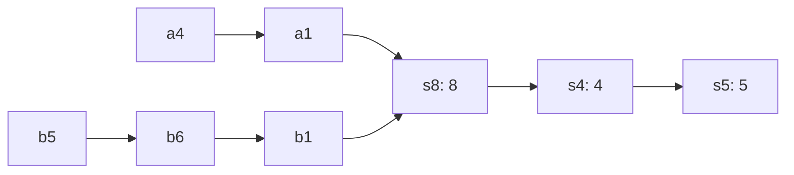

# Intersection of Two Linked Lists

Given the heads of two singly linked lists, return the node at which they intersect (the lists share their tail from that node on), or `null` if they do not intersect.

## Algorithm Strategy (Two Pointers that Switch Lists)

1. Start pointer `a` at `headA` and pointer `b` at `headB`.
2. Advance both one node at a time. When a pointer reaches the end of its list, redirect it to the head of the <em>other</em> list.
3. After switching, both pointers have travelled `lenA + lenB` nodes in total, so the difference in length is cancelled and they line up.
4. They meet at the intersection node, or both become `null` at the same moment when there is no intersection.

## Example walkthrough

- List A = `4 -> 1 -> 8 -> 4 -> 5`, list B = `5 -> 6 -> 1 -> 8 -> 4 -> 5` sharing the tail `8 -> 4 -> 5`: both pointers meet at the node with value 8.
- For `2 -> 6 -> 4` and `1 -> 5` without a shared node, both pointers reach `null` together: no intersection.

## Complexity Analysis

- **Time Complexity:** `O(m + n)` — Each pointer walks at most both lists once.
- **Space Complexity:** `O(1)` — Two pointers.

## Approaches

The same problem can be solved in several ways. The approach marked (Optimized) is the one to use in practice.

### Approach 1: Brute Force Pairs

Compare every node of A with every node of B by reference.

```java
public static ListNode getIntersectionBrute(ListNode headA, ListNode headB) {
    for (ListNode a = headA; a != null; a = a.next)
        for (ListNode b = headB; b != null; b = b.next)
            if (a == b) return a;
    return null;
}
```

- **Time Complexity:** O(m * n)
- **Space Complexity:** O(1)

### Approach 2: Hash Set of Visited Nodes

Store the nodes of A in a set and return the first node of B that is in it.

```java
public static ListNode getIntersectionSet(ListNode headA, ListNode headB) {
    Set<ListNode> seen = new HashSet<>();
    for (ListNode a = headA; a != null; a = a.next) seen.add(a);
    for (ListNode b = headB; b != null; b = b.next) if (seen.contains(b)) return b;
    return null;
}
```

- **Time Complexity:** O(m + n)
- **Space Complexity:** O(m)

### Approach 3: Length Difference

Measure both lengths, skip the extra nodes of the longer list, then walk both together.

```java
public static ListNode getIntersectionLengths(ListNode headA, ListNode headB) {
    int lengthA = 0, lengthB = 0;
    for (ListNode a = headA; a != null; a = a.next) lengthA++;
    for (ListNode b = headB; b != null; b = b.next) lengthB++;
    ListNode a = headA, b = headB;
    for (int i = lengthA - lengthB; i > 0; i--) a = a.next;
    for (int i = lengthB - lengthA; i > 0; i--) b = b.next;
    while (a != b) { a = a.next; b = b.next; }
    return a;
}
```

- **Time Complexity:** O(m + n)
- **Space Complexity:** O(1)

### Approach 4: Switch Lists at the End (Optimized)

Each pointer walks `A` then `B` (or `B` then `A`), so both travel the same total distance. This is the version implemented in the repository.

```java
public static ListNode getIntersectionNode(ListNode headA, ListNode headB) {
    ListNode a = headA, b = headB;
    while (a != b) {
        a = a == null ? headB : a.next;
        b = b == null ? headA : b.next;
    }
    return a;
}
```

- **Time Complexity:** O(m + n)
- **Space Complexity:** O(1)

### Comparison

| # | Approach | Time | Space |
|---|----------|------|-------|
| 1 | Brute Force Pairs | O(m * n) | O(1) |
| 2 | Hash Set of Visited Nodes | O(m + n) | O(m) |
| 3 | Length Difference | O(m + n) | O(1) |
| 4 | Switch Lists at the End (Optimized) | O(m + n) | O(1) |

## Source Code

Uses the shared helper [`ListNode`](../../src/main/java/com/ranga/linkedlist/ListNode.java) (a small `ListNode` with `of(...)` and `toString(...)` helpers for building and printing test data).

### IntersectionOfTwoLinkedLists.java

```java
public class IntersectionOfTwoLinkedLists {

    public static void main(String[] args) {
        ListNode shared = ListNode.of(8, 4, 5);
        ListNode headA = ListNode.of(4, 1);
        headA.next.next = shared;
        ListNode headB = ListNode.of(5, 6, 1);
        headB.next.next.next = shared;

        System.out.println("Input  : A = " + ListNode.toString(headA) + ", B = " + ListNode.toString(headB));
        ListNode meeting = getIntersectionNode(headA, headB);
        System.out.println("Output : intersect at value " + (meeting == null ? "none" : meeting.val));
        System.out.println();

        ListNode other1 = ListNode.of(2, 6, 4);
        ListNode other2 = ListNode.of(1, 5);
        System.out.println("Input  : A = " + ListNode.toString(other1) + ", B = " + ListNode.toString(other2));
        ListNode none = getIntersectionNode(other1, other2);
        System.out.println("Output : intersect at value " + (none == null ? "none" : none.val));
    }

    public static ListNode getIntersectionNode(ListNode headA, ListNode headB) {
        ListNode a = headA;
        ListNode b = headB;
        while (a != b) {
            a = a == null ? headB : a.next;
            b = b == null ? headA : b.next;
        }
        return a;
    }
}
```

## Solution

The optimized solution is Approach 4 above, which is also the version implemented in this repository.

The idea: if the lists have different lengths, two pointers started together never line up. Each pointer therefore walks its own list and, on reaching the end (`null`), jumps to the head of the other list. Both pointers then travel the same total distance (list A plus list B), so any length difference cancels and they arrive at the shared tail at the same moment. If there is no shared node they reach `null` together, which is also the answer.

**Input:** A = `[4, 1, 8, 4, 5]`, B = `[5, 6, 1, 8, 4, 5]`, where the last three nodes `8 -> 4 -> 5` are the same nodes in both lists. Private nodes are written `a4`, `a1`, `b5`, `b6`, `b1`; shared nodes `s8`, `s4`, `s5`.

| Move | a | b | a == b? |
|------|---|---|---------|
| 0 | a4 | b5 | no |
| 1 | a1 | b6 | no |
| 2 | s8 | b1 | no |
| 3 | s4 | s8 | no |
| 4 | s5 | s4 | no |
| 5 | null (end of A) | s5 | no |
| 6 | b5 (head of B) | null (end of B) | no |
| 7 | b6 | a4 (head of A) | no |
| 8 | b1 | a1 | no |
| 9 | s8 | s8 | yes, return `s8` |



**Edge cases.** The comparison is by node identity (`a != b`), not by value, so the equal values `4` and `5` met earlier are not mistaken for the intersection. With no shared node (`[2, 6, 4]` and `[1, 5]`) both pointers become `null` after lenA + lenB moves and the loop ends with `null`. If either head is `null`, the pointers switch once and both become `null`, which is returned.

**Result:** the node with value `8`, matching the class output (`intersect at value 8`); the disjoint example prints `none`.
