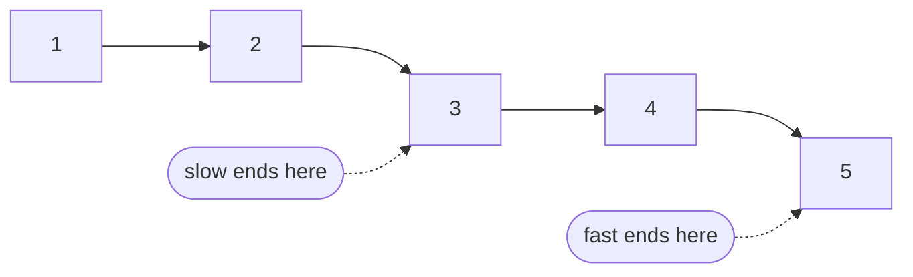

# Middle of the Linked List

Given the head of a singly linked list, return the middle node. If there are two middle nodes, return the second one.

## Algorithm Strategy (Fast and Slow Pointers)

1. Start `slow` and `fast` at the head.
2. Move `slow` one node and `fast` two nodes per step while `fast` and `fast.next` exist.
3. When `fast` reaches the end, `slow` has moved half as far, so it is at the middle.
4. For an even length the loop ends with `fast == null` and `slow` on the second of the two middle nodes, which is what the problem asks for.

## Example walkthrough

- For `[1, 2, 3, 4, 5]`: `slow` ends at 3 (`fast` at the last node).
- For `[1, 2, 3, 4, 5, 6]`: `slow` ends at 4 (`fast` is `null`), the second middle.

## Complexity Analysis

- **Time Complexity:** `O(n)` — One traversal.
- **Space Complexity:** `O(1)` — Two pointers.

## Approaches

The same problem can be solved in several ways. The approach marked (Optimized) is the one to use in practice.

### Approach 1: Count, Then Walk

Traverse once to count the nodes, then walk `n / 2` steps.

```java
public static ListNode middleNodeCount(ListNode head) {
    int n = 0;
    for (ListNode node = head; node != null; node = node.next) n++;
    ListNode node = head;
    for (int i = 0; i < n / 2; i++) node = node.next;
    return node;
}
```

- **Time Complexity:** O(n) with two passes
- **Space Complexity:** O(1)

### Approach 2: Fast and Slow Pointers (Optimized)

Advance one pointer twice as fast as the other so the slow one is at the middle when the fast one runs off the end. This is the version implemented in the repository.

```java
public static ListNode middleNode(ListNode head) {
    ListNode slow = head;
    ListNode fast = head;
    while (fast != null && fast.next != null) {
        slow = slow.next;
        fast = fast.next.next;
    }
    return slow;
}
```

- **Time Complexity:** O(n) with one pass
- **Space Complexity:** O(1)

### Comparison

| # | Approach | Time | Space |
|---|----------|------|-------|
| 1 | Count, Then Walk | O(n) with two passes | O(1) |
| 2 | Fast and Slow Pointers (Optimized) | O(n) with one pass | O(1) |

## Source Code

### MiddleOfTheLinkedList.java

```java
public class MiddleOfTheLinkedList {

    public static void main(String[] args) {
        int[][] inputs = {{1, 2, 3, 4, 5}, {1, 2, 3, 4, 5, 6}, {1}, {1, 2}};
        for (int[] values : inputs) {
            ListNode head = ListNode.of(values);
            System.out.println("Input  : head = " + ListNode.toString(head));
            System.out.println("Output : " + ListNode.toString(middleNode(head)));
            System.out.println();
        }
    }

    public static ListNode middleNode(ListNode head) {
        ListNode slow = head;
        ListNode fast = head;
        while (fast != null && fast.next != null) {
            slow = slow.next;
            fast = fast.next.next;
        }
        return slow;
    }
}
```

## Solution

The optimized solution is Approach 2 above, which is also the version implemented in this repository.

The idea: `fast` moves two nodes for every one node `slow` moves. When `fast` can no longer jump, `slow` has covered half the distance, so it is on the middle. This takes one pass and O(1) space, with no need to know the length.

**Input:** `head = [1, 2, 3, 4, 5]`.

| Step | `slow` | `fast` | Check `fast != null && fast.next != null` |
|------|--------|--------|-------------------------------------------|
| start | 1 | 1 | true |
| 1 | 2 | 3 | true |
| 2 | 3 | 5 | false (`5.next` is `null`) |

The loop stops and `slow` (node `3`) is returned, so the output is the list from there: `[3, 4, 5]`.



**Even length.** For `[1, 2, 3, 4, 5, 6]`: the pointers go `(1,1)`, `(2,3)`, `(3,5)`, `(4, null)` and the loop stops because `fast` is `null`, so `slow` is the second middle, node `4`, and the output is `[4, 5, 6]`.

**Edge cases.** One node (`[1]`) never enters the loop and returns `[1]`; `[1, 2]` returns `[2]`. A `null` head returns `null`.

**Result:** `[3, 4, 5]` for the sample, matching the class output.
