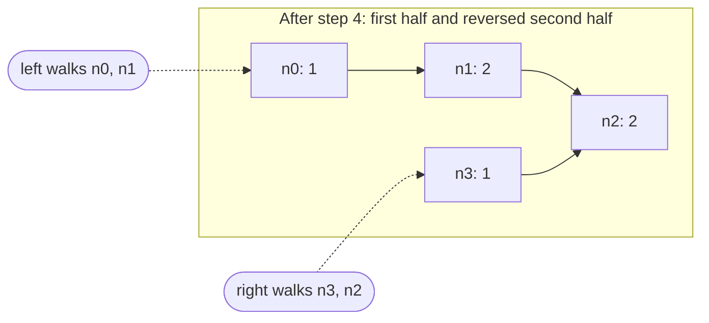

# Palindrome Linked List

Given the head of a singly linked list, return `true` if it is a palindrome (reads the same forwards and backwards). Aim for `O(n)` time and `O(1)` extra space.

## Algorithm Strategy (Find the Middle, Reverse the Second Half, Compare)

1. Use slow and fast pointers to find the middle: when `fast` reaches the end, `slow` is at the middle (the start of the second half).
2. Reverse the second half of the list in place.
3. Walk the first half and the reversed second half together, comparing the values. Any difference means the list is not a palindrome.
4. Optionally reverse the second half back to restore the original list.

## Example walkthrough

- For `1 -> 2 -> 2 -> 1`: the second half `2 -> 1` is reversed to `1 -> 2`; comparing with the first half `1 -> 2` matches: `true`.
- For `1 -> 2 -> 3`: the second half `3` is compared with `1`: `false`.

## Complexity Analysis

- **Time Complexity:** `O(n)` — Three linear passes.
- **Space Complexity:** `O(1)` — The list is modified in place (and restored).

## Approaches

The same problem can be solved in several ways. The approach marked (Optimized) is the one to use in practice.

### Approach 1: Copy Values to a List

Copy the values into an `ArrayList` and compare it with two pointers. Needs `O(n)` extra space.

```java
public static boolean isPalindromeList(ListNode head) {
    List<Integer> values = new ArrayList<>();
    for (ListNode node = head; node != null; node = node.next) values.add(node.val);
    for (int i = 0, j = values.size() - 1; i < j; i++, j--)
        if (!values.get(i).equals(values.get(j))) return false;
    return true;
}
```

- **Time Complexity:** O(n)
- **Space Complexity:** O(n)

### Approach 2: Stack of the First Half

Push the first half on a stack and pop it while walking the second half.

```java
public static boolean isPalindromeStack(ListNode head) {
    Deque<Integer> stack = new ArrayDeque<>();
    ListNode slow = head, fast = head;
    while (fast != null && fast.next != null) {
        stack.push(slow.val);
        slow = slow.next;
        fast = fast.next.next;
    }
    if (fast != null) slow = slow.next;         // skip the middle node of an odd-length list
    while (slow != null) {
        if (stack.pop() != slow.val) return false;
        slow = slow.next;
    }
    return true;
}
```

- **Time Complexity:** O(n)
- **Space Complexity:** O(n)

### Approach 3: Recursion with a Front Pointer

Recurse to the end, then compare the node on the way back with a pointer that moves forward from the head.

```java
private static ListNode front;

public static boolean isPalindromeRecursive(ListNode head) {
    front = head;
    return check(head);
}

private static boolean check(ListNode node) {
    if (node == null) return true;
    if (!check(node.next)) return false;
    if (node.val != front.val) return false;
    front = front.next;
    return true;
}
```

- **Time Complexity:** O(n)
- **Space Complexity:** O(n)

### Approach 4: Reverse the Second Half in Place (Optimized)

Find the middle, reverse the second half, compare, and restore the list. This is the version implemented in the repository.

```java
public static boolean isPalindrome(ListNode head) {
    if (head == null || head.next == null) return true;
    ListNode slow = head, fast = head;
    while (fast != null && fast.next != null) { slow = slow.next; fast = fast.next.next; }
    ListNode secondHalf = reverse(slow);
    ListNode left = head, right = secondHalf;
    boolean palindrome = true;
    while (right != null) {
        if (left.val != right.val) { palindrome = false; break; }
        left = left.next;
        right = right.next;
    }
    reverse(secondHalf);
    return palindrome;
}

private static ListNode reverse(ListNode head) {
    ListNode previous = null;
    while (head != null) { ListNode next = head.next; head.next = previous; previous = head; head = next; }
    return previous;
}
```

- **Time Complexity:** O(n)
- **Space Complexity:** O(1)

### Comparison

| # | Approach | Time | Space |
|---|----------|------|-------|
| 1 | Copy Values to a List | O(n) | O(n) |
| 2 | Stack of the First Half | O(n) | O(n) |
| 3 | Recursion with a Front Pointer | O(n) | O(n) |
| 4 | Reverse the Second Half in Place (Optimized) | O(n) | O(1) |

### Optimized Solution

The optimized solution is Approach 4 above, which is also the version implemented in this repository.

#### Optimized solution explained

The idea: a palindrome reads the same from both ends, but a singly linked list cannot be walked backwards. So the code finds the middle with a slow and a fast pointer, reverses the second half in place, and then walks the first half and the reversed second half together, comparing values. Nothing is copied (O(1) space), and the second half is reversed again at the end so the caller gets the original list back.

**Input:** `head = [1, 2, 2, 1]` (nodes written n0..n3 from the head).

| Step | What the code does | slow | fast | State |
|------|--------------------|------|------|-------|
| 1 | start | n0 (1) | n0 (1) | |
| 2 | fast and fast.next exist: move slow 1, fast 2 | n1 (2) | n2 (2) | |
| 3 | fast.next exists: move again | n2 (2) | null | loop ends, slow is the start of the second half |
| 4 | `reverse(slow)`: second half `2 -> 1` becomes `1 -> 2` | | | secondHalf = n3, n3 → n2 → null |
| 5 | compare left n0 (1) with right n3 (1) | | | equal, move both |
| 6 | compare left n1 (2) with right n2 (2) | | | equal, move both, right is null |
| 7 | `reverse(secondHalf)` restores `2 -> 1` | | | list is `[1, 2, 2, 1]` again |



**Edge cases.** `null` or a single node returns `true` immediately. For an odd length such as `[1, 2, 3, 2, 1]` the fast pointer ends on the last node, so slow stops on the middle node `3`; the middle node ends up at the tail of the first half and is simply compared with itself. On a mismatch (`[1, 2, 3]`, compares `1` with `3`) the loop breaks, but the second half is still restored before returning. `[1, 2]` compares `1` with `2` and returns `false`.

**Result:** `true` for `[1, 2, 2, 1]`, matching the class output, with the list printed unchanged afterwards.

## Source Code

Uses the shared helper [`ListNode`](../../src/main/java/com/ranga/linkedlist/ListNode.java) (a small `ListNode` with `of(...)` and `toString(...)` helpers for building and printing test data).

### PalindromeLinkedList.java

```java
public class PalindromeLinkedList {

    public static void main(String[] args) {
        int[][] inputs = {{1, 2, 2, 1}, {1, 2, 3, 2, 1}, {1, 2, 3}, {1}, {1, 2}};
        for (int[] values : inputs) {
            ListNode head = ListNode.of(values);
            System.out.println("Input  : head = " + ListNode.toString(head));
            System.out.println("Output : " + isPalindrome(head) + " (list afterwards: " + ListNode.toString(head) + ")");
            System.out.println();
        }
    }

    public static boolean isPalindrome(ListNode head) {
        if (head == null || head.next == null) {
            return true;
        }

        ListNode slow = head;
        ListNode fast = head;
        while (fast != null && fast.next != null) {
            slow = slow.next;
            fast = fast.next.next;
        }

        ListNode secondHalf = reverse(slow);
        ListNode left = head;
        ListNode right = secondHalf;
        boolean palindrome = true;
        while (right != null) {
            if (left.val != right.val) {
                palindrome = false;
                break;
            }
            left = left.next;
            right = right.next;
        }

        reverse(secondHalf);        // restore the list
        return palindrome;
    }

    private static ListNode reverse(ListNode head) {
        ListNode previous = null;
        while (head != null) {
            ListNode next = head.next;
            head.next = previous;
            previous = head;
            head = next;
        }
        return previous;
    }
}
```
