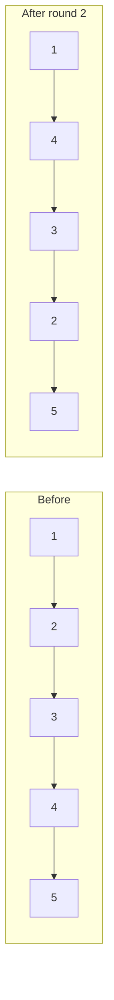

# Reverse Linked List II

Given the head of a singly linked list and two positions `left <= right` (1-indexed), reverse the nodes from position `left` to position `right` and return the list.

## Algorithm Strategy (Head Insertion Inside the Window)

1. Add a dummy node before the head so that `left = 1` needs no special case.
2. Move `prev` to the node just before position `left`; `curr` is the node at `left` and stays the tail of the reversed part.
3. Repeat `right - left` times: detach the node after `curr` and insert it right after `prev`.
4. Each step moves one more node to the front of the window, so the window ends up reversed in one pass without touching the nodes outside it.

## Example walkthrough

- For `1 -> 2 -> 3 -> 4 -> 5` with `left = 2`, `right = 4`: `prev` is node 1 and `curr` is node 2.
- Move 3 behind `prev`: `1 -> 3 -> 2 -> 4 -> 5`. Move 4 behind `prev`: `1 -> 4 -> 3 -> 2 -> 5`.
- Result: `[1, 4, 3, 2, 5]`.

## Complexity Analysis

- **Time Complexity:** `O(n)` — At most one pass to reach `left` and `right - left` pointer moves.
- **Space Complexity:** `O(1)` — A few pointers.

## Approaches

The same problem can be solved in several ways. The approach marked (Optimized) is the one to use in practice.

### Approach 1: Copy Values, Reverse the Array Range

Read the values into an array, reverse the window in the array and write the values back into the same nodes.

```java
public static ListNode reverseBetweenValues(ListNode head, int left, int right) {
    List<Integer> values = new ArrayList<>();
    for (ListNode node = head; node != null; node = node.next) values.add(node.val);
    Collections.reverse(values.subList(left - 1, right));
    int i = 0;
    for (ListNode node = head; node != null; node = node.next) node.val = values.get(i++);
    return head;
}
```

- **Time Complexity:** O(n)
- **Space Complexity:** O(n)

### Approach 2: Recursion

Recurse until the window starts, then reverse `right - left + 1` nodes and reconnect the tail.

```java
private static ListNode successor;

public static ListNode reverseBetweenRecursive(ListNode head, int left, int right) {
    if (left == 1) return reverseFirst(head, right);
    head.next = reverseBetweenRecursive(head.next, left - 1, right - 1);
    return head;
}

private static ListNode reverseFirst(ListNode head, int n) {
    if (n == 1) {
        successor = head.next;
        return head;
    }
    ListNode last = reverseFirst(head.next, n - 1);
    head.next.next = head;
    head.next = successor;
    return last;
}
```

- **Time Complexity:** O(n)
- **Space Complexity:** O(n) recursion stack

### Approach 3: Iterative Head Insertion (Optimized)

Keep `prev` fixed before the window and pull each following node to the front of it. This is the version implemented in the repository.

```java
public static ListNode reverseBetween(ListNode head, int left, int right) {
    ListNode dummy = new ListNode(0);
    dummy.next = head;
    ListNode prev = dummy;
    for (int i = 1; i < left; i++) {
        prev = prev.next;
    }
    ListNode curr = prev.next;
    for (int i = 0; i < right - left; i++) {
        ListNode next = curr.next;
        curr.next = next.next;
        next.next = prev.next;
        prev.next = next;
    }
    return dummy.next;
}
```

- **Time Complexity:** O(n)
- **Space Complexity:** O(1)

### Comparison

| # | Approach | Time | Space |
|---|----------|------|-------|
| 1 | Copy Values, Reverse the Array Range | O(n) | O(n) |
| 2 | Recursion | O(n) | O(n) recursion stack |
| 3 | Iterative Head Insertion (Optimized) | O(n) | O(1) |

## Source Code

### ReverseLinkedListII.java

```java
public class ReverseLinkedListII {

    public static void main(String[] args) {
        int[][] values = {{1, 2, 3, 4, 5}, {5}, {3, 5}, {1, 2, 3}};
        int[][] ranges = {{2, 4}, {1, 1}, {1, 2}, {1, 3}};
        for (int i = 0; i < values.length; i++) {
            ListNode head = ListNode.of(values[i]);
            System.out.println("Input  : head = " + ListNode.toString(head) + ", left = " + ranges[i][0] + ", right = " + ranges[i][1]);
            System.out.println("Output : " + ListNode.toString(reverseBetween(head, ranges[i][0], ranges[i][1])));
            System.out.println();
        }
    }

    public static ListNode reverseBetween(ListNode head, int left, int right) {
        ListNode dummy = new ListNode(0);
        dummy.next = head;
        ListNode prev = dummy;
        for (int i = 1; i < left; i++) {
            prev = prev.next;
        }
        ListNode curr = prev.next;
        for (int i = 0; i < right - left; i++) {
            ListNode next = curr.next;
            curr.next = next.next;
            next.next = prev.next;
            prev.next = next;
        }
        return dummy.next;
    }
}
```

## Solution

The optimized solution is Approach 3 above, which is also the version implemented in this repository.

The idea: reverse only the part between positions `left` and `right` in one pass. A dummy node in front of the head avoids a special case when `left = 1`. Move `prev` to the node just before position `left`; `curr` stays on the first node of the section, which ends up as its last node. Repeat `right - left` times: take the node after `curr` and splice it in right after `prev`, so each moved node lands in front of the earlier ones.

**Input:** `head = [1, 2, 3, 4, 5]`, `left = 2`, `right = 4`.

Setup: `dummy -> 1 -> 2 -> 3 -> 4 -> 5`; `prev` moves once (`left - 1 = 1`) to node `1`; `curr = 2`.

| Round | `next` (= `curr.next`) | `curr.next = next.next` | `next.next = prev.next` | `prev.next = next` | List afterwards |
|-------|------------------------|--------------------------|--------------------------|--------------------|-----------------|
| start | | | | | `1 -> 2 -> 3 -> 4 -> 5` |
| 1 | 3 | `2 -> 4` | `3 -> 2` | `1 -> 3` | `1 -> 3 -> 2 -> 4 -> 5` |
| 2 | 4 | `2 -> 5` | `4 -> 3` | `1 -> 4` | `1 -> 4 -> 3 -> 2 -> 5` |

There are `right - left = 2` rounds, and `curr` (node `2`) never moves; it just gets pushed to the end of the section.



**Edge cases.** `left = right` means zero rounds and the list is unchanged (`[5]` with `1, 1` stays `[5]`). `left = 1` works because `prev` stays on the dummy node (`[1, 2, 3]` with `1, 3` gives `[3, 2, 1]`, and `[3, 5]` with `1, 2` gives `[5, 3]`). The method assumes `1 <= left <= right <= length`; it does not validate them.

**Result:** `[1, 4, 3, 2, 5]`, matching the class output.
