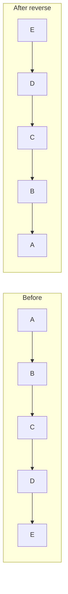

# Single Linked List

Demonstrates a generic singly linked list with common interview operations.

## Algorithm Strategy

1. Each `Node` stores a value and a reference to the next node; the list keeps a `head` reference and a `size`.
2. **add:** walk to the last node and link the new node after it (`O(n)`); an empty list just sets `head`.
3. **remove(index):** for index `0` move `head` to the next node; otherwise stop at the node before the target and bypass the target with `prev.next = prev.next.next`.
4. **reverse:** walk the list once, pointing every node's `next` to the previous node, then make the last visited node the new head.
5. **middle element:** either advance `size / 2` steps, or use two pointers where `fast` moves two nodes per step and `slow` one; when `fast` reaches the end, `slow` is in the middle (single pass).
6. **even/odd size:** either count the nodes, or jump two nodes at a time and check where the pointer ends (`null` means even, the last node means odd).

## Example walkthrough

- The demo adds `List1 ... List12`; `remove(0)` deletes `List1` by moving `head` to `List2`, leaving 11 nodes (an odd size).
- With 11 nodes, counting, slow/fast pointers and `get(size() / 2)` all report the middle element `List7`; `reverse()` then prints `List12 ... List2`.

## Complexity Analysis

- **Time Complexity:** `O(n)` for add, remove, get, reverse and middle; `O(1)` for size and isEmpty.
- **Space Complexity:** `O(1)` auxiliary space for every operation (the list itself uses `O(n)`).

## Approaches

The same problem can be solved in several ways. They are listed from the simplest to the most efficient.

### Approach 1: Add: Walk to the Tail

To append, start at the head and follow `next` until the last node. Simple, but every `add` is `O(n)`; adding `n` elements costs `O(n^2)`. This is the version implemented in the repository.

```java
static class Node<T> {
    T data;
    Node<T> next;
    Node(T data) { this.data = data; }
}

static <T> Node<T> addByWalking(Node<T> head, T data) {
    Node<T> node = new Node<>(data);
    if (head == null) return node;
    Node<T> curr = head;
    while (curr.next != null) curr = curr.next;
    curr.next = node;
    return head;
}
```

- **Time Complexity:** O(n) per add
- **Space Complexity:** O(1)

### Approach 2: Add: Keep a Tail Pointer (Optimized)

Store a reference to the last node in the list. Appending then needs no traversal, so `add` is `O(1)` (only `remove` of the last node still needs a walk in a singly linked list).

```java
static class TailList<T> {
    Node<T> head, tail;
    int size;

    void add(T data) {
        Node<T> node = new Node<>(data);
        if (head == null) head = tail = node;
        else { tail.next = node; tail = node; }
        size++;
    }
}
```

- **Time Complexity:** O(1) per add
- **Space Complexity:** O(1)

### Approach 3: Middle Element: Count Then Walk

First pass computes the length, second pass advances `size / 2` nodes. Two traversals, but easy to follow (the repository keeps a `size` field, which makes the first pass free).

```java
static <T> T middleCounting(Node<T> head) {
    int size = 0;
    for (Node<T> c = head; c != null; c = c.next) size++;
    Node<T> curr = head;
    for (int i = 0; i < size / 2; i++) curr = curr.next;
    return curr.data;
}
```

- **Time Complexity:** O(n)
- **Space Complexity:** O(1)

### Approach 4: Middle Element: Slow and Fast Pointers (Optimized)

Move `fast` two nodes and `slow` one node per step. When `fast` reaches the end, `slow` is in the middle (the second middle for even sizes). One pass and no size needed.

```java
static <T> T middleSlowFast(Node<T> head) {
    Node<T> slow = head, fast = head;
    while (fast != null && fast.next != null) {
        slow = slow.next;
        fast = fast.next.next;
    }
    return slow.data;
}
```

- **Time Complexity:** O(n)
- **Space Complexity:** O(1)

### Approach 5: Reverse: Iterative Pointer Reversal (Optimized)

Walk once and re-point every `next` to the previous node, then return the last node as the new head.

```java
static <T> Node<T> reverseIterative(Node<T> head) {
    Node<T> prev = null, curr = head;
    while (curr != null) {
        Node<T> next = curr.next;
        curr.next = prev;
        prev = curr;
        curr = next;
    }
    return prev;
}
```

- **Time Complexity:** O(n)
- **Space Complexity:** O(1)

### Approach 6: Reverse: Recursive

Reverse the rest of the list first, then make the following node point back to the current one. Elegant, but uses `O(n)` stack and can overflow on very long lists.

```java
static <T> Node<T> reverseRecursive(Node<T> head) {
    if (head == null || head.next == null) return head;
    Node<T> newHead = reverseRecursive(head.next);
    head.next.next = head;
    head.next = null;
    return newHead;
}
```

- **Time Complexity:** O(n)
- **Space Complexity:** O(n) recursion stack

### Approach 7: Reverse: Using a Stack

Push all values onto a stack and pop them back into the nodes. Easy, but needs `O(n)` extra space.

```java
static <T> void reverseWithStack(Node<T> head) {
    Deque<T> stack = new ArrayDeque<>();
    for (Node<T> c = head; c != null; c = c.next) stack.push(c.data);
    for (Node<T> c = head; c != null; c = c.next) c.data = stack.pop();
}
```

- **Time Complexity:** O(n)
- **Space Complexity:** O(n)

### Comparison

| # | Approach | Time | Space |
|---|----------|------|-------|
| 1 | Add: Walk to the Tail | O(n) per add | O(1) |
| 2 | Add: Keep a Tail Pointer (Optimized) | O(1) per add | O(1) |
| 3 | Middle Element: Count Then Walk | O(n) | O(1) |
| 4 | Middle Element: Slow and Fast Pointers (Optimized) | O(n) | O(1) |
| 5 | Reverse: Iterative Pointer Reversal (Optimized) | O(n) | O(1) |
| 6 | Reverse: Recursive | O(n) | O(n) recursion stack |
| 7 | Reverse: Using a Stack | O(n) | O(n) |

## Source Code

### SingleLinkedListDemo.java

```java
public class SingleLinkedListDemo {

    public static void main(String[] args) {
        SingleLinkedList<String> list = new SingleLinkedList<>();
        for (int i = 1; i <= 12; i++) {
            list.add("List" + i);
        }

        System.out.println("List size      : " + list.size());
        System.out.println("List of values : " + list);

        String deletedValue = list.remove(0);
        System.out.println("Deleted 0th index value : " + deletedValue);
        System.out.println("List size      : " + list.size());
        System.out.println("List of values : " + list);

        System.out.println("List size is " + ((list.size() % 2 == 0) ? "Even" : "Odd"));
        list.findSizeEvenOrOdd();
        list.findLinkedListLengthEven();

        System.out.println("Middle Element (counting)         : " + list.getMiddleElement());
        System.out.println("Middle Element (slow/fast)        : " + list.getMiddleElement2());
        System.out.println("Middle Element (get(size() / 2))  : " + list.get(list.size() / 2));

        list.reverse();
        System.out.println("Reversed list  : " + list);
    }
}

class Node<T> {

    private final T data;
    private Node<T> next;

    public Node(T data) {
        this.data = data;
    }

    public T getData() {
        return data;
    }

    public Node<T> getNext() {
        return next;
    }

    public void setNext(Node<T> next) {
        this.next = next;
    }

    @Override
    public String toString() {
        return data + "";
    }
}

class SingleLinkedList<T> {

    private Node<T> head;
    private int size;

    public SingleLinkedList() {
        this.head = null;
        this.size = 0;
    }

    public void add(T data) {
        Node<T> node = new Node<>(data);
        if (isEmpty()) {
            head = node;
        } else {
            Node<T> curr = head;
            while (curr.getNext() != null) {
                curr = curr.getNext();
            }
            curr.setNext(node);
        }
        size++;
    }

    public boolean isEmpty() {
        return head == null;
    }

    public int size() {
        return size;
    }

    public T remove(int index) {
        validateIndex(index);

        Node<T> curr = head;
        Node<T> deletedNode;
        if (index == 0) {
            deletedNode = curr;
            head = curr.getNext();
        } else {
            for (int i = 0; i < index - 1; i++) {
                curr = curr.getNext();
            }
            deletedNode = curr.getNext();
            curr.setNext(deletedNode.getNext());
        }
        size--;
        return deletedNode.getData();
    }

    public T get(int index) {
        validateIndex(index);
        Node<T> curr = head;
        for (int i = 0; i < index; i++) {
            curr = curr.getNext();
        }
        return curr.getData();
    }

    public void reverse() {
        Node<T> curr = head;
        Node<T> reverseNode = null;
        while (curr != null) {
            Node<T> next = curr.getNext();
            curr.setNext(reverseNode);
            reverseNode = curr;
            curr = next;
        }
        head = reverseNode;
    }

    private void validateIndex(int index) {
        if (index < 0) {
            throw new IndexOutOfBoundsException("Index value must be >= 0 but current index is " + index);
        } else if (index >= size) {
            throw new IndexOutOfBoundsException("Index: " + index + ", Size: " + size);
        }
    }

    /** Middle element found by advancing {@code size / 2} nodes from the head. */
    public T getMiddleElement() {
        Node<T> curr = head;
        for (int i = 0; i < size / 2; i++) {
            curr = curr.getNext();
        }
        return curr.getData();
    }

    /** Middle element found in a single pass with a slow and a fast pointer. */
    public T getMiddleElement2() {
        Node<T> slow = head;
        Node<T> fast = head;
        while (fast != null && fast.getNext() != null) {
            slow = slow.getNext();
            fast = fast.getNext().getNext();
        }
        return slow.getData();
    }

    public void findSizeEvenOrOdd() {
        Node<T> current = head;
        int count = 0;
        while (current != null) {
            current = current.getNext();
            count++;
        }

        System.out.println("Size (counting nodes) is " + (count % 2 == 0 ? "Even" : "Odd"));
    }

    public void findLinkedListLengthEven() {
        Node<T> node = head;
        while (node != null && node.getNext() != null) {
            node = node.getNext().getNext();
        }
        System.out.println("Size (two-step jump) is " + (node == null ? "Even" : "Odd"));
    }

    @Override
    public String toString() {
        StringBuilder sb = new StringBuilder("[");
        Node<T> curr = head;
        while (curr != null) {
            sb.append(curr.getData());
            if (curr.getNext() != null) {
                sb.append(", ");
            }
            curr = curr.getNext();
        }
        return sb.append("]").toString();
    }
}
```

## Solution

The optimized solution is Approach 2, 4 and 5 above. The version implemented in this repository is Approach 1, 3, 4 and 5.

**Note:** the page marks Approaches 2, 4 and 5 as optimized, but `SingleLinkedListDemo.java` implements Approaches 1, 3, 4 and 5. Its `add` walks to the tail (O(n) per add, no tail pointer) and its main method also uses the count-then-walk middle. The two optimized pieces that are really in the class, the slow/fast middle (`getMiddleElement2`) and the iterative `reverse`, are explained here.

The idea: the middle is found in one pass with two pointers, `slow` moving one node and `fast` two nodes per step, so when `fast` reaches the end `slow` is halfway. Reversal walks once and re-points each node's `next` to the node before it, keeping `curr`, `next` (saved before it is overwritten) and `reverseNode` (the already-reversed part), in O(n) time and O(1) space.

**Input:** a list built with `add` of `A, B, C, D, E` (checked in a scratch run against the real classes).

Middle with slow and fast:

| Step | `slow` | `fast` | Loop continues? |
|------|--------|--------|-----------------|
| start | A | A | yes |
| 1 | B | C | yes (`fast.next` = D) |
| 2 | C | E | no (`fast.next` is `null`) |

`slow` is `C`, the middle.

Reverse:

| Step | `curr` | `next` (saved) | Action | `reverseNode` afterwards |
|------|--------|----------------|--------|--------------------------|
| 1 | A | B | `A.next = null` | A |
| 2 | B | C | `B.next = A` | B -> A |
| 3 | C | D | `C.next = B` | C -> B -> A |
| 4 | D | E | `D.next = C` | D -> C -> B -> A |
| 5 | E | null | `E.next = D` | E -> D -> C -> B -> A |

Then `curr` is `null`, the loop stops and `head = reverseNode`.



**Edge cases.** With an even count (`A, B, C, D`) `fast` becomes `null` and `slow` stops on the second middle, `C`. Reversing an empty list leaves it empty; `getMiddleElement2` on an empty list throws a `NullPointerException` (`slow` is `null`). `remove` and `get` throw `IndexOutOfBoundsException` for a bad index.

**Result:** `[A, B, C, D, E]` has middle `C` and reverses to `[E, D, C, B, A]`. For the class's own main (11 items after the removal) both middle methods print `List7` and the reversed list is `[List12, ..., List2]`.
