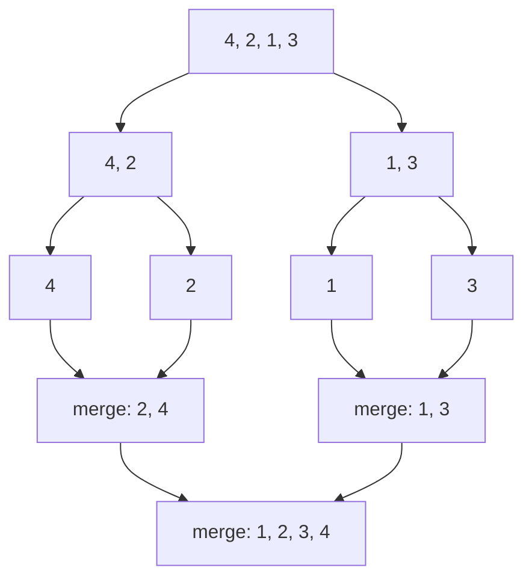

# Sort List

Given the head of a singly linked list, return the list sorted in ascending order in `O(n log n)` time.

## Algorithm Strategy (Merge Sort on a Linked List)

1. Merge sort suits linked lists: splitting needs no random access and merging relinks nodes without extra arrays.
2. If the list has zero or one node it is already sorted. Otherwise find the middle with fast and slow pointers, but stop `slow` at the node before the middle so the list can be cut in two.
3. Cut the list there by setting `prev.next = null`, then sort the left half and the right half recursively.
4. Merge the two sorted halves with a dummy head node, always taking the smaller front node (taking from the left on ties keeps the sort stable).

## Example walkthrough

- For `[4, 2, 1, 3]`: split into `[4, 2]` and `[1, 3]`; sort them to `[2, 4]` and `[1, 3]`.
- Merging gives `[1, 2, 3, 4]`.

## Complexity Analysis

- **Time Complexity:** `O(n log n)` — The list is halved `log n` times and each level merges `n` nodes.
- **Space Complexity:** `O(log n)` — Recursion depth. A bottom-up version brings this to `O(1)`.

## Approaches

The same problem can be solved in several ways. The approach marked (Optimized) is the one to use in practice.

### Approach 1: Copy to an Array and Sort

Copy the values to an array, sort it and write the values back into the same nodes.

```java
public static ListNode sortListArray(ListNode head) {
    List<Integer> values = new ArrayList<>();
    for (ListNode node = head; node != null; node = node.next) values.add(node.val);
    Collections.sort(values);
    ListNode node = head;
    for (int v : values) {
        node.val = v;
        node = node.next;
    }
    return head;
}
```

- **Time Complexity:** O(n log n)
- **Space Complexity:** O(n)

### Approach 2: Top-Down Merge Sort (Optimized)

Split at the middle, sort each half recursively and merge by relinking nodes; no values are copied. This is the version implemented in the repository.

```java
public static ListNode sortList(ListNode head) {
    if (head == null || head.next == null) {
        return head;
    }
    ListNode prev = null;
    ListNode slow = head;
    ListNode fast = head;
    while (fast != null && fast.next != null) {
        prev = slow;
        slow = slow.next;
        fast = fast.next.next;
    }
    prev.next = null;
    return merge(sortList(head), sortList(slow));
}

private static ListNode merge(ListNode a, ListNode b) {
    ListNode dummy = new ListNode(0);
    ListNode tail = dummy;
    while (a != null && b != null) {
        if (a.val <= b.val) {
            tail.next = a;
            a = a.next;
        } else {
            tail.next = b;
            b = b.next;
        }
        tail = tail.next;
    }
    tail.next = a != null ? a : b;
    return dummy.next;
}
```

- **Time Complexity:** O(n log n)
- **Space Complexity:** O(log n) recursion

### Comparison

| # | Approach | Time | Space |
|---|----------|------|-------|
| 1 | Copy to an Array and Sort | O(n log n) | O(n) |
| 2 | Top-Down Merge Sort (Optimized) | O(n log n) | O(log n) recursion |

## Source Code

### SortList.java

```java
public class SortList {

    public static void main(String[] args) {
        int[][] inputs = {{4, 2, 1, 3}, {-1, 5, 3, 4, 0}, {}, {1}, {3, 3, 1}};
        for (int[] values : inputs) {
            ListNode head = ListNode.of(values);
            System.out.println("Input  : head = " + ListNode.toString(head));
            System.out.println("Output : " + ListNode.toString(sortList(head)));
            System.out.println();
        }
    }

    public static ListNode sortList(ListNode head) {
        if (head == null || head.next == null) {
            return head;
        }
        ListNode prev = null;
        ListNode slow = head;
        ListNode fast = head;
        while (fast != null && fast.next != null) {
            prev = slow;
            slow = slow.next;
            fast = fast.next.next;
        }
        prev.next = null;
        return merge(sortList(head), sortList(slow));
    }

    private static ListNode merge(ListNode a, ListNode b) {
        ListNode dummy = new ListNode(0);
        ListNode tail = dummy;
        while (a != null && b != null) {
            if (a.val <= b.val) {
                tail.next = a;
                a = a.next;
            } else {
                tail.next = b;
                b = b.next;
            }
            tail = tail.next;
        }
        tail.next = a != null ? a : b;
        return dummy.next;
    }
}
```

## Solution

The optimized solution is Approach 2 above, which is also the version implemented in this repository.

The idea: merge sort suits linked lists, because splitting needs only pointer changes and merging two sorted lists needs no extra array. The code finds the middle with slow and fast pointers, cuts the list in two, sorts each half recursively, and merges the two sorted halves with a dummy-head merge. Every level of recursion does O(n) work and there are O(log n) levels, so the time is O(n log n).

**Input:** `head = [4, 2, 1, 3]`.

| Step | Call | slow stops at | Split | Result |
|------|------|---------------|-------|--------|
| 1 | sortList `[4, 2, 1, 3]` | 1 (prev = 2) | `[4, 2]` and `[1, 3]` | sort both, then merge |
| 2 | sortList `[4, 2]` | 2 (prev = 4) | `[4]` and `[2]` | each returns itself (one node) |
| 3 | merge `[4]`, `[2]` | | 2 <= 4 is false, so 2 first | `[2, 4]` |
| 4 | sortList `[1, 3]` | 3 (prev = 1) | `[1]` and `[3]` | merge gives `[1, 3]` |
| 5 | merge `[2, 4]`, `[1, 3]` | | takes 1, then 2, then 3, then the rest (4) | `[1, 2, 3, 4]` |



**Edge cases.** `null` and a single node are returned as they are, which is also the recursion base case, so `prev.next = null` is never reached with `prev == null`. For two nodes the fast pointer jumps past the end, so slow is the second node and each half gets one node. The merge uses `a.val <= b.val`, so equal values keep their original order: `[3, 3, 1]` gives `[1, 3, 3]`. When one half runs out, the rest of the other half is linked in one step.

**Result:** `[1, 2, 3, 4]`, matching the class output.
