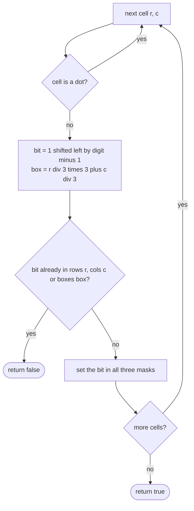

# Valid Sudoku

Determine whether a 9 x 9 Sudoku board is valid. Only the filled cells need to be checked: each row, each column and each of the nine 3 x 3 sub-boxes must contain the digits 1-9 without repetition. Empty cells are marked '.'. The board does not have to be solvable.

## Algorithm Strategy (Bit Masks for Rows, Columns and Boxes)

1. Keep one integer bit mask per row, per column and per 3 x 3 box; bit `d` means that digit `d` has been seen there.
2. For every filled cell compute the digit `d`, its row `r`, its column `c` and its box index `(r / 3) * 3 + c / 3`.
3. If bit `d` is already set in the mask of the row, the column or the box, the board is invalid.
4. Otherwise set the bit in all three masks. If the whole board is scanned without a conflict, it is valid.

## Example walkthrough

- In the standard example board every row, column and box contains each digit at most once, so the result is `true`.
- Changing the first cell to 8 puts a second 8 in the first column and in the first box: `false`.

## Complexity Analysis

- **Time Complexity:** `O(81) = O(1)` — A fixed number of cells.
- **Space Complexity:** `O(1)` — Three arrays of nine integers.

## Approaches

The same problem can be solved in several ways. The approach marked (Optimized) is the one to use in practice.

### Approach 1: HashSet of Position Tags

Add a string tag such as `"5 in row 0"`, `"5 in column 1"` and `"5 in box 0"` to a `HashSet` for every filled cell; a tag that is already present is a duplicate.

```java
public static boolean isValidSudokuTags(char[][] board) {
    Set<String> seen = new HashSet<>();
    for (int r = 0; r < 9; r++) {
        for (int c = 0; c < 9; c++) {
            char digit = board[r][c];
            if (digit == '.') continue;
            if (!seen.add(digit + " in row " + r) || !seen.add(digit + " in column " + c) || !seen.add(digit + " in box " + r / 3 + "-" + c / 3)) return false;
        }
    }
    return true;
}
```

- **Time Complexity:** O(81)
- **Space Complexity:** O(81)

### Approach 2: Boolean Tables for Rows, Columns and Boxes

Three `boolean[9][9]` tables record which digit has been seen in which row, column or box.

```java
public static boolean isValidSudokuTables(char[][] board) {
    boolean[][] rows = new boolean[9][9], cols = new boolean[9][9], boxes = new boolean[9][9];
    for (int r = 0; r < 9; r++) {
        for (int c = 0; c < 9; c++) {
            if (board[r][c] == '.') continue;
            int d = board[r][c] - '1', box = (r / 3) * 3 + c / 3;
            if (rows[r][d] || cols[c][d] || boxes[box][d]) return false;
            rows[r][d] = cols[c][d] = boxes[box][d] = true;
        }
    }
    return true;
}
```

- **Time Complexity:** O(81)
- **Space Complexity:** O(243)

### Approach 3: Check Each Unit Separately

Validate the nine rows, the nine columns and the nine boxes one after another with a helper that checks one group of nine cells. Three clean passes instead of one fused loop.

```java
public static boolean isValidSudokuUnits(char[][] board) {
    for (int i = 0; i < 9; i++) {
        char[] row = new char[9], column = new char[9], box = new char[9];
        for (int j = 0; j < 9; j++) {
            row[j] = board[i][j];
            column[j] = board[j][i];
            box[j] = board[(i / 3) * 3 + j / 3][(i % 3) * 3 + j % 3];
        }
        if (hasDuplicate(row) || hasDuplicate(column) || hasDuplicate(box)) return false;
    }
    return true;
}

private static boolean hasDuplicate(char[] cells) {
    boolean[] seen = new boolean[9];
    for (char cell : cells) {
        if (cell == '.') continue;
        if (seen[cell - '1']) return true;
        seen[cell - '1'] = true;
    }
    return false;
}
```

- **Time Complexity:** O(81)
- **Space Complexity:** O(1)

### Approach 4: Bit Masks (Optimized)

One `int` per row, column and box with bit `d` set when digit `d` was seen: a duplicate test is a single AND. This is the version implemented in the repository.

```java
public static boolean isValidSudoku(char[][] board) {
    int[] rows = new int[9], cols = new int[9], boxes = new int[9];
    for (int r = 0; r < 9; r++) {
        for (int c = 0; c < 9; c++) {
            if (board[r][c] == '.') continue;
            int bit = 1 << (board[r][c] - '1'), box = (r / 3) * 3 + c / 3;
            if ((rows[r] & bit) != 0 || (cols[c] & bit) != 0 || (boxes[box] & bit) != 0) return false;
            rows[r] |= bit; cols[c] |= bit; boxes[box] |= bit;
        }
    }
    return true;
}
```

- **Time Complexity:** O(81)
- **Space Complexity:** O(27) integers

### Comparison

| # | Approach | Time | Space |
|---|----------|------|-------|
| 1 | HashSet of Position Tags | O(81) | O(81) |
| 2 | Boolean Tables for Rows, Columns and Boxes | O(81) | O(243) |
| 3 | Check Each Unit Separately | O(81) | O(1) |
| 4 | Bit Masks (Optimized) | O(81) | O(27) integers |

## Source Code

### ValidSudoku.java

```java
import java.util.Arrays;

public class ValidSudoku {

    public static void main(String[] args) {
        String[] valid = {
                "53..7....", "6..195...", ".98....6.", "8...6...3", "4..8.3..1", "7...2...6", ".6....28.", "...419..5", "....8..79"};
        String[] invalid = valid.clone();
        invalid[0] = "83..7....";
        for (String[] rows : new String[][]{valid, invalid}) {
            char[][] board = new char[9][];
            for (int i = 0; i < 9; i++) {
                board[i] = rows[i].toCharArray();
            }
            System.out.println("Input  : board = " + Arrays.toString(rows));
            System.out.println("Output : " + isValidSudoku(board));
            System.out.println();
        }
    }

    public static boolean isValidSudoku(char[][] board) {
        int[] rows = new int[9];
        int[] cols = new int[9];
        int[] boxes = new int[9];
        for (int r = 0; r < 9; r++) {
            for (int c = 0; c < 9; c++) {
                if (board[r][c] == '.') {
                    continue;
                }
                int bit = 1 << (board[r][c] - '1');
                int box = (r / 3) * 3 + c / 3;
                if ((rows[r] & bit) != 0 || (cols[c] & bit) != 0 || (boxes[box] & bit) != 0) {
                    return false;
                }
                rows[r] |= bit;
                cols[c] |= bit;
                boxes[box] |= bit;
            }
        }
        return true;
    }
}
```

## Solution

The optimized solution is Approach 4 above, which is also the version implemented in this repository.

The idea: one pass over the 81 cells, with a bitmask per row, per column and per 3x3 box (`rows[9]`, `cols[9]`, `boxes[9]`). Digit `d` is bit `1 << (d - 1)`. A digit is a duplicate if its bit is already set in the mask of its row, column or box (`box = (r / 3) * 3 + c / 3`). Empty cells (`.`) are skipped; otherwise the bit is set in all three masks.

**Input:** the invalid board from the class, whose first row is `"83..7...."` (the valid board has `53..7....`). Cells are read row by row; only box 0 (top-left) is shown, because that is where the duplicate appears.

| Step | Cell `(r, c)` | Digit | Bit (`1 << (d-1)`) | Box | Box mask before | Result |
|------|---------------|-------|--------------------|-----|-----------------|--------|
| 1 | (0,0) | 8 | 128 | 0 | 0 | free, box 0 mask = 128 |
| 2 | (0,1) | 3 | 4 | 0 | 128 | free, mask = 132 |
| 3 | (0,4) | 7 | 64 | 1 | 0 | free (box 1) |
| 4 | (1,0) | 6 | 32 | 0 | 132 | free, mask = 164 |
| 5 | (1,3), (1,4), (1,5) | 1, 9, 5 | 1, 256, 16 | 1 | | free (box 1) |
| 6 | (2,1) | 9 | 256 | 0 | 164 | free, mask = 420 |
| 7 | (2,2) | 8 | 128 | 0 | 420 | `420 & 128 != 0`: 8 already in box 0, **return `false`** |



The `8` at `(0,0)` and the `8` at `(2,2)` are in different rows and columns, so only the box mask catches the clash.

**Edge cases.** Only already-filled cells are checked; the board does not need to be solvable. The valid board (first row `53..7....`) passes all 81 cells and returns `true`. The class assumes a 9x9 board of digits `1-9` and `.`; other characters are not validated.

**Result:** `false` for the invalid board and `true` for the valid one, matching the class output.
