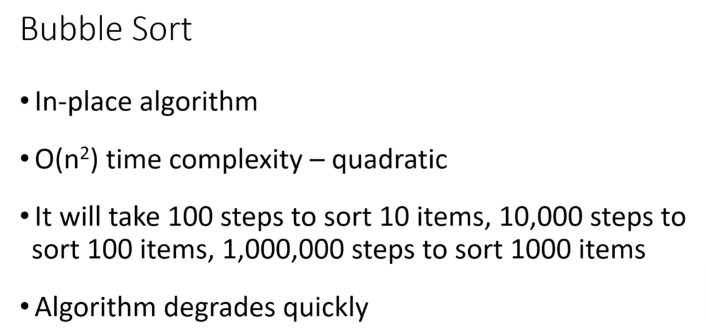
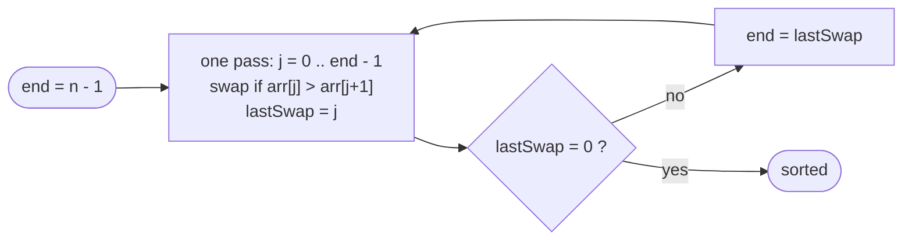

# Bubble Sort
Bubble sorting is a sorting algorithm where we check two elements and swap them at their correct positions.



## Algorithm Strategy (Adjacent Swaps with a Shrinking Range)

1. Guard first: a `null` or single-element array is already sorted and is returned untouched.
2. Let `end` be the last index that still has to be compared (initially `n - 1`).
3. In each pass walk `j` from `0` to `end - 1`; if `arr[j] > arr[j + 1]` swap them and remember `lastSwap = j`.
4. Everything after the last swap of a pass is already in its final place, so the next pass stops at `end = lastSwap`.
5. A pass without any swap leaves `lastSwap = 0`, which ends the loop. A sorted array therefore needs a single pass.

## Example walkthrough for `[5, 3, 8, 4]`

- Pass 1 (`end = 3`): `[5,3,8,4] -> [3,5,8,4] -> [3,5,8,4] -> [3,5,4,8]`; the last swap was at `j = 2`, so `end = 2`.
- Pass 2 (`end = 2`): `[3,5,4,8] -> [3,5,4,8] -> [3,4,5,8]`; the last swap was at `j = 1`, so `end = 1`.
- Pass 3 (`end = 1`): `3 <= 4`, no swap, `lastSwap = 0`, the loop ends with `[3, 4, 5, 8]`.

## Complexity Analysis

- **Time Complexity (Best):** `O(n)` — An already sorted array needs one pass without a swap.
- **Time Complexity (Average):** `O(n^2)` — Nested loops over the array.
- **Time Complexity (Worst):** `O(n^2)` — Array in reverse order.
- **Space Complexity:** `O(1)` — Sorts in place; only a temporary variable is used when swapping.

## Approaches

The same problem can be solved in several ways. They are listed from the simplest to the most efficient.

### Approach 1: Basic Bubble Sort

Always make `n - 1` passes of adjacent compare-and-swap, shrinking the inner loop by one each pass. This is the version implemented in the repository.

```java
public static void bubbleSortBasic(int[] arr) {
    int n = arr.length;
    for (int i = 0; i < n - 1; i++) {
        for (int j = 0; j < n - i - 1; j++) {
            if (arr[j] > arr[j + 1]) swap(arr, j, j + 1);
        }
    }
}
```

- **Time Complexity:** O(n^2) in every case
- **Space Complexity:** O(1)

### Approach 2: Early Exit with a `swapped` Flag

If a complete pass makes no swap the array is already sorted, so stop. This makes the best case (already sorted input) linear.

```java
public static void bubbleSortEarlyExit(int[] arr) {
    int n = arr.length;
    for (int i = 0; i < n - 1; i++) {
        boolean swapped = false;
        for (int j = 0; j < n - i - 1; j++) {
            if (arr[j] > arr[j + 1]) {
                swap(arr, j, j + 1);
                swapped = true;
            }
        }
        if (!swapped) break;
    }
}
```

- **Time Complexity:** Best O(n), average and worst O(n^2)
- **Space Complexity:** O(1)

### Approach 3: Cocktail Shaker Sort

Bubble sort in both directions: a forward pass pushes the largest element to the end, a backward pass pushes the smallest to the front, and the range shrinks from both sides. It moves small elements near the end much faster than plain bubble sort.

```java
public static void cocktailShakerSort(int[] arr) {
    int start = 0, end = arr.length - 1;
    boolean swapped = true;
    while (swapped && start < end) {
        swapped = false;
        for (int i = start; i < end; i++) {
            if (arr[i] > arr[i + 1]) { swap(arr, i, i + 1); swapped = true; }
        }
        end--;
        for (int i = end; i > start; i--) {
            if (arr[i - 1] > arr[i]) { swap(arr, i - 1, i); swapped = true; }
        }
        start++;
    }
}
```

- **Time Complexity:** Best O(n), average and worst O(n^2)
- **Space Complexity:** O(1)

### Approach 4: Recursive Bubble Sort

One pass of adjacent swaps puts the largest element at the end; then the same sort is applied recursively to the first `n - 1` elements.

```java
public static void bubbleSortRecursive(int[] arr) {
    sort(arr, arr.length);
}

private static void sort(int[] arr, int n) {
    if (n <= 1) return;
    boolean swapped = false;
    for (int i = 0; i < n - 1; i++) {
        if (arr[i] > arr[i + 1]) { swap(arr, i, i + 1); swapped = true; }
    }
    if (swapped) sort(arr, n - 1);
}
```

- **Time Complexity:** Best O(n), worst O(n^2)
- **Space Complexity:** O(n) recursion stack

### Approach 5: Odd-Even Transposition Sort

Alternate between comparing the pairs `(0,1), (2,3), ...` and the pairs `(1,2), (3,4), ...`. The comparisons inside one phase are independent, so a parallel machine can perform each phase in a single step.

```java
public static void oddEvenSort(int[] arr) {
    boolean sorted = false;
    while (!sorted) {
        sorted = true;
        for (int phase = 0; phase < 2; phase++) {
            for (int i = phase; i + 1 < arr.length; i += 2) {
                if (arr[i] > arr[i + 1]) { swap(arr, i, i + 1); sorted = false; }
            }
        }
    }
}
```

- **Time Complexity:** Best O(n), worst O(n^2)
- **Space Complexity:** O(1)

### Approach 6: Comb Sort (Bubble Sort with a Gap)

Compare elements that are `gap` apart and shrink the gap by a factor of about 1.3 each round until it is 1. Moving small elements from the end of the array early removes the "turtles" that make bubble sort slow, giving about `O(n log n)` on average.

```java
public static void combSort(int[] arr) {
    int gap = arr.length;
    boolean swapped = true;
    while (gap > 1 || swapped) {
        gap = Math.max(1, (int) (gap / 1.3));
        swapped = false;
        for (int i = 0; i + gap < arr.length; i++) {
            if (arr[i] > arr[i + gap]) { swap(arr, i, i + gap); swapped = true; }
        }
    }
}
```

- **Time Complexity:** Average about O(n log n), worst O(n^2)
- **Space Complexity:** O(1)

### Approach 7: Remember the Last Swap Position (Optimized)

Everything after the last swap of a pass is already in its final place, so the next pass only needs to go up to that position. It also exits early when no swap happens, and it skips long sorted tails.

```java
public static void bubbleSortOptimized(int[] arr) {
    int end = arr.length - 1;
    while (end > 0) {
        int lastSwap = 0;
        for (int j = 0; j < end; j++) {
            if (arr[j] > arr[j + 1]) {
                swap(arr, j, j + 1);
                lastSwap = j;
            }
        }
        end = lastSwap;
    }
}
```

- **Time Complexity:** Best O(n), average and worst O(n^2)
- **Space Complexity:** O(1)

### Comparison

| # | Approach | Time | Space |
|---|----------|------|-------|
| 1 | Basic Bubble Sort | O(n^2) in every case | O(1) |
| 2 | Early Exit with a `swapped` Flag | Best O(n), average and worst O(n^2) | O(1) |
| 3 | Cocktail Shaker Sort | Best O(n), average and worst O(n^2) | O(1) |
| 4 | Recursive Bubble Sort | Best O(n), worst O(n^2) | O(n) recursion stack |
| 5 | Odd-Even Transposition Sort | Best O(n), worst O(n^2) | O(1) |
| 6 | Comb Sort (Bubble Sort with a Gap) | Average about O(n log n), worst O(n^2) | O(1) |
| 7 | Remember the Last Swap Position (Optimized) | Best O(n), average and worst O(n^2) | O(1) |

## Source Code

### BubbleSort.java

```java
import java.util.Arrays;

public class BubbleSort {

    public static void main(String[] args) {
        int[] arr = {12, 4, 5, 7, 9, 20, 30, 6, 15};
        System.out.println("Original Array : " + Arrays.toString(arr));
        bubbleSort(arr);
        System.out.println("Sorted Array   : " + Arrays.toString(arr));
        System.out.println();

        int[] sorted = {1, 2, 3, 4, 5};
        System.out.println("Original Array : " + Arrays.toString(sorted) + "   (already sorted: one pass, no swap)");
        bubbleSort(sorted);
        System.out.println("Sorted Array   : " + Arrays.toString(sorted));
        System.out.println();

        int[] duplicates = {3, 1, 3, 2, 1};
        System.out.println("Original Array : " + Arrays.toString(duplicates));
        bubbleSort(duplicates);
        System.out.println("Sorted Array   : " + Arrays.toString(duplicates));
        System.out.println();

        int[] empty = {};
        bubbleSort(empty);
        bubbleSort(null);
        System.out.println("Empty and null arrays are returned untouched: " + Arrays.toString(empty));
    }

    /**
     * Sorts the array in ascending order using Bubble Sort that stops at the last swap position of each pass.
     *
     * @param arr the array to sort in place; {@code null} and arrays with fewer than two elements are left as they are
     */
    private static void bubbleSort(int[] arr) {
        // Guard Clause: null or single-element arrays are already sorted
        if (arr == null || arr.length <= 1) {
            return;
        }

        int end = arr.length - 1;
        while (end > 0) {
            int lastSwap = 0;
            for (int j = 0; j < end; j++) {
                if (arr[j] > arr[j + 1]) {
                    swap(arr, j, j + 1);
                    lastSwap = j;
                }
            }
            // Everything after the last swap is already in its final place
            end = lastSwap;
        }
    }

    private static void swap(int[] arr, int i, int j) {
        if (i == j) return;
        int temp = arr[i];
        arr[i] = arr[j];
        arr[j] = temp;
    }
}
```

## Solution

The optimized solution is Approach 7 above, which is also the version implemented in this repository.

The idea: walk through the array comparing neighbours and swapping any pair that is out of order, but remember where the last swap of the pass happened. Everything after that position is already sorted, so the next pass stops there. When a pass makes no swap, the position is 0 and the loop ends.

**Input:** `arr = [12, 4, 5, 7, 9, 20, 30, 6, 15]` (n = 9, so the first pass compares up to index 7 and 8).

| Pass | Compares `j` from 0 to | Swaps | Last swap at `j` | Array after the pass | Next `end` |
|------|------------------------|-------|------------------|----------------------|------------|
| 1 | 7 | 6 | 7 | `4 5 7 9 12 20 6 15 30` | 7 |
| 2 | 6 | 2 | 6 | `4 5 7 9 12 6 15 20 30` | 6 |
| 3 | 5 | 1 | 4 | `4 5 7 9 6 12 15 20 30` | 4 |
| 4 | 3 | 1 | 3 | `4 5 7 6 9 12 15 20 30` | 3 |
| 5 | 2 | 1 | 2 | `4 5 6 7 9 12 15 20 30` | 2 |
| 6 | 1 | 0 | 0 | `4 5 6 7 9 12 15 20 30` | 0, the loop ends |

Pass 3 shows the saving: the last swap was at index 4, so the sorted tail `12 15 20 30` is skipped. The basic version would still compare all of it.



**Edge cases.** `null`, empty and one-element arrays return at once through the guard clause. An already sorted array (`[1, 2, 3, 4, 5]`) makes one pass with no swap, so it costs only n - 1 comparisons, O(n). A reverse-ordered array swaps in every pass and is the O(n^2) worst case. Duplicates are never swapped with each other (the test is a strict `>`), so equal values keep their order and the sort is stable.

**Result:** `[4, 5, 6, 7, 9, 12, 15, 20, 30]`, matching the class output.
