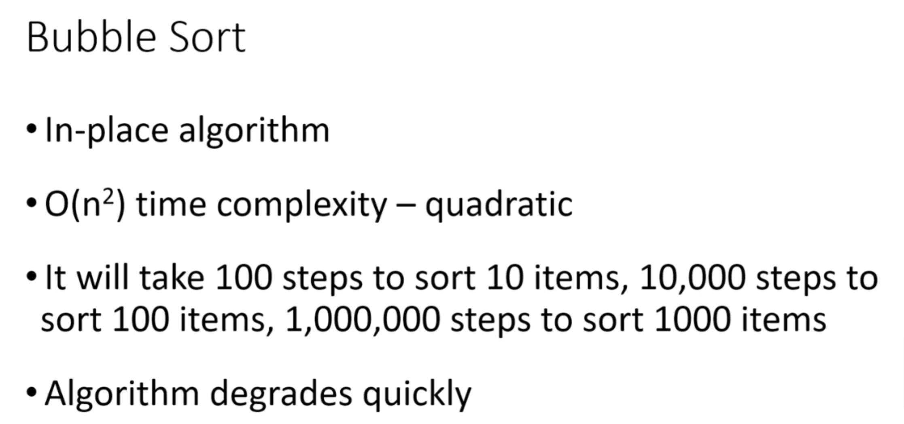

# Bubble Sort
Bubble sorting is a sorting algorithm where we check two elements and swap them at their correct positions.



## Algorithm Strategy (Repeated Adjacent Swaps)

1. Let `n` be the array length. Run an outer loop for `i = 0 .. n - 2` (one pass per iteration).
2. In each pass, walk an inner index `j` from `0` to `n - i - 2`.
3. Compare `arr[j]` with `arr[j + 1]`; if the left element is greater, swap them.
4. After pass `i`, the `i + 1` largest elements are in their final positions at the end of the array, so the next pass can stop one element earlier (`n - i - 1`).
5. After `n - 1` passes the whole array is sorted.

## Example walkthrough for `[5, 3, 8, 4]`

- Pass 1: `[5,3,8,4] -> [3,5,8,4] -> [3,5,8,4] -> [3,5,4,8]` (8 is now in place)
- Pass 2: `[3,5,4,8] -> [3,5,4,8] -> [3,4,5,8]` (5 is now in place)
- Pass 3: `[3,4,5,8]` (no swaps, the array is sorted)

## Complexity Analysis

- **Time Complexity (Best):** `O(n^2)` — Every pass is performed because this version has no early-exit check.
- **Time Complexity (Average):** `O(n^2)` — Nested loops over the array.
- **Time Complexity (Worst):** `O(n^2)` — Array in reverse order.
- **Space Complexity:** `O(1)` — Sorts in place; only a temporary variable is used when swapping.

## Approaches

The same problem can be solved in several ways. They are listed from the simplest to the most efficient.

### Approach 1: Basic Bubble Sort

Always make `n - 1` passes of adjacent compare-and-swap, shrinking the inner loop by one each pass. This is the version implemented in the repository.

```java
public static void bubbleSortBasic(int[] arr) {
    int n = arr.length;
    for (int i = 0; i < n - 1; i++) {
        for (int j = 0; j < n - i - 1; j++) {
            if (arr[j] > arr[j + 1]) swap(arr, j, j + 1);
        }
    }
}
```

- **Time Complexity:** O(n^2) in every case
- **Space Complexity:** O(1)

### Approach 2: Early Exit with a `swapped` Flag

If a complete pass makes no swap the array is already sorted, so stop. This makes the best case (already sorted input) linear.

```java
public static void bubbleSortEarlyExit(int[] arr) {
    int n = arr.length;
    for (int i = 0; i < n - 1; i++) {
        boolean swapped = false;
        for (int j = 0; j < n - i - 1; j++) {
            if (arr[j] > arr[j + 1]) {
                swap(arr, j, j + 1);
                swapped = true;
            }
        }
        if (!swapped) break;
    }
}
```

- **Time Complexity:** Best O(n), average and worst O(n^2)
- **Space Complexity:** O(1)

### Approach 3: Remember the Last Swap Position (Optimized)

Everything after the last swap of a pass is already in its final place, so the next pass only needs to go up to that position. It also exits early when no swap happens, and it skips long sorted tails.

```java
public static void bubbleSortOptimized(int[] arr) {
    int end = arr.length - 1;
    while (end > 0) {
        int lastSwap = 0;
        for (int j = 0; j < end; j++) {
            if (arr[j] > arr[j + 1]) {
                swap(arr, j, j + 1);
                lastSwap = j;
            }
        }
        end = lastSwap;
    }
}
```

- **Time Complexity:** Best O(n), average and worst O(n^2)
- **Space Complexity:** O(1)

### Comparison

| # | Approach | Time | Space |
|---|----------|------|-------|
| 1 | Basic Bubble Sort | O(n^2) in every case | O(1) |
| 2 | Early Exit with a `swapped` Flag | Best O(n), average and worst O(n^2) | O(1) |
| 3 | Remember the Last Swap Position (Optimized) | Best O(n), average and worst O(n^2) | O(1) |

### Optimized Solution

The optimized solution is Approach 3 above. The version implemented in this repository is Approach 1.

## Source Code

### BubbleSort.java

```java
import java.util.Arrays;

public class BubbleSort {

    public static void main(String[] args) {
        int[] arr = {12, 4, 5, 7, 9, 20, 30, 6, 15};

        System.out.println("Original Array : " + Arrays.toString(arr));
        bubbleSort(arr);
        System.out.println("Sorted Array   : " + Arrays.toString(arr));
    }

    /**
     * Sorts the array in ascending order using Bubble Sort.
     *
     * @param arr the array to sort in place
     */
    private static void bubbleSort(int[] arr) {
        // Guard Clause: null or single-element arrays are already sorted
        if (arr == null || arr.length <= 1) {
            return;
        }

        int n = arr.length;
        for (int i = 0; i < n - 1; i++) {
            // The last i elements are already in place, so the inner loop shrinks every pass
            for (int j = 0; j < n - i - 1; j++) {
                if (arr[j] > arr[j + 1]) {
                    swap(arr, j, j + 1);
                }
            }
        }
    }

    private static void swap(int[] arr, int i, int j) {
        if (i == j) return;
        int temp = arr[i];
        arr[i] = arr[j];
        arr[j] = temp;
    }
}
```
