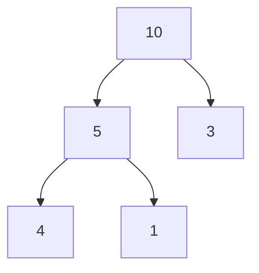

# Heap Sort

Sort an array in ascending order in `O(n log n)` time and `O(1)` extra space by turning it into a max-heap and repeatedly moving the largest element to the end.

## Algorithm Strategy (Build a Max-Heap, then Extract the Maximum)

1. A max-heap stored in an array keeps every parent larger than its children; the children of index `i` are `2i + 1` and `2i + 2`.
2. Build the heap bottom-up: call `heapify` (sift down) for every non-leaf index, from `n / 2 - 1` down to 0.
3. The largest element is now at index 0. Swap it with the last element of the heap, which puts it into its final position, and shrink the heap by one.
4. Sift the new root down to restore the heap property and repeat until the heap has a single element.

## Example walkthrough

- For `[4, 10, 3, 5, 1]`: building the heap gives `[10, 5, 3, 4, 1]`; swapping 10 to the end and sifting down gives `[5, 4, 3, 1 | 10]`, then `[4, 1, 3 | 5, 10]` and so on.
- The result is `[1, 3, 4, 5, 10]`.

## Complexity Analysis

- **Time Complexity:** `O(n log n)` — Building the heap is O(n); each of the n extractions sifts down in O(log n).
- **Space Complexity:** `O(1)` — In place, but not stable.

## Approaches

The same problem can be solved in several ways. The approach marked (Optimized) is the one to use in practice.

### Approach 1: PriorityQueue Extraction

Push everything into a `PriorityQueue` and pop the elements in order. Easy, but it needs `O(n)` extra space.

```java
public static void heapSortQueue(int[] arr) {
    PriorityQueue<Integer> queue = new PriorityQueue<>();
    for (int value : arr) queue.add(value);
    for (int i = 0; i < arr.length; i++) arr[i] = queue.poll();
}
```

- **Time Complexity:** O(n log n)
- **Space Complexity:** O(n)

### Approach 2: Recursive Heapify

The textbook in-place version with a recursive `heapify`.

```java
public static void heapSortRecursive(int[] arr) {
    int n = arr.length;
    for (int i = n / 2 - 1; i >= 0; i--) heapify(arr, n, i);
    for (int end = n - 1; end > 0; end--) {
        int temp = arr[0]; arr[0] = arr[end]; arr[end] = temp;
        heapify(arr, end, 0);
    }
}

private static void heapify(int[] arr, int size, int root) {
    int largest = root, left = 2 * root + 1, right = 2 * root + 2;
    if (left < size && arr[left] > arr[largest]) largest = left;
    if (right < size && arr[right] > arr[largest]) largest = right;
    if (largest != root) {
        int temp = arr[root]; arr[root] = arr[largest]; arr[largest] = temp;
        heapify(arr, size, largest);
    }
}
```

- **Time Complexity:** O(n log n)
- **Space Complexity:** O(log n)

### Approach 3: Build the Heap by Repeated Insertion

Insert the elements one by one with a sift-up (`O(n log n)` to build) and then extract; slower to build than the bottom-up method.

```java
public static void heapSortSiftUp(int[] arr) {
    for (int i = 1; i < arr.length; i++) {
        int child = i;
        while (child > 0 && arr[(child - 1) / 2] < arr[child]) {
            int parent = (child - 1) / 2;
            int temp = arr[parent]; arr[parent] = arr[child]; arr[child] = temp;
            child = parent;
        }
    }
    for (int end = arr.length - 1; end > 0; end--) {
        int temp = arr[0]; arr[0] = arr[end]; arr[end] = temp;
        int root = 0;
        while (true) {
            int largest = root, left = 2 * root + 1, right = 2 * root + 2;
            if (left < end && arr[left] > arr[largest]) largest = left;
            if (right < end && arr[right] > arr[largest]) largest = right;
            if (largest == root) break;
            int t = arr[root]; arr[root] = arr[largest]; arr[largest] = t;
            root = largest;
        }
    }
}
```

- **Time Complexity:** O(n log n)
- **Space Complexity:** O(1)

### Approach 4: Bottom-Up Heap Build with Iterative Sift-Down (Optimized)

Build the heap in `O(n)` from the last parent upwards and sift down iteratively. This is the version implemented in the repository.

```java
public static void heapSort(int[] arr) {
    int n = arr.length;
    for (int i = n / 2 - 1; i >= 0; i--) siftDown(arr, n, i);
    for (int end = n - 1; end > 0; end--) {
        swap(arr, 0, end);
        siftDown(arr, end, 0);
    }
}

private static void siftDown(int[] arr, int heapSize, int root) {
    while (true) {
        int largest = root, left = 2 * root + 1, right = 2 * root + 2;
        if (left < heapSize && arr[left] > arr[largest]) largest = left;
        if (right < heapSize && arr[right] > arr[largest]) largest = right;
        if (largest == root) return;
        swap(arr, root, largest);
        root = largest;
    }
}

private static void swap(int[] arr, int i, int j) {
    int temp = arr[i]; arr[i] = arr[j]; arr[j] = temp;
}
```

- **Time Complexity:** O(n log n)
- **Space Complexity:** O(1)

### Comparison

| # | Approach | Time | Space |
|---|----------|------|-------|
| 1 | PriorityQueue Extraction | O(n log n) | O(n) |
| 2 | Recursive Heapify | O(n log n) | O(log n) |
| 3 | Build the Heap by Repeated Insertion | O(n log n) | O(1) |
| 4 | Bottom-Up Heap Build with Iterative Sift-Down (Optimized) | O(n log n) | O(1) |

### Optimized Solution

The optimized solution is Approach 4 above, which is also the version implemented in this repository.

#### Optimized solution explained

The idea: build a max-heap inside the array itself (the children of index `k` are `2k + 1` and `2k + 2`, and every parent is `>=` its children), so the largest value sits at index 0. Then repeat: swap the root with the last element of the heap, shrink the heap by one (the largest value is now in its final place at the end), and `siftDown` the new root to restore the heap property. `siftDown` swaps a node with its larger child until neither child is bigger. Building costs O(n), the n - 1 extractions cost O(log n) each, so the total is O(n log n) in every case with O(1) extra space.

**Input:** `arr = [4, 10, 3, 5, 1]`.

Step 1 builds the heap by sifting down from the last parent (`n / 2 - 1 = 1`) to the root:

| Step | Action | Array |
|------|--------|-------|
| build i = 1 | node 10 has children 5 and 1, both smaller, so no swap | `[4, 10, 3, 5, 1]` |
| build i = 0 | node 4 has children 10 and 3, swap with 10; then 4 at index 1 has child 5 (index 3), swap with 5 | `[10, 5, 3, 4, 1]` |



Step 2 repeatedly moves the root to the end and repairs the heap (the sorted tail is shown after the bar):

| Step | Swap root with | siftDown of the new root | Heap part \| sorted tail |
|------|----------------|--------------------------|--------------------------|
| end = 4 | `arr[4]` (1) | 1 swaps with 5, then with 4 | `[5, 4, 3, 1]` \| `10` |
| end = 3 | `arr[3]` (1) | 1 swaps with 4 | `[4, 1, 3]` \| `5 10` |
| end = 2 | `arr[2]` (3) | 3 is not smaller than child 1, stays | `[3, 1]` \| `4 5 10` |
| end = 1 | `arr[1]` (1) | heap size 1, nothing to do | `[1]` \| `3 4 5 10` |

**Edge cases.** An empty or one-element array does nothing (the build loop starts at `n / 2 - 1 < 0` and the extraction loop does not run). Duplicates work (`[2, 2, 1, 1]` gives `[1, 1, 2, 2]`) but the sort is not stable. The order of the input has no influence on the running time. A `null` array is not guarded and would throw `NullPointerException`.

**Result:** `[1, 3, 4, 5, 10]`, matching the class output.

## Source Code

### HeapSort.java

```java
import java.util.Arrays;

public class HeapSort {

    public static void main(String[] args) {
        int[][] inputs = {{4, 10, 3, 5, 1}, {12, 4, 5, 7, 9, 20, 30, 6, 15}, {1, 2, 3, 4}, {4, 3, 2, 1}, {2, 2, 1, 1}};
        for (int[] arr : inputs) {
            System.out.println("Original Array : " + Arrays.toString(arr));
            heapSort(arr);
            System.out.println("Sorted Array   : " + Arrays.toString(arr));
            System.out.println();
        }
    }

    public static void heapSort(int[] arr) {
        int n = arr.length;
        for (int i = n / 2 - 1; i >= 0; i--) {
            siftDown(arr, n, i);
        }

        for (int end = n - 1; end > 0; end--) {
            swap(arr, 0, end);
            siftDown(arr, end, 0);
        }
    }

    private static void siftDown(int[] arr, int heapSize, int root) {
        while (true) {
            int largest = root;
            int left = 2 * root + 1;
            int right = 2 * root + 2;
            if (left < heapSize && arr[left] > arr[largest]) {
                largest = left;
            }
            if (right < heapSize && arr[right] > arr[largest]) {
                largest = right;
            }
            if (largest == root) {
                return;
            }
            swap(arr, root, largest);
            root = largest;
        }
    }

    private static void swap(int[] arr, int i, int j) {
        int temp = arr[i];
        arr[i] = arr[j];
        arr[j] = temp;
    }
}
```
