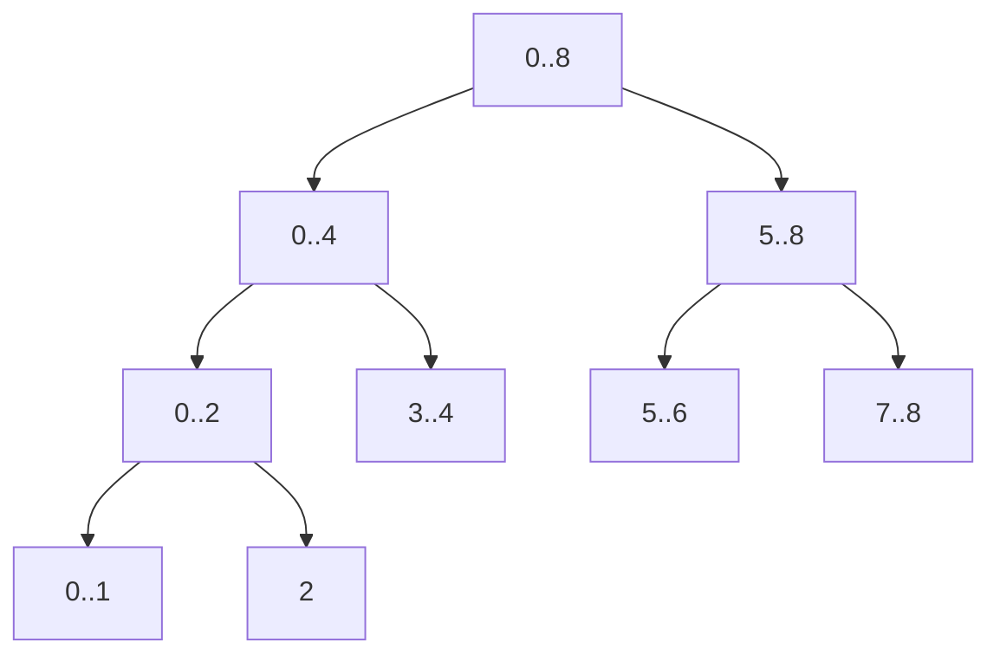

# Merge Sort

**Definition:** Merge sort is a sorting technique based on divide and conquer technique.

**Merge sort works as follows:**
* Divide the unsorted list into n sublists, each containing one element (a list of one element is considered sorted).
* Repeatedly merge sublists to produce new sorted sublists until there is only one sublist remaining. This will be the sorted list.


## Algorithm Strategy (Divide and Merge with One Buffer)

1. Guard first: a `null` array and arrays with fewer than two elements are already sorted.
2. Allocate a single auxiliary array `buffer` of the same length, once, before the recursion starts.
3. **Divide:** sort the index range `[low, high]` by sorting `[low, mid]` and `[mid + 1, high]` recursively, with `mid = low + (high - low) / 2`. No sub-array is copied.
4. **Skip when ordered:** if `arr[mid] <= arr[mid + 1]` the two halves are already in order, so the merge is skipped. An already sorted array is therefore processed in linear time.
5. **Merge:** copy `arr[low..high]` into the buffer, then write back into `arr`, each time taking the smaller front element of the two halves in the buffer (`<` on the right half, so equal keys keep their order and the sort is stable).

## Example walkthrough for `[38, 27, 43, 3]`

- Divide: `[38, 27] | [43, 3]` then `[38] [27] | [43] [3]`
- Merge `[0..1]`: `[27, 38, 43, 3]`; merge `[2..3]`: `[27, 38, 3, 43]`
- Merge `[0..3]`: `[3, 27, 38, 43]`

## Complexity Analysis

- **Time Complexity (Best):** `O(n)` — A sorted input skips every merge and only the recursion remains.
- **Time Complexity (Average):** `O(n log n)` — The range is always halved (`log n` levels) and each level merges in `O(n)`.
- **Time Complexity (Worst):** `O(n log n)` — Same as the average case.
- **Space Complexity:** `O(n)` — One buffer allocated once, plus `O(log n)` recursion stack, instead of new arrays at every level.

## Approaches

The same problem can be solved in several ways. They are listed from the simplest to the most efficient.

### Approach 1: Top-Down with New Arrays

Copy each half into new arrays, sort them recursively and merge. Easy to read; allocates many short-lived arrays. This is the version implemented in the repository.

```java
public static int[] mergeSortCopy(int[] arr) {
    if (arr.length <= 1) return arr;
    int mid = arr.length / 2;
    int[] left = mergeSortCopy(Arrays.copyOfRange(arr, 0, mid));
    int[] right = mergeSortCopy(Arrays.copyOfRange(arr, mid, arr.length));

    int[] result = new int[arr.length];
    int i = 0, j = 0, k = 0;
    while (i < left.length && j < right.length) {
        result[k++] = (left[i] <= right[j]) ? left[i++] : right[j++];
    }
    while (i < left.length) result[k++] = left[i++];
    while (j < right.length) result[k++] = right[j++];
    return result;
}
```

- **Time Complexity:** O(n log n)
- **Space Complexity:** O(n) with many temporary arrays

### Approach 2: Bottom-Up (Iterative)

Start with sorted runs of size 1 and repeatedly merge neighbouring runs, doubling the run size each round. No recursion, so no stack usage.

```java
public static void mergeSortBottomUp(int[] arr) {
    int n = arr.length;
    int[] src = arr, dst = new int[n];
    for (int width = 1; width < n; width *= 2) {
        for (int lo = 0; lo < n; lo += 2 * width) {
            int mid = Math.min(lo + width, n), hi = Math.min(lo + 2 * width, n);
            int i = lo, j = mid, k = lo;
            while (i < mid && j < hi) dst[k++] = (src[i] <= src[j]) ? src[i++] : src[j++];
            while (i < mid) dst[k++] = src[i++];
            while (j < hi) dst[k++] = src[j++];
        }
        int[] t = src; src = dst; dst = t;
    }
    if (src != arr) System.arraycopy(src, 0, arr, 0, n);
}
```

- **Time Complexity:** O(n log n)
- **Space Complexity:** O(n)

### Approach 3: Natural Merge Sort

Instead of splitting down to single elements, look for the runs that are already in ascending order and merge neighbouring runs until only one run remains. Sorted or nearly sorted input is handled in linear time.

```java
public static void mergeSortNatural(int[] arr) {
    int n = arr.length;
    int[] buffer = new int[n];
    boolean merged = true;
    while (merged) {
        merged = false;
        int start = 0;
        while (start < n) {
            int mid = runEnd(arr, start);
            if (mid >= n) break;
            int end = runEnd(arr, mid);
            merge(arr, buffer, start, mid, end);
            merged = true;
            start = end;
        }
    }
}

private static int runEnd(int[] arr, int from) {
    int i = from + 1;
    while (i < arr.length && arr[i - 1] <= arr[i]) i++;
    return i;
}

private static void merge(int[] arr, int[] buffer, int lo, int mid, int hi) {
    System.arraycopy(arr, lo, buffer, lo, hi - lo);
    int i = lo, j = mid;
    for (int k = lo; k < hi; k++) {
        if (i >= mid) arr[k] = buffer[j++];
        else if (j >= hi) arr[k] = buffer[i++];
        else if (buffer[j] < buffer[i]) arr[k] = buffer[j++];
        else arr[k] = buffer[i++];
    }
}
```

- **Time Complexity:** Best O(n), worst O(n log n)
- **Space Complexity:** O(n)

### Approach 4: In-Place Merge with Rotations

Merge without an auxiliary array: when the next element of the right half is smaller than the current element of the left half, rotate the block of smaller elements in front of the left half using three reversals. Needs no buffer, but is slower, `O(n log^2 n)`.

```java
public static void mergeSortInPlace(int[] arr) {
    sort(arr, 0, arr.length);
}

private static void sort(int[] a, int lo, int hi) {                // sorts a[lo..hi)
    if (hi - lo < 2) return;
    int mid = (lo + hi) >>> 1;
    sort(a, lo, mid);
    sort(a, mid, hi);
    int i = lo, j = mid;
    while (i < j && j < hi) {
        if (a[i] <= a[j]) { i++; continue; }
        int k = j;
        while (k < hi && a[k] < a[i]) k++;                         // a[j..k) is smaller than a[i]
        reverse(a, i, j - 1);
        reverse(a, j, k - 1);
        reverse(a, i, k - 1);                                      // rotate: a[j..k) now precedes a[i..j)
        i += k - j;
        j = k;
    }
}

private static void reverse(int[] a, int from, int to) {
    while (from < to) { int t = a[from]; a[from++] = a[to]; a[to--] = t; }
}
```

- **Time Complexity:** O(n log^2 n)
- **Space Complexity:** O(log n)

### Approach 5: Parallel Merge Sort with Fork/Join

The two halves are independent, so they can be sorted by different threads. A `RecursiveAction` splits large ranges, sorts small ones directly and merges the sorted halves with a shared buffer. (`Arrays.parallelSort` does the same internally.)

```java
public static void mergeSortParallel(int[] arr) {
    ForkJoinPool.commonPool().invoke(new SortTask(arr, new int[arr.length], 0, arr.length));
}

static class SortTask extends RecursiveAction {
    private final int[] a, buffer;
    private final int lo, hi;

    SortTask(int[] a, int[] buffer, int lo, int hi) { this.a = a; this.buffer = buffer; this.lo = lo; this.hi = hi; }

    @Override
    protected void compute() {
        if (hi - lo <= 32) { Arrays.sort(a, lo, hi); return; }
        int mid = (lo + hi) >>> 1;
        invokeAll(new SortTask(a, buffer, lo, mid), new SortTask(a, buffer, mid, hi));
        System.arraycopy(a, lo, buffer, lo, hi - lo);
        int i = lo, j = mid;
        for (int k = lo; k < hi; k++) {
            if (i >= mid) a[k] = buffer[j++];
            else if (j >= hi) a[k] = buffer[i++];
            else if (buffer[j] < buffer[i]) a[k] = buffer[j++];
            else a[k] = buffer[i++];
        }
    }
}
```

- **Time Complexity:** O(n log n) work, O(n) span with a sequential merge
- **Space Complexity:** O(n)

### Approach 6: Three-Way Merge Sort

Split the array into three parts instead of two, sort each part recursively and merge the three sorted parts with two ordinary merges. The recursion is shallower (`log3 n` levels) but every level does more comparisons, so the total is still `O(n log n)`.

```java
public static int[] mergeSortThreeWay(int[] arr) {
    if (arr.length <= 1) return arr.clone();
    int third = Math.max(1, arr.length / 3);
    int[] a = mergeSortThreeWay(Arrays.copyOfRange(arr, 0, third));
    int[] b = mergeSortThreeWay(Arrays.copyOfRange(arr, third, Math.min(arr.length, 2 * third)));
    int[] c = mergeSortThreeWay(Arrays.copyOfRange(arr, Math.min(arr.length, 2 * third), arr.length));
    return mergeTwo(mergeTwo(a, b), c);
}

private static int[] mergeTwo(int[] x, int[] y) {
    int[] result = new int[x.length + y.length];
    int i = 0, j = 0, k = 0;
    while (i < x.length && j < y.length) result[k++] = x[i] <= y[j] ? x[i++] : y[j++];
    while (i < x.length) result[k++] = x[i++];
    while (j < y.length) result[k++] = y[j++];
    return result;
}
```

- **Time Complexity:** O(n log n)
- **Space Complexity:** O(n)

### Approach 7: Top-Down with One Shared Buffer (Optimized)

Allocate a single auxiliary array once and merge index ranges in place, instead of allocating arrays at every level of the recursion. For small ranges insertion sort is usually faster, and skipping the merge when `arr[mid - 1] <= arr[mid]` makes already-sorted input linear.

```java
public static void mergeSortBuffer(int[] arr) {
    if (arr == null || arr.length <= 1) return;
    mergeSortBuffer(arr, new int[arr.length], 0, arr.length - 1);
}

private static void mergeSortBuffer(int[] arr, int[] buffer, int low, int high) {
    if (low >= high) return;
    int mid = low + (high - low) / 2;
    mergeSortBuffer(arr, buffer, low, mid);
    mergeSortBuffer(arr, buffer, mid + 1, high);

    if (arr[mid] <= arr[mid + 1]) return;   // already ordered, nothing to merge

    System.arraycopy(arr, low, buffer, low, high - low + 1);
    int i = low, j = mid + 1;
    for (int k = low; k <= high; k++) {
        if (i > mid) arr[k] = buffer[j++];
        else if (j > high) arr[k] = buffer[i++];
        else if (buffer[j] < buffer[i]) arr[k] = buffer[j++];
        else arr[k] = buffer[i++];
    }
}
```

- **Time Complexity:** O(n log n)
- **Space Complexity:** O(n) (one buffer) + O(log n) stack

### Comparison

| # | Approach | Time | Space |
|---|----------|------|-------|
| 1 | Top-Down with New Arrays | O(n log n) | O(n) with many temporary arrays |
| 2 | Bottom-Up (Iterative) | O(n log n) | O(n) |
| 3 | Natural Merge Sort | Best O(n), worst O(n log n) | O(n) |
| 4 | In-Place Merge with Rotations | O(n log^2 n) | O(log n) |
| 5 | Parallel Merge Sort with Fork/Join | O(n log n) work, O(n) span with a sequential merge | O(n) |
| 6 | Three-Way Merge Sort | O(n log n) | O(n) |
| 7 | Top-Down with One Shared Buffer (Optimized) | O(n log n) | O(n) (one buffer) + O(log n) stack |

## Source Code

### MergeSort.java

```java
import java.util.Arrays;

public class MergeSort {

    public static void main(String[] args) {
        int[] arr = {12, 4, 5, 7, 9, 20, 30, 6, 15};
        System.out.println("Original Array : " + Arrays.toString(arr));
        mergeSort(arr);
        System.out.println("Sorted Array   : " + Arrays.toString(arr));
        System.out.println();

        int[] sorted = {1, 2, 3, 4, 5, 6};
        System.out.println("Original Array : " + Arrays.toString(sorted) + "   (already sorted: every merge is skipped)");
        mergeSort(sorted);
        System.out.println("Sorted Array   : " + Arrays.toString(sorted));
        System.out.println();

        int[] duplicates = {3, 1, 3, 2, 1};
        System.out.println("Original Array : " + Arrays.toString(duplicates));
        mergeSort(duplicates);
        System.out.println("Sorted Array   : " + Arrays.toString(duplicates));
        System.out.println();

        int[] empty = {};
        mergeSort(empty);
        mergeSort(null);
        System.out.println("Empty and null arrays are returned untouched: " + Arrays.toString(empty));
    }

    /**
     * Sorts the array in ascending order, in place.
     *
     * @param arr the array to sort; {@code null} and arrays with fewer than two elements are left as they are
     */
    private static void mergeSort(int[] arr) {
        // Guard Clause: nothing to sort
        if (arr == null || arr.length <= 1) {
            return;
        }
        mergeSort(arr, new int[arr.length], 0, arr.length - 1);
    }

    /**
     * Sorts {@code arr[low..high]} using the shared {@code buffer}.
     */
    private static void mergeSort(int[] arr, int[] buffer, int low, int high) {
        if (low >= high) {
            return;
        }
        int mid = low + (high - low) / 2;
        mergeSort(arr, buffer, low, mid);
        mergeSort(arr, buffer, mid + 1, high);

        // The halves are already in order: nothing to merge
        if (arr[mid] <= arr[mid + 1]) {
            return;
        }
        merge(arr, buffer, low, mid, high);
    }

    /**
     * Merges the sorted ranges {@code arr[low..mid]} and {@code arr[mid + 1..high]}.
     */
    private static void merge(int[] arr, int[] buffer, int low, int mid, int high) {
        System.arraycopy(arr, low, buffer, low, high - low + 1);
        int i = low, j = mid + 1;
        for (int k = low; k <= high; k++) {
            if (i > mid) {
                arr[k] = buffer[j++];
            } else if (j > high) {
                arr[k] = buffer[i++];
            } else if (buffer[j] < buffer[i]) {
                // Take from the right half only when it is strictly smaller ('<' keeps the sort stable)
                arr[k] = buffer[j++];
            } else {
                arr[k] = buffer[i++];
            }
        }
    }
}
```

## Solution

The optimized solution is Approach 7 above, which is also the version implemented in this repository.

The idea: split the index range in half, sort each half, then merge the two sorted halves. Instead of creating new arrays for the halves, all work happens inside the original array, with one auxiliary `buffer` allocated once. A merge is skipped when the last element of the left half is not greater than the first element of the right half.

**Input:** `arr = [12, 4, 5, 7, 9, 20, 30, 6, 15]` (n = 9). The halves are `[0..4]` and `[5..8]`, then `[0..2]`/`[3..4]` and `[5..6]`/`[7..8]`, and so on down to single elements. The calls finish in this order:

| Step | Range | Left half | Right half | What happens |
|------|-------|-----------|------------|--------------|
| 1 | `[0..1]` | `12` | `4` | merge: `4 12` |
| 2 | `[0..2]` | `4 12` | `5` | merge: `4 5 12` |
| 3 | `[3..4]` | `7` | `9` | skipped, already in order |
| 4 | `[0..4]` | `4 5 12` | `7 9` | merge: `4 5 7 9 12` |
| 5 | `[5..6]` | `20` | `30` | skipped, already in order |
| 6 | `[7..8]` | `6` | `15` | skipped, already in order |
| 7 | `[5..8]` | `20 30` | `6 15` | merge: `6 15 20 30` |
| 8 | `[0..8]` | `4 5 7 9 12` | `6 15 20 30` | merge: `4 5 6 7 9 12 15 20 30` |

Step 2 (`[0..2]`) shows the saving: the left part `4 12` and the right part `5` are merged, but at step 3 (`[3..4]`) `7` and `9` are already in order, so nothing is copied. In total there are 8 range merges, 3 of them skipped.



**Edge cases.** `null`, empty and one-element arrays return at once through the guard clause. An already sorted array such as `[1, 2, 3, 4, 5, 6]` skips every merge, so the work is just the recursion (linear). Equal values keep their order, because the right half is taken only when its element is strictly smaller. The buffer is allocated once for the whole array, so the extra memory is `n` integers plus the `O(log n)` recursion stack.

**Result:** `[4, 5, 6, 7, 9, 12, 15, 20, 30]`, matching the class output.
