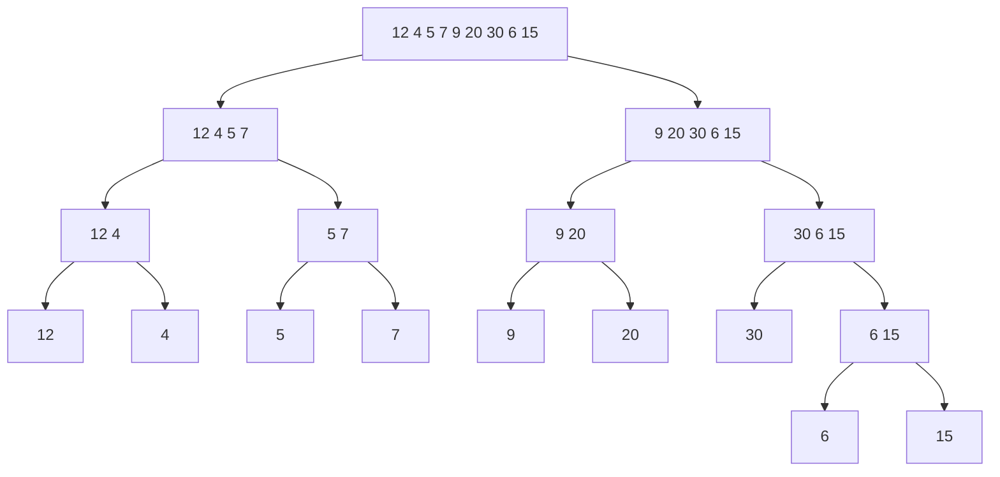

# Merge Sort

**Definition:** Merge sort is a sorting technique based on divide and conquer technique.

**Merge sort works as follows:**
* Divide the unsorted list into n sublists, each containing one element (a list of one element is considered sorted).
* Repeatedly merge sublists to produce new sorted sublists until there is only one sublist remaining. This will be the sorted list.


## Algorithm Strategy (Divide and Merge)

1. **Base case:** an array with `0` or `1` elements is already sorted, return it as is.
2. **Divide:** compute `mid = n / 2` and copy the elements into a `left` array (`arr[0..mid-1]`) and a `right` array (`arr[mid..n-1]`).
3. **Conquer:** recursively sort `left` and `right`.
4. **Merge:** keep one index per sorted half and repeatedly copy the smaller front element into the result; when one half is exhausted, copy the remainder of the other half.

## Example walkthrough for `[38, 27, 43, 3]`

- Divide: `[38, 27] | [43, 3]` then `[38] [27] | [43] [3]`
- Merge: `[27, 38]` and `[3, 43]`
- Merge: `[3, 27, 38, 43]`

## Complexity Analysis

- **Time Complexity (Best):** `O(n log n)` — The array is always halved (`log n` levels) and each level merges in `O(n)`.
- **Time Complexity (Average):** `O(n log n)` — Same as best case.
- **Time Complexity (Worst):** `O(n log n)` — Same as best case.
- **Space Complexity:** `O(n)` — Auxiliary arrays are created for the halves and the merged result.

## Approaches

The same problem can be solved in several ways. They are listed from the simplest to the most efficient.

### Approach 1: Top-Down with New Arrays (Implemented)

Copy each half into new arrays, sort them recursively and merge. Easy to read; allocates many short-lived arrays. This is the version implemented in the repository.

```java
public static int[] mergeSortCopy(int[] arr) {
    if (arr.length <= 1) return arr;
    int mid = arr.length / 2;
    int[] left = mergeSortCopy(Arrays.copyOfRange(arr, 0, mid));
    int[] right = mergeSortCopy(Arrays.copyOfRange(arr, mid, arr.length));

    int[] result = new int[arr.length];
    int i = 0, j = 0, k = 0;
    while (i < left.length && j < right.length) {
        result[k++] = (left[i] <= right[j]) ? left[i++] : right[j++];
    }
    while (i < left.length) result[k++] = left[i++];
    while (j < right.length) result[k++] = right[j++];
    return result;
}
```

- **Time Complexity:** O(n log n)
- **Space Complexity:** O(n) with many temporary arrays

### Approach 2: Bottom-Up (Iterative)

Start with sorted runs of size 1 and repeatedly merge neighbouring runs, doubling the run size each round. No recursion, so no stack usage.

```java
public static void mergeSortBottomUp(int[] arr) {
    int n = arr.length;
    int[] src = arr, dst = new int[n];
    for (int width = 1; width < n; width *= 2) {
        for (int lo = 0; lo < n; lo += 2 * width) {
            int mid = Math.min(lo + width, n), hi = Math.min(lo + 2 * width, n);
            int i = lo, j = mid, k = lo;
            while (i < mid && j < hi) dst[k++] = (src[i] <= src[j]) ? src[i++] : src[j++];
            while (i < mid) dst[k++] = src[i++];
            while (j < hi) dst[k++] = src[j++];
        }
        int[] t = src; src = dst; dst = t;
    }
    if (src != arr) System.arraycopy(src, 0, arr, 0, n);
}
```

- **Time Complexity:** O(n log n)
- **Space Complexity:** O(n)

### Approach 3: Natural Merge Sort

Instead of splitting down to single elements, look for the runs that are already in ascending order and merge neighbouring runs until only one run remains. Sorted or nearly sorted input is handled in linear time.

```java
public static void mergeSortNatural(int[] arr) {
    int n = arr.length;
    int[] buffer = new int[n];
    boolean merged = true;
    while (merged) {
        merged = false;
        int start = 0;
        while (start < n) {
            int mid = runEnd(arr, start);
            if (mid >= n) break;
            int end = runEnd(arr, mid);
            merge(arr, buffer, start, mid, end);
            merged = true;
            start = end;
        }
    }
}

private static int runEnd(int[] arr, int from) {
    int i = from + 1;
    while (i < arr.length && arr[i - 1] <= arr[i]) i++;
    return i;
}

private static void merge(int[] arr, int[] buffer, int lo, int mid, int hi) {
    System.arraycopy(arr, lo, buffer, lo, hi - lo);
    int i = lo, j = mid;
    for (int k = lo; k < hi; k++) {
        if (i >= mid) arr[k] = buffer[j++];
        else if (j >= hi) arr[k] = buffer[i++];
        else if (buffer[j] < buffer[i]) arr[k] = buffer[j++];
        else arr[k] = buffer[i++];
    }
}
```

- **Time Complexity:** Best O(n), worst O(n log n)
- **Space Complexity:** O(n)

### Approach 4: In-Place Merge with Rotations

Merge without an auxiliary array: when the next element of the right half is smaller than the current element of the left half, rotate the block of smaller elements in front of the left half using three reversals. Needs no buffer, but is slower, `O(n log^2 n)`.

```java
public static void mergeSortInPlace(int[] arr) {
    sort(arr, 0, arr.length);
}

private static void sort(int[] a, int lo, int hi) {                // sorts a[lo..hi)
    if (hi - lo < 2) return;
    int mid = (lo + hi) >>> 1;
    sort(a, lo, mid);
    sort(a, mid, hi);
    int i = lo, j = mid;
    while (i < j && j < hi) {
        if (a[i] <= a[j]) { i++; continue; }
        int k = j;
        while (k < hi && a[k] < a[i]) k++;                         // a[j..k) is smaller than a[i]
        reverse(a, i, j - 1);
        reverse(a, j, k - 1);
        reverse(a, i, k - 1);                                      // rotate: a[j..k) now precedes a[i..j)
        i += k - j;
        j = k;
    }
}

private static void reverse(int[] a, int from, int to) {
    while (from < to) { int t = a[from]; a[from++] = a[to]; a[to--] = t; }
}
```

- **Time Complexity:** O(n log^2 n)
- **Space Complexity:** O(log n)

### Approach 5: Parallel Merge Sort with Fork/Join

The two halves are independent, so they can be sorted by different threads. A `RecursiveAction` splits large ranges, sorts small ones directly and merges the sorted halves with a shared buffer. (`Arrays.parallelSort` does the same internally.)

```java
public static void mergeSortParallel(int[] arr) {
    ForkJoinPool.commonPool().invoke(new SortTask(arr, new int[arr.length], 0, arr.length));
}

static class SortTask extends RecursiveAction {
    private final int[] a, buffer;
    private final int lo, hi;

    SortTask(int[] a, int[] buffer, int lo, int hi) { this.a = a; this.buffer = buffer; this.lo = lo; this.hi = hi; }

    @Override
    protected void compute() {
        if (hi - lo <= 32) { Arrays.sort(a, lo, hi); return; }
        int mid = (lo + hi) >>> 1;
        invokeAll(new SortTask(a, buffer, lo, mid), new SortTask(a, buffer, mid, hi));
        System.arraycopy(a, lo, buffer, lo, hi - lo);
        int i = lo, j = mid;
        for (int k = lo; k < hi; k++) {
            if (i >= mid) a[k] = buffer[j++];
            else if (j >= hi) a[k] = buffer[i++];
            else if (buffer[j] < buffer[i]) a[k] = buffer[j++];
            else a[k] = buffer[i++];
        }
    }
}
```

- **Time Complexity:** O(n log n) work, O(n) span with a sequential merge
- **Space Complexity:** O(n)

### Approach 6: Three-Way Merge Sort

Split the array into three parts instead of two, sort each part recursively and merge the three sorted parts with two ordinary merges. The recursion is shallower (`log3 n` levels) but every level does more comparisons, so the total is still `O(n log n)`.

```java
public static int[] mergeSortThreeWay(int[] arr) {
    if (arr.length <= 1) return arr.clone();
    int third = Math.max(1, arr.length / 3);
    int[] a = mergeSortThreeWay(Arrays.copyOfRange(arr, 0, third));
    int[] b = mergeSortThreeWay(Arrays.copyOfRange(arr, third, Math.min(arr.length, 2 * third)));
    int[] c = mergeSortThreeWay(Arrays.copyOfRange(arr, Math.min(arr.length, 2 * third), arr.length));
    return mergeTwo(mergeTwo(a, b), c);
}

private static int[] mergeTwo(int[] x, int[] y) {
    int[] result = new int[x.length + y.length];
    int i = 0, j = 0, k = 0;
    while (i < x.length && j < y.length) result[k++] = x[i] <= y[j] ? x[i++] : y[j++];
    while (i < x.length) result[k++] = x[i++];
    while (j < y.length) result[k++] = y[j++];
    return result;
}
```

- **Time Complexity:** O(n log n)
- **Space Complexity:** O(n)

### Approach 7: Top-Down with One Shared Buffer (Optimized)

Allocate a single auxiliary array once and merge index ranges in place, instead of allocating arrays at every level of the recursion. For small ranges insertion sort is usually faster, and skipping the merge when `arr[mid - 1] <= arr[mid]` makes already-sorted input linear.

```java
public static void mergeSortBuffer(int[] arr) {
    if (arr == null || arr.length <= 1) return;
    mergeSortBuffer(arr, new int[arr.length], 0, arr.length - 1);
}

private static void mergeSortBuffer(int[] arr, int[] buffer, int low, int high) {
    if (low >= high) return;
    int mid = low + (high - low) / 2;
    mergeSortBuffer(arr, buffer, low, mid);
    mergeSortBuffer(arr, buffer, mid + 1, high);

    if (arr[mid] <= arr[mid + 1]) return;   // already ordered, nothing to merge

    System.arraycopy(arr, low, buffer, low, high - low + 1);
    int i = low, j = mid + 1;
    for (int k = low; k <= high; k++) {
        if (i > mid) arr[k] = buffer[j++];
        else if (j > high) arr[k] = buffer[i++];
        else if (buffer[j] < buffer[i]) arr[k] = buffer[j++];
        else arr[k] = buffer[i++];
    }
}
```

- **Time Complexity:** O(n log n)
- **Space Complexity:** O(n) (one buffer) + O(log n) stack

### Comparison

| # | Approach | Time | Space |
|---|----------|------|-------|
| 1 | Top-Down with New Arrays (Implemented) | O(n log n) | O(n) with many temporary arrays |
| 2 | Bottom-Up (Iterative) | O(n log n) | O(n) |
| 3 | Natural Merge Sort | Best O(n), worst O(n log n) | O(n) |
| 4 | In-Place Merge with Rotations | O(n log^2 n) | O(log n) |
| 5 | Parallel Merge Sort with Fork/Join | O(n log n) work, O(n) span with a sequential merge | O(n) |
| 6 | Three-Way Merge Sort | O(n log n) | O(n) |
| 7 | Top-Down with One Shared Buffer (Optimized) | O(n log n) | O(n) (one buffer) + O(log n) stack |

## Source Code

### MergeSort.java

```java
import java.util.Arrays;

public class MergeSort {

    public static void main(String[] args) {
        int[] arr = {12, 4, 5, 7, 9, 20, 30, 6, 15};

        System.out.println("Original Array : " + Arrays.toString(arr));
        int[] sortedArr = mergeSort(arr);
        System.out.println("Sorted Array   : " + Arrays.toString(sortedArr));
    }

    /**
     * Recursively splits the array in halves and merges the sorted halves.
     *
     * @param arr the array to sort
     * @return a new sorted array
     */
    private static int[] mergeSort(int[] arr) {
        int n = arr.length;
        if (n <= 1) {
            return arr;
        }

        int mid = n / 2;
        int[] left = new int[mid];
        int[] right = new int[n - mid];

        System.arraycopy(arr, 0, left, 0, left.length);
        System.arraycopy(arr, mid, right, 0, right.length);

        left = mergeSort(left);
        right = mergeSort(right);

        return merge(left, right);
    }

    /**
     * Merges two sorted arrays into one sorted array.
     *
     * @param left  the first sorted array
     * @param right the second sorted array
     * @return a sorted array containing all elements of both inputs
     */
    private static int[] merge(int[] left, int[] right) {
        int lengthL = left.length;
        int lengthR = right.length;

        int[] result = new int[lengthL + lengthR];
        int k = 0, i = 0, j = 0;

        while (i < lengthL || j < lengthR) {
            if (i < lengthL && j < lengthR) {
                // Take the smaller front element ('<=' keeps the sort stable)
                if (left[i] <= right[j]) {
                    result[k++] = left[i++];
                } else {
                    result[k++] = right[j++];
                }
            } else if (i < lengthL) {
                result[k++] = left[i++];
            } else {
                result[k++] = right[j++];
            }
        }
        return result;
    }
}
```

## Solution

This repository implements Approach 1 (Top-Down with New Arrays), marked `(Implemented)` in the Approaches section. The optimized approach on this page, Approach 7 (Top-Down with One Shared Buffer), is not implemented in the class.

The idea: divide and conquer. An array of 0 or 1 elements is already sorted; otherwise copy the left half (`n / 2` elements) and the right half into new arrays, sort each recursively, and `merge` the two sorted halves by repeatedly taking the smaller front element (`<=` takes the left one on ties, which keeps the sort stable). Every level of recursion does O(n) merging work and there are about log n levels, so the time is O(n log n) for any input order. The page names a "single shared buffer" variant as the optimized one, but the class in this repository is the simple version that allocates new arrays for each split and merge, and that is what is traced.

**Input:** `arr = [12, 4, 5, 7, 9, 20, 30, 6, 15]`.



The recursion goes down the left side first, and every array of length 1 is returned as is. The merges then happen in this order:

| Step | Merge (left + right) | Result |
|------|----------------------|--------|
| 1 | `[12]` + `[4]` | `[4, 12]` |
| 2 | `[5]` + `[7]` | `[5, 7]` |
| 3 | `[4, 12]` + `[5, 7]` | `[4, 5, 7, 12]` |
| 4 | `[9]` + `[20]` | `[9, 20]` |
| 5 | `[6]` + `[15]` | `[6, 15]` |
| 6 | `[30]` + `[6, 15]` | `[6, 15, 30]` |
| 7 | `[9, 20]` + `[6, 15, 30]` | `[6, 9, 15, 20, 30]` |
| 8 | `[4, 5, 7, 12]` + `[6, 9, 15, 20, 30]` | `[4, 5, 6, 7, 9, 12, 15, 20, 30]` |

Step 8 in detail: front elements 4 vs 6 take 4, 5 vs 6 take 5, 7 vs 6 take 6, 7 vs 9 take 7, 12 vs 9 take 9, 12 vs 15 take 12; the left array is now used up, so the rest of the right array (15, 20, 30) is copied.

**Edge cases.** An empty or one-element array is returned as is (`n <= 1`). The method returns a new sorted array and does not change the input array. When one side runs out, the other side's rest is copied unchanged. Space is O(n) for the copies. A `null` array would throw `NullPointerException` at `arr.length`.

**Result:** `[4, 5, 6, 7, 9, 12, 15, 20, 30]`, matching the class output.
