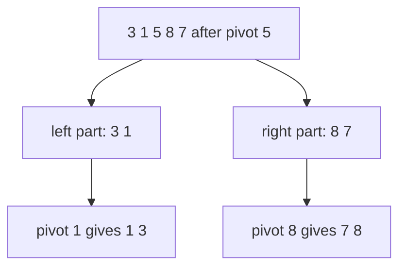

# Quick Sort

**Definition:** Quick sort is based on the concept of **Divide and Conquer** approach, just like **Merge Sort**. The
idea of choosing one element as a pivot element and partitioning the array around it such that: Left side of pivot
contains all the elements that are less than the pivot element Right side contains all elements greater than the pivot.

It reduces the space complexity and removes the use of the auxiliary array that is used in merge sort. Selecting a
random pivot in an array results in an improved time complexity in most of the cases.


## Algorithm Strategy (Random Pivot, Smaller Side First)

1. Guard first: a `null` array and ranges with fewer than two elements (`low >= high`) are already sorted.
2. **Choose a pivot:** pick a random index in `[low, high]` and swap it to `high`. No fixed input order (sorted, reversed, all equal) can then trigger the quadratic worst case on purpose.
3. **Partition (Lomuto):** keep `i` at the last element known to be `<= pivot` (initially `low - 1`). Scan `j = low .. high - 1`; whenever `arr[j] <= pivot`, increment `i` and swap. Then swap the pivot into `i + 1`, its final position.
4. **Recurse on the smaller part only:** call `quickSort` on the smaller side and continue the `while` loop on the larger side. Each recursive call handles at most half of the range, so the stack depth is `O(log n)` even in the worst case.

## Example walkthrough for `[8, 3, 7, 1, 5]` (suppose the random pivot is 5)

- Scan: 8 > 5 skip, 3 <= 5 swap to front, 7 > 5 skip, 1 <= 5 swap `-> [3, 1, 7, 8, 5]`
- Place pivot: `-> [3, 1, 5, 8, 7]`; 5 is final. The left part has 2 elements and the right part 2, so the left one is recursed and the loop continues on the right one.

## Complexity Analysis

- **Time Complexity (Best):** `O(n log n)` — The pivot splits the range into two nearly equal parts.
- **Time Complexity (Average):** `O(n log n)` — The random pivot gives balanced partitions in expectation for every input order.
- **Time Complexity (Worst):** `O(n^2)` — Possible only with extremely unlucky random pivots; many equal keys also reduce the benefit of Lomuto partitioning.
- **Space Complexity:** `O(log n)` — Recursion only on the smaller side bounds the stack depth, even in the worst case; sorts in place.

## Approaches

The same problem can be solved in several ways. They are listed from the simplest to the most efficient.

### Approach 1: Lomuto Partition, Last Element as Pivot

Pick the last element as pivot, move everything `<= pivot` to the front with a moving boundary and put the pivot after it. This is the version implemented in the repository. Sorted or all-equal input makes it quadratic.

```java
public static void quickSortLomuto(int[] arr, int low, int high) {
    if (low < high) {
        int pivot = arr[high], i = low - 1;
        for (int j = low; j < high; j++) {
            if (arr[j] <= pivot) swap(arr, ++i, j);
        }
        swap(arr, i + 1, high);
        quickSortLomuto(arr, low, i);
        quickSortLomuto(arr, i + 2, high);
    }
}
```

- **Time Complexity:** Average O(n log n), worst O(n^2)
- **Space Complexity:** O(log n) average, O(n) worst

### Approach 2: Hoare Partition

Two pointers start at both ends and move towards each other, swapping elements that are on the wrong side of the pivot. It does about three times fewer swaps than Lomuto.

```java
public static void quickSortHoare(int[] arr, int low, int high) {
    if (low < high) {
        int pivot = arr[low + (high - low) / 2];
        int i = low - 1, j = high + 1;
        while (true) {
            do { i++; } while (arr[i] < pivot);
            do { j--; } while (arr[j] > pivot);
            if (i >= j) break;
            swap(arr, i, j);
        }
        quickSortHoare(arr, low, j);
        quickSortHoare(arr, j + 1, high);
    }
}
```

- **Time Complexity:** Average O(n log n), worst O(n^2)
- **Space Complexity:** O(log n) average

### Approach 3: Three-Way Partition (Many Duplicates)

Split the range into `< pivot`, `== pivot` and `> pivot` (Dutch National Flag). All equal elements are done after one pass, so arrays with many duplicates no longer degrade.

```java
public static void quickSort3Way(int[] arr, int low, int high) {
    if (low >= high) return;
    int pivot = arr[low + (high - low) / 2];
    int lt = low, i = low, gt = high;
    while (i <= gt) {
        if (arr[i] < pivot) swap(arr, lt++, i++);
        else if (arr[i] > pivot) swap(arr, i, gt--);
        else i++;
    }
    quickSort3Way(arr, low, lt - 1);
    quickSort3Way(arr, gt + 1, high);
}
```

- **Time Complexity:** O(n log n) average, O(n) when all keys are equal
- **Space Complexity:** O(log n) average

### Approach 4: Random Pivot + Recurse on the Smaller Side (Optimized)

A random pivot makes the quadratic worst case extremely unlikely for any input order, and recursing only into the smaller partition (looping on the larger one) bounds the stack depth to `O(log n)` in the worst case.

```java
public static void quickSortOptimized(int[] arr, int low, int high) {
    Random random = new Random();
    while (low < high) {
        swap(arr, low + random.nextInt(high - low + 1), high);   // random pivot to the end
        int pivot = arr[high], i = low - 1;
        for (int j = low; j < high; j++) {
            if (arr[j] <= pivot) swap(arr, ++i, j);
        }
        swap(arr, i + 1, high);
        int p = i + 1;

        if (p - low < high - p) {          // recurse on the smaller side, loop on the larger
            quickSortOptimized(arr, low, p - 1);
            low = p + 1;
        } else {
            quickSortOptimized(arr, p + 1, high);
            high = p - 1;
        }
    }
}
```

- **Time Complexity:** O(n log n) expected
- **Space Complexity:** O(log n) worst case

### Comparison

| # | Approach | Time | Space |
|---|----------|------|-------|
| 1 | Lomuto Partition, Last Element as Pivot | Average O(n log n), worst O(n^2) | O(log n) average, O(n) worst |
| 2 | Hoare Partition | Average O(n log n), worst O(n^2) | O(log n) average |
| 3 | Three-Way Partition (Many Duplicates) | O(n log n) average, O(n) when all keys are equal | O(log n) average |
| 4 | Random Pivot + Recurse on the Smaller Side (Optimized) | O(n log n) expected | O(log n) worst case |

## Source Code

### QuickSort.java

```java
import java.util.Arrays;
import java.util.concurrent.ThreadLocalRandom;

public class QuickSort {

    public static void main(String[] args) {
        int[] arr = {12, 4, 5, 7, 9, 20, 30, 6, 15};
        System.out.println("Original Array : " + Arrays.toString(arr));
        quickSort(arr);
        System.out.println("Sorted Array   : " + Arrays.toString(arr));
        System.out.println();

        int[] sorted = {1, 2, 3, 4, 5, 6, 7, 8};
        System.out.println("Original Array : " + Arrays.toString(sorted) + "   (sorted input: no longer a worst case)");
        quickSort(sorted);
        System.out.println("Sorted Array   : " + Arrays.toString(sorted));
        System.out.println();

        int[] duplicates = {3, 1, 3, 2, 1, 3};
        System.out.println("Original Array : " + Arrays.toString(duplicates));
        quickSort(duplicates);
        System.out.println("Sorted Array   : " + Arrays.toString(duplicates));
        System.out.println();

        int[] empty = {};
        quickSort(empty);
        quickSort(null);
        System.out.println("Empty and null arrays are returned untouched: " + Arrays.toString(empty));
    }

    /**
     * Sorts the whole array in ascending order.
     *
     * @param arr the array to sort in place; {@code null} is ignored
     */
    private static void quickSort(int[] arr) {
        // Guard Clause: nothing to sort
        if (arr == null || arr.length <= 1) {
            return;
        }
        quickSort(arr, 0, arr.length - 1);
    }

    /**
     * Sorts {@code arr[low..high]} in place using Quick Sort with a random pivot.
     *
     * @param arr  the array to sort
     * @param low  the first index of the range
     * @param high the last index of the range
     */
    private static void quickSort(int[] arr, int low, int high) {
        while (low < high) {
            int pivot = partition(arr, low, high);

            // Recurse on the smaller part and loop on the larger one: the stack depth stays O(log n)
            if (pivot - low < high - pivot) {
                quickSort(arr, low, pivot - 1);
                low = pivot + 1;
            } else {
                quickSort(arr, pivot + 1, high);
                high = pivot - 1;
            }
        }
    }

    /**
     * Partitions {@code arr[low..high]} around a randomly chosen pivot.
     *
     * @param arr  the array to partition
     * @param low  the first index of the range
     * @param high the last index of the range
     * @return the final index of the pivot
     */
    private static int partition(int[] arr, int low, int high) {
        // choose a random pivot and move it to the end
        swap(arr, low + ThreadLocalRandom.current().nextInt(high - low + 1), high);
        int pivot = arr[high];

        // pointer for the last element that is <= pivot
        int i = low - 1;

        for (int j = low; j < high; j++) {
            if (arr[j] <= pivot) {
                i++;
                swap(arr, i, j);
            }
        }
        swap(arr, i + 1, high);
        return i + 1;
    }

    // Swapping the elements
    private static void swap(int[] arr, int i, int j) {
        if (i == j) return;
        int temp = arr[i];
        arr[i] = arr[j];
        arr[j] = temp;
    }
}
```

## Solution

The optimized solution is Approach 4 above, which is also the version implemented in this repository.

The idea: partition the range around a pivot so smaller values end up on its left and larger ones on its right, then sort the two sides the same way. Two safeguards make it robust: the pivot is picked at random, so a sorted or reversed input is no longer a worst case, and only the smaller side is recursed while a loop handles the larger side, so the call stack stays at O(log n).

**Input:** `arr = [8, 3, 7, 1, 5]`. The pivot is random, so this trace assumes the picks 5, 8 and 1 (the sorted result is the same for any picks).

| Step | Range `[low..high]` | Pivot (moved to `high`) | Array after partitioning | Pivot ends at | Left / right size | What happens next |
|------|---------------------|-------------------------|--------------------------|---------------|-------------------|-------------------|
| 1 | `[0..4]` | 5 | `3 1 [5] 8 7` | 2 | 2 / 2 | equal sizes: recurse on the right `[3..4]`, loop on the left `[0..1]` |
| 2 | `[3..4]` | 8 | `3 1 5 7 [8]` | 4 | 1 / 0 | the right side is empty and the left side is one element: done |
| 3 | `[0..1]` | 1 | `[1] 3 5 7 8` | 0 | 0 / 1 | the left side is empty and the right side is one element: done |



Why the stack stays small: at every level the recursive call gets the smaller part (at most half of the range), and the larger part is handled by the loop. On a sorted input of 200,000 elements a fixed last-element pivot would recurse 200,000 levels deep, while this version needs only about log2(200,000), roughly 18, and the random pivot keeps the partitions balanced.

**Edge cases.** `null`, empty and one-element arrays return at once through the guard clause. Duplicates such as `[3, 1, 3, 2, 1, 3]` are handled by the `<=` test and sort correctly, but a very large number of equal keys makes the partitions lopsided (see Approach 3 for the three-way partition). The sort is not stable.

**Result:** `[4, 5, 6, 7, 9, 12, 15, 20, 30]` for the sample in the class, matching its output.
