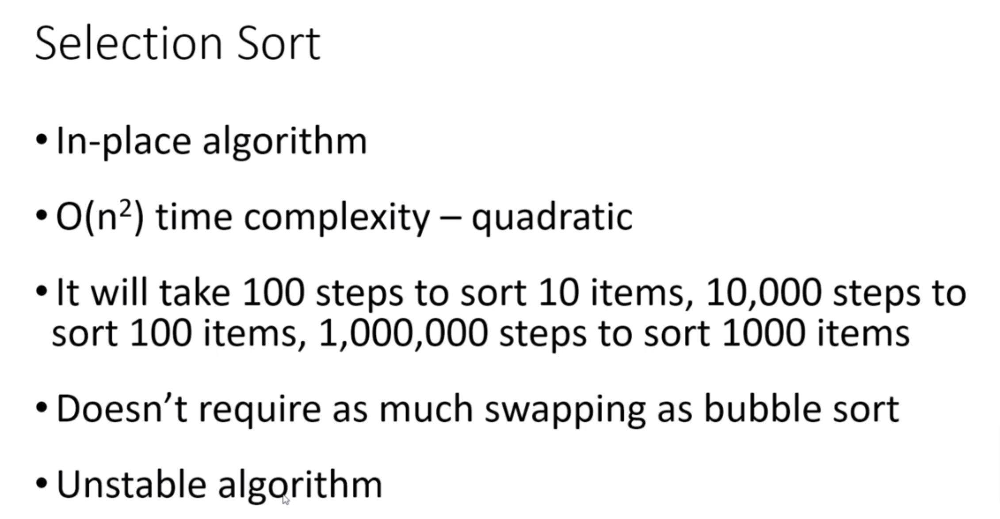

# Selection Sort

Selection sorting is a sorting algorithm where we select the minimum element from the array and put that at its correct position.



## Algorithm Strategy (Select the Minimum)

1. Split the array into a sorted prefix (initially empty) and an unsorted suffix.
2. For each position `i` from `0` to `n - 2`, assume `arr[i]` is the minimum and remember its index in `min_index`.
3. Scan the rest of the array (`j = i + 1 .. n - 1`); whenever `arr[j] < arr[min_index]`, update `min_index = j`.
4. Swap `arr[i]` with `arr[min_index]`, which grows the sorted prefix by one element.
5. When `i` reaches `n - 1` the last element is automatically the largest, so the array is sorted.

## Example walkthrough for `[29, 10, 14, 37, 13]`

- i = 0: minimum is 10, swap with 29 `-> [10, 29, 14, 37, 13]`
- i = 1: minimum is 13, swap with 29 `-> [10, 13, 14, 37, 29]`
- i = 2: minimum is 14, already in place
- i = 3: minimum is 29, swap with 37 `-> [10, 13, 14, 29, 37]`

## Complexity Analysis

- **Time Complexity (Best):** `O(n^2)` — The minimum is always searched for in the whole unsorted part.
- **Time Complexity (Average):** `O(n^2)` — Nested loops over the array.
- **Time Complexity (Worst):** `O(n^2)` — Same number of comparisons regardless of input order.
- **Space Complexity:** `O(1)` — Sorts in place. At most `n - 1` swaps are performed.

## Approaches

The same problem can be solved in several ways. They are listed from the simplest to the most efficient.

### Approach 1: Basic Selection Sort

For each position find the minimum of the unsorted suffix and swap it into place. This is the version implemented in the repository.

```java
public static void selectionSortBasic(int[] arr) {
    int n = arr.length;
    for (int i = 0; i < n - 1; i++) {
        int minIndex = i;
        for (int j = i + 1; j < n; j++) {
            if (arr[j] < arr[minIndex]) minIndex = j;
        }
        swap(arr, minIndex, i);
    }
}
```

- **Time Complexity:** O(n^2) in every case
- **Space Complexity:** O(1)

### Approach 2: Stable Selection Sort

The plain swap can change the relative order of equal elements. Instead of swapping, shift the elements between `i` and the minimum one position to the right and insert the minimum at `i`; equal elements keep their order, at the cost of extra moves.

```java
public static void selectionSortStable(int[] arr) {
    int n = arr.length;
    for (int i = 0; i < n - 1; i++) {
        int minIndex = i;
        for (int j = i + 1; j < n; j++) {
            if (arr[j] < arr[minIndex]) minIndex = j;
        }
        int min = arr[minIndex];
        while (minIndex > i) {
            arr[minIndex] = arr[minIndex - 1];
            minIndex--;
        }
        arr[i] = min;
    }
}
```

- **Time Complexity:** O(n^2)
- **Space Complexity:** O(1)

### Approach 3: Recursive Selection Sort

Find the minimum of the unsorted part, swap it to the front and sort the rest recursively.

```java
public static void selectionSortRecursive(int[] arr) {
    sort(arr, 0);
}

private static void sort(int[] arr, int start) {
    if (start >= arr.length - 1) return;
    int min = start;
    for (int j = start + 1; j < arr.length; j++) if (arr[j] < arr[min]) min = j;
    swap(arr, start, min);
    sort(arr, start + 1);
}
```

- **Time Complexity:** O(n^2)
- **Space Complexity:** O(n) recursion stack

### Approach 4: Select the Maximum and Fill from the End

The mirror image: find the maximum of the unsorted prefix and swap it to the end of that prefix. The sorted part grows from the right.

```java
public static void selectionSortMax(int[] arr) {
    for (int end = arr.length - 1; end > 0; end--) {
        int max = 0;
        for (int j = 1; j <= end; j++) if (arr[j] >= arr[max]) max = j;
        swap(arr, max, end);
    }
}
```

- **Time Complexity:** O(n^2)
- **Space Complexity:** O(1)

### Approach 5: Heap Sort (Selection with a Heap)

Heap sort is selection sort that finds the maximum of the unsorted part in `O(log n)` instead of `O(n)`: build a max-heap in the array, then repeatedly swap the root with the last element and restore the heap.

```java
public static void heapSort(int[] arr) {
    int n = arr.length;
    for (int i = n / 2 - 1; i >= 0; i--) siftDown(arr, i, n);        // build the max-heap
    for (int end = n - 1; end > 0; end--) {
        swap(arr, 0, end);                                            // the maximum goes to its final place
        siftDown(arr, 0, end);
    }
}

private static void siftDown(int[] a, int i, int size) {
    while (true) {
        int largest = i, left = 2 * i + 1, right = left + 1;
        if (left < size && a[left] > a[largest]) largest = left;
        if (right < size && a[right] > a[largest]) largest = right;
        if (largest == i) return;
        swap(a, i, largest);
        i = largest;
    }
}
```

- **Time Complexity:** O(n log n)
- **Space Complexity:** O(1)

### Approach 6: Bingo Sort

A selection sort variant for arrays with many duplicates: in every pass, find the next smallest value ("bingo") and move *all* of its occurrences to the front at once, so each distinct value costs only one pass.

```java
public static void bingoSort(int[] arr) {
    int n = arr.length;
    if (n < 2) return;
    int bingo = arr[0], largest = arr[0];
    for (int value : arr) { bingo = Math.min(bingo, value); largest = Math.max(largest, value); }
    int nextPos = 0;
    while (bingo < largest) {
        int nextBingo = largest, startPos = nextPos;
        for (int i = startPos; i < n; i++) {
            if (arr[i] == bingo) swap(arr, i, nextPos++);
            else if (arr[i] < nextBingo) nextBingo = arr[i];
        }
        bingo = nextBingo;
    }
}
```

- **Time Complexity:** O(n * d) where d is the number of distinct values
- **Space Complexity:** O(1)

### Approach 7: Double Selection: Min and Max per Pass (Optimized)

Find both the minimum and the maximum in each pass and place them at the two ends, so the number of passes is halved. It is still `O(n^2)` comparisons, but with about half the passes and swaps. If you need better than quadratic time, use Merge Sort, Quick Sort or Heap Sort.

```java
public static void selectionSortDouble(int[] arr) {
    int left = 0, right = arr.length - 1;
    while (left < right) {
        int minIndex = left, maxIndex = left;
        for (int j = left; j <= right; j++) {
            if (arr[j] < arr[minIndex]) minIndex = j;
            if (arr[j] > arr[maxIndex]) maxIndex = j;
        }
        swap(arr, left, minIndex);
        // If the maximum was at 'left', it has just been moved to minIndex
        if (maxIndex == left) maxIndex = minIndex;
        swap(arr, right, maxIndex);
        left++;
        right--;
    }
}
```

- **Time Complexity:** O(n^2)
- **Space Complexity:** O(1)

### Comparison

| # | Approach | Time | Space |
|---|----------|------|-------|
| 1 | Basic Selection Sort | O(n^2) in every case | O(1) |
| 2 | Stable Selection Sort | O(n^2) | O(1) |
| 3 | Recursive Selection Sort | O(n^2) | O(n) recursion stack |
| 4 | Select the Maximum and Fill from the End | O(n^2) | O(1) |
| 5 | Heap Sort (Selection with a Heap) | O(n log n) | O(1) |
| 6 | Bingo Sort | O(n * d) where d is the number of distinct values | O(1) |
| 7 | Double Selection: Min and Max per Pass (Optimized) | O(n^2) | O(1) |

### Optimized Solution

The optimized solution is Approach 7 above. The version implemented in this repository is Approach 1.

## Source Code

### SelectionSort.java

```java
import java.util.Arrays;

public class SelectionSort {

    public static void main(String[] args) {
        int[] arr = {12, 4, 5, 7, 9, 20, 30, 6, 15};

        System.out.println("Original Array : " + Arrays.toString(arr));
        selectionSort(arr);
        System.out.println("Sorted Array   : " + Arrays.toString(arr));
    }

    /**
     * Sorts the array in ascending order using Selection Sort.
     *
     * @param arr the array to sort in place
     */
    private static void selectionSort(int[] arr) {
        // Guard Clause: null or single-element arrays are already sorted
        if (arr == null || arr.length <= 1) {
            return;
        }

        int n = arr.length;
        for (int i = 0; i < n - 1; i++) {
            int min_index = i;
            for (int j = i + 1; j < n; j++) {
                if (arr[j] < arr[min_index]) {
                    min_index = j;   // searching for minimum index
                }
            }
            swap(arr, min_index, i); // place the minimum at the end of the sorted prefix
        }
    }

    private static void swap(int[] arr, int i, int j) {
        if (i == j) return;
        int temp = arr[i];
        arr[i] = arr[j];
        arr[j] = temp;
    }
}
```
