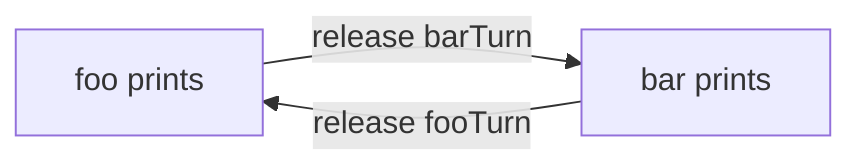

# Concurrency Coordination Puzzles (Print in Order and FooBar)

Two classic thread coordination puzzles. Print in Order: three threads call `first`, `second` and `third` in any start order, yet the output must be `firstsecondthird`. FooBar: one thread prints `foo` and another prints `bar`, `n` times each, and the output must alternate as `foobarfoobar...`.

## Algorithm Strategy (Semaphores as Turn Tokens)

1. A semaphore with zero permits is a gate: the thread that must wait calls `acquire()`, and the thread that goes before it calls `release()` when it is done.
2. Print in Order: `second` acquires `afterFirst`, which `first` releases after printing; `third` acquires `afterSecond`, which `second` releases. Whatever order the threads are started in, the output order is forced by the permits.
3. FooBar: two semaphores pass a single turn back and forth. `foo` starts with the permit on `fooTurn`; each loop iteration acquires `fooTurn`, prints `foo` and releases `barTurn`. `bar` does the mirror image.
4. No flag is polled and no thread burns CPU while it waits; a permit also cannot be lost, because a release before the acquire is remembered by the semaphore (unlike a `notify` sent before the `wait`).

## Example walkthrough

- Print in Order started as `third`, `first`, `second`: `third` blocks on `afterSecond`, `first` prints and releases `afterFirst`, `second` wakes, prints and releases `afterSecond`, `third` wakes and prints. Output: `firstsecondthird`.
- FooBar with `n = 2`: `foo` prints (turn passes to bar), `bar` prints (turn passes to foo), then the same again. Output: `foobarfoobar`, whichever thread is scheduled first.

## Complexity Analysis

- **Time Complexity:** `O(n)` — Each puzzle performs `n` handovers (three for Print in Order).
- **Space Complexity:** `O(1)` — A few semaphores.

## Approaches

The same problem can be solved in several ways. The approach marked (Optimized) is the one to use in practice.

### Approach 1: Print in Order with CountDownLatch

Each step waits on a one-shot latch that the previous step counts down. Equivalent to the semaphore version, and the latch states the intent ("wait until the first step is done").

```java
public static String printInOrderLatch(int[] startOrder) throws InterruptedException {
    CountDownLatch afterFirst = new CountDownLatch(1);
    CountDownLatch afterSecond = new CountDownLatch(1);
    StringBuffer out = new StringBuffer();
    List<Thread> threads = new ArrayList<>();
    for (int id : startOrder) {
        threads.add(new Thread(() -> {
            try {
                if (id == 1) {
                    out.append("first");
                    afterFirst.countDown();
                } else if (id == 2) {
                    afterFirst.await();
                    out.append("second");
                    afterSecond.countDown();
                } else {
                    afterSecond.await();
                    out.append("third");
                }
            } catch (InterruptedException e) {
                Thread.currentThread().interrupt();
            }
        }));
    }
    for (Thread t : threads) t.start();
    for (Thread t : threads) t.join();
    return out.toString();
}
```

- **Time Complexity:** O(1)
- **Space Complexity:** O(1)

### Approach 2: FooBar with wait / notifyAll

One monitor and a boolean that says whose turn it is. Each thread waits in a `while` loop until the flag is its own, prints, flips the flag and calls `notifyAll()`.

```java
public static String fooBarWaitNotify(int n) throws InterruptedException {
    StringBuffer out = new StringBuffer();
    Object lock = new Object();
    boolean[] fooTurn = {true};
    Thread foo = new Thread(() -> {
        for (int i = 0; i < n; i++) {
            synchronized (lock) {
                while (!fooTurn[0]) {
                    try { lock.wait(); } catch (InterruptedException e) { return; }
                }
                out.append("foo");
                fooTurn[0] = false;
                lock.notifyAll();
            }
        }
    });
    Thread bar = new Thread(() -> {
        for (int i = 0; i < n; i++) {
            synchronized (lock) {
                while (fooTurn[0]) {
                    try { lock.wait(); } catch (InterruptedException e) { return; }
                }
                out.append("bar");
                fooTurn[0] = true;
                lock.notifyAll();
            }
        }
    });
    bar.start();
    foo.start();
    foo.join();
    bar.join();
    return out.toString();
}
```

- **Time Complexity:** O(n)
- **Space Complexity:** O(1)

### Approach 3: FooBar with a Volatile Turn and Spinning

Both threads spin on an atomic turn variable and yield the CPU until it is their turn. No locks, but the waiting thread keeps the CPU busy, so this only suits very short waits.

```java
public static String fooBarSpin(int n) throws InterruptedException {
    StringBuffer out = new StringBuffer();
    AtomicInteger turn = new AtomicInteger(0);
    Thread foo = new Thread(() -> {
        for (int i = 0; i < n; i++) {
            while (turn.get() != 0) Thread.yield();
            out.append("foo");
            turn.set(1);
        }
    });
    Thread bar = new Thread(() -> {
        for (int i = 0; i < n; i++) {
            while (turn.get() != 1) Thread.yield();
            out.append("bar");
            turn.set(0);
        }
    });
    bar.start();
    foo.start();
    foo.join();
    bar.join();
    return out.toString();
}
```

- **Time Complexity:** O(n) plus busy waiting
- **Space Complexity:** O(1)

### Approach 4: Semaphores as Turn Tokens (Optimized)

Use zero-permit semaphores as gates so the order is enforced without flags, polling or lost signals. This is the version implemented in the repository.

```java
static final class Ordered {
    private final Semaphore afterFirst = new Semaphore(0);
    private final Semaphore afterSecond = new Semaphore(0);

    void first(Runnable print) {
        print.run();
        afterFirst.release();
    }

    void second(Runnable print) throws InterruptedException {
        afterFirst.acquire();
        print.run();
        afterSecond.release();
    }

    void third(Runnable print) throws InterruptedException {
        afterSecond.acquire();
        print.run();
    }
}

static final class FooBar {
    private final int n;
    private final Semaphore fooTurn = new Semaphore(1);
    private final Semaphore barTurn = new Semaphore(0);

    FooBar(int n) {
        this.n = n;
    }

    void foo(Runnable print) throws InterruptedException {
        for (int i = 0; i < n; i++) {
            fooTurn.acquire();
            print.run();
            barTurn.release();
        }
    }

    void bar(Runnable print) throws InterruptedException {
        for (int i = 0; i < n; i++) {
            barTurn.acquire();
            print.run();
            fooTurn.release();
        }
    }
}

public static String printInOrder(int[] startOrder) throws InterruptedException {
    Ordered ordered = new Ordered();
    StringBuffer out = new StringBuffer();
    List<Thread> threads = new ArrayList<>();
    for (int id : startOrder) {
        threads.add(new Thread(() -> {
            try {
                if (id == 1) {
                    ordered.first(() -> out.append("first"));
                } else if (id == 2) {
                    ordered.second(() -> out.append("second"));
                } else {
                    ordered.third(() -> out.append("third"));
                }
            } catch (InterruptedException e) {
                Thread.currentThread().interrupt();
            }
        }));
    }
    for (Thread t : threads) t.start();
    for (Thread t : threads) t.join();
    return out.toString();
}

public static String fooBar(int n) throws InterruptedException {
    FooBar fooBar = new FooBar(n);
    StringBuffer out = new StringBuffer();
    Thread foo = new Thread(() -> {
        try {
            fooBar.foo(() -> out.append("foo"));
        } catch (InterruptedException e) {
            Thread.currentThread().interrupt();
        }
    });
    Thread bar = new Thread(() -> {
        try {
            fooBar.bar(() -> out.append("bar"));
        } catch (InterruptedException e) {
            Thread.currentThread().interrupt();
        }
    });
    bar.start();
    foo.start();
    foo.join();
    bar.join();
    return out.toString();
}
```

- **Time Complexity:** O(n)
- **Space Complexity:** O(1)

### Comparison

| # | Approach | Time | Space |
|---|----------|------|-------|
| 1 | Print in Order with CountDownLatch | O(1) | O(1) |
| 2 | FooBar with wait / notifyAll | O(n) | O(1) |
| 3 | FooBar with a Volatile Turn and Spinning | O(n) plus busy waiting | O(1) |
| 4 | Semaphores as Turn Tokens (Optimized) | O(n) | O(1) |

### Optimized Solution

The optimized solution is Approach 4 above, which is also the version implemented in this repository.

#### Optimized solution explained

The idea: use semaphores as "turn tokens". A semaphore with 0 permits blocks `acquire()` until another thread calls `release()`, so a thread can only run its step after the thread before it has handed it a token. This makes the order depend on the tokens and not on which thread the scheduler starts first. The class contains two puzzles, both solved this way.

**Puzzle 1, print in order (`printInOrder`).** `Ordered` has two semaphores, `afterFirst` and `afterSecond`, both starting at 0. `first` prints then releases `afterFirst`; `second` acquires `afterFirst`, prints, then releases `afterSecond`; `third` acquires `afterSecond` and prints.

**Input:** threads started in the order `[3, 2, 1]` (the worst case).

| Step | Thread | Call | Semaphores `(afterFirst, afterSecond)` | Effect | Output so far |
|------|--------|------|----------------------------------------|--------|---------------|
| 1 | 3 | `third` starts | (0, 0) | `afterSecond.acquire()` has no permit: blocks | |
| 2 | 2 | `second` starts | (0, 0) | `afterFirst.acquire()` has no permit: blocks | |
| 3 | 1 | `first` runs | (0, 0) | prints `first`, `afterFirst.release()` | `first` |
| 4 | 2 | wakes | (1, 0) then (0, 0) | acquires the permit, prints `second`, `afterSecond.release()` | `firstsecond` |
| 5 | 3 | wakes | (0, 1) then (0, 0) | acquires the permit, prints `third` | `firstsecondthird` |

Whichever order the threads reach their `acquire` call, the chain is the same. If thread 1 runs first, the permits are simply waiting when threads 2 and 3 arrive, and they do not block.

**Puzzle 2, FooBar (`fooBar(n)`).** `fooTurn` starts with 1 permit and `barTurn` with 0. `foo` loops `n` times: acquire `fooTurn`, print `foo`, release `barTurn`. `bar` loops `n` times: acquire `barTurn`, print `bar`, release `fooTurn`. The two permits pass back and forth.

**Input:** `n = 3`. (`bar` is started first in the code, so it blocks at once on `barTurn` with 0 permits.)

| Step | Thread | `fooTurn` / `barTurn` before | Action | Output so far |
|------|--------|------------------------------|--------|---------------|
| 1 | foo, round 1 | 1 / 0 | acquire `fooTurn`, print, release `barTurn` | `foo` |
| 2 | bar, round 1 | 0 / 1 | acquire `barTurn`, print, release `fooTurn` | `foobar` |
| 3-4 | foo, bar round 2 | same pattern | `foo`, then `bar` | `foobarfoobar` |
| 5-6 | foo, bar round 3 | same pattern | `foo`, then `bar` | `foobarfoobarfoobar` |



**Edge cases.** The total number of permits in `fooTurn` and `barTurn` is always exactly 1, so the two threads can never print out of turn; with `n = 0` neither loop runs and the result is an empty string. An interrupt while blocked in `acquire` restores the interrupt flag and stops that thread. Both strings are built in a `StringBuffer` and the threads are joined before the result is read.

**Result:** `printInOrder` returns `firstsecondthird` for the orders `[1, 2, 3]`, `[3, 2, 1]` and `[2, 3, 1]`, and `fooBar(3)` returns `foobarfoobarfoobar`; this was the output in all three runs checked.

## Source Code

### ConcurrencyCoordinationPuzzles.java

```java
import java.util.ArrayList;
import java.util.Arrays;
import java.util.List;
import java.util.concurrent.Semaphore;

public class ConcurrencyCoordinationPuzzles {

    public static void main(String[] args) throws InterruptedException {
        int[][] orders = {{1, 2, 3}, {3, 2, 1}, {2, 3, 1}};
        for (int[] order : orders) {
            System.out.println("Input  : threads started in the order " + Arrays.toString(order));
            System.out.println("Output : " + printInOrder(order));
            System.out.println();
        }
        System.out.println("Input  : FooBar, n = 3");
        System.out.println("Output : " + fooBar(3));
    }

    static final class Ordered {
        private final Semaphore afterFirst = new Semaphore(0);
        private final Semaphore afterSecond = new Semaphore(0);

        void first(Runnable print) {
            print.run();
            afterFirst.release();
        }

        void second(Runnable print) throws InterruptedException {
            afterFirst.acquire();
            print.run();
            afterSecond.release();
        }

        void third(Runnable print) throws InterruptedException {
            afterSecond.acquire();
            print.run();
        }
    }

    static final class FooBar {
        private final int n;
        private final Semaphore fooTurn = new Semaphore(1);
        private final Semaphore barTurn = new Semaphore(0);

        FooBar(int n) {
            this.n = n;
        }

        void foo(Runnable print) throws InterruptedException {
            for (int i = 0; i < n; i++) {
                fooTurn.acquire();
                print.run();
                barTurn.release();
            }
        }

        void bar(Runnable print) throws InterruptedException {
            for (int i = 0; i < n; i++) {
                barTurn.acquire();
                print.run();
                fooTurn.release();
            }
        }
    }

    public static String printInOrder(int[] startOrder) throws InterruptedException {
        Ordered ordered = new Ordered();
        StringBuffer out = new StringBuffer();
        List<Thread> threads = new ArrayList<>();
        for (int id : startOrder) {
            threads.add(new Thread(() -> {
                try {
                    if (id == 1) {
                        ordered.first(() -> out.append("first"));
                    } else if (id == 2) {
                        ordered.second(() -> out.append("second"));
                    } else {
                        ordered.third(() -> out.append("third"));
                    }
                } catch (InterruptedException e) {
                    Thread.currentThread().interrupt();
                }
            }));
        }
        for (Thread t : threads) t.start();
        for (Thread t : threads) t.join();
        return out.toString();
    }

    public static String fooBar(int n) throws InterruptedException {
        FooBar fooBar = new FooBar(n);
        StringBuffer out = new StringBuffer();
        Thread foo = new Thread(() -> {
            try {
                fooBar.foo(() -> out.append("foo"));
            } catch (InterruptedException e) {
                Thread.currentThread().interrupt();
            }
        });
        Thread bar = new Thread(() -> {
            try {
                fooBar.bar(() -> out.append("bar"));
            } catch (InterruptedException e) {
                Thread.currentThread().interrupt();
            }
        });
        bar.start();
        foo.start();
        foo.join();
        bar.join();
        return out.toString();
    }
}
```
