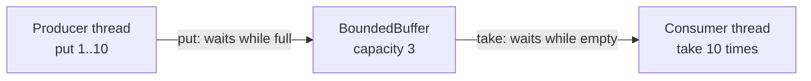

# Producer Consumer

Implement the producer-consumer problem: a producer thread puts items into a bounded buffer and a consumer thread takes them out. The producer must wait when the buffer is full and the consumer must wait when it is empty.

## Algorithm Strategy (Bounded Buffer with wait / notify)

1. Share a bounded queue (capacity `N`) between the threads and guard it with one lock (the buffer object itself).
2. Producer: while the queue is full, call `wait()`; then add the item and call `notifyAll()` so a waiting consumer wakes up.
3. Consumer: while the queue is empty, call `wait()`; then remove the item and call `notifyAll()` so a waiting producer wakes up.
4. Always test the condition in a `while` loop (not `if`) to protect against spurious wake-ups. The same behaviour is available ready-made as `BlockingQueue`.

## Example walkthrough

- A producer creating `1..10` and a consumer with a buffer of size 3: the producer blocks whenever 3 items are waiting, the consumer blocks when the buffer is empty.
- The consumer receives all ten items in the order they were produced, and the buffer never holds more than 3 items.

## Complexity Analysis

- **Time Complexity:** `O(1)` — Per put or take (excluding the waiting time).
- **Space Complexity:** `O(N)` — The buffer holds at most `N` items.

## Approaches

The same problem can be solved in several ways. The approach marked (Optimized) is the one to use in practice.

### Approach 1: wait / notifyAll (Optimized)

A bounded buffer whose methods are `synchronized` and wait on the buffer being full or empty. This is the version implemented in the repository.

```java
static class WaitNotifyBuffer {
    private final Queue<Integer> queue = new LinkedList<>();
    private final int capacity;
    WaitNotifyBuffer(int capacity) { this.capacity = capacity; }

    synchronized void put(int item) throws InterruptedException {
        while (queue.size() == capacity) wait();
        queue.add(item);
        notifyAll();
    }

    synchronized int take() throws InterruptedException {
        while (queue.isEmpty()) wait();
        int item = queue.remove();
        notifyAll();
        return item;
    }
}
```

- **Time Complexity:** O(1) per operation
- **Space Complexity:** O(capacity)

### Approach 2: BlockingQueue

`ArrayBlockingQueue` already blocks producers when full and consumers when empty. This is what production code should use.

```java
static class QueueBuffer {
    private final BlockingQueue<Integer> queue;
    QueueBuffer(int capacity) { queue = new ArrayBlockingQueue<>(capacity); }
    void put(int item) throws InterruptedException { queue.put(item); }
    int take() throws InterruptedException { return queue.take(); }
}
```

- **Time Complexity:** O(1) per operation
- **Space Complexity:** O(capacity)

### Approach 3: ReentrantLock with Two Conditions

Separate `notFull` and `notEmpty` conditions wake only the threads that can make progress.

```java
static class LockBuffer {
    private final Queue<Integer> queue = new LinkedList<>();
    private final int capacity;
    private final ReentrantLock lock = new ReentrantLock();
    private final Condition notFull = lock.newCondition(), notEmpty = lock.newCondition();
    LockBuffer(int capacity) { this.capacity = capacity; }

    void put(int item) throws InterruptedException {
        lock.lock();
        try {
            while (queue.size() == capacity) notFull.await();
            queue.add(item);
            notEmpty.signal();
        } finally { lock.unlock(); }
    }

    int take() throws InterruptedException {
        lock.lock();
        try {
            while (queue.isEmpty()) notEmpty.await();
            int item = queue.remove();
            notFull.signal();
            return item;
        } finally { lock.unlock(); }
    }
}
```

- **Time Complexity:** O(1) per operation
- **Space Complexity:** O(capacity)

### Approach 4: Two Semaphores and a Mutex

One semaphore counts free slots, one counts items; a mutex protects the queue itself.

```java
static class SemaphoreBuffer {
    private final Queue<Integer> queue = new LinkedList<>();
    private final Semaphore slots, items = new Semaphore(0), mutex = new Semaphore(1);
    SemaphoreBuffer(int capacity) { slots = new Semaphore(capacity); }

    void put(int item) throws InterruptedException {
        slots.acquire();
        mutex.acquire();
        queue.add(item);
        mutex.release();
        items.release();
    }

    int take() throws InterruptedException {
        items.acquire();
        mutex.acquire();
        int item = queue.remove();
        mutex.release();
        slots.release();
        return item;
    }
}
```

- **Time Complexity:** O(1) per operation
- **Space Complexity:** O(capacity)

### Comparison

| # | Approach | Time | Space |
|---|----------|------|-------|
| 1 | wait / notifyAll (Optimized) | O(1) per operation | O(capacity) |
| 2 | BlockingQueue | O(1) per operation | O(capacity) |
| 3 | ReentrantLock with Two Conditions | O(1) per operation | O(capacity) |
| 4 | Two Semaphores and a Mutex | O(1) per operation | O(capacity) |

### Optimized Solution

The optimized solution is Approach 1 above, which is also the version implemented in this repository.

#### Optimized solution explained

The idea: both threads share one `BoundedBuffer` (a queue plus a `capacity`), and every method is `synchronized` on that buffer, so only one thread changes the queue at a time. `put` waits in a `while (queue.size() == capacity)` loop while the buffer is full; `take` waits in a `while (queue.isEmpty())` loop while it is empty. After changing the queue each one calls `notifyAll()` to wake the other side. The check is a `while`, not an `if`, so a woken thread re-tests the condition before acting (protection against spurious wake-ups and against another thread having taken the slot first).

**Input:** producer puts `1..10`, consumer takes 10 items, capacity `3`. The exact interleaving of the two threads changes from run to run, so the table shows one possible start of a run and the rules that always hold.

| Step | Thread | Call | Condition seen | Action | Queue afterwards |
|------|--------|------|----------------|--------|------------------|
| 1 | Producer | `put(1)` | size 0, not full | add, `notifyAll()` | `[1]` |
| 2 | Producer | `put(2)` | size 1, not full | add, `notifyAll()` | `[1, 2]` |
| 3 | Producer | `put(3)` | size 2, not full | add, `notifyAll()` | `[1, 2, 3]` |
| 4 | Producer | `put(4)` | size 3 equals capacity | `wait()`, releases the lock | `[1, 2, 3]` |
| 5 | Consumer | `take()` | queue not empty | remove `1`, `notifyAll()` | `[2, 3]` |
| 6 | Producer | wakes in `put(4)` | size 2, not full now | add, `notifyAll()` | `[2, 3, 4]` |
| 7 | Consumer | `take()` ... | queue not empty | remove `2`, `3`, `4` as long as items exist; if the queue is empty it waits for the producer | |



What is guaranteed in every run: the queue never holds more than 3 items, the single lock makes each `put`/`take` atomic, and a `LinkedList` queue is first in, first out, so the consumer receives the items in the order they were produced. Threads are joined before printing, so `consumed` is complete when it is read.

**Edge cases.** If the consumer runs first it waits on an empty queue until the first `put`; if the producer is far ahead it waits on a full queue. An interrupt during `wait()` throws `InterruptedException`, which the thread bodies catch and turn back into the interrupt flag. `maxSize` records the largest queue length seen; in the runs checked it printed `3`, but that figure depends on thread timing and is only guaranteed to be between 1 and 3.

**Result:** the class prints `consumed = [1, 2, 3, 4, 5, 6, 7, 8, 9, 10]` (always, in this order) and `max buffered = 3` in every run observed.

## Source Code

### ProducerConsumer.java

```java
import java.util.ArrayList;
import java.util.LinkedList;
import java.util.List;
import java.util.Queue;

public class ProducerConsumer {

    public static void main(String[] args) throws InterruptedException {
        BoundedBuffer buffer = new BoundedBuffer(3);
        int items = 10;
        List<Integer> consumed = new ArrayList<>();

        Thread producer = new Thread(() -> {
            try {
                for (int i = 1; i <= items; i++) {
                    buffer.put(i);
                }
            } catch (InterruptedException e) {
                Thread.currentThread().interrupt();
            }
        });
        Thread consumer = new Thread(() -> {
            try {
                for (int i = 1; i <= items; i++) {
                    consumed.add(buffer.take());
                }
            } catch (InterruptedException e) {
                Thread.currentThread().interrupt();
            }
        });

        producer.start();
        consumer.start();
        producer.join();
        consumer.join();

        System.out.println("Input  : producer creates 1.." + items + ", buffer capacity = 3");
        System.out.println("Output : consumed = " + consumed + ", max buffered = " + buffer.maxSize());
    }

    /** A bounded buffer that blocks producers when full and consumers when empty. */
    static class BoundedBuffer {
        private final Queue<Integer> queue = new LinkedList<>();
        private final int capacity;
        private int maxSize;

        BoundedBuffer(int capacity) {
            this.capacity = capacity;
        }

        synchronized void put(int item) throws InterruptedException {
            while (queue.size() == capacity) {
                wait();
            }
            queue.add(item);
            maxSize = Math.max(maxSize, queue.size());
            notifyAll();
        }

        synchronized int take() throws InterruptedException {
            while (queue.isEmpty()) {
                wait();
            }
            int item = queue.remove();
            notifyAll();
            return item;
        }

        synchronized int maxSize() {
            return maxSize;
        }
    }
}
```
