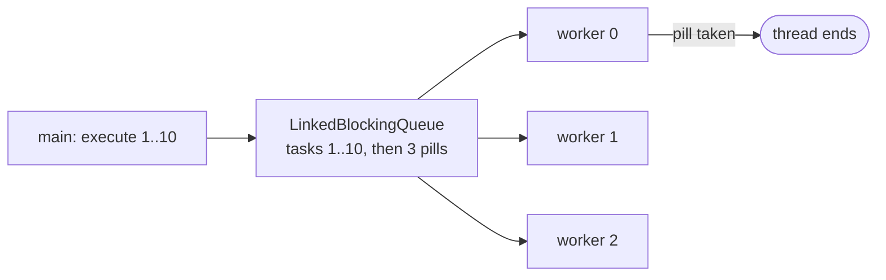

# Custom Simple Thread Pool

Implement a simple thread pool: a fixed number of worker threads that pull tasks from a shared queue, run them, and stop cleanly after `shutdown()` once every queued task has been executed.

## Algorithm Strategy (Fixed Workers and a Task Queue with Poison Pills)

1. Start `n` worker threads in the constructor. Each worker loops on `tasks.take()`, which blocks while the queue is empty, and runs the task it receives.
2. `execute(task)` adds the task to an unbounded `LinkedBlockingQueue`, so submitters never block and the same few threads are reused instead of creating one thread per task.
3. `shutdown()` marks the pool as closed and adds one special "poison pill" task per worker. Because the queue is FIFO, a worker only sees a pill after all earlier tasks were taken, so queued work is finished first.
4. A worker that takes a pill returns and its thread ends. `execute` and `shutdown` are `synchronized`, so no task can slip in behind the pills and stay in the queue forever.
5. A task that throws a `RuntimeException` is caught so that the worker survives and keeps serving the queue. `awaitTermination()` joins all workers.

## Example walkthrough

- Pool of 3 workers and ten tasks adding `1..10` to a shared counter: the ten tasks are queued, the three workers take them in turns.
- `shutdown()` queues three pills behind the tasks. Each worker finishes its current task, takes tasks until it meets a pill and exits.
- `awaitTermination()` returns once all workers ended; the counter is `55`. Calling `execute` afterwards throws `IllegalStateException`.

## Complexity Analysis

- **Time Complexity:** `O(1)` — Per `execute`; a task starts as soon as a worker is free.
- **Space Complexity:** `O(n + q)` — `n` worker threads plus `q` queued tasks.

## Approaches

The same problem can be solved in several ways. The approach marked (Optimized) is the one to use in practice.

### Approach 1: One Thread per Task

Start a new thread for every task and wait for all of them. Simple, but thread creation is expensive and the number of threads is unbounded, so a burst of tasks can exhaust memory.

```java
public static void runThreadPerTask(List<Runnable> tasks) throws InterruptedException {
    List<Thread> threads = new ArrayList<>();
    for (Runnable task : tasks) {
        Thread t = new Thread(task);
        threads.add(t);
        t.start();
    }
    for (Thread t : threads) t.join();
}
```

- **Time Complexity:** O(n) thread creations for n tasks
- **Space Complexity:** O(n) threads alive at once

### Approach 2: Hand-Written Task Queue (wait / notifyAll)

The same pool, but the queue is a plain `LinkedList` guarded by its own monitor. Workers `wait()` while the queue is empty and the pool is open, and `shutdown()` wakes them with `notifyAll()`. This is what `LinkedBlockingQueue` does for you.

```java
class WaitNotifyPool {
    private final LinkedList<Runnable> queue = new LinkedList<>();
    private final List<Thread> workers = new ArrayList<>();
    private boolean shutdown;

    WaitNotifyPool(int threads) {
        for (int i = 0; i < threads; i++) {
            Thread w = new Thread(this::loop);
            workers.add(w);
            w.start();
        }
    }

    void execute(Runnable task) {
        synchronized (queue) {
            if (shutdown) throw new IllegalStateException("Pool is shut down");
            queue.add(task);
            queue.notify();
        }
    }

    void shutdown() {
        synchronized (queue) {
            shutdown = true;
            queue.notifyAll();
        }
    }

    void awaitTermination() throws InterruptedException {
        for (Thread w : workers) w.join();
    }

    private void loop() {
        while (true) {
            Runnable task;
            synchronized (queue) {
                while (queue.isEmpty() && !shutdown) {
                    try { queue.wait(); } catch (InterruptedException e) { return; }
                }
                if (queue.isEmpty()) return;
                task = queue.removeFirst();
            }
            try { task.run(); } catch (RuntimeException e) { /* keep the worker alive */ }
        }
    }
}
```

- **Time Complexity:** O(1) per task
- **Space Complexity:** O(n + q)

### Approach 3: LinkedBlockingQueue with Poison Pills (Optimized)

Let a blocking queue do the waiting and use one poison pill per worker to end the pool after the queued work. This is the version implemented in the repository.

```java
private static final Runnable POISON_PILL = () -> { };

private final BlockingQueue<Runnable> tasks = new LinkedBlockingQueue<>();
private final List<Thread> workers = new ArrayList<>();
private boolean shutdown;

public SimpleThreadPool(int threads) {
    if (threads <= 0) {
        throw new IllegalArgumentException("threads must be positive");
    }
    for (int i = 0; i < threads; i++) {
        Thread worker = new Thread(this::runWorker, "pool-worker-" + i);
        workers.add(worker);
        worker.start();
    }
}

public synchronized void execute(Runnable task) {
    if (task == null) {
        throw new NullPointerException("task");
    }
    if (shutdown) {
        throw new IllegalStateException("Pool is shut down");
    }
    tasks.add(task);
}

public synchronized void shutdown() {
    if (shutdown) {
        return;
    }
    shutdown = true;
    for (int i = 0; i < workers.size(); i++) {
        tasks.add(POISON_PILL);
    }
}

public void awaitTermination() throws InterruptedException {
    for (Thread worker : workers) {
        worker.join();
    }
}

private void runWorker() {
    try {
        while (true) {
            Runnable task = tasks.take();
            if (task == POISON_PILL) {
                return;
            }
            try {
                task.run();
            } catch (RuntimeException e) {
                System.err.println(Thread.currentThread().getName() + " task failed: " + e);
            }
        }
    } catch (InterruptedException e) {
        Thread.currentThread().interrupt();
    }
}
```

- **Time Complexity:** O(1) per task
- **Space Complexity:** O(n + q)

### Comparison

| # | Approach | Time | Space |
|---|----------|------|-------|
| 1 | One Thread per Task | O(n) thread creations for n tasks | O(n) threads alive at once |
| 2 | Hand-Written Task Queue (wait / notifyAll) | O(1) per task | O(n + q) |
| 3 | LinkedBlockingQueue with Poison Pills (Optimized) | O(1) per task | O(n + q) |

### Optimized Solution

The optimized solution is Approach 3 above, which is also the version implemented in this repository.

#### Optimized solution explained

The idea: the pool starts `threads` worker threads in the constructor. Each worker runs the same loop: `tasks.take()` (a `LinkedBlockingQueue`, which blocks while the queue is empty), run the task, repeat. `execute` just adds a task to the queue. To stop, `shutdown` sets a flag and adds one "poison pill" (a special do-nothing `Runnable`) per worker; a worker that takes the pill returns. Because the queue is first in, first out, every pill sits behind all tasks submitted earlier, so all earlier tasks are started before any worker stops, and each worker consumes exactly one pill and exits. `awaitTermination` joins every worker.

**Input:** 3 workers, 10 tasks, where task `i` does `sum.addAndGet(i)`.

| Step | Action | Queue contents (front to back) | Notes |
|------|--------|-------------------------------|-------|
| 1 | constructor | empty | workers `pool-worker-0..2` start and block in `take()` |
| 2 | `execute` x 10 | tasks 1..10 | idle workers wake and each takes the next task; which worker runs which task is not fixed |
| 3 | `shutdown()` | tasks (those not yet taken), then `pill, pill, pill` | `shutdown = true`; 3 pills added after the tasks |
| 4 | workers keep taking | tasks first, then the pills | a worker finishes its current task before calling `take()` again |
| 5 | a worker takes a pill | | it returns, and its thread ends; after 3 pills all workers have ended |
| 6 | `awaitTermination()` | empty | `join()` on all 3 workers returns |
| 7 | `execute(...)` after shutdown | | throws `IllegalStateException("Pool is shut down")` |



Because every task is taken before the pills, and `join()` waits for each worker to finish its last task, the counter holds the full total when `main` reads it, so the sum is deterministic even though the task-to-worker assignment is not.

**Edge cases.** The constructor rejects `threads <= 0`; `execute(null)` throws `NullPointerException`; `shutdown()` called twice does nothing the second time (so no extra pills). A task that throws a `RuntimeException` is caught, reported on `System.err`, and the worker keeps running. An interrupt while waiting in `take()` restores the flag and ends that worker. `execute` and `shutdown` are `synchronized` so a task cannot be queued after the pills.

**Result:** the class prints `sum = 55` (1 + 2 + ... + 10) and then `After shutdown : Pool is shut down`, identical in all three runs checked.

## Source Code

### SimpleThreadPool.java

```java
import java.util.ArrayList;
import java.util.List;
import java.util.concurrent.BlockingQueue;
import java.util.concurrent.LinkedBlockingQueue;
import java.util.concurrent.atomic.AtomicInteger;

public class SimpleThreadPool {

    public static void main(String[] args) throws InterruptedException {
        SimpleThreadPool pool = new SimpleThreadPool(3);
        AtomicInteger sum = new AtomicInteger();
        for (int i = 1; i <= 10; i++) {
            final int value = i;
            pool.execute(() -> sum.addAndGet(value));
        }
        pool.shutdown();
        pool.awaitTermination();

        System.out.println("Input  : 3 workers, 10 tasks that add 1..10 to a counter");
        System.out.println("Output : sum = " + sum.get());
        try {
            pool.execute(() -> { });
        } catch (IllegalStateException e) {
            System.out.println("After shutdown : " + e.getMessage());
        }
    }

    private static final Runnable POISON_PILL = () -> { };

    private final BlockingQueue<Runnable> tasks = new LinkedBlockingQueue<>();
    private final List<Thread> workers = new ArrayList<>();
    private boolean shutdown;

    public SimpleThreadPool(int threads) {
        if (threads <= 0) {
            throw new IllegalArgumentException("threads must be positive");
        }
        for (int i = 0; i < threads; i++) {
            Thread worker = new Thread(this::runWorker, "pool-worker-" + i);
            workers.add(worker);
            worker.start();
        }
    }

    public synchronized void execute(Runnable task) {
        if (task == null) {
            throw new NullPointerException("task");
        }
        if (shutdown) {
            throw new IllegalStateException("Pool is shut down");
        }
        tasks.add(task);
    }

    public synchronized void shutdown() {
        if (shutdown) {
            return;
        }
        shutdown = true;
        for (int i = 0; i < workers.size(); i++) {
            tasks.add(POISON_PILL);
        }
    }

    public void awaitTermination() throws InterruptedException {
        for (Thread worker : workers) {
            worker.join();
        }
    }

    private void runWorker() {
        try {
            while (true) {
                Runnable task = tasks.take();
                if (task == POISON_PILL) {
                    return;
                }
                try {
                    task.run();
                } catch (RuntimeException e) {
                    System.err.println(Thread.currentThread().getName() + " task failed: " + e);
                }
            }
        } catch (InterruptedException e) {
            Thread.currentThread().interrupt();
        }
    }
}
```
