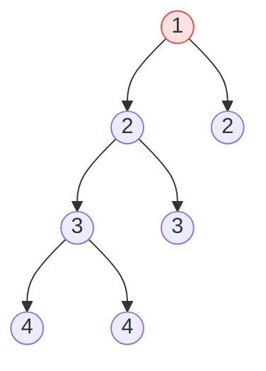

# Balanced Binary Tree

Given a binary tree, determine whether it is height-balanced: for every node, the heights of its left and right subtrees differ by at most 1.

## Algorithm Strategy (Post-order Height with an Early Exit)

1. A tree is balanced if both subtrees are balanced and their heights differ by at most 1.
2. Compute the height bottom-up with one recursive function that returns the height of a balanced subtree and the special value `-1` as soon as an imbalance is found.
3. At a node: if either child returned `-1`, or the heights differ by more than 1, return `-1`; otherwise return `1 + max(left, right)`.
4. The tree is balanced exactly when the root does not return `-1`. Every node is visited once.

## Example walkthrough

- For `[3, 9, 20, null, null, 15, 7]`: the subtree of 20 has height 2, the subtree of 9 has height 1, difference 1: `true`.
- For `[1, 2, 2, 3, 3, null, null, 4, 4]` the left subtree has height 4 and the right subtree height 2: `false`.

## Complexity Analysis

- **Time Complexity:** `O(n)` — Every node is visited once.
- **Space Complexity:** `O(h)` — Recursion depth equals the tree height.

## Approaches

The same problem can be solved in several ways. The approach marked (Optimized) is the one to use in practice.

### Approach 1: Top-Down (Heights Recomputed)

At every node compute the heights of both subtrees from scratch and check that they differ by at most 1, then recurse into both children. Simple, but heights are recomputed for the same nodes many times.

```java
public static boolean isBalancedTopDown(TreeNode root) {
    if (root == null) return true;
    return Math.abs(depthOf(root.left) - depthOf(root.right)) <= 1 && isBalancedTopDown(root.left) && isBalancedTopDown(root.right);
}

private static int depthOf(TreeNode node) {
    return node == null ? 0 : 1 + Math.max(depthOf(node.left), depthOf(node.right));
}
```

- **Time Complexity:** O(n^2) for a skewed tree (O(n log n) balanced)
- **Space Complexity:** O(h)

### Approach 2: Bottom-Up with a -1 Sentinel (Optimized)

One recursive function returns the height, or `-1` as soon as any subtree is unbalanced, so every node is visited once. This is the version implemented in the repository.

```java
public static boolean isBalanced(TreeNode root) {
    return height(root) != -1;
}

private static int height(TreeNode node) {
    if (node == null) return 0;
    int left = height(node.left);
    if (left == -1) return -1;
    int right = height(node.right);
    if (right == -1 || Math.abs(left - right) > 1) return -1;
    return 1 + Math.max(left, right);
}
```

- **Time Complexity:** O(n)
- **Space Complexity:** O(h)

### Approach 3: Bottom-Up Returning a (height, balanced) Pair

Return the height and the balance flag together instead of encoding "unbalanced" as `-1`. The meaning of each value is explicit, at the cost of allocating a small array per node.

```java
public static boolean isBalancedPair(TreeNode root) {
    return check(root)[1] == 1;
}

// returns {height, balanced ? 1 : 0}
private static int[] check(TreeNode node) {
    if (node == null) return new int[]{0, 1};
    int[] left = check(node.left), right = check(node.right);
    boolean balanced = left[1] == 1 && right[1] == 1 && Math.abs(left[0] - right[0]) <= 1;
    return new int[]{1 + Math.max(left[0], right[0]), balanced ? 1 : 0};
}
```

- **Time Complexity:** O(n)
- **Space Complexity:** O(h)

### Approach 4: Iterative Post-order with a Height Map

The bottom-up check without recursion: visit the nodes in post-order with an explicit stack, store each height in a map and stop at the first node whose children differ by more than 1.

```java
public static boolean isBalancedIterative(TreeNode root) {
    Map<TreeNode, Integer> heights = new IdentityHashMap<>();
    Deque<TreeNode> stack = new ArrayDeque<>();
    TreeNode curr = root, lastVisited = null;
    while (curr != null || !stack.isEmpty()) {
        while (curr != null) { stack.push(curr); curr = curr.left; }
        TreeNode top = stack.peek();
        if (top.right != null && lastVisited != top.right) {
            curr = top.right;
        } else {
            stack.pop();
            int left = top.left == null ? 0 : heights.get(top.left), right = top.right == null ? 0 : heights.get(top.right);
            if (Math.abs(left - right) > 1) return false;
            heights.put(top, 1 + Math.max(left, right));
            lastVisited = top;
        }
    }
    return true;
}
```

- **Time Complexity:** O(n)
- **Space Complexity:** O(n)

### Comparison

| # | Approach | Time | Space |
|---|----------|------|-------|
| 1 | Top-Down (Heights Recomputed) | O(n^2) for a skewed tree (O(n log n) balanced) | O(h) |
| 2 | Bottom-Up with a -1 Sentinel (Optimized) | O(n) | O(h) |
| 3 | Bottom-Up Returning a (height, balanced) Pair | O(n) | O(h) |
| 4 | Iterative Post-order with a Height Map | O(n) | O(n) |

## Source Code

Uses the shared helper [`TreeNode`](../../src/main/java/com/ranga/tree/TreeNode.java) (a small `TreeNode` with `of(...)` and `toString(...)` helpers for building and printing test data).

### BalancedBinaryTree.java

```java
public class BalancedBinaryTree {

    public static void main(String[] args) {
        Integer[][] inputs = {{3, 9, 20, null, null, 15, 7}, {1, 2, 2, 3, 3, null, null, 4, 4}, {}, {1, 2, null, 3}, {1, 2, 3}};
        for (Integer[] values : inputs) {
            TreeNode root = TreeNode.of(values);
            System.out.println("Input  : root = " + TreeNode.toString(root));
            System.out.println("Output : " + isBalanced(root));
            System.out.println();
        }
    }

    public static boolean isBalanced(TreeNode root) {
        return height(root) != -1;
    }

    // height of the subtree, or -1 if it is not balanced
    private static int height(TreeNode node) {
        if (node == null) {
            return 0;
        }
        int left = height(node.left);
        if (left == -1) {
            return -1;
        }
        int right = height(node.right);
        if (right == -1 || Math.abs(left - right) > 1) {
            return -1;
        }
        return 1 + Math.max(left, right);
    }
}
```

## Solution

The optimized solution is Approach 2 above, which is also the version implemented in this repository.

The idea: a tree is height-balanced when, at every node, the heights of the two subtrees differ by at most 1. Instead of recomputing heights for each node, one post-order walk returns the height of a subtree, or the sentinel `-1` meaning "this subtree is already unbalanced". As soon as a `-1` shows up it is passed straight up, and the right subtree is not even visited.

**Input:** the tree `[1, 2, 2, 3, 3, null, null, 4, 4]`, which is not balanced.



The root is the first place where the heights differ by more than 1.

| Step | Node finished | `left` | `right` | Check | Returns |
|------|---------------|--------|---------|-------|---------|
| 1 | `4` (left leaf) | 0 | 0 | diff 0 | 1 |
| 2 | `4` (right leaf) | 0 | 0 | diff 0 | 1 |
| 3 | `3` (left, has two children) | 1 | 1 | diff 0 | 2 |
| 4 | `3` (right, leaf) | 0 | 0 | diff 0 | 1 |
| 5 | `2` (left) | 2 | 1 | diff 1, allowed | 3 |
| 6 | `2` (right, leaf) | 0 | 0 | diff 0 | 1 |
| 7 | `1` (root) | 3 | 1 | diff 2, more than 1 | `-1` |

`isBalanced` returns `height(root) != -1`, which is `false`.

**Early exit.** The line `if (left == -1) return -1;` stops before the right subtree is examined, and `right == -1` is tested before the height difference. For `[1, 2, null, 3]` the call for `2` gets left height 1 and right height 0 (fine, returns 2), but at the root the left is 2 and the right is 0, so the result is `-1` and `false`.

**Edge cases.** An empty tree has height `0`, so it is balanced (`true`). A single node returns `1`, balanced. Each node is visited at most once: time `O(n)`, recursion space `O(h)`.

**Result:** `false` for the traced tree; the class output for the five inputs in `main` is `true`, `false`, `true`, `false`, `true`.
