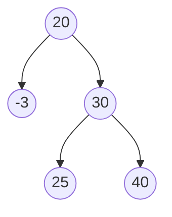

# Binary Search Tree

Demonstrates a Binary Search Tree (BST) of integers with common interview operations.

## Algorithm Strategy

1. **add:** recursively go left if the value is smaller than the node, right if larger, and create a new node when an empty child is reached.
2. **display (in-order):** visit left subtree, the node, then right subtree; this yields sorted order.
3. **mirror:** recursively mirror both children and swap them.
4. **minValue / maxValue:** keep going left (minimum) or right (maximum) until there is no child.
5. **size:** iterative in-order traversal with an explicit stack, counting every visited node.
6. **isBST:** pass the allowed `(min, max)` range down the recursion and fail when a value falls outside it.
7. **levelOrderTraversal:** breadth-first search with a queue, processing the tree one level at a time.

## Example walkthrough

- Adding `20, 30, -3, 25, 40` gives root `20` with children `-3` and `30`, and `30` has children `25` and `40`.
- In-order display prints `-3 20 25 30 40` (sorted); after `mirror()` it prints `40 30 25 20 -3`. The level-order traversal prints `20`, then `-3 30`, then `25 40`; `size` is `5`, the minimum is `-3`, the maximum is `40` and `isBST` is `true`.

## Complexity Analysis

- **Time Complexity:** `O(h)` for add, minValue and maxValue where `h` is the tree height (`O(log n)` for a balanced tree, `O(n)` for a skewed one); `O(n)` for display, mirror, size, isBST and levelOrderTraversal.
- **Space Complexity:** `O(h)` for the recursion/stack of the depth-first operations and `O(w)` for the queue of the level-order traversal (`w` = maximum width of the tree).

## Approaches

The same problem can be solved in several ways. They are listed from the simplest to the most efficient.

### Approach 1: Insert: Recursive (Implemented)

Go left or right depending on the comparison and attach a new node where a null child is found. Concise, but uses `O(h)` stack. This is the version implemented in the repository.

```java
static class BinaryNode {
    int value;
    BinaryNode left, right;
    BinaryNode(int value) { this.value = value; }
}

static BinaryNode insertRecursive(BinaryNode node, int value) {
    if (node == null) return new BinaryNode(value);
    if (value < node.value) node.left = insertRecursive(node.left, value);
    else if (value > node.value) node.right = insertRecursive(node.right, value);
    return node;
}
```

- **Time Complexity:** O(h)
- **Space Complexity:** O(h)

### Approach 2: Insert: Iterative (Optimized)

Walk down with a loop while remembering the parent, then attach the new node to it. Same time, but `O(1)` extra space and no risk of stack overflow on a skewed tree.

```java
static BinaryNode insertIterative(BinaryNode root, int value) {
    BinaryNode node = new BinaryNode(value);
    if (root == null) return node;
    BinaryNode curr = root, parent = null;
    while (curr != null) {
        parent = curr;
        if (value < curr.value) curr = curr.left;
        else if (value > curr.value) curr = curr.right;
        else return root;                         // duplicate: ignore
    }
    if (value < parent.value) parent.left = node; else parent.right = node;
    return root;
}
```

- **Time Complexity:** O(h)
- **Space Complexity:** O(1)

### Approach 3: Validate: Range Check (Min / Max) (Implemented)

Pass the allowed `(min, max)` range down the recursion; every node must be inside it. Use `long` bounds so that `Integer.MIN_VALUE` / `MAX_VALUE` values are handled correctly. This is the version implemented in the repository.

```java
static boolean isBstRange(BinaryNode node, long min, long max) {
    if (node == null) return true;
    if (node.value < min || node.value > max) return false;
    return isBstRange(node.left, min, (long) node.value - 1)
            && isBstRange(node.right, (long) node.value + 1, max);
}
```

- **Time Complexity:** O(n)
- **Space Complexity:** O(h)

### Approach 4: Validate: In-Order Traversal Must Be Increasing

An in-order traversal of a valid BST visits values in strictly increasing order, so remember the previous value and fail on the first non-increase.

```java
static Integer previous;

static boolean isBstInOrder(BinaryNode node) {
    previous = null;
    return inOrderCheck(node);
}

private static boolean inOrderCheck(BinaryNode node) {
    if (node == null) return true;
    if (!inOrderCheck(node.left)) return false;
    if (previous != null && node.value <= previous) return false;
    previous = node.value;
    return inOrderCheck(node.right);
}
```

- **Time Complexity:** O(n)
- **Space Complexity:** O(h)

### Approach 5: Size: Recursive Count

`size(node) = 1 + size(left) + size(right)`.

```java
static int sizeRecursive(BinaryNode node) {
    return node == null ? 0 : 1 + sizeRecursive(node.left) + sizeRecursive(node.right);
}
```

- **Time Complexity:** O(n)
- **Space Complexity:** O(h)

### Approach 6: Size: Iterative In-Order with a Stack (Implemented)

Simulate the recursion with an explicit stack, counting each visited node. This is the version implemented in the repository.

```java
static int sizeIterative(BinaryNode root) {
    int size = 0;
    Deque<BinaryNode> stack = new ArrayDeque<>();
    BinaryNode curr = root;
    while (curr != null || !stack.isEmpty()) {
        if (curr != null) { stack.push(curr); curr = curr.left; }
        else { curr = stack.pop(); size++; curr = curr.right; }
    }
    return size;
}
```

- **Time Complexity:** O(n)
- **Space Complexity:** O(h)

### Approach 7: Size: Maintain a Counter (Optimized)

If `size()` is called often, increment a counter on every successful insert (and decrement on delete) so that `size()` is `O(1)`.

```java
static class CountingTree {
    BinaryNode root;
    int size;

    void add(int value) {
        if (!contains(value)) {
            root = insertIterative(root, value);
            size++;
        }
    }

    boolean contains(int value) {
        BinaryNode curr = root;
        while (curr != null) {
            if (value == curr.value) return true;
            curr = value < curr.value ? curr.left : curr.right;
        }
        return false;
    }
}
```

- **Time Complexity:** O(1) for size()
- **Space Complexity:** O(1)

### Approach 8: Level-Order: Queue (BFS) (Implemented)

Process the tree level by level with a queue, taking `queue.size()` nodes per level. This is the version implemented in the repository.

```java
static List<List<Integer>> levelOrderQueue(BinaryNode root) {
    List<List<Integer>> levels = new ArrayList<>();
    if (root == null) return levels;
    Queue<BinaryNode> queue = new LinkedList<>();
    queue.add(root);
    while (!queue.isEmpty()) {
        List<Integer> level = new ArrayList<>();
        for (int i = queue.size(); i > 0; i--) {
            BinaryNode node = queue.poll();
            level.add(node.value);
            if (node.left != null) queue.add(node.left);
            if (node.right != null) queue.add(node.right);
        }
        levels.add(level);
    }
    return levels;
}
```

- **Time Complexity:** O(n)
- **Space Complexity:** O(w) (maximum width)

### Approach 9: Level-Order: Recursion by Depth

Recurse with the current depth and add each node to the list of its level. No queue is needed.

```java
static List<List<Integer>> levelOrderRecursive(BinaryNode root) {
    List<List<Integer>> levels = new ArrayList<>();
    fill(root, 0, levels);
    return levels;
}

private static void fill(BinaryNode node, int depth, List<List<Integer>> levels) {
    if (node == null) return;
    if (depth == levels.size()) levels.add(new ArrayList<>());
    levels.get(depth).add(node.value);
    fill(node.left, depth + 1, levels);
    fill(node.right, depth + 1, levels);
}
```

- **Time Complexity:** O(n)
- **Space Complexity:** O(h)

### Comparison

| # | Approach | Time | Space |
|---|----------|------|-------|
| 1 | Insert: Recursive (Implemented) | O(h) | O(h) |
| 2 | Insert: Iterative (Optimized) | O(h) | O(1) |
| 3 | Validate: Range Check (Min / Max) (Implemented) | O(n) | O(h) |
| 4 | Validate: In-Order Traversal Must Be Increasing | O(n) | O(h) |
| 5 | Size: Recursive Count | O(n) | O(h) |
| 6 | Size: Iterative In-Order with a Stack (Implemented) | O(n) | O(h) |
| 7 | Size: Maintain a Counter (Optimized) | O(1) for size() | O(1) |
| 8 | Level-Order: Queue (BFS) (Implemented) | O(n) | O(w) (maximum width) |
| 9 | Level-Order: Recursion by Depth | O(n) | O(h) |

## Source Code

### BinarySearchTree.java

```java
import java.util.ArrayDeque;
import java.util.Deque;
import java.util.LinkedList;
import java.util.Queue;

public class BinarySearchTree {

    public static void main(String[] args) {
        BinaryTree tree = new BinaryTree();
        int[] values = {20, 30, -3, 25, 40};
        for (int value : values) {
            tree.add(value);
        }

        System.out.println("Input        : " + java.util.Arrays.toString(values));
        System.out.println("Tree size    : " + tree.size());
        tree.display();

        // converting tree to mirror tree
        tree.mirror();
        System.out.println("After mirror()");
        tree.display();

        tree.mirror();
        System.out.println("Min: " + tree.minValue() + ", Max: " + tree.maxValue());
        System.out.println("IsBST        : " + tree.isBST());

        tree.levelOrderTraversal();
    }
}

class BinaryNode {

    Integer value;
    BinaryNode left;
    BinaryNode right;

    public BinaryNode(Integer value) {
        this.value = value;
        left = right = null;
    }

    @Override
    public String toString() {
        return "value: " + value + ", left: " + left + ", right: " + right;
    }
}

class BinaryTree {

    private BinaryNode rootNode;

    public void add(Integer t) {
        rootNode = add(rootNode, t);
    }

    private BinaryNode add(BinaryNode node, Integer t) {
        // if the node is null, create a new node and return it
        if (node == null) {
            return new BinaryNode(t);
        }
        // if the given value is less than the root node, recur for the left subtree
        if (t < node.value) {
            node.left = add(node.left, t);
        }
        // if the given value is more than the root node, recur for the right subtree
        else if (t > node.value) {
            node.right = add(node.right, t);
        }
        return node;
    }

    private void display(BinaryNode node) {
        if (node == null)
            return;

        display(node.left);
        System.out.print(node.value + " ");
        display(node.right);
    }

    public void display() {
        System.out.print("In-order     : ");
        display(rootNode);
        System.out.println();
    }

    public void mirror() {
        rootNode = mirror(rootNode);
    }

    private BinaryNode mirror(BinaryNode node) {
        if (node == null)
            return null;
        BinaryNode left = mirror(node.left);
        BinaryNode right = mirror(node.right);
        node.left = right;
        node.right = left;
        return node;
    }

    public int maxValue() {
        if (rootNode == null) {
            throw new IllegalStateException("Tree is empty");
        }
        /* loop down to find the rightmost node */
        BinaryNode current = rootNode;
        while (current.right != null) {
            current = current.right;
        }
        return current.value;
    }

    public int minValue() {
        if (rootNode == null) {
            throw new IllegalStateException("Tree is empty");
        }
        /* loop down to find the leftmost node */
        BinaryNode current = rootNode;
        while (current.left != null) {
            current = current.left;
        }
        return current.value;
    }

    public boolean isBST() {
        return isBST(rootNode, Long.MIN_VALUE, Long.MAX_VALUE);
    }

    private boolean isBST(BinaryNode node, long minValue, long maxValue) {
        if (node == null) {
            return true;
        }

        if (node.value < minValue || node.value > maxValue) {
            return false;
        }

        return isBST(node.left, minValue, (long) node.value - 1) && isBST(node.right, (long) node.value + 1, maxValue);
    }

    public int size() {
        BinaryNode current = rootNode;
        int size = 0;
        Deque<BinaryNode> stack = new ArrayDeque<>();
        while (!stack.isEmpty() || current != null) {
            if (current != null) {
                stack.push(current);
                current = current.left;
            } else {
                size++;
                current = stack.pop();
                current = current.right;
            }
        }
        return size;
    }

    public void levelOrderTraversal() {
        if (rootNode == null) {
            return;
        }
        Queue<BinaryNode> queue = new LinkedList<>();
        queue.add(rootNode);
        int level = 0;
        while (!queue.isEmpty()) {
            int nodesInLevel = queue.size();
            System.out.print("Level " + level++ + "      : ");
            for (int i = 0; i < nodesInLevel; i++) {
                BinaryNode tempNode = queue.poll();
                System.out.print(tempNode.value + " ");
                if (tempNode.left != null)
                    queue.add(tempNode.left);
                if (tempNode.right != null)
                    queue.add(tempNode.right);
            }
            System.out.println();
        }
    }

    public void clear() {
        rootNode = null;
    }
}
```

## Solution

This repository implements Approach 1 (Insert: Recursive), Approach 3 (Validate: Range Check (Min / Max)), Approach 6 (Size: Iterative In-Order with a Stack), Approach 8 (Level-Order: Queue (BFS)), marked `(Implemented)` in the Approaches section. The optimized approaches on this page, Approach 2 (Insert: Iterative), Approach 7 (Size: Maintain a Counter), are not implemented in the class.

The page names Approach 2 (iterative insert) and Approach 7 (maintained counter) as the optimized ones, but the class in this repository codes Approaches 1, 3, 6 and 8: a recursive `add`, the `isBST` range check, a stack-based `size()` and a queue-based `levelOrderTraversal()`. This block explains those coded versions; the class wins.

The idea: a BST keeps smaller values on the left and larger values on the right, so each operation follows one path or one traversal. `add` walks down by comparing and attaches a new node at the empty spot it reaches (a duplicate changes nothing). `isBST` passes down the range of values a node may legally hold. `size()` counts nodes with an iterative in-order walk (stack). `levelOrderTraversal()` reads the tree level by level with a queue.

**Input:** `add(20)`, `add(30)`, `add(-3)`, `add(25)`, `add(40)`.

| Step | Operation | Path taken | Result |
|------|-----------|------------|--------|
| 1 | `add(20)` | root is null | new root `20` |
| 2 | `add(30)` | `30 > 20`, go right, empty | `30` is right child of `20` |
| 3 | `add(-3)` | `-3 < 20`, go left, empty | `-3` is left child of `20` |
| 4 | `add(25)` | `25 > 20` right, `25 < 30` left, empty | `25` is left child of `30` |
| 5 | `add(40)` | `40 > 20` right, `40 > 30` right, empty | `40` is right child of `30` |



**isBST** starts with the range `[Long.MIN_VALUE, Long.MAX_VALUE]` and narrows it, so a value must fit the bounds of every ancestor, not just its parent:

| Node | Allowed range | In range? |
|------|---------------|-----------|
| `20` | `MIN .. MAX` | yes |
| `-3` | `MIN .. 19` | yes |
| `30` | `21 .. MAX` | yes |
| `25` | `21 .. 29` | yes |
| `40` | `31 .. MAX` | yes |

**size()** walks in order with a stack (`size++` happens when a node is popped): push `20`, push `-3`, pop `-3` (size 1), pop `20` (size 2), go right and push `30`, push `25`, pop `25` (size 3), pop `30` (size 4), push `40`, pop `40` (size 5). The stack is empty and `current` is null, so `size()` is `5`. Popping in this order also gives the sorted values `-3 20 25 30 40` that `display()` prints.

**Level order** keeps one level in the queue per round: `[20]` prints `20`; then `[-3, 30]` prints `-3 30`; then `[25, 40]` prints `25 40`.

**Edge cases.** `minValue()` and `maxValue()` throw `IllegalStateException("Tree is empty")` on an empty tree; `isBST` of an empty tree is `true`, `size()` is `0`, and `levelOrderTraversal()` prints nothing. Inserting an existing value leaves the tree unchanged. `isBST` uses `long` bounds so that a node holding `Integer.MIN_VALUE` or `Integer.MAX_VALUE` does not overflow when the bound is moved by one. `add` costs `O(h)`; `size()` and `isBST` cost `O(n)`.

**Result:** the class prints size `5`, in-order `-3 20 25 30 40` (and `40 30 25 20 -3` after `mirror()`), `Min: -3, Max: 40`, `IsBST : true`, and levels `20`, `-3 30`, `25 40`, matching the trace.
