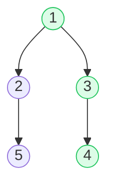

# Binary Tree Right Side View

Given the root of a binary tree, imagine standing on its right side and return the values of the nodes you can see, ordered from top to bottom (the last node of every level).

## Algorithm Strategy (Level-Order Traversal, Keep the Last Node of Each Level)

1. Run a breadth-first traversal with a queue and process the tree level by level (`levelSize = queue.size()` nodes per round).
2. Inside a level, the node that is processed last is the right-most node, the one visible from the right side.
3. Add the value of that last node to the result after each level.
4. Enqueue the left child before the right child so the right-most node of the next level is again processed last.

## Example walkthrough

- For `[1, 2, 3, null, 5, null, 4]`: level 0 shows 1; level 1 has 2 and 3, the last is 3; level 2 has 5 and 4, the last is 4.
- Result: `[1, 3, 4]`.

## Complexity Analysis

- **Time Complexity:** `O(n)` — Every node is enqueued once.
- **Space Complexity:** `O(w)` — The queue holds at most one level, `w` = maximum width.

## Approaches

The same problem can be solved in several ways. The approach marked (Optimized) is the one to use in practice.

### Approach 1: Collect All Levels, Take the Last of Each

Build the full level-order lists and keep the last element of every level. Easy to understand but stores every value.

```java
public static List<Integer> rightSideViewLevels(TreeNode root) {
    List<List<Integer>> levels = new ArrayList<>();
    collect(root, 0, levels);
    List<Integer> result = new ArrayList<>();
    for (List<Integer> level : levels) result.add(level.get(level.size() - 1));
    return result;
}

private static void collect(TreeNode node, int depth, List<List<Integer>> levels) {
    if (node == null) return;
    if (depth == levels.size()) levels.add(new ArrayList<>());
    levels.get(depth).add(node.val);
    collect(node.left, depth + 1, levels);
    collect(node.right, depth + 1, levels);
}
```

- **Time Complexity:** O(n)
- **Space Complexity:** O(n)

### Approach 2: DFS Visiting the Right Child First

A pre-order traversal that visits the right child before the left one reaches the right-most node of every depth first; record a node only when its depth has not been seen yet.

```java
public static List<Integer> rightSideViewDfs(TreeNode root) {
    List<Integer> result = new ArrayList<>();
    visit(root, 0, result);
    return result;
}

private static void visit(TreeNode node, int depth, List<Integer> result) {
    if (node == null) return;
    if (depth == result.size()) result.add(node.val);      // first node reached at this depth
    visit(node.right, depth + 1, result);
    visit(node.left, depth + 1, result);
}
```

- **Time Complexity:** O(n)
- **Space Complexity:** O(h)

### Approach 3: BFS Enqueuing the Right Child First

Run a level-order traversal that enqueues the right child before the left one; the first node of each level is then the right-most node.

```java
public static List<Integer> rightSideViewRightFirst(TreeNode root) {
    List<Integer> result = new ArrayList<>();
    if (root == null) return result;
    Queue<TreeNode> queue = new LinkedList<>();
    queue.add(root);
    while (!queue.isEmpty()) {
        result.add(queue.peek().val);                       // first node of the level
        for (int i = queue.size(); i > 0; i--) {
            TreeNode node = queue.poll();
            if (node.right != null) queue.add(node.right);
            if (node.left != null) queue.add(node.left);
        }
    }
    return result;
}
```

- **Time Complexity:** O(n)
- **Space Complexity:** O(w)

### Approach 4: BFS Keeping the Last Node of Each Level (Optimized)

A level-order traversal where the node processed last in each level is the visible one. This is the version implemented in the repository.

```java
public static List<Integer> rightSideView(TreeNode root) {
    List<Integer> result = new ArrayList<>();
    if (root == null) return result;
    Queue<TreeNode> queue = new LinkedList<>();
    queue.add(root);
    while (!queue.isEmpty()) {
        int levelSize = queue.size();
        for (int i = 0; i < levelSize; i++) {
            TreeNode node = queue.poll();
            if (i == levelSize - 1) result.add(node.val);
            if (node.left != null) queue.add(node.left);
            if (node.right != null) queue.add(node.right);
        }
    }
    return result;
}
```

- **Time Complexity:** O(n)
- **Space Complexity:** O(w)

### Comparison

| # | Approach | Time | Space |
|---|----------|------|-------|
| 1 | Collect All Levels, Take the Last of Each | O(n) | O(n) |
| 2 | DFS Visiting the Right Child First | O(n) | O(h) |
| 3 | BFS Enqueuing the Right Child First | O(n) | O(w) |
| 4 | BFS Keeping the Last Node of Each Level (Optimized) | O(n) | O(w) |

## Source Code

Uses the shared helper [`TreeNode`](../../src/main/java/com/ranga/tree/TreeNode.java) (a small `TreeNode` with `of(...)` and `toString(...)` helpers for building and printing test data).

### BinaryTreeRightSideView.java

```java
import java.util.ArrayList;
import java.util.LinkedList;
import java.util.List;
import java.util.Queue;

public class BinaryTreeRightSideView {

    public static void main(String[] args) {
        Integer[][] inputs = {{1, 2, 3, null, 5, null, 4}, {1, null, 3}, {}, {1, 2, 3, 4}, {1, 2}};
        for (Integer[] values : inputs) {
            TreeNode root = TreeNode.of(values);
            System.out.println("Input  : root = " + TreeNode.toString(root));
            System.out.println("Output : " + rightSideView(root));
            System.out.println();
        }
    }

    public static List<Integer> rightSideView(TreeNode root) {
        List<Integer> result = new ArrayList<>();
        if (root == null) {
            return result;
        }

        Queue<TreeNode> queue = new LinkedList<>();
        queue.add(root);
        while (!queue.isEmpty()) {
            int levelSize = queue.size();
            for (int i = 0; i < levelSize; i++) {
                TreeNode node = queue.poll();
                if (i == levelSize - 1) {
                    result.add(node.val);               // last node of the level = visible from the right
                }
                if (node.left != null) {
                    queue.add(node.left);
                }
                if (node.right != null) {
                    queue.add(node.right);
                }
            }
        }
        return result;
    }
}
```

## Solution

The optimized solution is Approach 4 above, which is also the version implemented in this repository.

The idea: standing on the right of the tree you see, on every level, the right-most node. A queue-based level-order traversal visits the nodes of a level from left to right, so the last node polled in each round is the one that is visible. The code records the node whose index in the round is `levelSize - 1` and still enqueues all children, so deeper levels are handled the same way.

**Input:** the tree `[1, 2, 3, null, 5, null, 4]`.



The green nodes are the ones recorded.

| Round | Queue at start (`levelSize`) | Polled (index `i`) | Recorded? (`i == levelSize - 1`) | `result` | Queue at end |
|-------|------------------------------|--------------------|----------------------------------|----------|--------------|
| 1 | `[1]` (1) | `1` (0) | yes | `[1]` | `[2, 3]` |
| 2 | `[2, 3]` (2) | `2` (0) | no | `[1]` | `[3, 5]` |
| 2 | | `3` (1) | yes | `[1, 3]` | `[5, 4]` |
| 3 | `[5, 4]` (2) | `5` (0) | no | `[1, 3]` | `[4]` |
| 3 | | `4` (1) | yes | `[1, 3, 4]` | `[ ]` |

The queue is empty, so the result is `[1, 3, 4]`. The value `5` is hidden behind `4`: both are on the third level and only the right-most counts.

**Edge cases.** An empty tree returns `[]`. A tree like `[1, 2]` (only a left child) returns `[1, 2]`, because the left node is the last node of its level; `[1, 2, 3, 4]` returns `[1, 3, 4]`, where `4` is a left child that shows through since level 3 has no node on the right. The size is captured before the loop, so children enqueued in a round are processed in the next one. Time is `O(n)`, extra space `O(w)`.

**Result:** `[1, 3, 4]` here, and the class output for the other inputs in `main` is `[1, 3]`, `[]`, `[1, 3, 4]` and `[1, 2]`.
