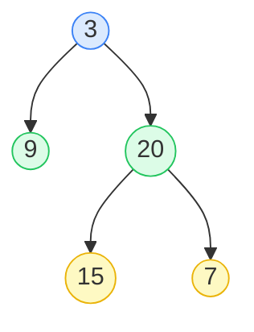

# Binary Tree Zigzag Level Order Traversal

Given the root of a binary tree, return the zigzag level order traversal of its nodes: the first level from left to right, the next level from right to left, then left to right again, and so on.

## Algorithm Strategy (BFS with an Alternating Direction)

1. Run a breadth-first search with a queue, processing the tree one level at a time.
2. For each level, take `size = queue.size()` nodes and collect their values in a `LinkedList`.
3. If the level index is even, append each value at the end (left to right); if it is odd, insert it at the front (right to left).
4. Add the children of every node to the queue as usual; the direction only changes how the level list is filled.

## Example walkthrough

- For `[3, 9, 20, null, null, 15, 7]`: level 0 is `[3]`, level 1 is read right to left `[20, 9]`, level 2 left to right `[15, 7]`.
- Result: `[[3], [20, 9], [15, 7]]`.

## Complexity Analysis

- **Time Complexity:** `O(n)` — Every node is visited once and inserted at either end in O(1).
- **Space Complexity:** `O(n)` — The queue holds up to one level, and the result holds all nodes.

## Approaches

The same problem can be solved in several ways. The approach marked (Optimized) is the one to use in practice.

### Approach 1: Level Order, then Reverse Odd Levels

Do a normal BFS and reverse every second level afterwards.

```java
public static List<List<Integer>> zigzagReverse(TreeNode root) {
    List<List<Integer>> result = new ArrayList<>();
    if (root == null) return result;
    Queue<TreeNode> queue = new LinkedList<>();
    queue.add(root);
    while (!queue.isEmpty()) {
        List<Integer> level = new ArrayList<>();
        for (int size = queue.size(); size > 0; size--) {
            TreeNode node = queue.poll();
            level.add(node.val);
            if (node.left != null) queue.add(node.left);
            if (node.right != null) queue.add(node.right);
        }
        if (result.size() % 2 == 1) Collections.reverse(level);
        result.add(level);
    }
    return result;
}
```

- **Time Complexity:** O(n)
- **Space Complexity:** O(n)

### Approach 2: Two Stacks

One stack holds the current level, the other collects the next level; the order in which children are pushed alternates.

```java
public static List<List<Integer>> zigzagTwoStacks(TreeNode root) {
    List<List<Integer>> result = new ArrayList<>();
    if (root == null) return result;
    Deque<TreeNode> current = new ArrayDeque<>(), next = new ArrayDeque<>();
    current.push(root);
    boolean leftToRight = true;
    while (!current.isEmpty()) {
        List<Integer> level = new ArrayList<>();
        while (!current.isEmpty()) {
            TreeNode node = current.pop();
            level.add(node.val);
            TreeNode first = leftToRight ? node.left : node.right;
            TreeNode second = leftToRight ? node.right : node.left;
            if (first != null) next.push(first);
            if (second != null) next.push(second);
        }
        result.add(level);
        Deque<TreeNode> swap = current; current = next; next = swap;
        leftToRight = !leftToRight;
    }
    return result;
}
```

- **Time Complexity:** O(n)
- **Space Complexity:** O(n)

### Approach 3: DFS with the Level as a Parameter

Recurse with the depth; add each value at the end or at the front of its level list depending on the depth parity.

```java
public static List<List<Integer>> zigzagDfs(TreeNode root) {
    List<List<Integer>> result = new ArrayList<>();
    dfs(root, 0, result);
    return result;
}

private static void dfs(TreeNode node, int depth, List<List<Integer>> result) {
    if (node == null) return;
    if (depth == result.size()) result.add(new LinkedList<>());
    LinkedList<Integer> level = (LinkedList<Integer>) result.get(depth);
    if (depth % 2 == 0) level.addLast(node.val); else level.addFirst(node.val);
    dfs(node.left, depth + 1, result);
    dfs(node.right, depth + 1, result);
}
```

- **Time Complexity:** O(n)
- **Space Complexity:** O(h) plus the result

### Approach 4: BFS with a Deque per Level (Optimized)

Fill each level list from the front or the back during a single BFS. This is the version implemented in the repository.

```java
public static List<List<Integer>> zigzagLevelOrder(TreeNode root) {
    List<List<Integer>> result = new ArrayList<>();
    if (root == null) return result;
    Queue<TreeNode> queue = new LinkedList<>();
    queue.add(root);
    boolean leftToRight = true;
    while (!queue.isEmpty()) {
        LinkedList<Integer> level = new LinkedList<>();
        for (int size = queue.size(); size > 0; size--) {
            TreeNode node = queue.poll();
            if (leftToRight) level.addLast(node.val); else level.addFirst(node.val);
            if (node.left != null) queue.add(node.left);
            if (node.right != null) queue.add(node.right);
        }
        result.add(level);
        leftToRight = !leftToRight;
    }
    return result;
}
```

- **Time Complexity:** O(n)
- **Space Complexity:** O(n)

### Comparison

| # | Approach | Time | Space |
|---|----------|------|-------|
| 1 | Level Order, then Reverse Odd Levels | O(n) | O(n) |
| 2 | Two Stacks | O(n) | O(n) |
| 3 | DFS with the Level as a Parameter | O(n) | O(h) plus the result |
| 4 | BFS with a Deque per Level (Optimized) | O(n) | O(n) |

## Source Code

Uses the shared helper [`TreeNode`](../../src/main/java/com/ranga/tree/TreeNode.java) (a small `TreeNode` with `of(...)` and `toString(...)` helpers for building and printing test data).

### BinaryTreeZigzagLevelOrder.java

```java
import java.util.ArrayList;
import java.util.LinkedList;
import java.util.List;
import java.util.Queue;

public class BinaryTreeZigzagLevelOrder {

    public static void main(String[] args) {
        Integer[][] inputs = {{3, 9, 20, null, null, 15, 7}, {1}, {}, {1, 2, 3, 4, null, null, 5}};
        for (Integer[] values : inputs) {
            TreeNode root = TreeNode.of(values);
            System.out.println("Input  : root = " + TreeNode.toString(root));
            System.out.println("Output : " + zigzagLevelOrder(root));
            System.out.println();
        }
    }

    public static List<List<Integer>> zigzagLevelOrder(TreeNode root) {
        List<List<Integer>> result = new ArrayList<>();
        if (root == null) {
            return result;
        }

        Queue<TreeNode> queue = new LinkedList<>();
        queue.add(root);
        boolean leftToRight = true;
        while (!queue.isEmpty()) {
            LinkedList<Integer> level = new LinkedList<>();
            for (int size = queue.size(); size > 0; size--) {
                TreeNode node = queue.poll();
                if (leftToRight) {
                    level.addLast(node.val);
                } else {
                    level.addFirst(node.val);
                }
                if (node.left != null) {
                    queue.add(node.left);
                }
                if (node.right != null) {
                    queue.add(node.right);
                }
            }
            result.add(level);
            leftToRight = !leftToRight;
        }
        return result;
    }
}
```

## Solution

The optimized solution is Approach 4 above, which is also the version implemented in this repository.

The idea: process the tree level by level with a queue, exactly as in a normal level-order traversal, but keep a flag `leftToRight` that flips after every level. The queue always receives children left then right, so the order the nodes leave the queue never changes; only the way each value is placed into the level's list changes: appended at the end when going left to right, inserted at the front when going right to left.

**Input:** the tree `[3, 9, 20, null, null, 15, 7]`.



| Round | `leftToRight` | Queue at start (`size`) | Nodes polled and how they are placed | `level` list | Queue at end |
|-------|---------------|-------------------------|--------------------------------------|--------------|--------------|
| 1 | true | `[3]` (1) | `3` addLast | `[3]` | `[9, 20]` |
| 2 | false | `[9, 20]` (2) | `9` addFirst gives `[9]`; `20` addFirst gives `[20, 9]` | `[20, 9]` | `[15, 7]` |
| 3 | true | `[15, 7]` (2) | `15` addLast, `7` addLast | `[15, 7]` | `[ ]` |

The queue is empty, so the loop ends. The result is `[[3], [20, 9], [15, 7]]`.

**Another input.** For `[1, 2, 3, 4, null, null, 5]` the rounds give `[1]`, then `2` and `3` placed at the front one after the other giving `[3, 2]`, then `4` and `5` going left to right giving `[4, 5]`: `[[1], [3, 2], [4, 5]]`.

**Edge cases.** An empty tree returns an empty list before the queue is built. A single node returns `[[1]]`. The level size is read once per round (`for (int size = queue.size(); size > 0; size--)`), so children added during the round are left for the next one. `addFirst` on a `LinkedList` is `O(1)`, so reversing costs nothing extra: total time `O(n)`, space `O(w)` for the widest level plus the output.

**Result:** matches the class output for all four inputs in `main`.
