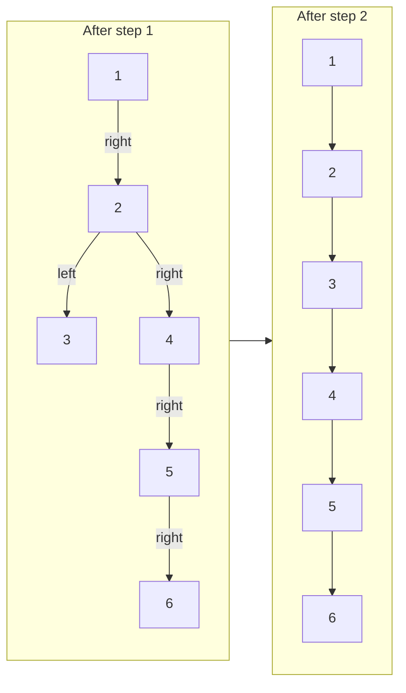

# Flatten Binary Tree to Linked List

Flatten a binary tree in place into a "linked list" that uses the `right` pointers: the list must follow the preorder traversal of the tree and every `left` pointer must be `null`.

## Algorithm Strategy (Splice the Left Subtree into the Right (Constant Extra Space))

1. Walk down from the root with a pointer `curr`. If `curr` has no left child, just move to `curr.right`.
2. Otherwise find the rightmost node of the left subtree, `tail`. In preorder, the right subtree comes right after everything in the left subtree, so attach `curr.right` to `tail.right`.
3. Then move the left subtree to the right: `curr.right = curr.left` and `curr.left = null`.
4. Continue with `curr = curr.right`. Each node is on the path of a "rightmost" search at most once, so the total work is linear and no stack or recursion is needed.

## Example walkthrough

- For `[1, 2, 5, 3, 4, null, 6]`: at 1 the rightmost node of the left subtree (2, 3, 4) is 4, so 5 hangs from 4; 2 becomes the right child of 1.
- At 2, the rightmost of its left subtree (3) is 3, so 4 hangs from 3. Result: `1, 2, 3, 4, 5, 6`.

## Complexity Analysis

- **Time Complexity:** `O(n)` — Every node is visited a constant number of times.
- **Space Complexity:** `O(1)` — No recursion and no extra collections.

## Approaches

The same problem can be solved in several ways. The approach marked (Optimized) is the one to use in practice.

### Approach 1: Collect the Preorder, Then Relink

Store the nodes in preorder in a list, then set each node's `left` to `null` and `right` to the next node.

```java
public static void flattenList(TreeNode root) {
    List<TreeNode> order = new ArrayList<>();
    preorder(root, order);
    for (int i = 0; i + 1 < order.size(); i++) {
        order.get(i).left = null;
        order.get(i).right = order.get(i + 1);
    }
    if (!order.isEmpty()) {
        order.get(order.size() - 1).left = null;
        order.get(order.size() - 1).right = null;
    }
}

private static void preorder(TreeNode node, List<TreeNode> order) {
    if (node == null) return;
    order.add(node);
    preorder(node.left, order);
    preorder(node.right, order);
}
```

- **Time Complexity:** O(n)
- **Space Complexity:** O(n)

### Approach 2: Reverse Preorder with a Previous Pointer

Visit right, then left, then the node; each node points its `right` at the node processed just before it.

```java
private static TreeNode prev;

public static void flattenReverse(TreeNode root) {
    prev = null;
    reverse(root);
}

private static void reverse(TreeNode node) {
    if (node == null) return;
    reverse(node.right);
    reverse(node.left);
    node.right = prev;
    node.left = null;
    prev = node;
}
```

- **Time Complexity:** O(n)
- **Space Complexity:** O(h) recursion depth

### Approach 3: Splice Left Subtree into the Right (Optimized)

Attach the right subtree below the rightmost node of the left subtree, then shift the left subtree to the right, walking down the list as it is built. This is the version implemented in the repository.

```java
public static void flatten(TreeNode root) {
    TreeNode curr = root;
    while (curr != null) {
        if (curr.left != null) {
            TreeNode tail = curr.left;
            while (tail.right != null) {
                tail = tail.right;
            }
            tail.right = curr.right;
            curr.right = curr.left;
            curr.left = null;
        }
        curr = curr.right;
    }
}
```

- **Time Complexity:** O(n)
- **Space Complexity:** O(1)

### Comparison

| # | Approach | Time | Space |
|---|----------|------|-------|
| 1 | Collect the Preorder, Then Relink | O(n) | O(n) |
| 2 | Reverse Preorder with a Previous Pointer | O(n) | O(h) recursion depth |
| 3 | Splice Left Subtree into the Right (Optimized) | O(n) | O(1) |

## Source Code

### FlattenBinaryTreeToLinkedList.java

```java
import java.util.ArrayList;
import java.util.List;

public class FlattenBinaryTreeToLinkedList {

    public static void main(String[] args) {
        Integer[][] inputs = {{1, 2, 5, 3, 4, null, 6}, {}, {0}, {1, null, 2}};
        for (Integer[] values : inputs) {
            TreeNode root = TreeNode.of(values);
            System.out.println("Input  : root = " + TreeNode.toString(root));
            flatten(root);
            System.out.println("Output : " + toList(root));
            System.out.println();
        }
    }

    public static void flatten(TreeNode root) {
        TreeNode curr = root;
        while (curr != null) {
            if (curr.left != null) {
                TreeNode tail = curr.left;
                while (tail.right != null) {
                    tail = tail.right;
                }
                tail.right = curr.right;
                curr.right = curr.left;
                curr.left = null;
            }
            curr = curr.right;
        }
    }

    private static List<Integer> toList(TreeNode root) {
        List<Integer> values = new ArrayList<>();
        for (TreeNode node = root; node != null; node = node.right) {
            values.add(node.val);
        }
        return values;
    }
}
```

## Solution

The optimized solution is Approach 3 above, which is also the version implemented in this repository.

The idea: preorder visits the root, then the whole left subtree, then the right subtree. For a node with a left child, find the rightmost node of the left subtree (`tail`), hang the node's old right subtree from `tail.right`, then move the left subtree to the right and clear `left`. Moving on to `curr.right` repeats this, so the tree turns into the preorder chain in place with no stack and no recursion.

**Input:** `root = [1, 2, 5, 3, 4, null, 6]` (1 has children 2 and 5; 2 has 3 and 4; 5 has only a right child 6).

| Step | `curr` | Left child? | `tail` (rightmost of left subtree) | Rewiring | Chain from the root afterwards |
|------|--------|-------------|------------------------------------|----------|--------------------------------|
| 1 | 1 | 2 | 4 | `4.right = 5`, `1.right = 2`, `1.left = null` | 1 -> 2 (3, 4 -> 5 -> 6) |
| 2 | 2 | 3 | 3 | `3.right = 4`, `2.right = 3`, `2.left = null` | 1 -> 2 -> 3 -> 4 -> 5 -> 6 |
| 3 | 3 | none | | move to `3.right` | unchanged |
| 4 | 4 | none | | move to `4.right` | unchanged |
| 5 | 5 | none | | move to `5.right` | unchanged |
| 6 | 6 | none | | move to `6.right` = null, loop ends | unchanged |



**Edge cases:** an empty tree makes the loop never start; a single node `[0]` or a right-only chain `[1, null, 2]` has no left child anywhere, so nothing is rewired.

**Result:** reading the `right` pointers gives `[1, 2, 3, 4, 5, 6]`, the same as the class output.
