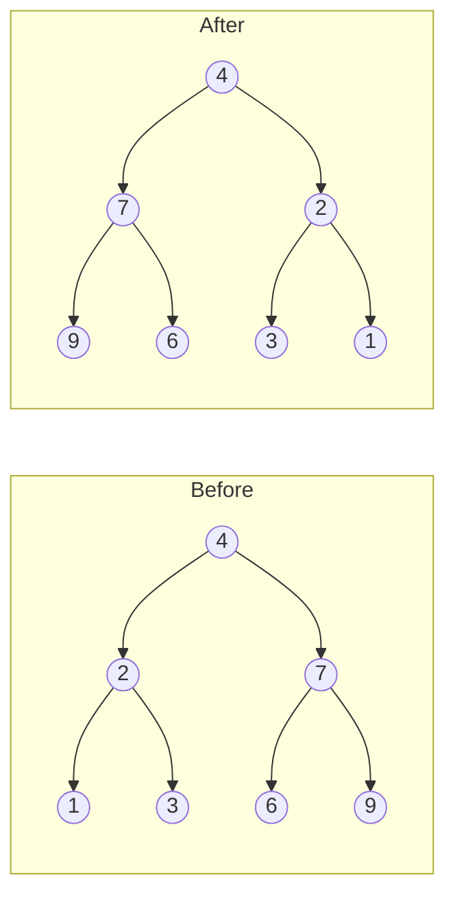

# Invert Binary Tree

Given the root of a binary tree, invert the tree (swap the left and right child of every node) and return its root.

## Algorithm Strategy (Recursive Swap)

1. If the node is `null`, there is nothing to invert.
2. Recursively invert the left and the right subtree.
3. Swap the two inverted subtrees: `node.left = invertedRight` and `node.right = invertedLeft`.
4. Return the node, so the parent can attach it.

## Example walkthrough

- For `[4, 2, 7, 1, 3, 6, 9]`: node 2 becomes `(3, 1)`, node 7 becomes `(9, 6)`.
- The root swaps them: `[4, 7, 2, 9, 6, 3, 1]`.

## Complexity Analysis

- **Time Complexity:** `O(n)` — Every node is visited once.
- **Space Complexity:** `O(h)` — Recursion depth equals the tree height.

## Approaches

The same problem can be solved in several ways. The approach marked (Optimized) is the one to use in practice.

### Approach 1: Iterative BFS

Visit the nodes level by level and swap the two children of each node.

```java
public static TreeNode invertTreeBfs(TreeNode root) {
    if (root == null) return null;
    Queue<TreeNode> queue = new LinkedList<>();
    queue.add(root);
    while (!queue.isEmpty()) {
        TreeNode node = queue.poll();
        TreeNode temp = node.left;
        node.left = node.right;
        node.right = temp;
        if (node.left != null) queue.add(node.left);
        if (node.right != null) queue.add(node.right);
    }
    return root;
}
```

- **Time Complexity:** O(n)
- **Space Complexity:** O(w)

### Approach 2: Iterative DFS with a Stack

The same swap with an explicit stack, which avoids recursion depth limits.

```java
public static TreeNode invertTreeStack(TreeNode root) {
    if (root == null) return null;
    Deque<TreeNode> stack = new ArrayDeque<>();
    stack.push(root);
    while (!stack.isEmpty()) {
        TreeNode node = stack.pop();
        TreeNode temp = node.left;
        node.left = node.right;
        node.right = temp;
        if (node.left != null) stack.push(node.left);
        if (node.right != null) stack.push(node.right);
    }
    return root;
}
```

- **Time Complexity:** O(n)
- **Space Complexity:** O(h)

### Approach 3: Swap Before Recursing (Pre-order)

Swap the two children first and then invert both subtrees. The order of the swap does not matter; this is the pre-order version of the recursive solution.

```java
public static TreeNode invertTreePreorder(TreeNode root) {
    if (root == null) return null;
    TreeNode temp = root.left;
    root.left = root.right;
    root.right = temp;
    invertTreePreorder(root.left);
    invertTreePreorder(root.right);
    return root;
}
```

- **Time Complexity:** O(n)
- **Space Complexity:** O(h)

### Approach 4: Build a New Mirrored Tree (Non-Destructive)

Create new nodes whose left child is the mirror of the original right child and vice versa, leaving the original tree untouched. Use it when the input must not be modified.

```java
public static TreeNode invertTreeCopy(TreeNode root) {
    if (root == null) return null;
    TreeNode mirrored = new TreeNode(root.val);
    mirrored.left = invertTreeCopy(root.right);
    mirrored.right = invertTreeCopy(root.left);
    return mirrored;
}
```

- **Time Complexity:** O(n)
- **Space Complexity:** O(n)

### Approach 5: Iterative Post-order with a Stack

Invert the children of a node only after both subtrees have been processed, using an explicit stack and a "last visited" pointer for the post-order traversal.

```java
public static TreeNode invertTreePostorder(TreeNode root) {
    Deque<TreeNode> stack = new ArrayDeque<>();
    TreeNode curr = root, lastVisited = null;
    while (curr != null || !stack.isEmpty()) {
        while (curr != null) { stack.push(curr); curr = curr.left; }
        TreeNode top = stack.peek();
        if (top.right != null && lastVisited != top.right) {
            curr = top.right;
        } else {
            stack.pop();
            TreeNode temp = top.left;
            top.left = top.right;
            top.right = temp;
            lastVisited = top;
        }
    }
    return root;
}
```

- **Time Complexity:** O(n)
- **Space Complexity:** O(h)

### Approach 6: Parallel Fork/Join

The two subtrees are independent, so a `RecursiveTask` can invert them in parallel and swap the results. Only worthwhile for very large trees.

```java
public static TreeNode invertTreeParallel(TreeNode root) {
    return ForkJoinPool.commonPool().invoke(new InvertTask(root, 0));
}

static class InvertTask extends RecursiveTask<TreeNode> {
    private final TreeNode node;
    private final int depth;

    InvertTask(TreeNode node, int depth) { this.node = node; this.depth = depth; }

    @Override
    protected TreeNode compute() {
        if (node == null) return null;
        if (depth >= 4) {                                   // below this depth sequential work is cheaper
            TreeNode left = new InvertTask(node.left, depth + 1).compute(), right = new InvertTask(node.right, depth + 1).compute();
            node.left = right;
            node.right = left;
            return node;
        }
        InvertTask leftTask = new InvertTask(node.left, depth + 1);
        leftTask.fork();
        TreeNode right = new InvertTask(node.right, depth + 1).compute();
        TreeNode left = leftTask.join();
        node.left = right;
        node.right = left;
        return node;
    }
}
```

- **Time Complexity:** O(n) work
- **Space Complexity:** O(h)

### Approach 7: Recursive Swap (Optimized)

Invert both subtrees and swap them. This is the version implemented in the repository.

```java
public static TreeNode invertTree(TreeNode root) {
    if (root == null) return null;
    TreeNode left = invertTree(root.left), right = invertTree(root.right);
    root.left = right;
    root.right = left;
    return root;
}
```

- **Time Complexity:** O(n)
- **Space Complexity:** O(h)

### Comparison

| # | Approach | Time | Space |
|---|----------|------|-------|
| 1 | Iterative BFS | O(n) | O(w) |
| 2 | Iterative DFS with a Stack | O(n) | O(h) |
| 3 | Swap Before Recursing (Pre-order) | O(n) | O(h) |
| 4 | Build a New Mirrored Tree (Non-Destructive) | O(n) | O(n) |
| 5 | Iterative Post-order with a Stack | O(n) | O(h) |
| 6 | Parallel Fork/Join | O(n) work | O(h) |
| 7 | Recursive Swap (Optimized) | O(n) | O(h) |

### Optimized Solution

The optimized solution is Approach 7 above, which is also the version implemented in this repository.

#### Optimized solution explained

The idea: inverting a tree means every node swaps its left and right subtrees. The method first inverts both children (each call returns its own already-inverted root), then assigns them to the opposite sides of the current node. Because each node is touched once, no extra structure is needed and the tree is changed in place.

**Input:** the tree `[4, 2, 7, 1, 3, 6, 9]`.



Order in which the calls finish (children before parent):

| Step | Node finished | `left` after recursion | `right` after recursion | Assignment | Subtree now |
|------|---------------|------------------------|-------------------------|------------|-------------|
| 1 | `1` | null | null | swap two nulls | `1` |
| 2 | `3` | null | null | swap two nulls | `3` |
| 3 | `2` | `1` | `3` | `left = 3`, `right = 1` | `2 (3, 1)` |
| 4 | `6` | null | null | swap two nulls | `6` |
| 5 | `9` | null | null | swap two nulls | `9` |
| 6 | `7` | `6` | `9` | `left = 9`, `right = 6` | `7 (9, 6)` |
| 7 | `4` | `2` | `7` | `left = 7`, `right = 2` | `4 (7 (9, 6), 2 (3, 1))` |

Reading the final tree level by level gives `[4, 7, 2, 9, 6, 3, 1]`.

**Edge cases.** An empty tree returns `null`, which is also the base case under every leaf. Both children are saved in local variables before they are reassigned, so a swap never loses a subtree. The returned root is the same object that was passed in. The recursion depth equals the tree height, so extra space is `O(h)`.

**Result:** `[4, 7, 2, 9, 6, 3, 1]` here, `[2, 3, 1]` for `[2, 1, 3]` and `[]` for the empty tree, matching the class output.

## Source Code

Uses the shared helper [`TreeNode`](../../src/main/java/com/ranga/tree/TreeNode.java) (a small `TreeNode` with `of(...)` and `toString(...)` helpers for building and printing test data).

### InvertBinaryTree.java

```java
public class InvertBinaryTree {

    public static void main(String[] args) {
        TreeNode[] inputs = {TreeNode.of(4, 2, 7, 1, 3, 6, 9), TreeNode.of(2, 1, 3), TreeNode.of()};
        for (TreeNode root : inputs) {
            System.out.println("Input  : root = " + TreeNode.toString(root));
            System.out.println("Output : " + TreeNode.toString(invertTree(root)));
            System.out.println();
        }
    }

    public static TreeNode invertTree(TreeNode root) {
        if (root == null) {
            return null;
        }
        TreeNode left = invertTree(root.left);
        TreeNode right = invertTree(root.right);
        root.left = right;
        root.right = left;
        return root;
    }
}
```
