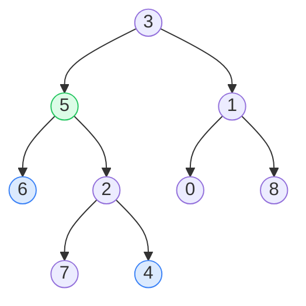

# Lowest Common Ancestor of a Binary Tree

Given a binary tree and two nodes `p` and `q` that are both in the tree, find their lowest common ancestor (LCA): the deepest node that has both `p` and `q` among its descendants (a node can be a descendant of itself). The tree is not a binary search tree.

## Algorithm Strategy (Post-Order Recursion)

1. If the current node is `null`, or it is `p` or `q`, return it: nothing deeper can be a better answer on this path.
2. Search the left subtree and the right subtree recursively.
3. If both searches return a node, then `p` and `q` lie in different subtrees, so the current node is the LCA.
4. If only one search returns a node, that node is either the LCA already found below or one of the targets: pass it up.

## Example walkthrough

- For the tree `[3, 5, 1, 6, 2, 0, 8, null, null, 7, 4]`, the LCA of `5` and `1` is `3`.
- The LCA of `5` and `4` is `5`, because a node may be its own descendant; the LCA of `6` and `4` is `5`.

## Complexity Analysis

- **Time Complexity:** `O(n)` — In the worst case every node is visited once.
- **Space Complexity:** `O(h)` — The recursion depth equals the height of the tree.

## Approaches

The same problem can be solved in several ways. The approach marked (Optimized) is the one to use in practice.

### Approach 1: Paths from the Root

Record the root-to-node path of `p` and of `q` and return the last node they share.

```java
public static TreeNode lcaPaths(TreeNode root, TreeNode p, TreeNode q) {
    List<TreeNode> pathP = new ArrayList<>(), pathQ = new ArrayList<>();
    if (!findPath(root, p, pathP) || !findPath(root, q, pathQ)) return null;
    TreeNode lca = null;
    for (int i = 0; i < Math.min(pathP.size(), pathQ.size()) && pathP.get(i) == pathQ.get(i); i++) lca = pathP.get(i);
    return lca;
}

private static boolean findPath(TreeNode node, TreeNode target, List<TreeNode> path) {
    if (node == null) return false;
    path.add(node);
    if (node == target || findPath(node.left, target, path) || findPath(node.right, target, path)) return true;
    path.remove(path.size() - 1);
    return false;
}
```

- **Time Complexity:** O(n)
- **Space Complexity:** O(h)

### Approach 2: Parent Pointers and an Ancestor Set

Store each node's parent in a map, collect all ancestors of `p` and walk up from `q` until a stored ancestor is hit.

```java
public static TreeNode lcaParents(TreeNode root, TreeNode p, TreeNode q) {
    Map<TreeNode, TreeNode> parent = new HashMap<>();
    Deque<TreeNode> stack = new ArrayDeque<>();
    parent.put(root, null);
    stack.push(root);
    while (!stack.isEmpty()) {
        TreeNode node = stack.pop();
        if (node.left != null) { parent.put(node.left, node); stack.push(node.left); }
        if (node.right != null) { parent.put(node.right, node); stack.push(node.right); }
    }
    Set<TreeNode> ancestors = new HashSet<>();
    for (TreeNode n = p; n != null; n = parent.get(n)) ancestors.add(n);
    for (TreeNode n = q; n != null; n = parent.get(n)) if (ancestors.contains(n)) return n;
    return null;
}
```

- **Time Complexity:** O(n)
- **Space Complexity:** O(n)

### Approach 3: Post-Order Recursion (Optimized)

Return a target when found; the first node that receives a result from both sides is the LCA. This is the version implemented in the repository.

```java
public static TreeNode lowestCommonAncestor(TreeNode root, TreeNode p, TreeNode q) {
    if (root == null || root == p || root == q) return root;
    TreeNode left = lowestCommonAncestor(root.left, p, q);
    TreeNode right = lowestCommonAncestor(root.right, p, q);
    if (left != null && right != null) return root;
    return left != null ? left : right;
}
```

- **Time Complexity:** O(n)
- **Space Complexity:** O(h)

### Comparison

| # | Approach | Time | Space |
|---|----------|------|-------|
| 1 | Paths from the Root | O(n) | O(h) |
| 2 | Parent Pointers and an Ancestor Set | O(n) | O(n) |
| 3 | Post-Order Recursion (Optimized) | O(n) | O(h) |

### Optimized Solution

The optimized solution is Approach 3 above, which is also the version implemented in this repository.

#### Optimized solution explained

The idea: ask each subtree "does it contain `p` or `q`?". The recursive call returns the node itself as soon as it meets `p` or `q` (there is no need to look below it), or `null` for a branch that has neither. At a node, if both the left and the right answers are non-null, then `p` and `q` are on different sides and this node is their lowest common ancestor; if only one side answered, that answer (which is either one of the targets or an ancestor already found) is passed up.

**Input:** the tree `[3, 5, 1, 6, 2, 0, 8, null, null, 7, 4]`, with `p = 6` and `q = 4`.



Blue nodes are `p` and `q`, the green node is the answer.

| Step | Call | Left answer | Right answer | Returns |
|------|------|-------------|--------------|---------|
| 1 | `lca(6)` | - | - | `6` (it is `p`, returned at once) |
| 2 | `lca(7)` | `null` | `null` | `null` |
| 3 | `lca(4)` | - | - | `4` (it is `q`) |
| 4 | `lca(2)` | `null` (from 7) | `4` | `4` (only one side found) |
| 5 | `lca(5)` | `6` | `4` | `5` (both sides found, so `5` is the ancestor) |
| 6 | `lca(0)`, `lca(8)`, `lca(1)` | `null` | `null` | `null` |
| 7 | `lca(3)` | `5` | `null` (from 1) | `5` |

The answer is node `5`.

**Other pairs.** For `p = 5, q = 4`, node `5` is returned immediately (`root == p`) without looking below it, and `3` passes it up: the answer is `5`, a node being its own ancestor. For `p = 5, q = 1` the left answer is `5` and the right is `1`, so the root `3` is returned.

**Edge cases.** The comparison is by node identity (`root == p`), and the demo finds the node objects with `find` first. A `null` root returns `null`. The method assumes both nodes are in the tree. If only one is present it returns that node. Each node is visited once: time `O(n)`, recursion space `O(h)`.

**Result:** `5` for the traced pair; the class output for the five pairs in `main` is `3`, `5`, `5`, `3`, `1`.

## Source Code

Uses the shared helper [`TreeNode`](../../src/main/java/com/ranga/tree/TreeNode.java) (a small `TreeNode` with `of(...)` and `toString(...)` helpers for building and printing test data).

### LowestCommonAncestorOfBinaryTree.java

```java
public class LowestCommonAncestorOfBinaryTree {

    public static void main(String[] args) {
        TreeNode root = TreeNode.of(3, 5, 1, 6, 2, 0, 8, null, null, 7, 4);
        int[][] pairs = {{5, 1}, {5, 4}, {6, 4}, {7, 8}, {0, 8}};
        System.out.println("Tree   : root = " + TreeNode.toString(root));
        System.out.println();
        for (int[] pair : pairs) {
            TreeNode ancestor = lowestCommonAncestor(root, find(root, pair[0]), find(root, pair[1]));
            System.out.println("Input  : p = " + pair[0] + ", q = " + pair[1]);
            System.out.println("Output : " + ancestor.val);
            System.out.println();
        }
    }

    public static TreeNode lowestCommonAncestor(TreeNode root, TreeNode p, TreeNode q) {
        if (root == null || root == p || root == q) {
            return root;
        }

        TreeNode left = lowestCommonAncestor(root.left, p, q);
        TreeNode right = lowestCommonAncestor(root.right, p, q);
        if (left != null && right != null) {
            return root;
        }
        return left != null ? left : right;
    }

    private static TreeNode find(TreeNode root, int value) {
        if (root == null || root.val == value) {
            return root;
        }
        TreeNode left = find(root.left, value);
        return left != null ? left : find(root.right, value);
    }
}
```
