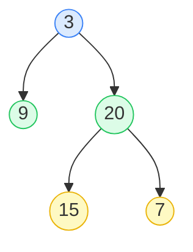

# Maximum Depth of Binary Tree

Given the root of a binary tree, return its maximum depth: the number of nodes along the longest path from the root down to the farthest leaf.

## Algorithm Strategy (Recursion (Depth-First Search))

1. The depth of an empty tree is 0.
2. The depth of any other tree is 1 (for the root) plus the larger of the depths of its left and right subtrees.
3. Recurse on both children and combine the results with `Math.max`.

## Example walkthrough

- For `[3, 9, 20, null, null, 15, 7]`: node 9 has depth 1; node 20 has depth 2 (via 15 or 7).
- The root gives `1 + max(1, 2) = 3`.

## Complexity Analysis

- **Time Complexity:** `O(n)` — Every node is visited once.
- **Space Complexity:** `O(h)` — Recursion depth equals the height `h` of the tree (`O(n)` for a skewed tree).

## Approaches

The same problem can be solved in several ways. The approach marked (Optimized) is the one to use in practice.

### Approach 1: Iterative DFS with a Stack

Push each node together with its depth on an explicit stack and remember the largest depth seen. Avoids stack overflow on very deep (skewed) trees.

```java
public static int maxDepthStack(TreeNode root) {
    if (root == null) return 0;
    Deque<TreeNode> nodes = new ArrayDeque<>();
    Deque<Integer> depths = new ArrayDeque<>();
    nodes.push(root);
    depths.push(1);
    int best = 0;
    while (!nodes.isEmpty()) {
        TreeNode node = nodes.pop();
        int depth = depths.pop();
        best = Math.max(best, depth);
        if (node.left != null) { nodes.push(node.left); depths.push(depth + 1); }
        if (node.right != null) { nodes.push(node.right); depths.push(depth + 1); }
    }
    return best;
}
```

- **Time Complexity:** O(n)
- **Space Complexity:** O(h)

### Approach 2: Level-Order BFS

Process the tree level by level with a queue and count the levels.

```java
public static int maxDepthBfs(TreeNode root) {
    if (root == null) return 0;
    Queue<TreeNode> queue = new LinkedList<>();
    queue.add(root);
    int depth = 0;
    while (!queue.isEmpty()) {
        depth++;
        for (int i = queue.size(); i > 0; i--) {
            TreeNode node = queue.poll();
            if (node.left != null) queue.add(node.left);
            if (node.right != null) queue.add(node.right);
        }
    }
    return depth;
}
```

- **Time Complexity:** O(n)
- **Space Complexity:** O(w) (maximum width)

### Approach 3: Top-Down Recursion with a Depth Parameter

Pass the current depth down the recursion and update a global maximum at every node. The opposite direction of the bottom-up solution, which returns heights from the leaves.

```java
public static int maxDepthTopDown(TreeNode root) {
    int[] best = {0};
    visit(root, 1, best);
    return best[0];
}

private static void visit(TreeNode node, int depth, int[] best) {
    if (node == null) return;
    best[0] = Math.max(best[0], depth);
    visit(node.left, depth + 1, best);
    visit(node.right, depth + 1, best);
}
```

- **Time Complexity:** O(n)
- **Space Complexity:** O(h)

### Approach 4: Iterative Post-order Height Computation

Traverse in post-order with an explicit stack and keep the current stack size as the depth of the node being visited; the largest stack size seen is the depth of the deepest node.

```java
public static int maxDepthPostorder(TreeNode root) {
    Deque<TreeNode> stack = new ArrayDeque<>();
    TreeNode curr = root, lastVisited = null;
    int best = 0;
    while (curr != null || !stack.isEmpty()) {
        while (curr != null) { stack.push(curr); curr = curr.left; }
        best = Math.max(best, stack.size());
        TreeNode top = stack.peek();
        if (top.right != null && lastVisited != top.right) {
            curr = top.right;
        } else {
            lastVisited = stack.pop();
        }
    }
    return best;
}
```

- **Time Complexity:** O(n)
- **Space Complexity:** O(h)

### Approach 5: BFS with a Null Level Marker

Separate the levels in the queue with a `null` marker and count the markers; the number of completed levels is the depth.

```java
public static int maxDepthMarker(TreeNode root) {
    if (root == null) return 0;
    Queue<TreeNode> queue = new LinkedList<>();
    queue.add(root);
    queue.add(null);
    int depth = 0;
    while (!queue.isEmpty()) {
        TreeNode node = queue.poll();
        if (node == null) {
            depth++;
            if (!queue.isEmpty()) queue.add(null);
        } else {
            if (node.left != null) queue.add(node.left);
            if (node.right != null) queue.add(node.right);
        }
    }
    return depth;
}
```

- **Time Complexity:** O(n)
- **Space Complexity:** O(w)

### Approach 6: Parallel Fork/Join

Compute the heights of the two subtrees in parallel with a `RecursiveTask` and combine them. Only useful for huge trees; shown to illustrate that the problem decomposes cleanly.

```java
public static int maxDepthParallel(TreeNode root) {
    return ForkJoinPool.commonPool().invoke(new DepthTask(root, 0));
}

static class DepthTask extends RecursiveTask<Integer> {
    private final TreeNode node;
    private final int level;

    DepthTask(TreeNode node, int level) { this.node = node; this.level = level; }

    @Override
    protected Integer compute() {
        if (node == null) return 0;
        DepthTask left = new DepthTask(node.left, level + 1), right = new DepthTask(node.right, level + 1);
        if (level >= 4) return 1 + Math.max(left.compute(), right.compute());     // go sequential when deep
        left.fork();
        int rightDepth = right.compute();
        return 1 + Math.max(left.join(), rightDepth);
    }
}
```

- **Time Complexity:** O(n) work
- **Space Complexity:** O(h)

### Approach 7: Recursive DFS (Optimized)

The depth of a tree is one more than the depth of its deeper subtree. This is the version implemented in the repository.

```java
public static int maxDepth(TreeNode root) {
    if (root == null) return 0;
    return 1 + Math.max(maxDepth(root.left), maxDepth(root.right));
}
```

- **Time Complexity:** O(n)
- **Space Complexity:** O(h)

### Comparison

| # | Approach | Time | Space |
|---|----------|------|-------|
| 1 | Iterative DFS with a Stack | O(n) | O(h) |
| 2 | Level-Order BFS | O(n) | O(w) (maximum width) |
| 3 | Top-Down Recursion with a Depth Parameter | O(n) | O(h) |
| 4 | Iterative Post-order Height Computation | O(n) | O(h) |
| 5 | BFS with a Null Level Marker | O(n) | O(w) |
| 6 | Parallel Fork/Join | O(n) work | O(h) |
| 7 | Recursive DFS (Optimized) | O(n) | O(h) |

## Source Code

Uses the shared helper [`TreeNode`](../../src/main/java/com/ranga/tree/TreeNode.java) (a small `TreeNode` with `of(...)` and `toString(...)` helpers for building and printing test data).

### MaximumDepthOfBinaryTree.java

```java
public class MaximumDepthOfBinaryTree {

    public static void main(String[] args) {
        TreeNode[] inputs = {TreeNode.of(3, 9, 20, null, null, 15, 7), TreeNode.of(1, null, 2), TreeNode.of()};
        for (TreeNode root : inputs) {
            System.out.println("Input  : root = " + TreeNode.toString(root));
            System.out.println("Output : " + maxDepth(root));
            System.out.println();
        }
    }

    public static int maxDepth(TreeNode root) {
        if (root == null) {
            return 0;
        }
        return 1 + Math.max(maxDepth(root.left), maxDepth(root.right));
    }
}
```

## Solution

The optimized solution is Approach 7 above, which is also the version implemented in this repository.

The idea: the depth of a tree is 1 (for the root) plus the depth of its deeper subtree, and an empty tree has depth 0. The method simply asks both children for their depth, keeps the larger answer and adds one on the way back up.

**Input:** the tree `[3, 9, 20, null, null, 15, 7]`.



Calls happen top-down, left child first; values come back bottom-up. The order in which each call finishes:

| Step | Call finishes | Left result | Right result | Returns `1 + max(left, right)` |
|------|---------------|-------------|--------------|-------------------------------|
| 1 | `maxDepth(9)` | `0` (null) | `0` (null) | `1` |
| 2 | `maxDepth(15)` | `0` | `0` | `1` |
| 3 | `maxDepth(7)` | `0` | `0` | `1` |
| 4 | `maxDepth(20)` | `1` (from 15) | `1` (from 7) | `2` |
| 5 | `maxDepth(3)` | `1` (from 9) | `2` (from 20) | `3` |

**Edge cases.** An empty tree (`root == null`) returns `0`; this is also the base case that stops the recursion below every leaf. For `[1, null, 2]` the left result is `0` and the right is `1`, so the answer is `2` (a skewed tree makes the recursion as deep as the tree, so the stack use is `O(h)`).

**Result:** `3` for the traced tree, `2` for `[1, null, 2]` and `0` for the empty tree, matching the class output.
